# 🏛️ Vietnam Public Procurement Lakehouse

> **Hệ thống Hồ Dữ liệu & Phân tích Đấu thầu Quốc gia**  
> *An enterprise-grade Medallion Data Lakehouse for ingesting, standardizing, and analyzing Vietnam Public Procurement data (Mua Sắm Công), powered by Apache Iceberg Format v2, DuckDB Vectorized Engine, and Dagster Orchestration.*

---

<p align="center">
  <a href="https://python.org"></a>
  <a href="https://iceberg.apache.org/"></a>
  <a href="https://duckdb.org/"></a>
  <a href="https://dagster.io/"></a>
  <a href="https://docker.com"></a>
  <a href="https://pytest.org"></a>
  
  
</p>

---

## 🌟 Điểm Nhấn Kiến Trúc (Architectural Highlights)

Hệ thống được thiết kế theo các nguyên tắc chuẩn mực của kỹ nghệ dữ liệu hiện đại:

* **Mô hình Medallion 4 Tầng Đồng Bộ Phân Vùng Ngày:**
  * **Bronze (Raw Lake):** Dữ liệu JSONL/Parquet thô cào từ Cổng Mua Sắm Công, quản lý commit qua PostgreSQL.
  * **Silver (Relational Lakehouse):** 23 bảng quan hệ chuẩn hóa 1-hop lưu trên **Apache Iceberg Format v2**.
  * **Gold (Business Dimensional):** **Kimball Star Schema** gồm 9 Dimension và 7 Fact, tính toán in-memory siêu tốc bằng **DuckDB Vectorized Engine**.
  * **Audit (Kiểm toán Toàn vẹn):** Tự động đối soát tài chính 3 phần (tổng tiền kế hoạch, trúng thầu, kiểm tra khóa ngoại mồ côi).
* **Kiến trúc Lục giác (Hexagonal Architecture):** Tách biệt tuyệt đối logic nghiệp vụ phân tích (`domain`) khỏi database engine, storage SDK và web framework.
* **Cơ chế Phân phối Không Sao Chép (Zero-Copy Views):** Tầng báo cáo người dùng (`gold.*`, `silver.*`) sử dụng SQL views trỏ trực tiếp vào dữ liệu vật lý đang active, hỗ trợ Blue-Green deployment và nâng cấp phiên bản không độ trễ.
* **Tính Lũy Thừa Tuyệt Đối (Idempotent 100%):** Cơ chế ghi đè phân vùng nguyên tử (Atomic Partition Overwrite) đảm bảo chạy lại bất kỳ ngày nào cũng không sinh ra dữ liệu trùng lặp.

---

## 🔄 Sơ Đồ Luồng Dữ Liệu Trực Quan (End-to-End Pipeline)

```mermaid
flowchart LR
    subgraph Bronze["Tầng 1: Bronze"]
        B1["bronze_khlcnt"]
        B2["bronze_project"]
        B3["bronze_notify_contractor"]
        B4["bronze_contractor_result"]
    end

    subgraph Silver["Tầng 2: Silver (23 Bảng)"]
        S1["silver_plan_revision"]
        S2["silver_package_revision"]
        S3["silver_notice_revision"]
        S4["silver_result_revision"]
        S_MORE["... và 19 bảng con quan hệ"]
    end

    subgraph GoldDims["Tầng 3: Gold Dimensions"]
        D1["dim_date"]
        D2["dim_geography"]
        D3["dim_party"]
        D4["dim_sector"]
        D_MORE["... và 5 dims khác"]
    end

    subgraph GoldFacts["Tầng 4: Gold Facts"]
        F1["fact_demand_daily"]
        F2["fact_notice_daily"]
        F3["fact_award_daily"]
        F4["fact_savings_daily"]
        F5["fact_duration_daily"]
        F6["fact_status_daily"]
        F7["fact_supplier_daily"]
    end

    subgraph Audit["Tầng 5: Audit"]
        AUDIT["reconciliation_audit"]
    end

    Bronze --> Silver
    Silver --> GoldDims
    GoldDims --> GoldFacts
    GoldFacts --> Audit
```



---

## 🚀 Khởi Chạy Nhanh (Turnkey Quickstart)

Hệ thống được đóng gói hoàn chỉnh bằng Docker Compose và trình quản lý gói Python siêu tốc `uv`:

### 1. Khởi động Toàn Bộ Hạ Tầng Docker
```bash
# 1. Tạo file cấu hình từ file mẫu
cp .env.example .env

# 2. Khởi chạy 7 dịch vụ (S3, Iceberg Catalog, Dagster, PostgreSQL, Ops)
docker compose up -d
```

### 2. Thiết Lập Môi Trường Python Cục Bộ
```bash
# Cài đặt toàn bộ dependencies trong vài giây
uv sync --extra dev --extra ops --extra orchestration
```

### 3. Vận Hành Pipeline (Lựa chọn Dagster UI hoặc CLI)
* **Qua Giao Diện Web Dagster:** Mở [http://localhost:3002](http://localhost:3002) $\rightarrow$ Chọn ngày phân vùng $\rightarrow$ Nhấn **Materialize all**.
* **Hoặc Chạy Thủ Công Qua Bộ Ba CLI:**
  ```bash
  # 1. Cào dữ liệu Bronze
  uv run ingest --resource all --date 2025-10-09

  # 2. Chuẩn hóa sang 23 bảng Silver Iceberg
  uv run silver all --date 2025-10-09

  # 3. Đối soát toàn vẹn tầng Gold
  uv run gold reconcile
  ```

---

## 🌐 Danh Mục Cổng Dịch Vụ & Giao Diện Quản Trị

| Dịch vụ | Địa chỉ kết nối | Chức năng chính |
| :--- | :--- | :--- |
| **Dagster Web UI** | [http://localhost:3002](http://localhost:3002) | Dashboard theo dõi Lineage 4 cột, trigger jobs, xem log |
| **Ops Dashboard & API** | [http://localhost:8000/ops](http://localhost:8000/ops) | Giao diện giám sát tiến độ thu thập thầu thời gian thực |
| **SeaweedFS S3 Storage** | [http://localhost:8333](http://localhost:8333) | Object Storage tương thích S3 lưu trữ Bronze Parquet |
| **Apache Iceberg REST Catalog**| [http://localhost:8181](http://localhost:8181) | Quản lý bảng Iceberg Format v2 (`lake.silver`, `lake.gold`) |
| **Application PostgreSQL** | `localhost:25432` | Cơ sở dữ liệu lưu trữ Commit Lineage và Partition Attempts |

---

## 📚 Hệ Thống Tài Liệu Kỹ Thuật (Documentation)

Hệ sinh thái tài liệu được cấu trúc chuyên sâu trong thư mục [`docs/`](docs/README.md):

* 🌟 **[Hành trình Tiến hóa & Bài học Kỹ thuật Thực chiến](docs/evolution-and-lessons-learned.md)**: Phân tích các thất bại kiến trúc ban đầu và 6 bước ngoặt cải tiến cốt lõi.
* 🏛️ **[Kiến trúc Tổng quan & Luồng Dữ liệu](docs/architecture/01-system-overview-and-dataflow.md)**: Đặc tả luồng end-to-end, topology container và nguyên tắc bất biến.
* 📊 **[Đặc tả Kỹ thuật Các Tầng Medallion](docs/architecture/02-medallion-layers-specification.md)**: Cấu trúc 23 bảng Silver và Star Schema 16 bảng Gold.
* 🛠️ **[Cẩm nang Vận hành Toàn Diện & Sổ tay CLI A $\rightarrow$ Z](docs/operations-and-guides/02-cli-reference-and-workflows.md)**: Hướng dẫn chi tiết tất cả lệnh `ingest`, `silver`, `gold`.
* 📜 **[Hồ sơ Quyết định Kiến trúc (ADRs)](docs/decisions/0004-gold-hexagonal-architecture.md)**: Bản ghi các quyết định thiết kế chính thức (ADR 0001 – 0005).

---

## 🛡️ Bản quyền & Giấy phép
Dự án được phân phối theo giấy phép [MIT License](LICENSE).
