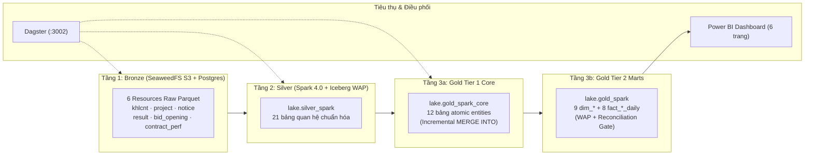

# 🏛️ Vietnam Public Procurement Lakehouse

> **Hệ thống Hồ Dữ liệu & Phân tích Đấu thầu Quốc gia**  
> *A Medallion Data Lakehouse for ingesting, standardizing, and analyzing Vietnam Public Procurement data (Mua Sắm Công), powered by Apache Spark 4.0, Apache Iceberg 1.10 (Write-Audit-Publish), SeaweedFS S3, PostgreSQL 17, Dagster Orchestration, and multi-node K3s.*

---

<p align="center">
  <a href="https://python.org"></a>
  <a href="https://spark.apache.org/"></a>
  <a href="https://iceberg.apache.org/"></a>
  <a href="https://dagster.io/"></a>
  <a href="https://k3s.io/"></a>
  <a href="https://docker.com"></a>
</p>

---

## 🌟 Điểm Nhấn Kiến Trúc (Architectural Highlights)

* **Mô hình Medallion 3 Tầng + Two-Tier Gold trên Apache Iceberg 1.10:**
  * **Bronze (`src/procurement/bronze/`, `ingestion/`):** Thu thập dữ liệu thô từ Cổng Mua Sắm Công (`khlcnt`, `project`, `notify_contractor`, `contractor_result`, `bid_opening`, `contract_performance`), ghi Parquet lên SeaweedFS S3 và quản lý commit/lineage trong PostgreSQL.
  * **Silver (`src/procurement/silver/`):** **21 bảng quan hệ chuẩn hóa** (`lake.silver_spark.*`) xử lý phân tán bằng **Apache Spark 4.0**, hỗ trợ cả incremental theo receipt và backfill nhiều năm.
  * **Gold (`src/procurement/gold/`):** Kiến trúc **Two-Tier Gold**:
    * **Tier 1 (`lake.gold_spark_core.*`):** 12 bảng atomic core entities hỗ trợ `MERGE INTO` tăng trưởng theo Iceberg `start-snapshot-id`.
    * **Tier 2 (`lake.gold_spark.*`):** **17 bảng public Star Schema** (9 `dim_*` + 8 `fact_*_daily` phân vùng theo `months(report_date)`) phục vụ trực tiếp cho Power BI Dashboard 6 trang.
* **Write-Audit-Publish (WAP) & Data Quality Gate:** Mọi đợt ghi Silver/Gold đều stage trên Iceberg WAP branch riêng, chạy kiểm tra chất lượng (0 NULL/dup PK, đối soát tổng giá trị trúng thầu `fact_award_daily == fact_supplier_daily` lệch `0.000000 VND`) trước khi `fast_forward` vào `main`.
* **Chạy linh hoạt từ 1 máy đến nhiều máy (K3s LAN / Tailscale):** Hỗ trợ `local[4]` cho phát triển cục bộ và mở rộng đa máy (Linux + Windows WSL2) qua cụm K3s `DaemonSet` (LAN Wi-Fi hoặc Tailscale VPN).

---

## 🔄 Sơ Đồ Luồng Dữ Liệu (End-to-End Pipeline)



---

## 🚀 Khởi Chạy Nhanh (Quickstart)

### 1. Khởi động Hạ tầng Docker Compose
```bash
cp .env.example .env
docker compose up -d --build
```
*(Khởi chạy SeaweedFS S3 `:8333` + Iceberg REST `:8181`, PostgreSQL 17 `:25432`, và cụm Dagster `:3002` đã tích hợp sẵn Java 21 + PySpark 4.0.0.)*

### 2. Cài Môi Trường Python Cục Bộ
```bash
uv sync --extra orchestration --extra spark --extra dev
```

### 3. Vận Hành Pipeline (Dagster UI hoặc Bộ Ba CLI)
* **Qua Dagster Web UI:** Mở [http://127.0.0.1:3002](http://127.0.0.1:3002) → chạy `bronze_daily`, `spark_lakehouse_daily_job`, hoặc `spark_iceberg_maintenance_job`.
* **Hoặc chạy trực tiếp bằng CLI (`ingest`, `silver`, `gold`):**
  ```bash
  # 1. Cào dữ liệu Bronze
  .venv/bin/ingest --resource all --date 2026-10-30

  # 2. Chạy Silver incremental (thêm --k3s để chạy trên cụm K3s)
  .venv/bin/silver run --k3s

  # 3. Chạy Gold incremental (tự động NO_OP nếu Silver chưa có snapshot mới)
  .venv/bin/gold run --k3s

  # 4. Bảo trì Iceberg định kỳ (compaction, rewrite manifests, expire snapshots, orphan cleanup)
  .venv/bin/silver maintain --k3s
  .venv/bin/gold maintain --k3s
  ```

---

## 🌐 Danh Mục Cổng Dịch Vụ

| Dịch vụ | Địa chỉ mặc định | Chức năng chính |
| :--- | :--- | :--- |
| **Dagster Web UI** | [http://127.0.0.1:3002](http://127.0.0.1:3002) | Điều phối Bronze, Watcher, Spark Silver/Gold & Maintenance |
| **SeaweedFS S3 Storage** | `http://<HOST>:8333` | Object Storage S3 lưu Bronze Parquet & Iceberg warehouse |
| **Apache Iceberg REST Catalog** | `http://<HOST>:8181` | Quản lý bảng Iceberg (`silver_spark`, `gold_spark_core`, `gold_spark`) |
| **PostgreSQL 17** | `localhost:25432` | Metadata Bronze commits, Spark watermarks & Dagster state |
| **Spark Master Web UI (K3s)** | `http://<MASTER_IP>:8080` | Giám sát workers, stages & tài nguyên cụm Spark |

---

## 📚 Tài Liệu Kỹ Thuật (Documentation)

* 🛠️ **[Bước 1: Thiết lập Môi trường & Hạ tầng Docker](docs/operations-and-guides/01-environment-setup-and-docker.md)**
* 🌐 **[Cụm K3s + Spark 4.0 Multi-Node (Flow 1: LAN Wi-Fi & Flow 2: Tailscale VPN)](infra/k3s/README.md)**
* ⌨️ **[Bước 2: Sổ tay Tra cứu CLI (`ingest`, `silver`, `gold`)](docs/operations-and-guides/02-cli-reference-and-workflows.md)**
* 🔁 **[Bước 3: Sổ tay Điều phối Dagster](docs/operations-and-guides/03-dagster-orchestration-manual.md)**
* 🩹 **[Bước 4: Backfill Lịch sử & Xử lý Sự cố](docs/operations-and-guides/04-backfill-and-troubleshooting.md)**
* 🏛️ **[Tổng quan Kiến trúc & Luồng Dữ liệu](docs/architecture/01-system-overview-and-dataflow.md)**
* 📊 **[Power BI Dashboard (6 trang phân tích)](PowerBI/ProcurementDashboard/README.md)**

---

## 🛡️ Giấy phép
Dự án được phân phối theo giấy phép [MIT License](LICENSE).
