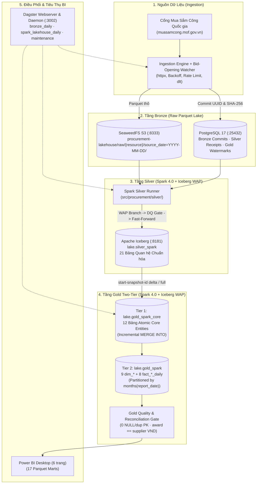
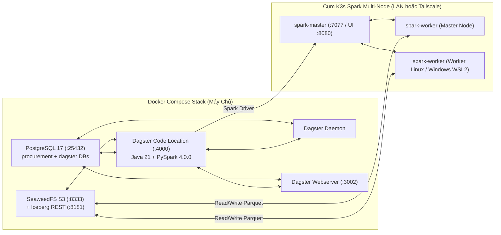

# Tổng Quan Kiến Trúc & Luồng Dữ Liệu (System Architecture & Data Flow)

- **Mô hình kiến trúc:** Medallion Lakehouse 3 Tầng ($Bronze \rightarrow Silver \rightarrow Two\text{-}Tier\ Gold$)
- **Định dạng lưu trữ:** Apache Iceberg 1.10 (Format v2, Write-Audit-Publish) trên SeaweedFS S3
- **Engine tính toán:** Apache Spark 4.0.0 (chạy cục bộ `local[N]` hoặc phân tán trên K3s Multi-Node)
- **Điều phối:** Dagster (Docker Compose với JVM 21 + PySpark 4.0.0 tích hợp sẵn)

---

## 1. Sơ Đồ Luồng Dữ Liệu End-to-End



---

## 2. Cấu Trúc Hạ Tầng (Infrastructure Topology)



---

## 3. Cấu Trúc Mã Nguồn (`src/procurement/`)

```text
src/procurement/
├── ingestion/        # Cào API MuaSamCong (6 resources)
├── watcher/          # Theo dõi lịch mở thầu (bid_opening)
├── bronze/           # Ghi & xác thực Bronze Parquet
├── quality/          # Hợp đồng kiểm tra chất lượng đầu vào Bronze
├── spark/            # Hạ tầng Spark 4.0 + Iceberg 1.10 dùng chung (session, WAP, maintenance)
├── silver/           # Tầng Silver Spark (21 bảng Iceberg + receipts + DQ gate)
├── gold/             # Tầng Gold Spark Two-Tier (12 core + 17 marts + watermarks + DQ gate)
├── orchestration/    # Dagster jobs, schedules & sensors
├── metadata/         # PostgreSQL partition metadata service
├── storage/          # S3 / object storage helpers
├── common/           # Settings, catalog, dates, errors, logging
└── cli/              # Entrypoint `ingest` + Rich terminal UI
```

---

## 4. Nguyên Tắc Kiến Trúc Cốt Lõi

1. **Write-Audit-Publish (WAP) tuyệt đối:** Cả Silver và Gold đều ghi vào Iceberg branch tạm, kiểm tra chất lượng xong mới `fast_forward` vào `main`. Nếu lỗi, branch tạm bị `abort` nên bảng production không bao giờ bị nửa chừng hay hỏng dữ liệu.
2. **Two-Tier Gold & Incremental Snapshot Tracking:** Tầng Core lưu 12 thực thể nguyên tử có khóa merge (`CORE_MERGE_KEYS`), cho phép `gold run` hàng ngày chỉ đọc delta từ `start-snapshot-id` của Silver và `MERGE INTO` thay vì tính lại toàn bộ 5 năm.
3. **Pure-JVM Execution trên K3s:** Toàn bộ transform Silver/Gold chạy thuần Spark SQL / JVM (không dùng Python UDF/RDD trên worker), nên miễn nhiễm khác biệt phiên bản Python giữa host và K3s pod.
