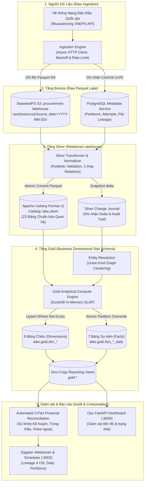
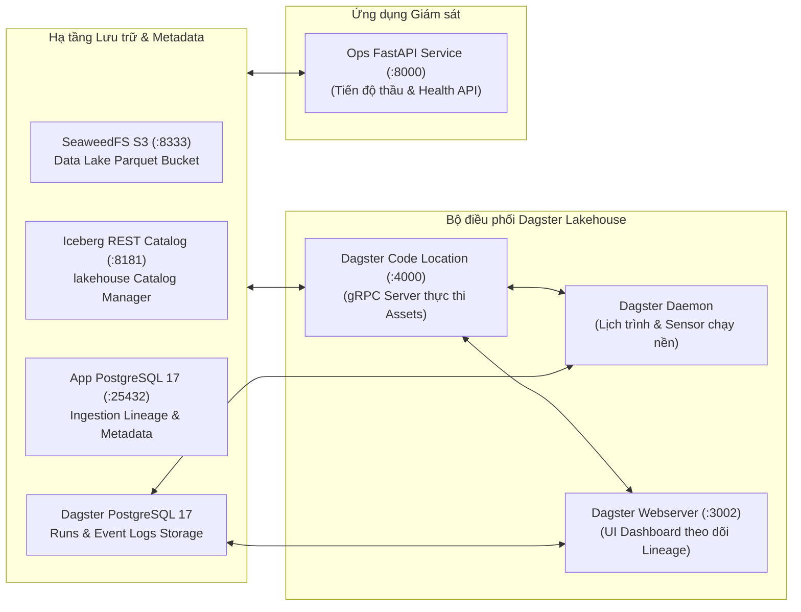

# Tổng Quan Kiến Trúc & Luồng Dữ Liệu (System Architecture & Data Flow)

- **Trạng thái:** CHÍNH THỨC (Single Source of Truth cho Kiến trúc Tổng thể)
- **Mô hình kiến trúc:** Medallion Lakehouse (Bronze $\rightarrow$ Silver $\rightarrow$ Gold) + Hexagonal Architecture (Ports & Adapters)
- **Định dạng lưu trữ:** Apache Iceberg Format v2 trên SeaweedFS S3 Object Storage
- **Engine tính toán:** DuckDB (In-memory OLAP & SIMD Vectorized Engine)

---

## 1. Sơ đồ Luồng Dữ liệu Trực quan (End-to-End Data Flow)

Hệ sinh thái vận hành theo luồng 4 tầng tuần tự, được bảo đảm tính nhất quán và toàn vẹn bằng phân vùng chuẩn Ngày (`YYYY-MM-DD`):

---

## 2. Sơ đồ Cấu trúc Hạ tầng & Dịch vụ (Infrastructure Topology)

Toàn bộ hệ thống được container hóa và điều phối thống nhất thông qua `compose.yaml`:

---

## 3. Các Nguyên Tắc Kiến Trúc Bất Biến (Core Principles)

1. **Phân vùng Ngày đồng nhất (Daily Partition Homogeneity):**
   - Mọi thực thể từ Bronze, Silver đến Gold đều sử dụng chung một khóa phân vùng duy nhất: ngày báo cáo/sự kiện (`YYYY-MM-DD`).
   - Xóa bỏ hoàn toàn tình trạng chạy lệch pha giữa Silver (theo ngày) và Gold (theo tháng).

2. **Tính lũy thừa & Ghi đè an toàn (Idempotency & Partition Overwrite):**
   - Mọi Job có thể chạy lại vô hạn lần cho cùng một ngày mà không sinh ra dữ liệu trùng lặp.
   - Gold Facts sử dụng cơ chế `DELETE WHERE report_date >= start AND report_date < end` kết hợp `INSERT INTO` trong cùng transaction ACID của Iceberg.
   - Gold Dimensions áp dụng cơ chế `INSERT ... WHERE NOT EXISTS`.

3. **Kiến trúc Lục giác (Hexagonal Architecture):**
   - Tầng Domain (`gold.domain`, `silver.domain`) thuần túy chứa logic nghiệp vụ và schema, độc lập 100% với database engine, storage SDK và web framework.
   - Giao tiếp hạ tầng thông qua các cổng chuẩn (`ports`) và adapter chuyên biệt (`adapters`).

4. **Zero-Copy Reporting Views (`gold.*`):**
   - Người dùng và hệ thống BI (Metabase, Looker, Superset) truy vấn thông qua các SQL View logic trong schema `gold.*`.
   - Các view này trỏ trực tiếp tới release vật lý đang active (ví dụ: `lake.gold.*` hoặc bản thử nghiệm `lake.gold_v2.*`), cho phép chuyển đổi phiên bản (blue-green promote) tức thì mà không cần copy hay di chuyển dữ liệu.
