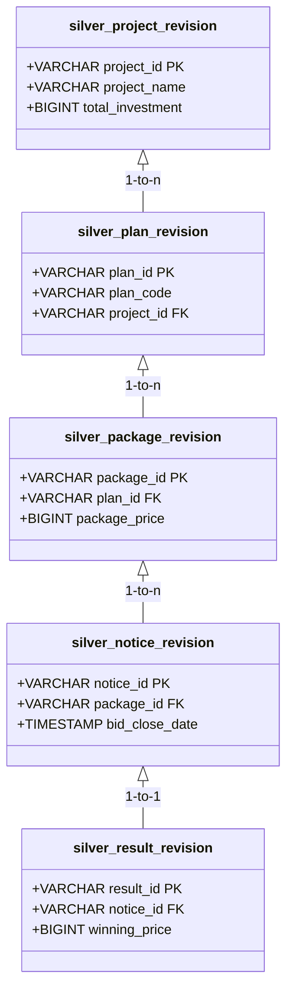

# Đặc Tả Kỹ Thuật Các Tầng Medallion (Bronze, Silver, Gold Layers Specification)

- **Trạng thái:** CHÍNH THỨC
- **Mã nguồn:** [`src/procurement/bronze/`](file:///home/soul/Dự%20án/procurement/procurement-lakehouse/src/procurement/bronze), [`src/procurement/silver/`](file:///home/soul/Dự%20án/procurement/procurement-lakehouse/src/procurement/silver), [`src/procurement/gold/`](file:///home/soul/Dự%20án/procurement/procurement-lakehouse/src/procurement/gold)

---

## 1. Tầng Bronze (Raw Data Lake)

Tầng Bronze chịu trách nhiệm thu thập và bảo quản nguyên vẹn dữ liệu thô dạng JSON và Parquet từ Cổng Thông tin Đấu thầu Quốc gia.

### 1.1. Các Tài nguyên Dữ liệu Chính (Core Resources)
Hệ thống xử lý 4 tài nguyên chính phục vụ phân tích mua sắm công:
1. **`khlcnt`**: Kế hoạch lựa chọn nhà thầu (dự án, gói thầu dự kiến, nguồn vốn, phân loại).
2. **`project`**: Thông tin danh mục dự án đầu tư phát triển (địa điểm, quy mô, quyết định phê duyệt).
3. **`notify_contractor`**: Thông báo mời thầu (hình thức LCNT, phương thức, thời gian mở thầu, HSMT).
4. **`contractor_result`**: Kết quả lựa chọn nhà thầu (nhà thầu trúng thầu, giá trúng, tỉ lệ giảm giá).

*(Lưu ý: Phân hệ `contract_performance` về thực hiện hợp đồng sau trúng thầu được cô lập riêng thành luồng thử nghiệm pilot).*

### 1.2. Cấu trúc Lưu trữ & Phân vùng (Partition Layout)
- **Lưu trữ:** SeaweedFS S3 bucket `procurement-lakehouse`.
- **Đường dẫn phân vùng:**
  ```
  s3://procurement-lakehouse/raw/{resource}/source_date=YYYY-MM-DD/
  ```
- **Metadata:** Ghi nhận toàn bộ Commit Attempt, partition ID, file number, record count, byte size và SHA-256 hash vào PostgreSQL (`app-postgres:25432`).

---

## 2. Tầng Silver (Relational Lakehouse)

Tầng Silver chuyển đổi dữ liệu thô bán cấu trúc thành **23 bảng quan hệ chuẩn hóa (Normalized Relational Schema)** theo tiêu chuẩn **Apache Iceberg Format v2**.

### 2.1. Cấu trúc 23 Bảng Quan hệ (`lake.silver`)
Dữ liệu được tổ chức theo quan hệ 1-Hop với các bảng gốc (Anchor Revisions) và bảng chi tiết:



- **Nhóm Dự án:** `silver_project_revision`, `silver_project_location`.
- **Nhóm Kế hoạch & Gói thầu:** `silver_plan_revision`, `silver_package_revision`, `silver_package_location`, `silver_package_lot`.
- **Nhóm Mời thầu:** `silver_notice_revision`, `silver_notice_location`, `silver_notice_lot`, `silver_notice_contractor`.
- **Nhóm Kết quả trúng thầu:** `silver_result_revision`, `silver_award_lot`, `silver_award_contractor`.

### 2.2. Kiểm soát Chất lượng & Audit Trail
- Mỗi dòng dữ liệu được đính kèm `source_date`, `extracted_at`, `lineage_hash`.
- Bảng nhật ký thay đổi (**Silver Change Journal**) ghi nhận toàn bộ biến động snapshot để phục vụ cho thuật toán gom cụm tại tầng Gold.

---

## 3. Tầng Gold (Business Dimensional Star Schema)

Tầng Gold được thiết kế theo mô hình **Kim Tự Tháp Chiều (Star Schema Dimensional Model)** đạt chuẩn Kimball, bao gồm **9 bảng Chiều (Dimensions)** và **7 bảng Sự kiện (Facts)**.

### 3.1. Sơ đồ Star Schema Chi tiết

```mermaid
erDiagram
    fact_demand_daily }o--|| dim_date : "date_key"
    fact_demand_daily }o--|| dim_geography : "geo_key"
    fact_demand_daily }o--|| dim_party : "party_key"
    fact_demand_daily }o--|| dim_sector : "sector_key"
    fact_demand_daily }o--|| dim_value_band : "band_key"

    fact_notice_daily }o--|| dim_date : "date_key"
    fact_notice_daily }o--|| dim_geography : "geo_key"
    fact_notice_daily }o--|| dim_procurement_method : "method_key"
    fact_notice_daily }o--|| dim_party : "party_key"

    fact_award_daily }o--|| dim_date : "date_key"
    fact_award_daily }o--|| dim_party : "party_key"
    fact_award_daily }o--|| dim_value_band : "band_key"

    fact_savings_daily }o--|| dim_date : "date_key"
    fact_savings_daily }o--|| dim_party : "party_key"
    fact_savings_daily }o--|| dim_sector : "sector_key"

    fact_duration_daily }o--|| dim_date : "date_key"
    fact_duration_daily }o--|| dim_duration_metric : "metric_key"

    fact_status_daily }o--|| dim_date : "date_key"
    fact_status_daily }o--|| dim_progress_status : "status_key"

    fact_supplier_daily }o--|| dim_date : "date_key"
    fact_supplier_daily }o--|| dim_party : "party_key"
```



### 3.2. Danh mục 9 Bảng Chiều (Dimensions)
| Tên bảng | Khóa chính (PK) | Diễn giải nghiệp vụ | Nguồn làm giàu |
| :--- | :--- | :--- | :--- |
| `dim_date` | `date_key` | Chiều thời gian (ngày, tháng, quý, năm, tuần ISO) | Tạo tự động theo lịch |
| `dim_geography` | `geo_key` | Chiều địa lý 63 tỉnh/thành phố Việt Nam | Seed từ danh mục chuẩn & `project_location` |
| `dim_party` | `party_key` | Chủ đầu tư, Bên mời thầu & Nhà thầu trúng thầu | Gom cụm mã định danh & MST (Union-Find) |
| `dim_sector` | `sector_key` | Lĩnh vực đấu thầu (Hàng hóa, Xây lắp, Tư vấn, Phi tư vấn) | `silver_package_revision` |
| `dim_procurement_method` | `method_key` | Hình thức LCNT (Đấu thầu rộng rãi, Chỉ định thầu, Chào hàng) | `silver_notice_revision` |
| `dim_value_band` | `band_key` | Phân khúc quy mô giá trị gói thầu (Dưới 1 tỷ, 1-10 tỷ, > 100 tỷ) | Quy tắc chính sách giá trị |
| `dim_currency` | `currency_key` | Đồng tiền thanh toán (VND, USD, EUR...) | `silver_package_revision` |
| `dim_progress_status` | `status_key` | Trạng thái tiến độ thực hiện gói thầu | Máy trạng thái vòng đời thầu |
| `dim_duration_metric` | `duration_metric_key` | Định nghĩa các mốc đo lường thời gian xử lý thầu | Từ điển thời lượng chuẩn |

### 3.3. Danh mục 7 Bảng Sự kiện (Daily Facts)
Mọi bảng Fact đều có hạt phân vùng là `report_date` (phân vùng Ngày).

1. **`fact_demand_daily`**: Nhu cầu mua sắm công phát sinh theo ngày (số lượng gói thầu, tổng giá trị kế hoạch đề xuất).
2. **`fact_notice_daily`**: Khối lượng mời thầu được công khai (giá gói thầu mở mời, phương thức đấu thầu qua mạng).
3. **`fact_award_daily`**: Khối lượng trúng thầu thực tế (giá trúng thầu, nhà thầu chiến thắng, số lượng nhà thầu tham gia).
4. **`fact_savings_daily`**: Hiệu quả tiết kiệm ngân sách nhà nước (giá dự toán trừ giá trúng thầu, tỉ lệ phần trăm tiết kiệm).
5. **`fact_duration_daily`**: Thời lượng và độ trễ các giai đoạn (thời gian lập kế hoạch $\rightarrow$ đăng thông báo $\rightarrow$ mở thầu $\rightarrow$ công bố kết quả).
6. **`fact_status_daily`**: Bức tranh tiến độ toàn hệ thống (số lượng gói thầu đang mời thầu, đã đóng thầu, đã hủy thầu).
7. **`fact_supplier_daily`**: Đánh giá năng lực và phân bổ thị phần nhà thầu tham gia thị trường mua sắm công.

### 3.4. Cơ chế Đẩy Dữ Liệu vào Iceberg (Publishing Mechanism)
- **Tạo bảng tự động:** Tự động kiểm tra và gọi `ensure_gold_tables()` trước khi publish.
- **Fact Table Transaction:**
  ```sql
  BEGIN TRANSACTION;
  DELETE FROM lake.gold.fact_award_daily 
  WHERE report_date >= '2025-10-09' AND report_date < '2025-10-10';

  INSERT INTO lake.gold.fact_award_daily
  SELECT * FROM temp_fact_award_daily;
  COMMIT;
  ```
- **Dimension Table Transaction:**
  ```sql
  INSERT INTO lake.gold.dim_party
  SELECT * FROM temp_dim_party t
  WHERE NOT EXISTS (
    SELECT 1 FROM lake.gold.dim_party d WHERE d.party_key = t.party_key
  );
  ```
