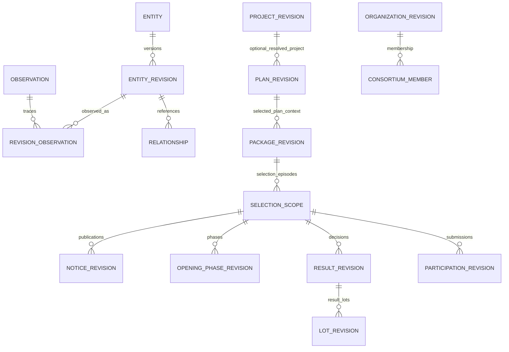
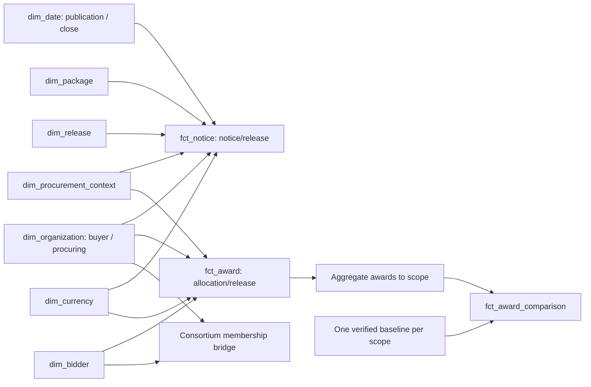

# Khám phá dữ liệu đấu thầu và thiết kế kho phân tích

Ngày khảo sát: **16/10/2026, Asia/Saigon**. Repository: `procurement-lakehouse`, commit `339301dad54982d38f5567613538ec219865d409`. Phạm vi: nghiên cứu, đọc dữ liệu và đề xuất; không triển khai ứng dụng, bảng hay migration.

**Cập nhật kiểm tra toàn bộ dữ liệu:** Phụ lục C đã đọc đủ **5.599.552 bản ghi / 7.960 file**, profile **612 field ở các root được chọn và 2.885 cặp bảng–JSON path**. Có **20 hồ sơ không có dữ liệu nghiệp vụ: 17 project + 3 plan**. Đây là số liệu toàn bộ bốn archive, thay cho việc chỉ dùng mẫu để đánh giá null. Các thống kê giá, uniqueness và joins ở phần khảo sát ban đầu vẫn là kết quả trên mẫu 45.644 dòng.

## 1. Tóm tắt điều hành

**Nên xây kho theo quá trình lựa chọn nhà thầu, với các thực thể có lịch sử và các fact có grain riêng; không biến mỗi response API thành một bảng phân tích rồi nối tất cả với nhau.** Giá trị lớn nhất nằm ở việc nối kế hoạch → gói thầu → thông báo → mở thầu → kết quả, nhưng độ phủ và ý nghĩa từng trường quyết định khả năng thực hiện.

Các kết luận chính:

- **VERIFIED:** Bốn archive `exports/bronze-2022.zip` đến `bronze-2025.zip` có 6.107 day manifest thành công, khai báo tổng 5.599.552 bản ghi Bronze. Đây là tổng occurrence theo manifest, **không phải** số gói thầu hoặc số hồ sơ duy nhất đã kiểm đếm toàn bộ.
- **VERIFIED:** Đã đọc 45.644 bản ghi từ 100 file Parquet, chọn theo năm/quý/bảng; kiểm SHA-256 file khớp 100/100, hash nội dung và lineage khớp 45.644/45.644. Mẫu có chủ đích, không ngẫu nhiên, không đại diện thống kê cả nước.
- **VERIFIED:** Bảng `bid_opening_detail` riêng chỉ có 106 hồ sơ, thuộc năm ngày nguồn 17–21/09/2022. Không thể công bố tỷ lệ một nhà thầu dự thầu toàn thị trường hoặc xu hướng cạnh tranh 2023–2025 từ tập này. **Bổ sung tại D:** kết quả còn chứa `lotOpenDetails` không rỗng trong 444.912 records; cần kiểm định nguồn nhúng này để khai thác cạnh tranh trên tập đủ điều kiện.
- **VERIFIED:** Mẫu có quan hệ kế hoạch–gói thầu rất tốt: 18.069/18.069 gói nối được với 7.961 kế hoạch trong mẫu. Ngược lại, 9.604/13.927 kết quả thiếu `notifyId`; không thể dùng duy nhất UUID thông báo làm FK bắt buộc.
- **VERIFIED:** Nhánh Silver có code nhưng chưa đạt hợp đồng phân tích thống nhất: mapping cũ đọc `investUnit` thay vì `investTotalUnit`, đọc `planName` thay vì `name`, và đưa child generic vào schema lot/participation không tương thích. Không có bằng chứng đã triển khai Gold trong mã khảo sát.

**MVP đề nghị:** mart **“Cơ cấu thị trường thông báo và thời gian chuẩn bị dự thầu”**, bắt đầu với standard/VK có trường ngày và giá đã kiểm tra; reoffer là phân nhóm riêng. Công bố số thông báo, phân khúc, phân phối thời gian công bố–đóng thầu và chất lượng/độ phủ. Không gọi tổng giá thông báo là chi tiêu thực tế; không gọi khoảng thời gian ngắn là vi phạm pháp luật. Đây là nền tảng để mở rộng sang vòng đời, cạnh tranh, tập trung nhà cung cấp và chênh lệch giá.

### Quy ước bằng chứng

| Nhãn | Ý nghĩa trong báo cáo |
| --- | --- |
| VERIFIED | Có dữ liệu đọc được hoặc kiểm tra mã/thực thi được nêu rõ; phạm vi kiểm chứng luôn đi kèm |
| INFERRED | Diễn giải hợp lý, chưa được xác nhận đầy đủ về nghiệp vụ hoặc trên toàn bộ tập |
| PROPOSED | Thiết kế/capability khuyến nghị, chưa phải sản phẩm đang hoạt động |
| BLOCKED | Thiếu dữ liệu hoặc hợp đồng ngữ nghĩa để tính chỉ số một cách đáng tin cậy |

“Có trường” không đồng nghĩa “đủ dữ liệu”, “không null” không đồng nghĩa “đúng nghĩa”, “checksum đúng” không đồng nghĩa “response nghiệp vụ hợp lệ”. Mọi thiết kế ở mục 7–14 là **PROPOSED**, trừ khi ghi khác.

## 2. Kiểm kê repository và nguồn dữ liệu

### 2.1. Kiến trúc hiện hữu và ranh giới module

Đã kiểm kê cây `src`, `tests`, `docs`, `migrations`, `infra`, `data`, cùng archive và các nhóm export. Có 182 file Python trong `src/procurement`; khảo sát sâu các đường thực thi liên quan ingestion, chất lượng, metadata, Bronze và Silver. Không tuyên bố đọc từng dòng của toàn bộ repository, mọi file export hay mọi bản ghi.

| Khu vực | Bằng chứng trong repository | Vai trò/đánh giá |
| --- | --- | --- |
| Nguồn | [ingestion/sources/muasamcong](../../src/procurement/ingestion/sources/muasamcong) | Năm resource; search và detail riêng; concurrency; biến thể thông báo |
| Điều phối | [ingestion/service.py](../../src/procurement/ingestion/service.py), `ingestion/engine`, `jobs`, `orchestration` | Chạy theo cửa sổ ngày, pagination, attempt, Dagster |
| Bronze | [bronze/models.py](../../src/procurement/bronze/models.py), `writer.py`, `dlt_writer.py`, `reader.py`, `verification.py` | Envelope typed, payload linh hoạt; Parquet; đọc danh sách file cố định |
| Metadata core | [metadata/models.py](../../src/procurement/metadata/models.py), `metadata/postgres`, [migration 0001](../../migrations/versions/0001_bronze_core.py) | Partition, attempt, lease, commit và file descriptor; tách dữ liệu điều khiển khỏi nghiệp vụ |
| Legacy storage | [storage/committed.py](../../src/procurement/storage/committed.py), `storage/control.py` | Lựa chọn ngày qua manifest; còn được Silver cũ sử dụng |
| Chất lượng | `quality/contracts.py`, `notify.toml`, `bid_opening.toml`, `quality/repair`, `watcher` | Routing, kiểm response, repair và theo dõi công bố tài chính muộn |
| Silver | [processing/silver](../../src/procurement/processing/silver), [warehouse.py](../../src/procurement/processing/warehouse.py), [cli/silver.py](../../src/procurement/cli/silver.py) | Có pipeline generic và transformer registry; mới thấy transformer chuyên biệt project; chưa đồng nhất hai đường |
| Release/storage đích | `processing/releases.py`, `storage/iceberg.py` | Có cơ chế pin snapshot/release; chưa xác nhận vận hành thực tế trong lần khảo sát |
| Gold | Tài liệu [architecture.md](../architecture.md) | Có thiết kế mục tiêu; không tìm thấy job Gold trong orchestration khảo sát |
| Tests | `tests/ingestion`, `tests/quality`, `tests/storage`, `tests/integration`, `tests/unit/silver` | Có tests ingestion, hash, commit, roundtrip, Iceberg, parser và project transformer; test tồn tại không chứng minh đã pass hiện tại |
| Triển khai | `infra/docker`, `infra/dagster`, `infra/sandbox`, `infra/systemd` | Docker/S3-compatible storage/PostgreSQL/Dagster; không khởi động dịch vụ trong khảo sát |

Pydantic `BronzeRecord` chỉ ép kiểu `source_id`, `source_version`, `run_id`, `source_date`, `ingested_at`, `content_hash`, `payload`; `payload` là `dict[str, Any]`. Schema này không bảo đảm trường giá, nhà thầu hoặc ngày nghiệp vụ tồn tại. Metadata core dùng dataclass immutable và SQLAlchemy/PostgreSQL, không phải bảng nghiệp vụ đấu thầu.

Tài liệu hiện có không hoàn toàn đồng bộ: `architecture.md` nói Silver/Gold chưa triển khai, nhưng code Silver đã tồn tại; `warehouse.py` ghi “15-table” trong khi `SCHEMAS` có **17** entries, kể cả `revision_observation` và `child`. Phân biệt rõ **code có sẵn**, **thiết kế mục tiêu** và **bảng đã chạy trong môi trường thực tế**; trạng thái cuối chưa kiểm tra vì không kết nối DB/S3.

### 2.2. Hợp đồng nguồn và thiên lệch do cách search

Prefix API trong code: `/o/egp-portal-contractor-selection-v2/services/`; search dùng `smart/search`. **Không gọi API production** trong lần khảo sát; chỉ đọc adapter và dùng web để đọc tài liệu công khai.

| Resource → Bronze table | Root nghiệp vụ/khóa ứng viên | Giới hạn cần giữ |
| --- | --- | --- |
| project → `project_detail` | `projectDTO.id`, `no`, `version` | Có ID legacy dạng chuỗi số; không ép UUID database |
| khlcnt → `khlcnt_plan_detail` | `bidPoBidpPlanProjectDetailView.id`, `planNo`, `planVersion` | Root kế hoạch; `pid` có thể null hợp lệ, chưa chứng minh mọi kế hoạch có dự án |
| khlcnt → `khlcnt_bid_package_detail` | root `id`, `bidNo`, `planId` | `planVersion` là phiên bản kế hoạch, không phải phiên bản gói |
| notify → `notify_contractor_standard_detail` | `bidoNotifyContractorM` hoặc `bidNoContractorResponse.bidNotification` | Hai root không được cộng thành hai thông báo; phải kiểm mâu thuẫn |
| notify → `notify_contractor_vk_adb_detail` | `bidoNotifyContractorP` | Có cả online và offline; tên family không đủ để suy quy trình hay nhà tài trợ |
| notify → `notify_contractor_reoffer_detail` | root `notifyNo`, `notifyVersion`, `id` | `priceInit` và `priceStep` khác budget; danh sách passed/result/all khác vai trò |
| result → `contractor_result_detail` | `bideContractorInputResultDTO.id`, `resultVersion` | Envelope `source_id` là số thông báo trong mẫu, không phải result ID |
| opening → `bid_opening_detail` | `notifyNo`, `notifyVersion` và phase | Payload ghép nhiều response; không phải snapshot nguyên tử |

Nguồn mã: các `resource.py` và `extractor.py` trong thư mục adapter tương ứng. Project/KHLCNT search theo `publicDate` và type riêng. Notify search theo `publicDate`, loại `caseKHKQ="1"`. Result search theo **`publicDateKqlcnt`**, type `es-notify-contractor`, step `notify-contractor-step-4-kqlcnt`. Opening search theo **ngày công bố thông báo**, các step 2/3/4, `publicDateKqmt not_null`, `isInternet=1`.

Hệ quả: không join các resource bằng cùng `source_date`; result không có notice tương ứng chưa chứng minh dữ liệu sai. Một ngày SUCCESS chỉ khẳng định hoàn tất tập truy vấn với filter đã dùng, không khẳng định bao phủ mọi hoạt động mua sắm công.

### 2.3. Dữ liệu thực sự có tại máy

`data/` chứa SQLite phục vụ ops, watcher, benchmark và lock, không có thư mục Bronze cục bộ. Không dùng SQLite ops như nguồn nghiệp vụ chuẩn. Có archive trong cả `imports/` và `exports/`; chọn duy nhất bộ **exports** để tránh tính trùng. Không giải nén/ghi file tạm.

| Archive | Kích thước byte | Bundle ID | Tạo ngày UTC |
| --- | ---: | --- | --- |
| `exports/bronze-2022.zip` | 422.753.791 | `582263c5ae454c99b3105fd76dd5644b` | 06/10/2026 11:14:07 |
| `exports/bronze-2023.zip` | 1.686.267.678 | `507177619314486fbf4f9ae714d38c84` | 06/10/2026 11:27:33 |
| `exports/bronze-2024.zip` | 2.433.272.406 | `e58762c5a3444ca8a24406af5afec963` | 06/10/2026 11:48:44 |
| `exports/bronze-2025.zip` | 2.631.679.766 | `2107523203ee43e49c6afa5a616dc1c4` | 06/10/2026 06:39:09 |

Mỗi archive có `transfer.json`, `objects/_control/.../day.json`, page/run manifests và `objects/bronze/muasamcong/<table>/source_date=.../run_id=.../*.parquet`. `transfer.json` ghi membership và SHA-256 từng object.

**VERIFIED — số bản ghi khai báo trong toàn bộ day manifest:**

| Resource | 2022 | 2023 | 2024 | 2025 |
| --- | ---: | ---: | ---: | ---: |
| Project | 30.054 | 62.237 | 76.974 | 70.536 |
| KHLCNT, gồm plan + package | 280.821 | 858.965 | 1.088.083 | 1.074.673 |
| Notify, cộng các family | 55.412 | 172.744 | 199.327 | 129.735 |
| Result | 78.182 | 359.284 | 521.064 | 541.355 |
| Opening | 106 | Không có partition | Không có partition | Không có partition |

Không gọi dòng KHLCNT là “số kế hoạch”: một kế hoạch sinh thêm nhiều package records.

Độ phủ theo manifest:

- Project, KHLCNT, notify: đủ 365/365/366/365 ngày theo bốn năm. Tuy nhiên, 2022 có lần lượt **22/41/259 ngày SUCCESS với 0 bản ghi**.
- Result: 2022 có 259 ngày rỗng; 2023–2024 đủ ngày; **2025 thiếu 01/01**, còn 364 ngày thành công.
- Opening: 264 ngày thành công từ 01/01–21/09/2022, trong đó 259 ngày rỗng; thiếu 101 ngày còn lại. Các năm sau thiếu toàn bộ 365/366/365 ngày.
- “Missing day”, “SUCCESS rỗng”, “payload thiếu trường” và “phase chưa công bố” là bốn trạng thái khác nhau.
- Mốc quan sát trong mẫu là tháng 09–10/2026, dù ngày nguồn 2022–2025. Không có bằng chứng đây là lịch sử được quan sát liên tục từ 2022.

## 3. Profiling đã thực hiện và phát hiện

### 3.1. Phương pháp, phạm vi, khả năng tái lập

Áp dụng workflow của các skill `exploratory-data-analysis`, `data-analysis`, `analytics-engineer` và tài liệu dimensional modeling đi kèm: kiểm cấu trúc → missing/types → phân phối → quan hệ → ngoại lệ → grain/metric/quality contracts. Không tạo notebook, chart hay profile HTML riêng vì yêu cầu chỉ tạo báo cáo này. Không xóa cột toàn null khỏi Bronze/Silver chỉ vì mẫu không dùng được.

Thực thi bằng `.venv/Scripts/python.exe -B -`, `zipfile`, `pyarrow.parquet`, `json`, `Decimal`, `collections`, `statistics`, `hashlib`. Script truyền qua stdin, đọc vào RAM, không chạy pipeline writer. Mọi thống kê dưới đây là kết quả thực thi trong phiên khảo sát, không lấy các kết quả report cũ làm kết quả mới.

Quy tắc mẫu: với từng archive, bảng và quý, sắp xếp tên file; lấy **toàn bộ file của ngày đầu tiên có Parquet trong quý đó**. Riêng opening đọc cả năm file hiện có. Không ép ngày rỗng thành dữ liệu. Chọn đầu quý gây thiên lệch ngày nghỉ/lễ, không dùng mẫu này ước lượng quy mô quốc gia. Có kiểm tra các ID đầu/cuối mẫu; không chép thông tin liên hệ hoặc giấy tờ cá nhân vào báo cáo.

| Bảng | File mẫu | Dòng mẫu | Số trường khác nhau ở root chọn | Khóa không null/distinct |
| --- | ---: | ---: | ---: | --- |
| project | 16 | 1.951 | 44 | 1.950/1.950 `id` |
| plan | 16 | 7.961 | 39 | 7.961/7.961 `id` |
| package | 16 | 18.069 | 86 | 18.069/18.069 `id` |
| standard notice | 14 | 3.416 | 91 | 3.416/3.416 `notifyNo` |
| VK notice | 14 | 149 | 73 | 149/149 `notifyNo` |
| reoffer | 5 | 65 | 85 | 65/65 `notifyNo` |
| result | 14 | 13.927 | 103 | 13.927/13.927 `id` |
| opening | 5 | 106 | 91, root notify | 106/106 `notifyNo` |
| **Tổng** | **100** | **45.644** | Không cộng số cột của các root khác nhau | |

Schema Parquet quan sát có 9 cột: bảy trường envelope/payload cộng `_dlt_load_id`, `_dlt_id`; `payload` là JSON string; `source_date` là string, `ingested_at` là timestamp UTC microsecond. Không dùng `_dlt_id` làm business key. Tổng byte file Parquet được chọn khoảng 67,17 MB; đây là kích thước file chưa phải RAM đỉnh của object Python, chưa đo peak memory.

Kiểm tra toàn bộ mẫu: 100/100 file thuộc day membership trong transfer; 100/100 SHA-256 file khớp; 45.644/45.644 content hash khớp theo hàm hash của repository; 45.644/45.644 `run_id/source_date` khớp đường dẫn. Chưa kiểm SHA-256 mọi file trong bốn archive, chưa đọc lại toàn bộ 5,60 triệu dòng để đối soát manifest.

### 3.2. Khóa, missing và kiểu dữ liệu

| Kiểm tra VERIFIED | Kết quả mẫu | Hàm ý |
| --- | --- | --- |
| Trùng khóa nghiệp vụ được chọn | Không có duplicate excess trong từng bảng mẫu | Chỉ là ứng viên khóa, chưa chứng minh unique toàn kho hoặc xuyên revision |
| Trùng `(source_id,source_version)` và content hash | Không có trong từng bảng mẫu | Mẫu effective export không kiểm chứng được lịch sử refresh |
| Cùng khóa/version, khác content hash | 0 nhóm trong mẫu | Không suy ra nguồn không có sửa đổi không tăng version |
| Project root rỗng về nghiệp vụ | 1/1.951 root có toàn bộ giá trị null | Quarantine entity, vẫn lưu observation; envelope có ID không đủ cứu root |
| Plan `pid` null | 5.697/7.961 = 71,56% | Dự án là quan hệ optional; không bắt mọi kế hoạch join project |
| Plan `pno` null | 5.695/7.961 | `pid` và `pno` không hoàn toàn cùng độ phủ |
| Plan `investTotal` null | 303/7.961 = 3,81% | Không thay null bằng 0 |
| Package `planName` null | 18.069/18.069 | Lấy tên từ plan `name`, không dựa vào trường này |
| Package `bidEstimatePrice` null | 17.286/18.069 = 95,67% | Không đồng nhất estimate với budget |
| Result `notifyId` null | 9.604/13.927 = 68,96% | Cần alias số/version và trạng thái unresolved |
| Result `bidEstimatePrice` null | 12.984/13.927 = 93,23% | Benchmark theo dự toán điều chỉnh bị giới hạn |
| Result `decisionDate` null | 57/13.927 = 0,41% | Chỉ tính lag cho mẫu đủ ngày; báo denominator |
| Standard `bidEstimatePrice` null | 2.838/3.416 = 83,08% | Không tùy tiện coalesce giữa hai loại giá |
| Reoffer `priceInit` null | 9/65 = 13,85% | Chênh lệch giá chào lại chỉ tính nhóm đủ dữ liệu |
| Reoffer `priceStep` null | 21/65 = 32,31% | Phân tích bước giá không đủ mọi record |
| Result lot currency null | 26.254/26.299 = 99,83% | Giá gốc VND ở result chưa tự chứng minh đơn vị của mọi khoản child |
| Participant tax code thiếu | 4.880/37.179 = 13,13% | Dùng source organization ID; không tạo MST từ mã cổng |

ID thực tế có cả `mi_...`, chuỗi số dài và UUID. Giữ TEXT + namespace + id_scheme; tên scheme `uuid` trong code hiện tại chưa phản ánh toàn bộ legacy IDs. `bidNo` của 13.927 result chỉ có 13.926 giá trị distinct, nên không chọn `bidNo` làm result PK. Standard có 3.416 notice nhưng 3.408 `bidId` và 3.404 `bidNo`: nhiều thông báo cho cùng gói là vấn đề thực tế, không chỉ giả định thiết kế.

Tiền ở root package trong mẫu là integer; result có 13.924 integer và 3 Decimal; `priceStep` có 41 integer và 3 Decimal không null. Vì vậy parser phải giữ số thập phân chính xác, không đi qua binary float. VND là giá trị duy nhất ở các root tiền tệ được khảo sát; điều đó không cho phép mặc định VND cho field thiếu hoặc cho toàn kho.

Ví dụ lỗi project tái lập được: archive 2024, member `objects/bronze/muasamcong/project_detail/source_date=2024-04-01/run_id=79a6a3c259394b29bc63bbb9a079e109/compact-000000.parquet`, envelope `source_id=972890cb-f8c9-4a1f-94f5-d0406e767ebb`. `projectDTO.id` null, số field có giá trị khác null ở root bằng 0. Hash đúng nhưng không tạo được entity đáng tin cậy.

### 3.3. Phân phối và quan hệ định lượng

**Giá trị danh nghĩa VND, mẫu gộp nhiều năm/quy trình; số trung bình làm tròn.** IQR dùng quartile inclusive và ngưỡng 1,5×IQR. Ngoại lệ thống kê không phải sai dữ liệu hoặc bằng chứng sai phạm.

| Trường | n số hợp lệ | Min | Median | Mean | Max | Ngoại lệ IQR |
| --- | ---: | ---: | ---: | ---: | ---: | ---: |
| Project `investTotal` | 1.950 | 4.770.568 | 2.475.848.500 | 34.062.882.993 | 7.549.165.000.000 | 243 |
| Plan `investTotal` | 7.658 | 648.000 | 499.854.125 | 22.963.857.136 | 28.788.181.589.755 | 1.152 |
| Package `bidPrice` | 18.069 | 1 | 94.738.000 | 2.199.478.727 | 3.232.322.475.474 | 2.718 |
| Standard `bidPrice` | 3.416 | 17.360.000 | 1.321.220.819 | 5.909.862.452 | 1.886.048.119.000 | 434 |
| Result `bidPrice` — giá gói, không phải award | 13.927 | 1 | 128.660.000 | 3.832.454.229 | 5.066.775.413.791 | 2.196 |

Không có giá 0 hoặc âm trong các vector số trên. Giá 1 VND là tín hiệu cần kiểm tra, không tự loại. Các cấp tiền không cộng với nhau: tổng mức đầu tư dự án, tổng vốn liên quan kế hoạch, giá gói, giá lô và giá trúng là các phép đo khác grain.

Standard notice: `DTRR` 2.140; `CHCT` 1.253; `CHCTRG` 17; `DTHC` 4; `TVCN` 2. Trong result, `CDTRG` 8.553/13.927 và `isInternet=0` 9.641/13.927; standard notice lại có 3.404/3.416 `isInternet=1`. Đây là bằng chứng các tập source có cơ cấu khác nhau; không lấy số result chia số notice để gọi là “tỷ lệ hoàn thành” hoặc so trực tiếp mức cạnh tranh.

**Khoảng thời gian quan sát từ `publicDate` tới `bidCloseDate`** của standard tính được 3.416/3.416 dòng: median **9,007 ngày**, mean 11,989; SD population 19,322; min 3,335; max 375,622; không có giá trị âm. Skewness population 16,239, excess kurtosis 286,997 cho thấy đuôi rất dài. Đây chưa phải số ngày chuẩn bị theo quy định pháp luật hoặc theo lần phát hành đầu tiên.

| Family/nhóm | n | Median ngày công bố–đóng |
| --- | ---: | ---: |
| Standard DTRR | 2.140 | 10,146 |
| Standard CHCT | 1.253 | 7,005 |
| Standard CHCTRG | 17 | 4,991 |
| VK, mọi hình thức trong mẫu | 149 | 13,896 |
| Reoffer, dùng `reofferCloseDate` | 65 | 5,724 |

Pearson giữa `log10(bidPrice)` và khoảng thời gian trên ở standard là **0,07946**. Không diễn giải là tác động nhân quả hoặc “giá không ảnh hưởng thời gian”; chưa kiểm soát lĩnh vực, hình thức, năm, sửa đổi ngày và thiên lệch mẫu. Không tính correlation giữa các ID, mã trạng thái hay giữa tổng đầu tư dự án và giá gói sau join fanout. Bước sau nên dùng log-price, median/quantile theo peer group, cỡ mẫu tối thiểu và sensitivity analysis cho các khoảng >90 ngày.

### 3.4. Nested data, nhà thầu và opening

- Plan có tổng **18.069** phần tử `bidpPlanDetailToProjectList`, bằng số package trong mẫu ghép; kiểm FK riêng ở mục tiếp theo.
- Package có **18.784** vị trí trong `bidLocation[]`, **31.927** lô trong `bidpBidLotList[]`. Explode cả hai đồng thời sẽ nhân bản tiền gói.
- Result có **26.299** `lotResultDTO[]`, **37.179** contractor rows. `bidResult`: `1` = 25.360, `0` = 11.788, `2` = 31. Có 25.360 dòng có `bidWiningPrice`, 2.361 có `ventureCode`; `role` có null/0/1/2. Mối tương quan code–price là VERIFIED; ý nghĩa chính thức của từng code và phạm vi tiền theo liên danh vẫn INFERRED, cần contract trước khi công bố award.
- Reoffer có 433 dòng `bidoListContractorReofferPassedDTOList`, 590 `contractorsResult`, 948 `contractorsResultAll`. Không union rồi đếm như danh sách bidder độc lập hay winner.
- JSON trong string thực sự xuất hiện: project `plocation`, package/result `bidPriceDetail`, result lot `goodsList`; cần parse có schema/version, giữ raw và lỗi parse. Chưa profile toàn bộ item/form để cam kết chỉ số đơn giá.
- Opening có 90 bản một túi, 16 bản hai túi. 16 bản hai túi có đủ cả technical và financial trong archive này. Các danh sách `lot_open_detail*` đều rỗng; không diễn giải là không có bidder.
- Path bidder VERIFIED: `bid_open[ hoặc bid_open_technical/bid_open_financial].bidSubmissionByContractorViewResponse.bidSubmissionDTOList[]`, với `contractorCode`, `ventureCode`, `bidPrice`, `bidPriceUnit`, `bidFinalPrice`, `techResult`, `lotNoValueDTOList`.
- Có 125 submission rows trong 90 bản một túi, 18 rows technical và 18 rows financial trong 16 bản hai túi. Không cộng technical và financial thành 36 bidder.

Kiểm tra thăm dò lấy distinct `ventureCode or contractorCode` ở một túi hoặc technical: phân phối 106 hồ sơ là **80 có 1**, **17 có 2**, **8 có 3**, **1 có 5** bidder ứng viên. Tỷ lệ mẫu thô 80/106 = **75,47%**; chưa chứng nhận consortium identity/danh sách đầy đủ và mẫu chỉ năm ngày. **Không đưa 75,47% lên dashboard như chỉ số cạnh tranh quốc gia.**

### 3.5. Kiểm quan hệ và lịch sử

| Quan hệ kiểm trên mẫu | Tham chiếu không null | Khớp tập đích mẫu | Diễn giải |
| --- | ---: | ---: | --- |
| Package `planId` → plan `id` | 18.069 | 18.069 | Bằng chứng mạnh cho quan hệ N:1 trong phạm vi mẫu |
| Plan `pid` → project `id` | 2.264 | 1.467 | Các dự án công bố ngày khác có thể ngoài mẫu; không coi 797 còn lại là orphan thật |
| Standard `bidId` → package `id` | 3.416 | 397 | Khác thời gian công bố; cần scan/key index rộng hơn |
| Result `notifyNo` → standard `notifyNo` | 13.927 | 6 | Mẫu không cùng cohort và thiếu family khác; không phải tỷ lệ RI toàn kho |

Chưa xác minh uniqueness xuyên toàn archive, cross-family alias, nhiều phiên bản cùng entity hoặc quan hệ kết quả–mở thầu trên toàn bộ dữ liệu. Cần build key index đầy đủ trước khi dùng match rate làm tiêu chí release. Dùng LEFT JOIN và biểu diễn `unresolved/ambiguous`, không inner join âm thầm làm mất hồ sơ.

Timestamp payload thường không có offset; có cả timestamp có offset trong nested data. `source_date` là partition tìm kiếm, không phải effective date. `ingested_at` trong mẫu project từ 15–20/09/2026; opening 04/10/2026. Một snapshot thu thập năm 2026 có thể chứa thông tin kết quả gắn với kế hoạch 2022; không dùng nó làm feature “đã biết tại 2022” trong mô hình dự báo.

### 3.6. JSONL có thật nhưng không phải raw Bronze mới

Đã đọc toàn bộ [exports/notify-quality-reviewed-2025/records.jsonl](../../exports/notify-quality-reviewed-2025/records.jsonl): **129.678 dòng**, 0 lỗi JSON; mỗi dòng có `source_id`, `source_version`, `content_hash`, `table`, `contract`, `context`, `workflow`, `route`, `result`, `date`, `run_id`, `resource`; không có `payload` raw.

`result.status` gồm **117.639 pass**, **12.039 fail**. Đây là evidence từ một lần audit, không phải chất lượng hiện tại của archive: tổng notify archive 2025 là 129.735 và có lịch sử repair. Không áp tỷ lệ fail của evidence này cho release khác, không nạp nó như 129.678 thông báo mới. Phải nối bằng file/revision/hash/run và xác định audit trước hay sau repair.

## 4. Bối cảnh đấu thầu Việt Nam và nguyên tắc diễn giải

1. **Đứt gãy hệ thống:** hệ thống e-GP mới vận hành từ 16/09/2022. Điều này phù hợp với việc các ngày notify/result trước khoảng thời gian này rỗng trong archive, nhưng chưa đủ chứng minh nguyên nhân của từng khoảng thiếu. Không so tăng trưởng cả năm 2022–2023 như hai năm cùng độ phủ. [Thông tin Chính phủ về vận hành e-GP mới](https://baochinhphu.vn/chinh-thuc-van-hanh-he-thong-mang-dau-thau-quoc-gia-moi-102220916120258978.htm).
2. **Thay đổi chế độ pháp lý:** Luật 22/2023/QH15 có hiệu lực 01/01/2024; có Luật 90/2025/QH15 sửa đổi và Nghị định 214/2025/NĐ-CP về lựa chọn nhà thầu. Đây là căn cứ xây dimension/version về chế độ quy định, không phải cam kết đã rà soát toàn bộ văn bản áp dụng cho mọi hồ sơ. Trước khi tính “đúng hạn/vi phạm”, cần xác định ngày hiệu lực, chuyển tiếp, hình thức, loại gói và quy tắc ngày làm việc. [Luật 22/2023](https://vanban.chinhphu.vn/?docid=208419&pageid=27160), [Luật 90/2025 bản gốc](https://vbpl.vn/FileData/TW/Lists/vbpq/Attachments/179382/VanBanGoc_90.2025.QH15.pdf), [Nghị định 214/2025](https://vanban.chinhphu.vn/?classid=1&docid=214821&pageid=27160).
3. **Địa giới và tổ chức thay đổi:** cổng e-GP có thông báo cập nhật địa chỉ sau sắp xếp hành chính từ 01/07/2025. Giữ địa bàn/mã tổ chức theo phiên bản, không ghi đè dữ liệu cũ bằng tên tỉnh hiện tại rồi diễn giải thành dịch chuyển thị trường. [Thông báo trên cổng e-GP](https://muasamcong.mpi.gov.vn/home/-/login/openid_connect_request).
4. **Chuỗi nghiệp vụ dài hơn tập nguồn:** kế hoạch, tender, award, contract và implementation là các giai đoạn khác nhau. Kho hiện có mạnh ở công bố/lựa chọn, chưa có bằng chứng nguồn thực hiện hợp đồng, thanh toán, nghiệm thu đầy đủ. Không gọi giá trúng thầu là giải ngân hoặc hiệu quả thực hiện. OCDS là tài liệu tham chiếu về nhu cầu và khả năng nối dữ liệu, không cần ép mô hình nội bộ giống nguyên schema OCDS. [OCDS — User needs](https://standard.open-contracting.org/latest/en/guidance/design/user_needs/).
5. **Anomaly không phải misconduct:** phân tích nhà thầu duy nhất, lặp cặp người mua–nhà cung cấp, giá sát nhau, tập trung hoặc thời gian ngắn chỉ phục vụ sàng lọc/đặt câu hỏi. Cần phân nhóm, đối chiếu hồ sơ và thẩm định chuyên môn; không suy danh tính vi phạm từ score. [Open Contracting Partnership — Red flags methodology](https://www.open-contracting.org/resources/red-flags-in-public-procurement-a-guide-to-using-data-to-detect-and-mitigate-risks/).

Các nguồn web được tra cứu ngày khảo sát; báo cáo chỉ dùng chúng cho bối cảnh và thiết kế phân tích, không kết luận tuân thủ pháp lý của hồ sơ cụ thể.

## 5. Danh mục cơ hội phân tích, xếp hạng theo giá trị và độ tin cậy

### 5.1. Cách xếp hạng

Điểm chuyên gia **PROPOSED**, không phải kết quả mô hình: giá trị V, khả thi F, độ tin cậy R trên thang 1–5; tổng `0,45V + 0,30F + 0,25R`. F/R phản ánh dữ liệu vừa khảo sát, không chỉ độ dễ viết SQL. Điểm không có độ chính xác thực nghiệm; dùng để ưu tiên và phải cập nhật khi bổ sung dữ liệu. Mức phức tạp T/V/C = thấp/vừa/cao, không phải ước lượng ngày công.

| Hạng/ID | Cơ hội và câu hỏi | Loại | V/F/R → điểm | Phức tạp | Trạng thái khả năng hiện tại |
| --- | --- | --- | --- | --- | --- |
| 1 A01 | Thị trường nào, người mua nào có nhiều cơ hội và cửa sổ chuẩn bị ngắn/dài? | Mô tả/chẩn đoán | 4/5/4 → 4,30 | V | VERIFIED trường và thống kê mẫu; cần chứng nhận toàn release |
| 2 A02 | Quá trình lựa chọn mất thời gian ở đâu, hồ sơ nào chưa thấy kết quả? | Chẩn đoán | 5/3/3 → 3,90 | C | INFERRED; cần liên kết đầy đủ và xử lý kiểm duyệt phải |
| 3 A03 | Người mua phụ thuộc vào nhà cung cấp/liên danh nào? | Chẩn đoán | 5/3/2 → 3,65 | C | INFERRED; outcome/price scope cần xác nhận |
| 4 A04 | Phân khúc nào ít cạnh tranh, thay đổi sau một mốc chính sách ra sao? | Chẩn đoán/nâng cao | 5/2/2 → 3,35 | C | VERIFIED pilot 106; BLOCKED quy mô nhiều năm |
| 5 A05 | Chênh lệch giá trúng với giá cơ sở và cạnh tranh có quan hệ gì? | Chẩn đoán | 5/2/2 → 3,35 | C | INFERRED; chưa đủ contract tiền và award |
| 6 A06 | Kế hoạch biến thành hoạt động lựa chọn ở mức nào? | Mô tả/chẩn đoán | 4/3/3 → 3,45 | V | VERIFIED plan–package mẫu; nối bước sau chưa đủ |
| 7 A07 | Độ phủ dữ liệu thay đổi ở đâu, kết luận có bền khi đổi cohort? | Chẩn đoán | 3/5/5 → 4,10 | T | VERIFIED manifest/mẫu; là nền bắt buộc mọi mart |
| 8 A08 | Thông báo bị sửa/gia hạn/hủy và mời lại như thế nào? | Chẩn đoán | 4/2/2 → 2,90 | C | PROPOSED, lịch sử quan sát còn thiếu |
| 9 A09 | Cùng hàng hóa/cấu hình, đơn giá khác nhau bao nhiêu? | Chẩn đoán/nâng cao | 5/1/1 → 2,80 | C | BLOCKED chuẩn hóa item và đơn vị |
| 10 A10 | Chào giá trực tuyến tạo mức giảm giá và tham gia như thế nào? | Chẩn đoán | 4/2/2 → 2,90 | C | INFERRED, mẫu 65 và nhiều list khác vai trò |
| 11 A11 | Nhà thầu mới có gia nhập, tiếp tục tham gia và thắng ở đâu? | Chẩn đoán | 4/2/1 → 2,65 | C | BLOCKED lịch sử tham gia đầy đủ |
| 12 A12 | Mạng đồng dự thầu có cấu trúc bất thường nào cần kiểm tra? | Nâng cao | 5/1/1 → 2,80 | C | BLOCKED coverage, identity và nhãn thẩm định |
| 13 A13 | Có thể dự báo số bidder/thời gian có kết quả và gợi ý cơ hội phù hợp? | Nâng cao | 4/1/1 → 2,35 | C | BLOCKED point-in-time features và nhãn đủ |
| 14 A14 | Hợp đồng có giao đúng hạn, thanh toán đúng giá và chất lượng không? | Chẩn đoán | 5/1/1 → 2,80 | C | BLOCKED nguồn thực hiện hợp đồng |

**Cách đọc thứ tự:** hạng 1–5 là năm sản phẩm ưu tiên về giá trị nghiệp vụ có xét khả năng mở rộng, không sắp máy móc chỉ theo điểm tổng. A07 có điểm cao nhưng là capability hạ tầng đi kèm, không thay thế sản phẩm nghiệp vụ; A06 có điểm cao hơn A04/A05 nhưng tiềm năng trả lời câu hỏi cạnh tranh/giá trị kinh tế thấp hơn. Các ưu tiên này là quyết định minh bạch cần review, không phải thang xếp hạng khách quan.

### 5.2. Đặc tả cơ hội và dữ liệu cần

Quy ước path: `J=projectDTO`, `P=bidPoBidpPlanProjectDetailView`, `K=root package`, `N=root notice theo family`, `R=bideContractorInputResultDTO`, `L=R.lotResultDTO[]`, `C=L.contractorList[]`, `O=bid_open*.bidSubmissionByContractorViewResponse.bidSubmissionDTOList[]`.

| ID | Vì sao quan trọng; stakeholder; giá trị kỳ vọng | Bronze cần dùng | Metric/phương pháp | Hạn chế/điều kiện triển khai |
| --- | --- | --- | --- | --- |
| A01 | Nhà thầu chọn phân khúc; bên mời thầu đối sánh lịch công bố; quản lý thấy cơ cấu nhu cầu | `N.notifyNo/id/notifyVersion/bidId/publicDate/bidCloseDate/bidPrice/bidPriceUnit/investField/bidForm/procuringEntityCode`; reoffer dùng ngày riêng | Số notice distinct, số package distinct trong tập liên kết, median/P90 khoảng thời gian, phân vị giá, tỷ trọng theo hình thức | Mẫu đã tính thời gian; latest publication có thể là sửa đổi; budget không phải spending; chưa có dữ liệu 2026 để gợi ý “cơ hội đang mở” |
| A02 | Chủ đầu tư phát hiện điểm chờ; nghiên cứu hiệu quả quy trình | `P.publicDate`, `K.planId/id`, `N.bidId/notifyNo/publicDate/bidCloseDate`, `R.notifyNo/notifyVersion/decisionDate/publicDate` | Median lag theo giai đoạn; cohort theo ngày thông báo; survival/Kaplan–Meier khi điều kiện quan sát thỏa | Không có kết quả ≠ chậm/hủy; cần endpoint coverage, cutoff, censoring, ghép xuyên ngày/năm và episode |
| A03 | Người mua quản trị phụ thuộc; doanh nghiệp hiểu cấu trúc thị trường | `R.investorCode/procuringEntityCode/bidField`, `C.orgCode/ventureCode/role/bidResult/bidWiningPrice`, currency scope | CR1/CR5, HHI theo số award và theo giá trị, mạng buyer–supplier, phân rã theo phân khúc | Liên danh tính một chủ thể nhận award nếu đúng contract; không nhân giá cho thành viên; không gom buyer bằng tên |
| A04 | Cơ quan quản lý nhận diện phân khúc ít cạnh tranh; người mua đối sánh | `N.bidForm/bidMode/investField`, `O.contractorCode/ventureCode`, phase, `R` cho nhóm đánh giá | Số bidder distinct/scope, tỷ lệ 1 bidder, distribution; mô hình phân tầng theo sector/budget/region/time | Opening mới 106 hồ sơ; technical và financial là hai population khác nhau; phải biết danh sách đủ, không dùng chỉ winner để đo competition |
| A05 | Đánh giá mức chênh lệch giá theo quy trình, hỗ trợ ưu tiên review | `K/N/R.bidPrice`, `bidEstimatePrice`, units; `L.lotPrice/lotEstimatePrice`, `C.bidWiningPrice/bidResult/ventureCode/role` | `(B-A)/B`, ratio-of-sums, quantile regression/stratification khi có đủ dữ liệu | Cùng phạm vi, currency, thuế, phiên bản, toàn bộ phần award; không gọi là tiết kiệm ngân sách thực tế; số âm không cắt về 0 |
| A06 | Chủ đầu tư theo dõi danh mục và chuyển đổi kế hoạch thành tender | `P.id/planNo/bidPack/publicDate/pid`, `bidpPlanDetailToProjectList[].id`, `K.id/planId/bidStartUnit/Year/Quarter/Month`, `N.bidId` | Package count, tỷ lệ có notice trên cohort đủ quan sát, phân bố planned period; sum budget đúng cấp | Gói không có TBMT có thể thuộc quy trình khác; kế hoạch điều chỉnh không đếm lại; quarter không ép thành ngày chính xác |
| A07 | Mọi stakeholder biết phạm vi đáng tin của chỉ số; giảm quyết định sai | Transfer/day/page manifests, envelope, `quality_issue`, status/phase | Partition coverage, eligibility rate, orphan/ambiguous rate, hash/row reconciliation, freshness | Coverage kỹ thuật khác market coverage; JSONL audit khác release; mẫu denominator phải rõ |
| A08 | Người mua giảm sửa đổi, nhà thầu hiểu rủi ro lịch; theo dõi ổn định hồ sơ | `N.notifyVersion`, version lists, `delayDTOList/delayList`, `cancelDate/cancelBidHistoryList`, nhiều observation | Số sửa đổi có bằng chứng, ngày gia hạn, cohort mời lại theo package | List path tùy family; chưa profile đầy đủ lịch sử; hash đổi có thể do embedded result mới, không phải sửa tender |
| A09 | Đơn vị mua sắm tập trung tìm mặt hàng cần đối sánh | `L.goodsList`, `R.lotResultItems[].formValue`, `formCode` nếu có; item quantity/spec/unit/tax/currency từ form cần xác minh | Median đơn giá chuẩn theo cấu hình; robust residuals; giá trị mua tập trung tiềm năng | Chưa xác nhận đầy đủ item field; thuốc/hàng hóa/dịch vụ khác cấu trúc; dòng group, dịch, option dễ double count |
| A10 | Người mua đánh giá cơ chế chào lại; nhà thầu hiểu cạnh tranh theo vòng | `N.priceInit/priceStep/reofferOpenDate/reofferCloseDate`, ba list reoffer đã nêu | Giảm giá đầu–cuối theo cùng scope, số người đủ điều kiện, số tham gia/round nếu có timestamp | Không coi `contractorsResultAll` là mỗi bidder một dòng; phải xác nhận price currency, thời điểm, vai trò và quy tắc vòng |
| A11 | Hiệp hội/doanh nghiệp hiểu rào cản gia nhập và duy trì tham gia | Lịch sử `O.contractorCode`, `C.orgCode/taxCode/taxNation`, outcomes theo scope | First-observed entrant, retention cohort, win rate trên số lần đủ điều kiện | First observed không phải thành lập mới; source chỉ winner sẽ gây selection bias; thiếu opening nhiều năm |
| A12 | Bộ phận thẩm định chọn hồ sơ cần đọc sâu | Bid participation đầy đủ, price, consortium membership, buyer, episode, thời gian | Co-bidding graph, cộng đồng, luân phiên thắng, giá sát nhau so peer; multiple-testing correction | Không kết luận thông đồng; hợp tác liên danh hợp pháp và thị trường chuyên biệt có thể tạo cấu trúc tương tự |
| A13 | Nhà thầu tìm cơ hội; người mua dự báo workload và ít bidder | Notice text/sector/value/buyer trước cutoff, opening/result labels sau đó | Retrieval/ranking; baseline theo phân khúc trước ML; temporal holdout và calibration | Tránh leakage từ embedded result, revision quan sát muộn; split theo thời gian và entity, không random row split |
| A14 | Quản lý quan tâm kết quả cuối cùng của chi tiêu | Nguồn tương lai: contract ID, amendments, delivery, acceptance, payment; field chưa xác định | On-time delivery, overrun, payment delay, outcome/value-for-money | Không có adapter/dataset xác minh; không thay bằng `cperiod` kế hoạch hay giá trúng |

## 6. Khoảng trống nguồn và khuyến nghị thu thập

| Ưu tiên | Thiếu gì | Thu thập/kiểm tra đề nghị | Điều kiện nghiệm thu |
| --- | --- | --- | --- |
| P0 | Một ngày result 2025 bị thiếu; trạng thái committed core/legacy có thể khác | Lập kế hoạch lấy lại 01/01/2025 sau khi được phép gọi production; đối chiếu transfer với committed snapshot của core | Ngày có trạng thái rõ, đủ file/hash/count; không ghi đè lịch sử |
| P0 | Key index toàn tập và mapping outcomes/currency | Profile đầy đủ ID/no/version, duplicate/conflict, code domain theo năm/family; kiểm hồ sơ mẫu nhiều vai trò liên danh | Uniqueness/ref cardinality có số liệu; quy tắc có evidence và version |
| P1 | Opening 2023–2025, phần lớn cuối 2022 | Backfill theo cohort ngày thông báo đã thu thập, giữ cả technical/financial, theo watcher công bố muộn | Báo coverage trên tập notice eligible, trạng thái pending/failed/absent riêng; không chỉ tổng request |
| P1 | Lịch sử thay đổi và cancellations | Thu nhiều observation theo lịch; giữ raw version lists và endpoint lịch sử nếu có quyền | Phân biệt thời gian quan sát và hiệu lực; không giả lập lịch sử từ bản hiện tại |
| P1 | Organization identity, địa giới/codelist theo thời gian | Nguồn đăng ký tổ chức/crosswalk được phép; lưu mã hệ thống và MST/quốc gia riêng | Không auto-merge theo tên; mapping có confidence và bằng chứng |
| P2 | Item/form và nghĩa giá | Lấy mẫu phân tầng theo form/năm/lĩnh vực/liên danh/lô/tiền tệ, tài liệu biểu mẫu | Có leaf/group rules, unit/spec/tax/currency, reconciliation subtotal |
| P2 | Phạm vi trước e-GP mới | Khảo sát nguồn hệ thống cũ và quy tắc chuyển đổi | Danh sách kỳ/loại hồ sơ bao phủ; không nhập trùng với migrated ID |
| P3 | Contract, amendment, nghiệm thu, thanh toán | Xác định nguồn/khóa nối và quyền truy cập trước triển khai | Có contract/event grain và đủ thời gian/thành tiền thực tế |

Không khuyến nghị crawl tràn lan trước khi chốt mẫu số coverage. Mỗi bổ sung nguồn cần lưu query window/filter, source version, thời điểm từng response, trạng thái công bố và provenance. Gói thầu đã kết thúc nhưng refresh lỗi không được xóa bản tốt trước đó.

## 7. Thiết kế Silver tái sử dụng

### 7.1. Grain và nguyên tắc identity

Silver cần ba loại dữ liệu tách biệt: **observation vật lý**, **revision nghiệp vụ**, **projection typed**. Tổ chức và scope lựa chọn là reusable model, không gắn riêng một dashboard. Không ràng buộc “phải đúng 15 bảng”; số bảng là hệ quả của grain và lịch sử.

- `entity_id = hash(namespace, entity_type, id_scheme, source_identity)`. ID nguồn là text, namespace ít nhất xác định cổng/hệ nguồn. Không gộp result và notice có cùng `source_id`.
- Project/plan/package/result dùng opaque detail ID làm khóa ứng viên; notice dùng `notifyNo` nếu uniqueness toàn nguồn và family được chứng minh. Giữ document ID + source version ở revision/alias. Nếu business number thay đổi hoặc được tái sử dụng, không auto-merge.
- `revision_id` dựa entity + source version + semantic content fingerprint; giữ `mapping_version` riêng cho projection. Nếu tiếp tục đưa mapping version vào revision ID như code cũ, phải phân biệt “projection rebuild” với “source revision” để không tạo lịch sử giả.
- `observed_at` là timestamp nhận từ Bronze. Có thể thêm `valid_from/to` chỉ khi nguồn cung cấp bằng chứng; SCD quan sát không phải lịch sử pháp lý.
- `current` là latest observed trong **membership của release**; cùng thời điểm có revision khác nhau → ambiguous. Không chọn bằng max lexical version, max source date hoặc thời gian chạy transform.
- `selection_scope` tách lần lựa chọn/episode và lô; một package có thể có nhiều notice, hủy/mời lại hoặc nhiều award. Không mặc định mọi notice cùng package thuộc một episode; khi chưa xác minh giữ `episode_resolution=unresolved`.
- Mọi child gắn với parent revision và list role/path. ID child có thể chỉ unique trong parent; thiếu ID dùng hash nội dung + occurrence, ghi rõ không ổn định xuyên revisions.

### 7.2. Từ điển core và control/lineage

Ký hiệu kiểu: `T=TEXT`, `D=DATE`, `TS=timestamp có timezone khi xác minh`, `M=DECIMAL(38,6)`, `Q=DECIMAL(38,9)`, `J=JSON/string JSON nguyên gốc`, `B=boolean`. PK/FK ghi rõ; mọi thuộc tính nguồn ngoài identity là nullable cho tới khi contract chứng minh required. Raw value và parse status phải giữ ở projection hoặc observation gắn lineage. Từ điển dưới đây là hợp đồng logic, không phải DDL đã tạo.

| Model đề xuất, grain/PK | Field và ý nghĩa | Mapping/nguồn và lịch sử |
| --- | --- | --- |
| `observation`: một occurrence vật lý, PK `observation_id:T` | `resource/table:T`, `source_id/version:T?`, `source_date:D`, `run_id:T`, `file_key/sha256:T`, `row_ordinal:integer`, `observed_at:TS`, `content_hash:T`, `payload_json:J` | Envelope + archive/member/commit descriptor; append-only; chưa có nguồn namespace trong envelope thì lấy config đã pin |
| `entity`: một identity nguồn đã định nghĩa, PK `entity_id:T` | `namespace/entity_type/id_scheme/source_identity:T` | Tạo từ root được xác minh; unique bộ bốn; không chứa run metadata |
| `entity_revision`: một trạng thái nguồn phân biệt, PK `revision_id:T`, FK entity | `source_version:T?`, `semantic_hash:T`, `payload_json:J`, `source_changed_at:TS?`, `validity_basis:T?` | Payload/version và thời gian thay đổi nếu có nghĩa rõ; append-only; không dùng ingestion time thay effective time |
| `revision_observation`: một liên kết occurrence–revision, PK `(observation_id,revision_id)` | Hai FK; `mapping_version:T`, `interpretation_status:T` | Cho phép replay mapping mà không mất provenance; release chỉ chọn một interpretation hợp lệ cho từng observation |
| `current_entity`: một entity mỗi release, PK `(release_id,entity_id)` | `revision_id:T?`, `selection_status:T`, `observed_at:TS` | Derived từ accepted membership; ambiguous giữ null revision, không phát minh tie-break nghiệp vụ |
| `relationship`: một reference có vai trò từ revision, PK `relationship_id:T` | `from_revision_id`, `target_type/id_scheme/identity:T?`, `role/path:T`, `target_entity_id:T?`, `resolution_status:T`, `resolution_rule_version:T` | `P.pid`, `K.planId`, `N.bidId/planNo`, `R.notifyId/notifyNo/bidId`; giữ missing/unresolved/ambiguous/resolved; không xóa reference lỗi |
| `quality_issue`: một rule failure/warning trên occurrence hoặc revision, PK `issue_id:T` | `observation_id/revision_id:T?`, `code/path/severity:T`, `rule_version:T`, `details:J`, `capability:T` | Parser/contract/RI; có severity nhưng capability mới quyết định metric eligibility |
| `quarantine`: một occurrence/child bị từ chối theo rule, PK `(object_id,rule_version,reason)` | `object_type:T`, `observation_id:T`, `reason/path:T`, `raw_reference:T` | Missing root/identity, child không parse; không sao chép PII không cần thiết vào báo cáo lỗi |
| `release_partition`: một resource/ngày/capability trong release, PK bộ này | `commit_id:T?`, `run_id:T`, `expected/accepted/quarantined:integer`, `file_manifest:J`, `status:T`, `selection_hash:T`, `mapping_version:T` | Control metadata/transfer manifest; tách schema governance, không nhúng attempt vào organization/project |

Không biến `current_entity` thành nguồn lịch sử duy nhất. Không tạo thêm bản raw đầy đủ trong mọi bảng chỉ để tiện truy vấn: observation/revision giữ raw; typed children giữ raw fragment nếu cần, tránh nhân bản payload toàn cây.

### 7.3. Từ điển typed business revisions và source-to-target

Tất cả bảng `*_revision` bên dưới có PK/FK `revision_id:T`, FK `entity_id:T`, `projection_version:T`, `parse_status:T`; một dòng cho một revision đã chấp nhận. Giữ root JSON theo reference tới revision; không lấy embedded context thay authoritative detail mà không ghi provenance.

| Bảng | Thuộc tính typed đề xuất | Mapping có bằng chứng; quy tắc |
| --- | --- | --- |
| `project_revision` | `project_no:T`, `source_version:T`, `title:T`, `investor_source_code/name:T?`, `total_investment:M?`, `currency:T?`, `decision_no:T?`, `decision_date:D?`, `published_local:timestamp?`, `status_raw:T?`, `objective/scale:T?` | `J.no/version/name/investorCode/investorName/investTotal/investTotalUnit/decisionNo/decisionDate/publicDate/status/investTarget/investScale`; địa điểm ở root payload, không tự tìm chỉ trong J |
| `plan_revision` | `plan_no/version/title:T`, `project_source_id/no:T?`, `total_investment:M?`, `currency:T?`, `declared_package_count:integer?`, `published_local:timestamp?`, `decision_date:D?`, `status_raw:T?` | `P.planNo/planVersion/name/pid/pno/investTotal/investTotalUnit/bidPack/publicDate/decisionDate/status`; `investorName` nếu thực có; buyer code không bịa từ plan ID |
| `package_revision` | `package_no/title:T`, `plan_id/no/version:T`, `budget_amount:M?`, `estimate_amount:M?`, `budget_currency:T?`, `sector/method/mode:T`, `contract_type:T?`, `duration_value:Q?`, `duration_unit:T?`, `planned_period_value:T?`, `planned_period_precision:T`, `online/domestic:B?` | `K.bidNo/bidName/planId/planNo/planVersion/bidPrice/bidEstimatePrice/bidPriceUnit/bidField/bidForm/bidMode/ctype/cperiod/cperiodUnit/bidStartYear/Month/Quarter/Unit/isInternet/isDomestic`; estimate currency phải có mapping riêng được xác nhận |
| `notice_revision` | `notice_no/document_id/version:T`, `package_id/no:T?`, `plan_no:T?`, `title:T?`, `buyer_code/name:T?`, `procuring_code/name:T?`, `published_local/close_local/open_local:timestamp?`, `budget_amount:M?`, `currency:T?`, `initial_reoffer_price:M?`, `step_price:M?`, `family/method/mode/sector/status_raw:T` | `N.notifyNo/id/notifyVersion/bidId/bidNo/planNo/bidName/investorCode/Name/procuringEntityCode/Name/publicDate`; standard/VK `bidCloseDate/bidOpenDate/bidPrice/bidPriceUnit`, reoffer `reofferCloseDate/reofferOpenDate/priceInit/priceStep`; sector `investField`, không đọc nhầm `bidField` |
| `result_revision` | `result_id/version:T`, `notice_id/no/version:T?`, `package_id/no:T?`, `published_local:timestamp?`, `decision_no/date:T?/D?`, `status_raw/type_raw:T?`, `budget_amount:M?`, `budget_currency:T?`, `method/mode/sector:T?`, `buyer/procuring_code:T?` | `R.id/resultVersion/notifyId/notifyNo/notifyVersion/bidId/bidNo/publicDate/decisionNo/decisionDate/status/type/bidPrice/bidPriceUnit/bidForm/bidMode/bidField/investorCode/procuringEntityCode`; không map `R.bidPrice` sang total winning price |
| `opening_phase_revision` | `notice_no/version:T`, `phase:T`, `published_status:T`, `actual_open_local:timestamp?`, `reported_bidder_count:integer?`, `mode:T`, `response_observed_at:TS?` | Composite payload notify/roundmng + `bid_open*`; `roundmng.bidoBidroundMngViewDTO.successBidOpenDateTc` trong contract code; chưa xác nhận path/count field báo cáo tổng, giữ nullable/BLOCKED cho measure đó; phase single/technical/financial không trộn |

Timestamp typed bổ sung cặp `*_raw:T`, `*_utc:TS?`, `timezone_basis:T`, `precision:T` khi cần. Với `decisionDate` kết thúc 23:59:59 phổ biến, nên giữ ngày quyết định và raw timestamp, không diễn giải đến giây là thời điểm ký thực tế.

### 7.4. Từ điển children, organization, scope và mappings mở rộng

| Model/grain/PK | Field chính | Source-to-target và giới hạn |
| --- | --- | --- |
| `lot_revision`: một lot trong một parent revision và source role, PK `lot_revision_id:T` | `parent_revision_id:T`, `source_lot_id/no/name:T?`, `role:T`, `budget/estimate:M?`, `currency:T?`, `status_raw/winning_code:T?`, `raw:J` | Package `bidpBidLotList[]`; result `L.id/lotNo/lotName/lotPrice/lotEstimatePrice/lotPriceUnit/status/winningCode`; notice list path tùy family; không gộp các lot chỉ vì cùng tên |
| `participation_revision`: một submission/evaluation occurrence theo scope/phase/source role, PK `participation_revision_id:T` | `parent_revision_id/scope_id:T`, `source_row_id:T?`, `bidder_id:T?`, `org_code/name/tax_code/tax_country:T?`, `venture_code/name/role_raw:T?`, `bid_price/winning_price:M?`, `currency:T?`, `outcome_raw:T?`, `raw:J` | Result `C.id/orgCode/orgFullname/taxCode/taxNation/ventureCode/ventureName/role/bidResult/bidWiningPrice`; opening `O.id/contractorCode/Name/ventureCode/Name/bidPrice/bidFinalPrice/bidPriceUnit/techResult`; nguồn/phase riêng, chưa chuẩn hóa winner khi codelist chưa chốt |
| `selection_scope`: một episode và scope package/lot đã phân biệt, PK `scope_id:T` | `package_entity_id:T?`, `episode_id:T?`, `scope_type:T`, `lot_entity_ref:T?`, `resolution_status:T`, `evidence:J` | Derived từ notice/result/package/lot references; episode mapping PROPOSED, chưa phải field nguồn; có scope unresolved thì chặn metric liên episode |
| `organization_revision`: một trạng thái tổ chức quan sát, PK `org_revision_id:T` | `organization_id:T`, `source_org_code:T`, `name:T?`, `tax_code/country:T?`, `observed_from/to:TS`, `identity_status:T` | Investor/procuring codes và C/O organization codes; `taxNation+taxCode` là alias có chứng cứ, không mặc định từ prefix `vn` |
| `consortium_member`: một thành viên/vai trò trong bidder liên danh thuộc scope/revision, PK `(bidder_id,scope_id,org_id,role,revision_id)` | `share:Q?`, `source_role:T?`, `evidence:J` | `C.ventureCode/ventureName/role/orgCode`, đối chiếu mở thầu; chưa thấy share được xác minh, luôn nullable; không chia đều tiền |
| `entity_location`: một location occurrence theo parent revision/role, PK `location_link_id:T` | `revision_id`, `role:T`, `province/district/ward_code/name:T?`, `source_geography_version:T?`, `raw:J` | Project root `provCode/districtCode/plocation`; package `bidLocation[]`; standard `bidpBidLocationList[]`; VK `lsBidpBidLocationDTO[]`; reoffer `bidDetail.bidLocation[]` cần kiểm đủ family trước rollout |
| `item_revision`: một dòng item có vai trò leaf/group thuộc form/lot/revision, PK `item_revision_id:T` | `parent_revision_id/lot_ref:T`, `source_path/row_id:T?`, `form_code/version:T?`, `is_leaf:B?`, `description/spec/unit:T?`, `quantity:Q?`, `unit_price/line_value:M?`, `currency/tax_basis:T?`, `raw:J` | `L.goodsList`, `R.lotResultItems[].formValue`; thuộc tính con chưa xác minh đầy đủ nên PROPOSED, không tự đặt required; raw mới được bảo toàn trước |
| `child_extension`: một phần tử list chưa có typed contract, PK hash parent/path/occurrence | `revision_id`, `path/role:T`, `source_id:T?`, `ordinal:integer`, `raw:J`, `schema_fingerprint:T` | Giữ lists/form chưa hiểu; không phân loại winner/lot bằng substring tên trường |
| `code_mapping`: một raw code/domain/source schema/effective interval | `domain/raw_code/source_family:T`, `canonical_code/label:T?`, `valid_from/to:D?`, `mapping_version/evidence:T`, `status:T` | Từ code nguồn và tài liệu/đối chiếu; unknown code giữ unknown, không ép chung status giữa notice/result |

Không cần materialize toàn bộ model mở rộng ở MVP. `child_extension` giữ thông tin chưa khai thác, nhưng không thay thế việc thiết kế typed lot/participation khi triển khai metric tương ứng. Tách organization và consortium để có thể hỏi cả “ai nhận award?” và “ai là thành viên?” mà không nhân tiền.

### 7.5. ERD logic



Sơ đồ là quan hệ logic sau resolution; không yêu cầu FK không null từ plan sang project hoặc ép một notice/result cho mỗi package. Liên kết giữa revision phải có policy chọn revision phù hợp thời điểm/release; nối mọi revision của hai phía sẽ tạo fanout.

### 7.6. Dedup, corrections, late arrivals, lịch sử

1. Pin danh sách commit/file và checksum trước đọc; hợp lệ input xong mới publish output. Dedup vật lý không làm mất `revision_observation`.
2. Dedup business trong phạm vi entity/version/semantic hash. Cùng version khác hash giữ cả hai, gắn conflict; không `drop_duplicates(source_id)`.
3. Lưu observation mới khi re-crawl; phân biệt nội dung thay đổi, retry y hệt, repair bản sao và thay mapping. `semantic_hash` toàn payload có thể đổi vì embedded result dù core entity không đổi; nên thêm fingerprint core và child theo contract trước khi suy sự kiện.
4. Refresh mất hồ sơ không phải tombstone/hủy. Chỉ suy hủy từ trạng thái/sự kiện có bằng chứng và mapping theo nguồn.
5. Late result/financial phase phải làm bẩn cohort ngày nguồn cũ và các entity/scope phụ thuộc. Không incremental chỉ bằng `source_date > max(date)`.
6. Khi sửa partition, tính lại hợp entity IDs cũ và mới; nếu chỉ recompute entity còn xuất hiện sẽ giữ current cũ bị sai.
7. SCD1 chỉ cho sửa lỗi kỹ thuật không mang ý nghĩa lịch sử, vẫn lưu mapping release; SCD2 quan sát cho organization/geography/descriptive attributes cần so theo thời gian. Project/notice/result revisions append-only; current là view/materialization có thể dựng lại.
8. Không cần bitemporal đầy đủ ngay nếu không có valid time nguồn. Thiết kế chừa chỗ và công bố “as observed”; không dựng valid intervals giả bằng ngày crawl.

## 8. Gold: domains, facts, dimensions và KPI

### 8.1. Conformed dimensions

Mỗi dimension có surrogate key ổn định trong release và natural identity riêng. Unknown, unresolved và not-applicable có member khác nhau; không đếm các placeholder là tổ chức thực.

| Dimension/grain | Thuộc tính chính/nguồn Silver | Lịch sử và quan hệ |
| --- | --- | --- |
| `dim_date`: một ngày | Ngày/tháng/quý/năm; lịch ngày làm việc chỉ khi có nguồn đã xác minh | Role-playing publication/close/decision; không gán ngày giả cho quarter |
| `dim_period`: một khoảng theo precision | Year/quarter/month/start/end/precision từ planned period | Dùng kế hoạch có độ chính xác thấp |
| `dim_organization`: một revision tổ chức | Source ID, tên, MST/quốc gia có bằng chứng, identity status | SCD2 observed; nhiều FK role buyer/procuring/supplier về cùng dimension; fact không đổi tổ chức lịch sử theo current name |
| `dim_bidder`: một bidder cá nhân/tổ chức/liên danh | Bidder ID/type/name từ participation và consortium | Thành viên ở bridge; không cùng grain organization |
| `dim_procurement_context`: một tổ hợp code đã map | Method, mode, sector, online/domestic, source family, code mapping version | Giữ raw/unknown; regime là thuộc tính có interval nếu xác minh |
| `dim_geography`: một mã địa bàn trong phiên bản | Tên/mã cấp hành chính, valid interval, crosswalk status | SCD2 theo nguồn đã xác minh; không tự gộp province cũ vào mới |
| `dim_currency`: một mã tiền tệ | Mã đơn vị và trạng thái mapping | Tỷ giá lịch sử là dữ liệu riêng nếu cần; không quy đổi ngầm |
| `dim_package`: một package projection phù hợp release | ID, số, tên, plan/project references đã resolved | Không nhúng budget thành measure dimension để BI cộng lặp |
| `dim_release`: một bản phát hành | Input selection/hash, snapshot refs, mapping/code version, cutoff, certification | Mọi fact tham chiếu; consumer pin một release |

`dim_item` và `dim_unit` chỉ bổ sung khi A09 được xác nhận (grain canonical item/spec và unit có conversion rule); dictionary thuộc tính từ `item_revision`, không map mặt hàng chỉ bằng tên tương tự. Date và context không cần snowflake phức tạp; star schema ưu tiên cho consumer.

### 8.2. Fact tables, từ điển và grain

Các fact đều có `release_id`, `source_revision_id` hoặc bridge lineage, `eligibility_status`, `exclusion_reason`; tiền là Decimal. Một fact có thể nhiều FK date/org theo vai trò. Không join trực tiếp fact–fact ở grain khác nhau; aggregate về cùng scope trước.

| Domain/fact | Một dòng là gì; PK logic gồm release | Measures/field dictionary | Dimensions và nguồn |
| --- | --- | --- | --- |
| Thị trường: `fct_notice` | Một notice entity tại revision được chọn; `(release,notice_entity)` | `notice_count=1`, `package_id?`, `published_local`, `close_local`, `preparation_days?`, `budget_amount?`, `budget_eligible`, `interval_eligible`; family riêng | Publication/close date, buyer/procuring, context, currency, package; `notice_revision` |
| Danh mục: `fct_package_plan` | Một package tại revision chọn; `(release,package_entity)` | `package_count=1`, `budget_amount?`, `estimate_amount?`, `planned_period_key`, `plan_id`, `project_id?` | Package/context/currency/period; project và plan tiền giữ ở cấp riêng, không thêm vào mỗi package |
| Vòng đời: `fct_selection_lifecycle` | Một episode/scope đã resolution; `(release,scope)` | `first_publication`, `close`, `opening`, `decision`, `result_publication`, `observed_until`, `is_censored`, lag đủ điều kiện | Date role, buyer, context, package; revisions/events; accumulating snapshot theo release |
| Cạnh tranh: `fct_bid_participation` | Một bidder trong một scope/phase; `(release,scope,phase,bidder)` khi đã dedup | `participation_count=1`, `bid_price?`, `final_bid_price?`, `outcome_raw/canonical?`, `list_complete` | Bidder, context, currency, date; giữ lineage các participant rows gộp |
| Cạnh tranh: `fct_competition` | Một scope/phase; `(release,scope,phase)` | `eligible_scope_count`, `single_bidder_flag`, `distinct_bidder_count?`, `list_complete`; cỡ mẫu | Context, buyer, package, date; aggregate participation đúng phase |
| Kết quả: `fct_award` | Một phần trao thầu độc lập, không trùng; `(release,award_allocation_id)` | `award_value?`, `award_count=1`, `scope_id`, `recipient_bidder_id`, `decision_date`, `currency_basis`, `tax_basis` | Bidder/buyer/context/currency; result/lot/participant verified; không một dòng cho mỗi thành viên liên danh |
| Giá: `fct_award_comparison` | Một scope và cơ sở so sánh; `(release,scope,baseline_type)` | `baseline_amount=B`, `awarded_amount=A`, `difference=B-A`, `price_scope_complete`, `currency/tax_basis`, `baseline_revision_id` | Context/buyer/date/currency; awards đã aggregate, baseline đúng version |
| Hàng hóa: `fct_award_item` | Một item leaf có giá trị riêng trong award; `(release,award,item_leaf_id)` | `quantity`, `unit_price`, `line_value`, `unit`, `tax_basis`; không chứa subtotal duplicate | Item/unit/currency/date/supplier; BLOCKED cho tới khi item contract pass |
| Quan sát: `fct_data_coverage` | Một resource/ngày/capability; `(release,resource,source_date,capability)` | `expected_partition`, `available_partition`, `input/accepted/eligible/quarantined_rows`, `unresolved_refs`, `freshness_lag` | Date/release/resource/capability; governance tables; không cộng số partition qua capabilities |

`fct_procurement_event` có thể bổ sung sau cho một sự kiện có bằng chứng (`event_id`, entity/scope, event_type, business_time, observed_time, raw evidence). Chưa materialize từ mọi hash change. Project portfolio và plan publication có thể là view một entity/release trên typed revision, chỉ materialize fact riêng khi có nhu cầu và quy tắc cộng tổng đầu tư; không mở thêm hai bảng chỉ để khớp API.

### 8.3. Semantic metrics và điều kiện đủ

| KPI | Định nghĩa/đơn vị và denominator | Cộng gộp/an toàn | Trạng thái |
| --- | --- | --- | --- |
| Số thông báo | `count distinct notice_entity_id` trong release và kỳ công bố chọn | Không cộng snapshot qua release; không bằng số package | VERIFIED tính được trên mẫu; Gold PROPOSED |
| Số gói trong tập thông báo | Distinct package ID đã resolved; kèm số notice unresolved | Không thay package ID thiếu bằng notice ID | VERIFIED nhiều notice/package trong mẫu; toàn tập chưa chứng nhận |
| Median/P90 thời gian chuẩn bị quan sát | Quantile của `(close_local-publication_local)` tính ngày 24 giờ, ở notice có hai mốc cùng basis và không âm | Không average median giữa tháng; không dùng business-day/legal label; tách reoffer | VERIFIED median mẫu; P90 chưa thực thi trong khảo sát |
| Tỷ trọng phương thức | Số notice thuộc method / số notice có method đã map trong cùng cohort; kèm unknown count | Nếu denominator chỉ mapped phải công bố rõ | Code có dữ liệu; nhãn cần review |
| Tổng giá gói quan sát | Sum một baseline budget/package/release, cùng currency và phiên bản đã chọn | Không cộng theo notice; nếu chưa chọn được baseline thì chỉ phân phối giá notice | Chỉ số package-wide PROPOSED |
| Tỷ lệ một bidder | `sum(single_bidder_flag)/sum(eligible_scope_count)` tại cùng phase, danh sách đủ và hình thức eligible | Zero bidder khác unknown; technical/financial không trộn; kèm N và coverage | Thăm dò 80/106; toàn thị trường BLOCKED |
| HHI giá trị | `Σ(supplier_award_value/segment_award_value)^2` trong một segment/kỳ/currency; thang 0–1 | Supplier/consortium identity rõ; không average HHI theo tháng để có năm; tổng bằng 0 → null | INFERRED nguồn; metric chưa certified |
| CR5 | Giá trị của năm bidder nhận award lớn nhất / tổng award eligible cùng segment | Không gộp tất cả unknown thành một nhà cung cấp lớn | PROPOSED |
| Chênh lệch giá tương đối | `(ΣB-ΣA)/ΣB` trên **cùng tập scope eligible**; B>0, đủ award, cùng currency/tax/scope | Không mean phần trăm gói; không cộng các baseline_type; không gọi là tiết kiệm thực chi | BLOCKED contract award/currency |
| Lag quyết định–công bố | `result_publication_date - decision_date` trên result có hai ngày đúng basis | Ngày âm gắn issue; missing khỏi denominator và công bố số loại | Trường đã có, metric toàn mẫu chưa chạy |
| Time-to-result | Kết quả đầu tiên có bằng chứng − publication đầu của episode; unfinished censor tại cutoff phù hợp | Không chỉ lấy hồ sơ đã hoàn tất; Kaplan–Meier chỉ sau đánh giá censoring/coverage | PROPOSED |
| Tỷ lệ package có notice quan sát | Package cohort có ít nhất một notice resolved / package eligible cùng cohort đủ cửa sổ quan sát | Không gọi là tiến độ triển khai cho mọi hình thức | PROPOSED |
| Partition coverage | Ngày có commit đủ điều kiện / ngày kỳ vọng trong resource/capability | SUCCESS 0 vẫn available; thiếu opening capability không coi là 0 bidder | VERIFIED cho archive manifests |
| Metric eligibility coverage | Số entity/scope đủ điều kiện metric / số candidate cùng cohort | Luôn đi cùng giá trị KPI và lý do loại | PROPOSED production contract |

### 8.4. Dimensional diagram và tránh fanout



Bridge geography là quan hệ nhiều nơi; dashboard toàn quốc đếm distinct fact key, không sum ngân sách đã nhân số địa điểm. Chỉ phân bổ tiền theo địa bàn khi có tỷ trọng nguồn; không chia đều mặc định. Bridge consortium cũng không có measure award lặp. Nếu một scope có nhiều kết quả thay thế, chỉ chọn outcome có hiệu lực theo policy đã xác minh, không cộng mọi result revision. Partial award/hủy một phần phải giữ completeness thay vì gán tổng award thiếu thành tiết kiệm lớn.

### 8.5. Hiệu năng và chiến lược lưu trữ

MVP đọc immutable Parquet đã chứng nhận bằng DuckDB phù hợp với stack hiện có. Iceberg v2 có lợi khi cần snapshot, schema evolution và incremental nhiều bảng; nhưng chưa nên coi đó là điều kiện để khám phá KPI. Nếu giữ Iceberg, pin **snapshot ID từng bảng trong một release**, không đọc mỗi bảng ở `latest` và kỳ vọng transaction đa bảng.

Partition Gold theo tháng nghiệp vụ của fact nếu volume chứng minh cần; sort/cluster theo package/scope/buyer, tránh partition theo organization ID cardinality cao. Không tạo file cho từng entity. Bảng dimension nhỏ có thể rebuild; fact lớn rebuild các partition dirty và phụ thuộc, dùng full rebuild làm chuẩn đối soát. Kết quả profiling cho thấy vài triệu occurrence, chưa có benchmark justify Spark hoặc Data Vault toàn diện.

Materialize aggregate tháng–sector–method chỉ sau atomic fact ổn định; lưu numerator/denominator additive cho tỷ lệ, giữ khả năng tính distinct và quantile đúng. Currency và release là filter bắt buộc với measure tiền; không cho BI tự cộng nhiều release. Không dùng full-table DELETE/INSERT và RAM toàn kho làm mặc định khi volume tăng.

## 9. Ma trận truy vết Bronze → Silver → Gold → câu hỏi

Các tên viết tắt path theo mục 5.2. “VERIFIED field” chỉ khẳng định trường có trong mẫu, không nói metric đã chạy ở Gold.

| Câu hỏi | Bronze fields thực có/cần thêm | Silver | Gold | Metric | Khả thi và hạn chế |
| --- | --- | --- | --- | --- | --- |
| A01 Cơ cấu và thời gian cơ hội | `N.notifyNo/publicDate/bidCloseDate/bidForm/investField/bidPrice/bidPriceUnit` | notice revision, code mapping, organization | notice + date/context/release | Số notice, median/P90 interval | VERIFIED field và median mẫu; latest publication/history cần policy |
| A02 Điểm chờ quy trình | `P.publicDate`, `K.planId`, `N.bidId/notifyNo`, `R.notifyNo/decisionDate/publicDate` | relationship, scope, notice/result revisions | lifecycle | Stage lag, time-to-result | INFERRED; join mẫu thấp không chứng minh orphan; cần full key index |
| A03 Phụ thuộc nhà cung cấp | `R.procuringEntityCode`, `C.orgCode/ventureCode/role/bidResult/bidWiningPrice` | participation, organization, consortium, lot/scope | award + bidder | CR5/HHI | INFERRED; outcome/currency/consortium chưa certified |
| A04 Ít cạnh tranh | `O.contractorCode/ventureCode`, branch phase, `N.bidMode/bidForm` | opening phase, participation, scope | participation/competition | Distinct bidder, single bidder rate | VERIFIED pilot; BLOCKED nhiều năm |
| A05 Chênh lệch giá | `K/N/R.bidPrice`, `L.lotPrice`, `C.bidWiningPrice`, units | package/notice/result/lot/participation | award comparison | Ratio-of-sums gap | BLOCKED scope/currency; không dùng R.bidPrice làm award |
| A06 Chuyển đổi kế hoạch | `P.id/bidPack`, package list IDs, `K.planId/id`, `N.bidId` | plan/package/relationship | package plan, lifecycle | Package có notice theo cohort | VERIFIED plan-package; phần sau INFERRED |
| A07 Kết luận đáng tin tới đâu | Manifests, file hashes, envelope, quality JSONL theo đúng release | observation/quality/release partition | data coverage | Coverage/eligibility/freshness | VERIFIED metadata; audit cũ không thay current |
| A08 Sửa/gia hạn/hủy | `notifyVersion`, `cancelBidHistoryList`, `delayList/DTOList`, observations | notice revisions + event sau xác minh | event/lifecycle | Extension/cancellation count | PROPOSED; thiếu chuỗi lịch sử quan sát |
| A09 Đối sánh đơn giá | `goodsList`, `lotResultItems[].formValue`, nội dung item cần xác minh | item revision, unit/code mappings | award item | Unit-price residual | BLOCKED item schema/tax/unit |
| A10 Chào lại | `priceInit/priceStep/reoffer*Date`, list result/all/passed | notice + participation theo reoffer role | competition + comparison riêng | Initial–final change | INFERRED; không trộn list vai trò |
| A11 Gia nhập/retention | O/C organization/venture codes theo nhiều kỳ | organization/participation history | participation/award | First-observed/retention/win rate | BLOCKED denominator và coverage |
| A12 Mạng bất thường | O/C bidder-price-outcome, buyer và scope | bidder/consortium/scope | participation/award | Co-bidding features | BLOCKED; chỉ hỗ trợ review, không kết luận sai phạm |
| A13 Dự báo/gợi ý | N text/context trước cutoff + O/R labels | point-in-time revisions | notice/lifecycle/competition | Ranking, calibrated prediction | BLOCKED leakage/nhãn; không dùng embedded future result |
| A14 Hiệu quả thực hiện | Contract/payment/delivery fields chưa có nguồn xác minh | Model tương lai sau discovery | Contract implementation mart tương lai | On-time/overrun/payment lag | BLOCKED nguồn; không hứa KPI hiện tính được |

## 10. Chất lượng, lịch sử và kiểm chứng kiến trúc hiện hữu

### 10.1. Findings từ code và dry-run trên dữ liệu thật

Đã gọi **hàm thuần trong RAM** `observations.transform → revisions.assemble → validate` cho dòng đầu project/plan/result ở archive 2025; không gọi `stage`, CLI `run`, DB hoặc network. Đây là kiểm mapping/shape, không phải chứng nhận pipeline end-to-end.

| Mức ưu tiên | Bằng chứng | Rủi ro phân tích và hướng sửa đề xuất |
| --- | --- | --- |
| P0 | [contracts.py](../../src/procurement/processing/silver/contracts.py) map project currency `investUnit`; mẫu có `investTotalUnit`; dry-run cho currency null và `unknown_currency` | Dữ liệu đúng bị mất đơn vị. Thống nhất mapping với transformer project và xác minh raw path |
| P0 | contracts map plan title `planName`; P có `name`; dry-run title null, không có issue | KPI/tra cứu mất tên dù nguồn có; kiểm required mapping theo observed path, không theo tên mong muốn |
| P0 | [revisions.py](../../src/procurement/processing/silver/revisions.py) đưa dict generic child vào `lot`, `bid_participation`; [warehouse.py](../../src/procurement/processing/warehouse.py) đòi typed fields | Dry-run result đầu 2025 sinh 3 lot rows và 1 participation row có `child_id/path/ordinal/payload_json`, thiếu `lot_id/lot_no/lot_price` hoặc `participation_id/contractor_code`; shape không tương thích INSERT BY NAME. Chưa thực thi SQL write; cần typed adapters riêng |
| P0 | `validate()` vẫn accepted=1 cho từng dry-run trên | Đối soát observation/FK generic chưa chứng minh schema/business completeness. Thêm validate PK/schema typed và capability metrics |
| P0 | [cli/silver.py](../../src/procurement/cli/silver.py) đọc `fs.find` mọi Parquet trong ngày, dùng `file_sha256="verified_sha256"`, `ingested_at=datetime.now(UTC)` trong `cmd_run` | Có thể đọc attempt không committed, lineage không thực, phá observation history; đường CLI không nên là production writer trước khi dùng commit snapshot/hash thật |
| P0 | CLI ghi `silver/.../<table>/source_date=.../data.parquet` và query glob | Overwrite theo ngày không phải release đa bảng; consumer có thể đọc mixed build. Chọn một writer/release contract |
| P1 | [pipeline.py](../../src/procurement/processing/silver/pipeline.py) dùng `observations.transform`, không registry transformer | Sửa transformer riêng chưa bảo đảm pipeline chính đổi; cần hợp nhất dispatch và contract tests |
| P1 | `selection.freeze` dùng legacy `storage.committed`, core metadata có commit IDs/file descriptors | Cần adapter thống nhất chọn input từ PostgreSQL core hoặc legacy archive; không để hai nguồn tự quyết current |
| P1 | `assemble` phân loại list theo substring “lot/contractor/participant/bidder” | Embedded mirror/lists khác vai trò thành lot/participant giả. Giữ extension raw, typed mapping bằng path+contract |
| P1 | Result generic `amount` lấy `R.bidPrice` | Được dùng như budget thì hợp lý, bị gọi award thì sai nghiêm trọng; bỏ measure tên mơ hồ khỏi semantic layer |
| P1 | Generic `semantic_hash=digest(payload)` và revision ID chứa VERSION | Embedded enrichment hoặc remap có thể thành “revision nghiệp vụ”; tách projection/source state và event semantics |
| P1 | `parsers.parse_iso_datetime` tự gắn múi giờ Việt Nam cho timestamp naive; project transformer gán `public_date_raw=parse_date(...)` | Timezone là assumption cần contract; trường raw mất phần giờ. Lưu raw nguyên bản, timezone basis, typed separately |
| P2 | Pipeline gom `rows.extend` toàn bộ; warehouse stage DELETE/INSERT tất cả bảng | RAM và rewrite cost tăng; benchmark sau khi chốt grain, incremental theo dirty dependencies |

Một mẫu result tạo 3 “lot” từ list ở nhiều context không chứng minh có 3 lot nghiệp vụ khác nhau. Đó là ví dụ cụ thể lý do không dùng tên list để quyết định grain.

Tests hiện có giúp kiểm parser/transformer/commit, nhưng chưa chạy toàn bộ test suite trong nghiên cứu này để tránh phát sinh cache/artifact hoặc dịch vụ ngoài phạm vi. Không ghi “all tests pass”. Khuyến nghị kiểm regression trong pha triển khai: raw fixture thật đã khử PII, contract typed output, exact decimal, latest selection, replay và totals không đổi khi join bridge.

### 10.2. Quality gates trước khi release

**Chặn toàn release:** thiếu file đã pin, checksum/count/lineage sai, duplicate PK output, FK nội bộ sai, schema không khớp, baseline input thay đổi, publish state không chắc chắn. Không promote khi chưa đọc hết iterator và đối soát cuối.

**Quarantine occurrence/child:** thiếu root/identity, conflicting roots không giải được, child cần thiết không parse. Bảo toàn observation và raw reference. Trường optional parse lỗi giữ null + issue, không làm rơi cả entity tùy tiện.

**Chặn capability chứ không nhất thiết toàn dataset:** currency unknown chặn money aggregation; consortium ambiguous chặn supplier share; missing opening list chặn competition; timestamps chưa rõ basis chặn duration; item chưa có leaf rule chặn unit-price mart.

Đẳng thức đối soát cần có:

```text
input_occurrences = accepted_occurrences + quarantined_occurrences
accepted_occurrences = count(revision_observation cho interpretation đã chọn)
child_candidates = accepted_children + quarantined_children
reference_candidates = resolved + unresolved + ambiguous + missing_or_invalid
metric_candidates = eligible + excluded_with_reason
```

Không yêu cầu số entity bằng số occurrence. Mỗi output có rule/mapping version, input membership, capability status. Unknown codelist mới là cảnh báo cần review, không tự sửa code hoặc label. Các field liên hệ/giấy tờ có trong raw result không cần đưa vào Gold; chỉ bảo toàn trong vùng raw có kiểm soát truy cập theo nhu cầu.

## 11. So sánh các lựa chọn kiến trúc

| Quyết định | Phương án ưu tiên | Phương án khác và trade-off |
| --- | --- | --- |
| Silver theo entity + typed revisions | Tái sử dụng cho nhiều câu hỏi, giữ lineage/history | Bảng theo API dễ bắt đầu nhưng trộn root/mirror và khó nối; một bảng rộng tạo null/fanout; Data Vault toàn diện quá nặng cho hiện trạng |
| Lịch sử append-only + current view | Giữ correction, re-observation và ambiguous | SCD1 toàn bộ rẻ nhưng mất lịch sử; bitemporal đầy đủ chưa có valid-time evidence |
| Generic raw extension + typed child theo contract | Không mất field mới, metric có ngữ nghĩa | EAV toàn bộ linh hoạt nhưng BI khó dùng; explode tất cả lists làm sai grain |
| Exact source identity + reviewed alias | Có thể giải thích từng match | Fuzzy name merge tự động sai tổ chức/liên danh; chỉ dùng fuzzy để tạo candidate review |
| Immutable release + snapshot refs | Reproducible và rollback đa bảng | Đọc latest từng bảng/glob theo ngày nhanh viết nhưng mixed-version và khó kiểm chứng |
| DuckDB/Parquet MVP, Iceberg khi nhu cầu rõ | Phù hợp stack và quy mô ban đầu | Bắt buộc platform lớn trước KPI trì hoãn giá trị; bỏ Iceberg hoàn toàn mất lợi ích snapshot khi scale |
| Capability-specific quality | Dataset vẫn hữu ích dù một nhóm metric chưa đủ | Một cờ “valid” chung khiến gold dùng field không đủ hoặc chặn mọi dữ liệu vì optional null |

## 12. Một mart MVP nên làm trước

**Chọn duy nhất domain “Cơ cấu thị trường thông báo và thời gian chuẩn bị dự thầu”.** Người dùng đầu tiên: nhà thầu nghiên cứu phân khúc và bên mời thầu đối sánh lịch công bố. A07 coverage là phần bắt buộc của mart, không phải dự án BI riêng.

Phạm vi ban đầu:

1. Dùng một release đã pin; ưu tiên standard/VK giai đoạn 2023–2025 với coverage được xác nhận. 2022 chỉ hiển thị từ đoạn có dữ liệu và ghi rõ đứt gãy. Reoffer tách family/metric giá, không gộp `priceInit` vào budget.
2. Fact một notice entity/release, giữ document/revision lineage; dimensions ngày, buyer/procuring, method/mode/sector, currency, release. Package/geography optional, không để unresolved làm rơi notice.
3. Đầu ra: số thông báo; phân phối giá quan sát; median/P90 khoảng công bố–đóng theo peer group; phân bố hình thức và lĩnh vực; số eligible/excluded và ngày coverage. Cỡ mẫu nhỏ hiển thị N, không xếp hạng cứng.
4. Trải nghiệm phân tích: chọn kỳ/family/sector/method → xem cơ cấu và distribution → drill xuống hồ sơ và revision evidence. Nhãn “khoảng thời gian quan sát” và “giá gói công bố”, không nhãn “tuân thủ” hay “tiết kiệm”.
5. Không hiển thị “đang mở hôm nay”: chưa có dataset 2026 được khảo sát. Muốn sản phẩm cơ hội trực tiếp cần ingestion freshness/SLA riêng.

Acceptance criteria đề xuất: zero duplicate fact keys; mọi row truy được Bronze; reconcile input→accepted/quarantine; full key/index profile trên phạm vi release; interval đủ hai mốc và timezone basis; mọi money metric lọc currency; khoảng âm bị loại có lý do; counts không đổi khi thêm dimension optional; khi join location không tăng tổng notice; kết quả rebuild lặp lại giống nhau. Không đặt tỷ lệ completeness mục tiêu tùy ý khi chưa có profile toàn tập.

MVP này được chọn vì trường cốt lõi đã được xác minh, không phụ thuộc outcome/consortium chưa rõ, nhưng vẫn trả lời câu hỏi về cơ cấu nhu cầu và khả năng tiếp cận cơ hội. Sau đó thêm result/lifecycle để chuyển từ thị trường công bố sang hành trình lựa chọn.

## 13. Lộ trình triển khai theo cổng nghiệm thu

| Pha | Việc chính | Deliverable tương lai | Điều kiện chuyển pha |
| --- | --- | --- | --- |
| 0 — Chứng nhận input | Chọn core commit contract; scan full keys/fields, đối soát archive/manifest; review P0 mappings; tạo codebook | Pinned input inventory, profile đầy đủ, source contract | Không còn ambiguity về nguồn current và field tiền/ngày của MVP |
| 1 — Silver tối thiểu + MVP | Observation/entity/revision/lineage, notice adapters, organization/context cơ bản, release/quality gates; mart notice | Một mart có drill-through và coverage | Acceptance mục 12; so full rebuild/incremental và rerun |
| 2 — Vòng đời và danh mục | Plan/package/result mappings; relationship index; selection episode; dữ liệu missing day | Package/lifecycle analytics theo cohort | Key resolution có denominator; chưa hoàn tất được xử lý censoring đúng |
| 3 — Cạnh tranh và tập trung | Backfill opening sau authorization, phase contracts, bidder/consortium, outcome/award price | Competition và supplier dependence | Đủ coverage, role/outcome/currency verified; tổng award không đổi khi join members |
| 4 — Giá và hàng hóa | Comparable baselines, item form parser/unit/spec/tax; benchmark | Award comparison, pilot item mart | Scope không chồng lấn; item totals reconcile; không đánh đồng gap với real savings |
| 5 — Nâng cao | Temporal feature store nhẹ, co-bidding analysis, survival/forecasting, review feedback | Analytical products có confidence/evidence | Không leakage; temporal holdout; đủ cỡ mẫu; có quy trình thẩm định flag |

Không ấn định SLA hay số tuần khi chưa đo full profiling/build; benchmark ở cuối pha 0/1 quyết định partition/materialization. Mỗi pha phải tạo giá trị có thể kiểm chứng, không đợi toàn bộ mô hình tương lai hoàn thành.

## 14. Quyết định cần review trước khi viết code

1. **Nguồn chân lý committed input:** PostgreSQL core commit/file descriptors hay legacy manifest cho từng luồng? Chọn một interface snapshot; archive là input offline, không tự đồng nghĩa production current.
2. **Hợp nhất đường Silver:** giữ pipeline generic hay registry làm contract duy nhất? CLI trực tiếp phải đi qua selection/release thật; sửa mapping sai và typed child trước materialization.
3. **Identity/grain:** notice number qua family/version, detail legacy IDs, episode của mời lại, scope package/lô, bidder liên danh và award allocation. Xác minh full-key/cardinality trước đóng băng PK/FK.
4. **Ngữ nghĩa lịch sử:** latest observed hay legal effective; vai trò source version/semantic hash/mapping version; cách giữ ambiguous và correction không tăng version.
5. **Ý nghĩa tiền:** budget/estimate/initial/award, currency inheritance có bằng chứng, thuế, giá lô và phần của liên danh; quyết định tên metric trước khi viết sum.
6. **Ngày và policy coverage:** timezone từng path, publication đầu hay mới nhất, planned period precision, incomplete 2022/opening, cutoff và censoring của lifecycle.
7. **Release/storage:** Parquet immutable đủ cho MVP hay tiếp tục Iceberg; protocol publish nhiều bảng, pin snapshots, rollback, tránh đọc glob/latest; không đổi platform chỉ theo tên “lakehouse”.
8. **Phạm vi sản phẩm đầu tiên:** chấp nhận mart notice với coverage và lịch sử quan sát; chưa cam kết chỉ số cạnh tranh toàn quốc, tiết kiệm thực chi, sai phạm hay hiệu quả hợp đồng.

## Phụ lục A. Mã tái lập mẫu và kiểm tra nền

Đoạn mã sau được ghi trong báo cáo để tái lập phạm vi, không phải file script mới. Logic chọn mẫu và các kiểm tra tương ứng đã được thực thi trong phiên; có thể chạy bằng Python với `-B` tại repository root. Không ghi file, không kết nối nguồn production.

```python
import hashlib
import io
import json
import sys
import zipfile
from collections import Counter
import pyarrow.parquet as pq

sys.path.insert(0, "src")
from procurement.bronze.hashing import calculate_content_hash

counts = Counter()
for year in range(2022, 2026):
    with zipfile.ZipFile(f"exports/bronze-{year}.zip") as z:
        transfer = json.loads(z.read("transfer.json"))
        members = {o for day in transfer["days"] for o in day["objects"]}
        names = sorted(n for n in z.namelist() if n.endswith(".parquet"))
        selected = []
        for table in sorted({n.split("/")[3] for n in names}):
            table_files = [n for n in names if n.split("/")[3] == table]
            if table == "bid_opening_detail":
                selected.extend(table_files)
                continue
            for quarter in range(4):
                candidates = [n for n in table_files
                    if (int(n.split("source_date=")[1][5:7]) - 1) // 3 == quarter]
                if candidates:
                    day = candidates[0].split("source_date=")[1][:10]
                    selected.extend(n for n in candidates
                                    if f"source_date={day}/" in n)
        for name in selected:
            key = name.removeprefix("objects/")
            raw = z.read(name)
            assert key in members
            assert hashlib.sha256(raw).hexdigest() == transfer["objects"][key]["sha256"]
            counts["files"] += 1
            for row in pq.read_table(io.BytesIO(raw)).to_pylist():
                # Hash theo canonicalization hiện có của repository.
                payload = json.loads(row["payload"])
                assert calculate_content_hash(payload) == row["content_hash"]
                assert f"run_id={row['run_id']}/" in name
                assert f"source_date={row['source_date']}/" in name
                counts["rows"] += 1
                # Khi profile tiền: json.loads(row['payload'], parse_float=Decimal).
print(dict(counts))  # Kết quả đã quan sát: {'files': 100, 'rows': 45644}
```

Các bước profiling bổ sung đã chạy: lấy root theo family; đếm absent/null/blank/type/distinct; Counter khóa và hash; thống kê integer/Decimal; quantile inclusive/IQR; thời gian bằng `datetime.fromisoformat`; Pearson bằng `statistics.correlation(log10(price), duration)`; set membership cho FK trên mẫu; traversal nested paths; scan JSONL `result.status`. Ngày mẫu mặc định đầu quý, ngoại lệ đầu có dữ liệu: project 2022 Q1 là 01/01, plan/package 02/01; result 2022 Q3 là 16/09; standard/opening 17/09; VK 22/09; reoffer lần đầu 09/12/2024; result 2025 Q1 là 02/01. Mẫu có thể tái lập từ bundle IDs nêu trên.

## Phụ lục B. Những điều chưa kiểm chứng

- Ở lần khảo sát đầu chưa đọc tất cả payload; **Phụ lục C bổ sung sau đã đọc toàn bộ 5.599.552 occurrence và kiểm checksum toàn bộ 7.960 file**. Chưa khẳng định khóa unique toàn kho; checksum đối chiếu transfer manifest không chứng nhận tính đúng nghiệp vụ của nguồn.
- Không kiểm production DB, S3 current, snapshot Iceberg hiện hành; không chạy API ingestion, migration hoặc writer.
- Không xác nhận mọi enum outcome/role, nghĩa pháp lý của thời hạn, currency inheritance của lot/member, item leaf schema hay việc hoàn thành hợp đồng.
- Không ước lượng thống kê đại diện Việt Nam từ mẫu đầu quý hoặc 106 opening; không gọi missing reference ngoài mẫu là orphan thật.
- Không suy lịch sử hiệu lực 2022–2025 từ snapshot quan sát 2026, không dùng dữ liệu bổ sung về sau để chứng minh khả năng dự báo trong quá khứ.
- Chỉ tạo báo cáo này; các thay đổi code/schema/thu thập dữ liệu trong nội dung là đề xuất cho bước tiếp theo.

## Phụ lục C. Kiểm tra toàn bộ archive: null, root rỗng và nghi vấn API

Bổ sung ngày 16/10/2026 theo yêu cầu kiểm tra toàn bộ dữ liệu. Phần này mở rộng từ lấy mẫu sang toàn bộ bốn archive đối với các phép kiểm null/cấu trúc. Các kết luận về uniqueness, phân phối giá và quan hệ trong phần trước vẫn thuộc phạm vi mẫu. Không gọi API production; không sửa application code hoặc database.

Đã đọc **5,599,552 bản ghi / 7,960 file Parquet** trong exports/bronze-2022.zip đến bronze-2025.zip. SHA-256 file khớp 7,960/7,960; membership khớp 7,960; lineage run/ngày khớp 5,599,552/5,599,552. Số partition resource/ngày/run lệch row count so day manifest: **0**.

Phương pháp: đọc mọi file và mọi record, không sampling; scan mọi JSON path native, chuẩn hóa array index thành []. JSON nhúng trong string vẫn là string, không phân tích nội dung file đính kèm. Dùng Python -B, zipfile, PyArrow batch 512 và orjson; bốn tiến trình đọc độc lập theo năm, chỉ tổng hợp RAM rồi append báo cáo. Không dùng parser số này để tính metric tiền, chỉ phân loại null/kiểu/cấu trúc.

**Phân biệt chính xác:** all_fields_null: object không rỗng, mọi field trực tiếp là JSON null. all_fields_empty: không thuộc nhóm trên, mọi field là null/chuỗi trắng/collection rỗng. Missing/null_root/wrong_type/empty_object tách riêng. payload_no_nonempty_scalar: duyệt cả cây, không có scalar có dữ liệu; 0 và false vẫn được coi là dữ liệu. Root thay thế được kiểm riêng, root chọn ưu tiên root có dữ liệu. has_data không đồng nghĩa đúng API hoặc đầy đủ nghiệp vụ.

**Giới hạn nguyên nhân:** đối chiếu routing dựa workflow trong payload với family rules hiện tại; không phải xác minh request/search context ở thời điểm crawl. Mismatch là nghi vấn cần đối chiếu, match không chứng minh lịch sử gọi API đúng. Không khẳng định lỗi upstream hay sai endpoint chỉ từ tỷ lệ null.

### C.0. Kết luận dành cho việc xử lý dữ liệu rỗng

**Đã phân biệt được response rỗng hoàn toàn với chỉ null một số trường.** Trong toàn bộ bốn archive có **20 hồ sơ không chứa scalar nghiệp vụ nào**, gồm hai dạng:

| Nhóm | 2022 | 2023 | 2024 | 2025 | Bản chất response |
| --- | ---: | ---: | ---: | ---: | --- |
| Project rỗng | 6 | 9 | 2 | 0 | Object `projectDTO` có **44/44 field null**; phần ngoài chỉ null và ba list rỗng |
| Plan rỗng | 0 | 0 | 1 | 2 | **5/5 field top-level null**, bao gồm toàn bộ root `bidPoBidpPlanProjectDetailView` |

Mỗi nhóm có một content hash chung cho tất cả ID bị ảnh hưởng:

- Project: `d1d87baf65e51b94f46edd6d538077bbe84c3a63a0d2feb9435529a65f68fc7f`.
- Plan: `a6bed0603660c1b5445e7864dfa58c61c8960400d9eebca71691ff5e23263a87`.

Payload thực của cả ba plan:

```json
{
  "bidPoBidpPlanProjectDetailView": null,
  "bidpPlanDetailToProjectList": null,
  "project": null,
  "lsBidpPlanDetailDTO": null,
  "correctPacks": null
}
```

Các ID plan cần xử lý: `f705dfb8-e887-4d6e-aba5-bffba046de24` (10/04/2024), `3f0af505-9ad7-4fc4-adb8-dea6a00dcd58` (26/11/2025), `cf956479-8ddb-482c-84fa-d9886eaedd2a` (05/12/2025). Ngày trong ngoặc là source_date, không phải ngày gọi API. Danh sách **đầy đủ 20 ID**, file/member/row và ngày ảnh hưởng nằm ở C.4; các nhóm flag lặp lại cùng record, không phải lỗi mới.

**Không phát hiện root chính rỗng** trong các bảng package, standard/VK/reoffer notice, contractor result và opening. Hai root mirror standard đều có dữ liệu trên 536.187 records; hai root opening đều có dữ liệu trên 106 records. Không tìm thấy xung đột ID/no/version giữa các root được kiểm, mismatch envelope identity có thể đối chiếu, hoặc error envelope `error` có giá trị / `success=false`. Đây chỉ là các kiểm tra đã định nghĩa, không chứng nhận mọi response đúng nghiệp vụ.

**557.218 thông báo** khớp family rule hiện có khi tính từ workflow trong payload; không có unresolved/mismatch theo phép kiểm này. Điều đó không khôi phục được endpoint/request/search context lúc thu thập. Các audit lịch sử từng phát hiện `wrong_detail_table` và có repair; kết quả audit cũ không được coi là lỗi còn tồn tại trong archive sau repair.

**Nguồn gốc cần điều tra, không kết luận trước:** hình dạng rỗng giống hệt nhau cho nhiều ID gợi ý response mẫu/default không trả được đối tượng. Các khả năng gồm ID đã mất hiệu lực hoặc không còn truy xuất được, loại hồ sơ cần endpoint/parameter khác, trạng thái quyền/công bố, hoặc lỗi hệ thống nguồn. Archive chỉ có Bronze và `_control`, không chứa đầy đủ request/response HTTP và raw search context để phân biệt các khả năng này. Chưa gọi lại API production.

**Lỗ hổng kiểm định trong code đã xác nhận:** `project/extractor.py` và `khlcnt/extractor.py` nhận detail rồi ghi Bronze mà chưa bắt buộc root/ID nghiệp vụ khớp search. Với plan, `plan_detail.get("bidpPlanDetailToProjectList") or []` còn làm response null-list được xử lý giống danh sách gói rỗng hợp lệ. Vì vậy thành công ở transport hoặc manifest không đủ chứng minh lấy được detail. `contractor_result/extractor.py` cũng chỉ kiểm DTO là dict và có fallback identity từ search, cần tăng contract phòng ngừa dù scan hiện tại không thấy result rỗng. Notify đã có `validate_detail` mạnh hơn trước khi ghi.

Đã truy vết project `972890cb-f8c9-4a1f-94f5-d0406e767ebb`: `ingested_at=2026-09-20T17:06:27.680800+00:00`; compaction run `79a6a3c259394b29bc63bbb9a079e109` ngày 05/10/2026 có báo cáo `multiset_equal=true`, `table_counts_equal=true`, `hash_and_lineage_valid=true`, baseline run `c248b776c5dd4871bec09093a410b414`. Nguồn: `exports/bronze-compaction/b9172017fb1a4ec3bcad3498561342b7/report.json`. Đây là evidence lưu sẵn của compaction, chưa đọc lại toàn bộ baseline file. Không có bằng chứng compaction tạo ra payload rỗng; không dùng thời gian compaction làm thời gian request API.

### C.0a. Những field null riêng lẻ: không gọi là response rỗng

| Bảng/field | Kết quả toàn bộ archive | Cách xử lý |
| --- | --- | --- |
| Package `planName` | 2.278.458/2.278.458 null (100%) | Field có vẻ không được populate ở endpoint này; lấy tên qua plan `name` và FK. Không coi toàn bộ package API lỗi |
| Package `bidEstimatePrice` | 2.175.787/2.278.458 null (95,4938%) | Không có dự toán điều chỉnh trong phần lớn response; giữ khác `bidPrice` |
| Result `notifyId` | 993.561/1.499.885 null (66,2425%) | Kiểm theo phương thức/quy trình; dùng số thông báo/version khi đủ bằng chứng; chưa kết luận sai API |
| Result `bidEstimatePrice` | 1.407.813/1.499.885 null (93,8614%) | Không được tự thay bằng giá gói rồi gọi là cùng nghĩa |
| Plan `pid` | 744.473 null + 3 absent do root null, trên 1.024.084 records | Quan hệ project optional/chưa đủ dữ liệu, cần tách nhóm kế hoạch trước khi coi là thiếu |
| Project `investTotal` | 34 null trên 239.801 records | 17 thuộc response rỗng; còn **17 hồ sơ có root dữ liệu nhưng thiếu tổng đầu tư** |
| Project `publicDate` | 19 null trên 239.801 records | 17 thuộc response rỗng; còn **2 hồ sơ có root dữ liệu nhưng thiếu ngày công bố** |
| Plan `investTotalUnit` | 106 null + 3 absent trên 1.024.084 records | 106 trường hợp thiếu currency trong root có dữ liệu, cần contract tiền tệ |
| Result `decisionDate` | 3.054/1.499.885 null (0,2036%) | Chặn riêng metric lag nếu thiếu ngày, không loại toàn result |
| Reoffer `priceInit` | 1.402/6.966 null (20,1263%) | Kiểm theo scope/lô và workflow; chặn metric cần giá đầu, không gọi cả payload null |

Các con số này thay thế tỷ lệ mẫu khi nói về độ đầy đủ field trong bốn archive. Ý nghĩa vì sao field null vẫn cần phân tích theo quy trình, không thể suy chỉ từ tỷ lệ.

### C.0b. Backlog xử lý riêng cho chất lượng response

| Thứ tự | Việc cần làm | Điều kiện nghiệm thu |
| --- | --- | --- |
| 1 | Đưa 20 ID rỗng vào danh sách điều tra/quarantine ở lớp xử lý; giữ nguyên raw Bronze | Không tạo business entity/KPI từ response rỗng; vẫn truy được bản gốc |
| 2 | Bổ sung contract cho project/plan/package và tăng contract result | Phát hiện root null, object toàn null/default, thiếu/mismatch identity, error envelope; optional null không gây fail tùy tiện |
| 3 | Chuẩn bị đối chiếu từng ID với raw search context, endpoint và request body không có token | Biết search trả loại/ID gì và detail được gọi theo rule nào; không suy request từ run compaction |
| 4 | Sau khi được phép gọi production, kiểm lại 20 ID bằng endpoint đúng theo loại hồ sơ và một hồ sơ đối chứng | Phân loại được còn tồn tại/không truy xuất được/sai route/nguồn lỗi; giữ từng response và thời điểm, không ghi đè evidence cũ |
| 5 | Sửa/thu lại theo nguyên nhân đã xác minh; không retry vô hạn cùng response mẫu | Attempt mới có validation và lineage thật; commit/release mới đối soát được |
| 6 | Rule field-level theo capability | Phân biệt null hợp lệ, unknown, chưa công bố và invalid; tiền/ngày/quan hệ thiếu chỉ chặn metric phụ thuộc |

Các mục trên là đề xuất, **chưa sửa code, quarantine dữ liệu hay refetch API** trong lần kiểm tra này. Không cần crawl lại cả 5,6 triệu dòng để xử lý 20 response rỗng đã định vị được.

### C.1. Tổng hợp theo bảng

| Table | Records | Root all-null | Root all-empty | Root missing/null/wrong/{} | Payload không có scalar có dữ liệu | Root ≥80% empty | Error envelope |
| --- | ---: | ---: | ---: | ---: | ---: | ---: | ---: |
| bid_opening_detail | 106 | 0 | 0 | 0 | 0 | 0 | 0 |
| contractor_result_detail | 1,499,885 | 0 | 0 | 0 | 0 | 0 | 0 |
| khlcnt_bid_package_detail | 2,278,458 | 0 | 0 | 0 | 0 | 0 | 0 |
| khlcnt_plan_detail | 1,024,084 | 0 | 0 | 3 | 3 | 0 | 0 |
| notify_contractor_reoffer_detail | 6,966 | 0 | 0 | 0 | 0 | 0 | 0 |
| notify_contractor_standard_detail | 536,187 | 0 | 0 | 0 | 0 | 0 | 0 |
| notify_contractor_vk_adb_detail | 14,065 | 0 | 0 | 0 | 0 | 0 | 0 |
| project_detail | 239,801 | 17 | 0 | 0 | 17 | 17 | 0 |

Ngưỡng ≥80% là cảnh báo thống kê, KHÔNG phải số hồ sơ lỗi. Field optional null, list rỗng hoặc phase chưa công bố có thể hợp lệ.

### C.2. Kiểm riêng từng root/alias theo năm

| Year | Table | Root | Classification counts |
| --- | --- | --- | --- |
| 2022 | bid_opening_detail | notify.bidNoContractorResponse.bidNotification | has_data=106 |
| 2022 | bid_opening_detail | roundmng.bidoBidroundMngViewDTO | has_data=106 |
| 2022 | contractor_result_detail | bideContractorInputResultDTO | has_data=78,182 |
| 2022 | khlcnt_bid_package_detail | $ | has_data=198,249 |
| 2022 | khlcnt_plan_detail | bidPoBidpPlanProjectDetailView | has_data=82,572 |
| 2022 | notify_contractor_standard_detail | bidNoContractorResponse.bidNotification | has_data=54,574 |
| 2022 | notify_contractor_standard_detail | bidoNotifyContractorM | has_data=54,574 |
| 2022 | notify_contractor_vk_adb_detail | bidoNotifyContractorP | has_data=838 |
| 2022 | project_detail | projectDTO | all_fields_null=6, has_data=30,048 |
| 2023 | contractor_result_detail | bideContractorInputResultDTO | has_data=359,284 |
| 2023 | khlcnt_bid_package_detail | $ | has_data=602,180 |
| 2023 | khlcnt_plan_detail | bidPoBidpPlanProjectDetailView | has_data=256,785 |
| 2023 | notify_contractor_standard_detail | bidNoContractorResponse.bidNotification | has_data=169,422 |
| 2023 | notify_contractor_standard_detail | bidoNotifyContractorM | has_data=169,422 |
| 2023 | notify_contractor_vk_adb_detail | bidoNotifyContractorP | has_data=3,322 |
| 2023 | project_detail | projectDTO | all_fields_null=9, has_data=62,228 |
| 2024 | contractor_result_detail | bideContractorInputResultDTO | has_data=521,064 |
| 2024 | khlcnt_bid_package_detail | $ | has_data=765,348 |
| 2024 | khlcnt_plan_detail | bidPoBidpPlanProjectDetailView | has_data=322,734, null_root=1 |
| 2024 | notify_contractor_reoffer_detail | $ | has_data=40 |
| 2024 | notify_contractor_standard_detail | bidNoContractorResponse.bidNotification | has_data=195,042 |
| 2024 | notify_contractor_standard_detail | bidoNotifyContractorM | has_data=195,042 |
| 2024 | notify_contractor_vk_adb_detail | bidoNotifyContractorP | has_data=4,245 |
| 2024 | project_detail | projectDTO | all_fields_null=2, has_data=76,972 |
| 2025 | contractor_result_detail | bideContractorInputResultDTO | has_data=541,355 |
| 2025 | khlcnt_bid_package_detail | $ | has_data=712,681 |
| 2025 | khlcnt_plan_detail | bidPoBidpPlanProjectDetailView | has_data=361,990, null_root=2 |
| 2025 | notify_contractor_reoffer_detail | $ | has_data=6,926 |
| 2025 | notify_contractor_standard_detail | bidNoContractorResponse.bidNotification | has_data=117,149 |
| 2025 | notify_contractor_standard_detail | bidoNotifyContractorM | has_data=117,149 |
| 2025 | notify_contractor_vk_adb_detail | bidoNotifyContractorP | has_data=5,660 |
| 2025 | project_detail | projectDTO | has_data=70,536 |

### C.3. Identity, routing và JSON

| Table | Check | Count |
| --- | --- | ---: |
| khlcnt_plan_detail | payload_all_top_values_null | 3 |
| notify_contractor_reoffer_detail | routing_matches_from_payload | 6,966 |
| notify_contractor_standard_detail | routing_matches_from_payload | 536,187 |
| notify_contractor_vk_adb_detail | routing_matches_from_payload | 14,065 |
| project_detail | missing_identity_id | 17 |

### C.4. Hồ sơ cần đối chiếu nguyên nhân

Tối đa 30 ví dụ mỗi bảng/flag/năm; một record có thể xuất hiện trong nhiều flag. Không cộng số flag thành số hồ sơ duy nhất. Row ordinal bắt đầu từ 0 trong member. Chỉ in ID/lineage và tên field, không in thông tin cá nhân. Mọi ngày bị ảnh hưởng được liệt kê với counts.

#### khlcnt_plan_detail — business_root_null_root

Occurrences: **3**; số ngày: 3. Ngày/count: 2024-04-10:1, 2025-11-26:1, 2025-12-05:1.

| Source ID | Archive/member/row | Root null/fields | Outer nonempty keys | Workflow |
| --- | --- | --- | --- | --- |
| f705dfb8-e887-4d6e-aba5-bffba046de24 | bronze-2024.zip :: objects/bronze/muasamcong/khlcnt_plan_detail/source_date=2024-04-10/run_id=5392438a7198428d98991c2b588f5481/compact-000000.parquet :: row 536 | None/None |  | {} |
| 3f0af505-9ad7-4fc4-adb8-dea6a00dcd58 | bronze-2025.zip :: objects/bronze/muasamcong/khlcnt_plan_detail/source_date=2025-11-26/run_id=945fce6b3d4a4fa19fa2d48d72555844/compact-000000.parquet :: row 1825 | None/None |  | {} |
| cf956479-8ddb-482c-84fa-d9886eaedd2a | bronze-2025.zip :: objects/bronze/muasamcong/khlcnt_plan_detail/source_date=2025-12-05/run_id=442f8ac5629f4fbea9e28f78a007397b/compact-000000.parquet :: row 1958 | None/None |  | {} |

Content hashes theo thứ tự ví dụ: a6bed0603660c1b5445e7864dfa58c61c8960400d9eebca71691ff5e23263a87, a6bed0603660c1b5445e7864dfa58c61c8960400d9eebca71691ff5e23263a87, a6bed0603660c1b5445e7864dfa58c61c8960400d9eebca71691ff5e23263a87.

#### khlcnt_plan_detail — payload_all_top_values_null

Occurrences: **3**; số ngày: 3. Ngày/count: 2024-04-10:1, 2025-11-26:1, 2025-12-05:1.

| Source ID | Archive/member/row | Root null/fields | Outer nonempty keys | Workflow |
| --- | --- | --- | --- | --- |
| f705dfb8-e887-4d6e-aba5-bffba046de24 | bronze-2024.zip :: objects/bronze/muasamcong/khlcnt_plan_detail/source_date=2024-04-10/run_id=5392438a7198428d98991c2b588f5481/compact-000000.parquet :: row 536 | None/None |  | {} |
| 3f0af505-9ad7-4fc4-adb8-dea6a00dcd58 | bronze-2025.zip :: objects/bronze/muasamcong/khlcnt_plan_detail/source_date=2025-11-26/run_id=945fce6b3d4a4fa19fa2d48d72555844/compact-000000.parquet :: row 1825 | None/None |  | {} |
| cf956479-8ddb-482c-84fa-d9886eaedd2a | bronze-2025.zip :: objects/bronze/muasamcong/khlcnt_plan_detail/source_date=2025-12-05/run_id=442f8ac5629f4fbea9e28f78a007397b/compact-000000.parquet :: row 1958 | None/None |  | {} |

Content hashes theo thứ tự ví dụ: a6bed0603660c1b5445e7864dfa58c61c8960400d9eebca71691ff5e23263a87, a6bed0603660c1b5445e7864dfa58c61c8960400d9eebca71691ff5e23263a87, a6bed0603660c1b5445e7864dfa58c61c8960400d9eebca71691ff5e23263a87.

#### khlcnt_plan_detail — payload_no_nonempty_scalar

Occurrences: **3**; số ngày: 3. Ngày/count: 2024-04-10:1, 2025-11-26:1, 2025-12-05:1.

| Source ID | Archive/member/row | Root null/fields | Outer nonempty keys | Workflow |
| --- | --- | --- | --- | --- |
| f705dfb8-e887-4d6e-aba5-bffba046de24 | bronze-2024.zip :: objects/bronze/muasamcong/khlcnt_plan_detail/source_date=2024-04-10/run_id=5392438a7198428d98991c2b588f5481/compact-000000.parquet :: row 536 | None/None |  | {} |
| 3f0af505-9ad7-4fc4-adb8-dea6a00dcd58 | bronze-2025.zip :: objects/bronze/muasamcong/khlcnt_plan_detail/source_date=2025-11-26/run_id=945fce6b3d4a4fa19fa2d48d72555844/compact-000000.parquet :: row 1825 | None/None |  | {} |
| cf956479-8ddb-482c-84fa-d9886eaedd2a | bronze-2025.zip :: objects/bronze/muasamcong/khlcnt_plan_detail/source_date=2025-12-05/run_id=442f8ac5629f4fbea9e28f78a007397b/compact-000000.parquet :: row 1958 | None/None |  | {} |

Content hashes theo thứ tự ví dụ: a6bed0603660c1b5445e7864dfa58c61c8960400d9eebca71691ff5e23263a87, a6bed0603660c1b5445e7864dfa58c61c8960400d9eebca71691ff5e23263a87, a6bed0603660c1b5445e7864dfa58c61c8960400d9eebca71691ff5e23263a87.

#### project_detail — business_root_all_fields_null

Occurrences: **17**; số ngày: 15. Ngày/count: 2022-10-19:1, 2022-10-20:2, 2022-10-25:2, 2022-10-26:1, 2023-06-03:1, 2023-07-17:1, 2023-07-18:1, 2023-07-25:1, 2023-08-08:1, 2023-08-14:1, 2023-09-25:1, 2023-10-17:1, 2023-11-08:1, 2024-03-26:1, 2024-04-01:1.

| Source ID | Archive/member/row | Root null/fields | Outer nonempty keys | Workflow |
| --- | --- | --- | --- | --- |
| 118044f8-0a81-4c79-94ce-92c7e26047e3 | bronze-2022.zip :: objects/bronze/muasamcong/project_detail/source_date=2022-10-19/run_id=fc2ff546de4e476080b9a3442baae243/compact-000000.parquet :: row 178 | 44/44 |  | {"processApply": null, "bidForm": null, "isInternet": null, "bidMode": null} |
| d115a820-9bf9-4bac-8fd4-193fb2c9163b | bronze-2022.zip :: objects/bronze/muasamcong/project_detail/source_date=2022-10-20/run_id=7688578cdcd547419cd6d09a2fce6c70/compact-000000.parquet :: row 13 | 44/44 |  | {"processApply": null, "bidForm": null, "isInternet": null, "bidMode": null} |
| 129ca4a2-b6e7-4204-bca9-ac4fdeb32fed | bronze-2022.zip :: objects/bronze/muasamcong/project_detail/source_date=2022-10-20/run_id=7688578cdcd547419cd6d09a2fce6c70/compact-000000.parquet :: row 122 | 44/44 |  | {"processApply": null, "bidForm": null, "isInternet": null, "bidMode": null} |
| b1799d12-6a17-43e8-9a52-825564071779 | bronze-2022.zip :: objects/bronze/muasamcong/project_detail/source_date=2022-10-25/run_id=92bc44b50fb74417946fa6b3d219152b/compact-000000.parquet :: row 17 | 44/44 |  | {"processApply": null, "bidForm": null, "isInternet": null, "bidMode": null} |
| 378e667a-4aab-4dee-8acf-8ee05f3a1aca | bronze-2022.zip :: objects/bronze/muasamcong/project_detail/source_date=2022-10-25/run_id=92bc44b50fb74417946fa6b3d219152b/compact-000000.parquet :: row 123 | 44/44 |  | {"processApply": null, "bidForm": null, "isInternet": null, "bidMode": null} |
| a7a64a22-20bc-4f28-9e7c-5770d5a7ac1f | bronze-2022.zip :: objects/bronze/muasamcong/project_detail/source_date=2022-10-26/run_id=c01d657310cd450780083ce3b465c178/compact-000000.parquet :: row 138 | 44/44 |  | {"processApply": null, "bidForm": null, "isInternet": null, "bidMode": null} |
| fc3a7503-1e17-47ef-94c1-3f01e9a7216d | bronze-2023.zip :: objects/bronze/muasamcong/project_detail/source_date=2023-06-03/run_id=fbb69a6f9ec7413e89f04bfe50d15fa3/compact-000000.parquet :: row 33 | 44/44 |  | {"processApply": null, "bidForm": null, "isInternet": null, "bidMode": null} |
| cdce9ebe-0bc9-4a28-b566-29e7466ae97e | bronze-2023.zip :: objects/bronze/muasamcong/project_detail/source_date=2023-07-17/run_id=f14a7c16be974d4886c4f2042f861aee/compact-000000.parquet :: row 146 | 44/44 |  | {"processApply": null, "bidForm": null, "isInternet": null, "bidMode": null} |
| 3e702b77-ff9d-4f3b-bdb2-81c1949fe3d4 | bronze-2023.zip :: objects/bronze/muasamcong/project_detail/source_date=2023-07-18/run_id=19513bbbc048488ebb1dd166866d113c/compact-000000.parquet :: row 205 | 44/44 |  | {"processApply": null, "bidForm": null, "isInternet": null, "bidMode": null} |
| 5a3ae925-dcb6-4b80-91a5-f490edefde71 | bronze-2023.zip :: objects/bronze/muasamcong/project_detail/source_date=2023-07-25/run_id=0a142ced67ba4930a6f97c9a6592bdcb/compact-000000.parquet :: row 34 | 44/44 |  | {"processApply": null, "bidForm": null, "isInternet": null, "bidMode": null} |
| 28c3d39a-e550-4858-a5d8-347e521f1e73 | bronze-2023.zip :: objects/bronze/muasamcong/project_detail/source_date=2023-08-08/run_id=d63aad05bc2a484ca63ebe6ae605d8a3/compact-000000.parquet :: row 94 | 44/44 |  | {"processApply": null, "bidForm": null, "isInternet": null, "bidMode": null} |
| cfb51404-67f8-489a-8c12-49b48d750065 | bronze-2023.zip :: objects/bronze/muasamcong/project_detail/source_date=2023-08-14/run_id=3b9318e0f6744a199e69579f43f95a8f/compact-000000.parquet :: row 59 | 44/44 |  | {"processApply": null, "bidForm": null, "isInternet": null, "bidMode": null} |
| 62266b55-f737-4391-8df7-e4e664f0c369 | bronze-2023.zip :: objects/bronze/muasamcong/project_detail/source_date=2023-09-25/run_id=6c193edccb1541ab99fca21684e25be4/compact-000000.parquet :: row 137 | 44/44 |  | {"processApply": null, "bidForm": null, "isInternet": null, "bidMode": null} |
| dc0270ed-75c1-4aa1-95b8-244d75355424 | bronze-2023.zip :: objects/bronze/muasamcong/project_detail/source_date=2023-10-17/run_id=58c584bbe8be481dab2119f72d60ceba/compact-000000.parquet :: row 146 | 44/44 |  | {"processApply": null, "bidForm": null, "isInternet": null, "bidMode": null} |
| 3912835e-1cfd-4d20-aadc-0692d5188bce | bronze-2023.zip :: objects/bronze/muasamcong/project_detail/source_date=2023-11-08/run_id=3a3b83dc5c23452191dc775c41f31dae/compact-000000.parquet :: row 139 | 44/44 |  | {"processApply": null, "bidForm": null, "isInternet": null, "bidMode": null} |
| 71b7db72-2a72-45df-bc33-6c93aafe35f4 | bronze-2024.zip :: objects/bronze/muasamcong/project_detail/source_date=2024-03-26/run_id=158ce2edca25487bafee5b84b2d16282/compact-000000.parquet :: row 172 | 44/44 |  | {"processApply": null, "bidForm": null, "isInternet": null, "bidMode": null} |
| 972890cb-f8c9-4a1f-94f5-d0406e767ebb | bronze-2024.zip :: objects/bronze/muasamcong/project_detail/source_date=2024-04-01/run_id=79a6a3c259394b29bc63bbb9a079e109/compact-000000.parquet :: row 64 | 44/44 |  | {"processApply": null, "bidForm": null, "isInternet": null, "bidMode": null} |

Content hashes theo thứ tự ví dụ: d1d87baf65e51b94f46edd6d538077bbe84c3a63a0d2feb9435529a65f68fc7f, d1d87baf65e51b94f46edd6d538077bbe84c3a63a0d2feb9435529a65f68fc7f, d1d87baf65e51b94f46edd6d538077bbe84c3a63a0d2feb9435529a65f68fc7f, d1d87baf65e51b94f46edd6d538077bbe84c3a63a0d2feb9435529a65f68fc7f, d1d87baf65e51b94f46edd6d538077bbe84c3a63a0d2feb9435529a65f68fc7f, d1d87baf65e51b94f46edd6d538077bbe84c3a63a0d2feb9435529a65f68fc7f, d1d87baf65e51b94f46edd6d538077bbe84c3a63a0d2feb9435529a65f68fc7f, d1d87baf65e51b94f46edd6d538077bbe84c3a63a0d2feb9435529a65f68fc7f, d1d87baf65e51b94f46edd6d538077bbe84c3a63a0d2feb9435529a65f68fc7f, d1d87baf65e51b94f46edd6d538077bbe84c3a63a0d2feb9435529a65f68fc7f, d1d87baf65e51b94f46edd6d538077bbe84c3a63a0d2feb9435529a65f68fc7f, d1d87baf65e51b94f46edd6d538077bbe84c3a63a0d2feb9435529a65f68fc7f, d1d87baf65e51b94f46edd6d538077bbe84c3a63a0d2feb9435529a65f68fc7f, d1d87baf65e51b94f46edd6d538077bbe84c3a63a0d2feb9435529a65f68fc7f, d1d87baf65e51b94f46edd6d538077bbe84c3a63a0d2feb9435529a65f68fc7f, d1d87baf65e51b94f46edd6d538077bbe84c3a63a0d2feb9435529a65f68fc7f, d1d87baf65e51b94f46edd6d538077bbe84c3a63a0d2feb9435529a65f68fc7f.

#### project_detail — missing_identity_id

Occurrences: **17**; số ngày: 15. Ngày/count: 2022-10-19:1, 2022-10-20:2, 2022-10-25:2, 2022-10-26:1, 2023-06-03:1, 2023-07-17:1, 2023-07-18:1, 2023-07-25:1, 2023-08-08:1, 2023-08-14:1, 2023-09-25:1, 2023-10-17:1, 2023-11-08:1, 2024-03-26:1, 2024-04-01:1.

| Source ID | Archive/member/row | Root null/fields | Outer nonempty keys | Workflow |
| --- | --- | --- | --- | --- |
| 118044f8-0a81-4c79-94ce-92c7e26047e3 | bronze-2022.zip :: objects/bronze/muasamcong/project_detail/source_date=2022-10-19/run_id=fc2ff546de4e476080b9a3442baae243/compact-000000.parquet :: row 178 | 44/44 |  | {"processApply": null, "bidForm": null, "isInternet": null, "bidMode": null} |
| d115a820-9bf9-4bac-8fd4-193fb2c9163b | bronze-2022.zip :: objects/bronze/muasamcong/project_detail/source_date=2022-10-20/run_id=7688578cdcd547419cd6d09a2fce6c70/compact-000000.parquet :: row 13 | 44/44 |  | {"processApply": null, "bidForm": null, "isInternet": null, "bidMode": null} |
| 129ca4a2-b6e7-4204-bca9-ac4fdeb32fed | bronze-2022.zip :: objects/bronze/muasamcong/project_detail/source_date=2022-10-20/run_id=7688578cdcd547419cd6d09a2fce6c70/compact-000000.parquet :: row 122 | 44/44 |  | {"processApply": null, "bidForm": null, "isInternet": null, "bidMode": null} |
| b1799d12-6a17-43e8-9a52-825564071779 | bronze-2022.zip :: objects/bronze/muasamcong/project_detail/source_date=2022-10-25/run_id=92bc44b50fb74417946fa6b3d219152b/compact-000000.parquet :: row 17 | 44/44 |  | {"processApply": null, "bidForm": null, "isInternet": null, "bidMode": null} |
| 378e667a-4aab-4dee-8acf-8ee05f3a1aca | bronze-2022.zip :: objects/bronze/muasamcong/project_detail/source_date=2022-10-25/run_id=92bc44b50fb74417946fa6b3d219152b/compact-000000.parquet :: row 123 | 44/44 |  | {"processApply": null, "bidForm": null, "isInternet": null, "bidMode": null} |
| a7a64a22-20bc-4f28-9e7c-5770d5a7ac1f | bronze-2022.zip :: objects/bronze/muasamcong/project_detail/source_date=2022-10-26/run_id=c01d657310cd450780083ce3b465c178/compact-000000.parquet :: row 138 | 44/44 |  | {"processApply": null, "bidForm": null, "isInternet": null, "bidMode": null} |
| fc3a7503-1e17-47ef-94c1-3f01e9a7216d | bronze-2023.zip :: objects/bronze/muasamcong/project_detail/source_date=2023-06-03/run_id=fbb69a6f9ec7413e89f04bfe50d15fa3/compact-000000.parquet :: row 33 | 44/44 |  | {"processApply": null, "bidForm": null, "isInternet": null, "bidMode": null} |
| cdce9ebe-0bc9-4a28-b566-29e7466ae97e | bronze-2023.zip :: objects/bronze/muasamcong/project_detail/source_date=2023-07-17/run_id=f14a7c16be974d4886c4f2042f861aee/compact-000000.parquet :: row 146 | 44/44 |  | {"processApply": null, "bidForm": null, "isInternet": null, "bidMode": null} |
| 3e702b77-ff9d-4f3b-bdb2-81c1949fe3d4 | bronze-2023.zip :: objects/bronze/muasamcong/project_detail/source_date=2023-07-18/run_id=19513bbbc048488ebb1dd166866d113c/compact-000000.parquet :: row 205 | 44/44 |  | {"processApply": null, "bidForm": null, "isInternet": null, "bidMode": null} |
| 5a3ae925-dcb6-4b80-91a5-f490edefde71 | bronze-2023.zip :: objects/bronze/muasamcong/project_detail/source_date=2023-07-25/run_id=0a142ced67ba4930a6f97c9a6592bdcb/compact-000000.parquet :: row 34 | 44/44 |  | {"processApply": null, "bidForm": null, "isInternet": null, "bidMode": null} |
| 28c3d39a-e550-4858-a5d8-347e521f1e73 | bronze-2023.zip :: objects/bronze/muasamcong/project_detail/source_date=2023-08-08/run_id=d63aad05bc2a484ca63ebe6ae605d8a3/compact-000000.parquet :: row 94 | 44/44 |  | {"processApply": null, "bidForm": null, "isInternet": null, "bidMode": null} |
| cfb51404-67f8-489a-8c12-49b48d750065 | bronze-2023.zip :: objects/bronze/muasamcong/project_detail/source_date=2023-08-14/run_id=3b9318e0f6744a199e69579f43f95a8f/compact-000000.parquet :: row 59 | 44/44 |  | {"processApply": null, "bidForm": null, "isInternet": null, "bidMode": null} |
| 62266b55-f737-4391-8df7-e4e664f0c369 | bronze-2023.zip :: objects/bronze/muasamcong/project_detail/source_date=2023-09-25/run_id=6c193edccb1541ab99fca21684e25be4/compact-000000.parquet :: row 137 | 44/44 |  | {"processApply": null, "bidForm": null, "isInternet": null, "bidMode": null} |
| dc0270ed-75c1-4aa1-95b8-244d75355424 | bronze-2023.zip :: objects/bronze/muasamcong/project_detail/source_date=2023-10-17/run_id=58c584bbe8be481dab2119f72d60ceba/compact-000000.parquet :: row 146 | 44/44 |  | {"processApply": null, "bidForm": null, "isInternet": null, "bidMode": null} |
| 3912835e-1cfd-4d20-aadc-0692d5188bce | bronze-2023.zip :: objects/bronze/muasamcong/project_detail/source_date=2023-11-08/run_id=3a3b83dc5c23452191dc775c41f31dae/compact-000000.parquet :: row 139 | 44/44 |  | {"processApply": null, "bidForm": null, "isInternet": null, "bidMode": null} |
| 71b7db72-2a72-45df-bc33-6c93aafe35f4 | bronze-2024.zip :: objects/bronze/muasamcong/project_detail/source_date=2024-03-26/run_id=158ce2edca25487bafee5b84b2d16282/compact-000000.parquet :: row 172 | 44/44 |  | {"processApply": null, "bidForm": null, "isInternet": null, "bidMode": null} |
| 972890cb-f8c9-4a1f-94f5-d0406e767ebb | bronze-2024.zip :: objects/bronze/muasamcong/project_detail/source_date=2024-04-01/run_id=79a6a3c259394b29bc63bbb9a079e109/compact-000000.parquet :: row 64 | 44/44 |  | {"processApply": null, "bidForm": null, "isInternet": null, "bidMode": null} |

Content hashes theo thứ tự ví dụ: d1d87baf65e51b94f46edd6d538077bbe84c3a63a0d2feb9435529a65f68fc7f, d1d87baf65e51b94f46edd6d538077bbe84c3a63a0d2feb9435529a65f68fc7f, d1d87baf65e51b94f46edd6d538077bbe84c3a63a0d2feb9435529a65f68fc7f, d1d87baf65e51b94f46edd6d538077bbe84c3a63a0d2feb9435529a65f68fc7f, d1d87baf65e51b94f46edd6d538077bbe84c3a63a0d2feb9435529a65f68fc7f, d1d87baf65e51b94f46edd6d538077bbe84c3a63a0d2feb9435529a65f68fc7f, d1d87baf65e51b94f46edd6d538077bbe84c3a63a0d2feb9435529a65f68fc7f, d1d87baf65e51b94f46edd6d538077bbe84c3a63a0d2feb9435529a65f68fc7f, d1d87baf65e51b94f46edd6d538077bbe84c3a63a0d2feb9435529a65f68fc7f, d1d87baf65e51b94f46edd6d538077bbe84c3a63a0d2feb9435529a65f68fc7f, d1d87baf65e51b94f46edd6d538077bbe84c3a63a0d2feb9435529a65f68fc7f, d1d87baf65e51b94f46edd6d538077bbe84c3a63a0d2feb9435529a65f68fc7f, d1d87baf65e51b94f46edd6d538077bbe84c3a63a0d2feb9435529a65f68fc7f, d1d87baf65e51b94f46edd6d538077bbe84c3a63a0d2feb9435529a65f68fc7f, d1d87baf65e51b94f46edd6d538077bbe84c3a63a0d2feb9435529a65f68fc7f, d1d87baf65e51b94f46edd6d538077bbe84c3a63a0d2feb9435529a65f68fc7f, d1d87baf65e51b94f46edd6d538077bbe84c3a63a0d2feb9435529a65f68fc7f.

#### project_detail — payload_no_nonempty_scalar

Occurrences: **17**; số ngày: 15. Ngày/count: 2022-10-19:1, 2022-10-20:2, 2022-10-25:2, 2022-10-26:1, 2023-06-03:1, 2023-07-17:1, 2023-07-18:1, 2023-07-25:1, 2023-08-08:1, 2023-08-14:1, 2023-09-25:1, 2023-10-17:1, 2023-11-08:1, 2024-03-26:1, 2024-04-01:1.

| Source ID | Archive/member/row | Root null/fields | Outer nonempty keys | Workflow |
| --- | --- | --- | --- | --- |
| 118044f8-0a81-4c79-94ce-92c7e26047e3 | bronze-2022.zip :: objects/bronze/muasamcong/project_detail/source_date=2022-10-19/run_id=fc2ff546de4e476080b9a3442baae243/compact-000000.parquet :: row 178 | 44/44 |  | {"processApply": null, "bidForm": null, "isInternet": null, "bidMode": null} |
| d115a820-9bf9-4bac-8fd4-193fb2c9163b | bronze-2022.zip :: objects/bronze/muasamcong/project_detail/source_date=2022-10-20/run_id=7688578cdcd547419cd6d09a2fce6c70/compact-000000.parquet :: row 13 | 44/44 |  | {"processApply": null, "bidForm": null, "isInternet": null, "bidMode": null} |
| 129ca4a2-b6e7-4204-bca9-ac4fdeb32fed | bronze-2022.zip :: objects/bronze/muasamcong/project_detail/source_date=2022-10-20/run_id=7688578cdcd547419cd6d09a2fce6c70/compact-000000.parquet :: row 122 | 44/44 |  | {"processApply": null, "bidForm": null, "isInternet": null, "bidMode": null} |
| b1799d12-6a17-43e8-9a52-825564071779 | bronze-2022.zip :: objects/bronze/muasamcong/project_detail/source_date=2022-10-25/run_id=92bc44b50fb74417946fa6b3d219152b/compact-000000.parquet :: row 17 | 44/44 |  | {"processApply": null, "bidForm": null, "isInternet": null, "bidMode": null} |
| 378e667a-4aab-4dee-8acf-8ee05f3a1aca | bronze-2022.zip :: objects/bronze/muasamcong/project_detail/source_date=2022-10-25/run_id=92bc44b50fb74417946fa6b3d219152b/compact-000000.parquet :: row 123 | 44/44 |  | {"processApply": null, "bidForm": null, "isInternet": null, "bidMode": null} |
| a7a64a22-20bc-4f28-9e7c-5770d5a7ac1f | bronze-2022.zip :: objects/bronze/muasamcong/project_detail/source_date=2022-10-26/run_id=c01d657310cd450780083ce3b465c178/compact-000000.parquet :: row 138 | 44/44 |  | {"processApply": null, "bidForm": null, "isInternet": null, "bidMode": null} |
| fc3a7503-1e17-47ef-94c1-3f01e9a7216d | bronze-2023.zip :: objects/bronze/muasamcong/project_detail/source_date=2023-06-03/run_id=fbb69a6f9ec7413e89f04bfe50d15fa3/compact-000000.parquet :: row 33 | 44/44 |  | {"processApply": null, "bidForm": null, "isInternet": null, "bidMode": null} |
| cdce9ebe-0bc9-4a28-b566-29e7466ae97e | bronze-2023.zip :: objects/bronze/muasamcong/project_detail/source_date=2023-07-17/run_id=f14a7c16be974d4886c4f2042f861aee/compact-000000.parquet :: row 146 | 44/44 |  | {"processApply": null, "bidForm": null, "isInternet": null, "bidMode": null} |
| 3e702b77-ff9d-4f3b-bdb2-81c1949fe3d4 | bronze-2023.zip :: objects/bronze/muasamcong/project_detail/source_date=2023-07-18/run_id=19513bbbc048488ebb1dd166866d113c/compact-000000.parquet :: row 205 | 44/44 |  | {"processApply": null, "bidForm": null, "isInternet": null, "bidMode": null} |
| 5a3ae925-dcb6-4b80-91a5-f490edefde71 | bronze-2023.zip :: objects/bronze/muasamcong/project_detail/source_date=2023-07-25/run_id=0a142ced67ba4930a6f97c9a6592bdcb/compact-000000.parquet :: row 34 | 44/44 |  | {"processApply": null, "bidForm": null, "isInternet": null, "bidMode": null} |
| 28c3d39a-e550-4858-a5d8-347e521f1e73 | bronze-2023.zip :: objects/bronze/muasamcong/project_detail/source_date=2023-08-08/run_id=d63aad05bc2a484ca63ebe6ae605d8a3/compact-000000.parquet :: row 94 | 44/44 |  | {"processApply": null, "bidForm": null, "isInternet": null, "bidMode": null} |
| cfb51404-67f8-489a-8c12-49b48d750065 | bronze-2023.zip :: objects/bronze/muasamcong/project_detail/source_date=2023-08-14/run_id=3b9318e0f6744a199e69579f43f95a8f/compact-000000.parquet :: row 59 | 44/44 |  | {"processApply": null, "bidForm": null, "isInternet": null, "bidMode": null} |
| 62266b55-f737-4391-8df7-e4e664f0c369 | bronze-2023.zip :: objects/bronze/muasamcong/project_detail/source_date=2023-09-25/run_id=6c193edccb1541ab99fca21684e25be4/compact-000000.parquet :: row 137 | 44/44 |  | {"processApply": null, "bidForm": null, "isInternet": null, "bidMode": null} |
| dc0270ed-75c1-4aa1-95b8-244d75355424 | bronze-2023.zip :: objects/bronze/muasamcong/project_detail/source_date=2023-10-17/run_id=58c584bbe8be481dab2119f72d60ceba/compact-000000.parquet :: row 146 | 44/44 |  | {"processApply": null, "bidForm": null, "isInternet": null, "bidMode": null} |
| 3912835e-1cfd-4d20-aadc-0692d5188bce | bronze-2023.zip :: objects/bronze/muasamcong/project_detail/source_date=2023-11-08/run_id=3a3b83dc5c23452191dc775c41f31dae/compact-000000.parquet :: row 139 | 44/44 |  | {"processApply": null, "bidForm": null, "isInternet": null, "bidMode": null} |
| 71b7db72-2a72-45df-bc33-6c93aafe35f4 | bronze-2024.zip :: objects/bronze/muasamcong/project_detail/source_date=2024-03-26/run_id=158ce2edca25487bafee5b84b2d16282/compact-000000.parquet :: row 172 | 44/44 |  | {"processApply": null, "bidForm": null, "isInternet": null, "bidMode": null} |
| 972890cb-f8c9-4a1f-94f5-d0406e767ebb | bronze-2024.zip :: objects/bronze/muasamcong/project_detail/source_date=2024-04-01/run_id=79a6a3c259394b29bc63bbb9a079e109/compact-000000.parquet :: row 64 | 44/44 |  | {"processApply": null, "bidForm": null, "isInternet": null, "bidMode": null} |

Content hashes theo thứ tự ví dụ: d1d87baf65e51b94f46edd6d538077bbe84c3a63a0d2feb9435529a65f68fc7f, d1d87baf65e51b94f46edd6d538077bbe84c3a63a0d2feb9435529a65f68fc7f, d1d87baf65e51b94f46edd6d538077bbe84c3a63a0d2feb9435529a65f68fc7f, d1d87baf65e51b94f46edd6d538077bbe84c3a63a0d2feb9435529a65f68fc7f, d1d87baf65e51b94f46edd6d538077bbe84c3a63a0d2feb9435529a65f68fc7f, d1d87baf65e51b94f46edd6d538077bbe84c3a63a0d2feb9435529a65f68fc7f, d1d87baf65e51b94f46edd6d538077bbe84c3a63a0d2feb9435529a65f68fc7f, d1d87baf65e51b94f46edd6d538077bbe84c3a63a0d2feb9435529a65f68fc7f, d1d87baf65e51b94f46edd6d538077bbe84c3a63a0d2feb9435529a65f68fc7f, d1d87baf65e51b94f46edd6d538077bbe84c3a63a0d2feb9435529a65f68fc7f, d1d87baf65e51b94f46edd6d538077bbe84c3a63a0d2feb9435529a65f68fc7f, d1d87baf65e51b94f46edd6d538077bbe84c3a63a0d2feb9435529a65f68fc7f, d1d87baf65e51b94f46edd6d538077bbe84c3a63a0d2feb9435529a65f68fc7f, d1d87baf65e51b94f46edd6d538077bbe84c3a63a0d2feb9435529a65f68fc7f, d1d87baf65e51b94f46edd6d538077bbe84c3a63a0d2feb9435529a65f68fc7f, d1d87baf65e51b94f46edd6d538077bbe84c3a63a0d2feb9435529a65f68fc7f, d1d87baf65e51b94f46edd6d538077bbe84c3a63a0d2feb9435529a65f68fc7f.

### C.5. Profile mọi field trực tiếp của root chọn

Absent = không có field trong root chọn so với số record toàn bảng. Null = key tồn tại với JSON null. Blank = string trắng/rỗng; object/list rỗng không gộp vào null. Tỷ lệ null tính trên toàn bộ records của bảng; nếu cần tỷ lệ missing-or-null hãy cộng hai cột.

<details><summary>bid_opening_detail: 106 records, 91 fields quan sát</summary>

| Field | Absent | Null | Null % records | Blank | Empty object | Empty list | Non-null types number/string/object/list/bool |
| --- | ---: | ---: | ---: | ---: | ---: | ---: | --- |
| additionalChoise | 0 | 106 | 100.0000% | 0 | 0 | 0 | 0/0/0/0/0 |
| additionalPrice | 0 | 106 | 100.0000% | 0 | 0 | 0 | 0/0/0/0/0 |
| baseMedicine | 0 | 106 | 100.0000% | 0 | 0 | 0 | 0/0/0/0/0 |
| bidBefore | 0 | 106 | 100.0000% | 0 | 0 | 0 | 0/0/0/0/0 |
| bidCloseDate | 0 | 0 | 0.0000% | 0 | 0 | 0 | 0/106/0/0/0 |
| bidEstimatePrice | 0 | 54 | 50.9434% | 0 | 0 | 0 | 52/0/0/0/0 |
| bidForm | 0 | 0 | 0.0000% | 0 | 0 | 0 | 0/106/0/0/0 |
| bidGuaranteeFormEn | 0 | 106 | 100.0000% | 0 | 0 | 0 | 0/0/0/0/0 |
| bidId | 0 | 0 | 0.0000% | 0 | 0 | 0 | 0/106/0/0/0 |
| bidMode | 0 | 0 | 0.0000% | 0 | 0 | 0 | 0/106/0/0/0 |
| bidName | 0 | 0 | 0.0000% | 0 | 0 | 0 | 0/106/0/0/0 |
| bidNo | 0 | 0 | 0.0000% | 0 | 0 | 0 | 0/106/0/0/0 |
| bidNoType | 0 | 0 | 0.0000% | 0 | 0 | 0 | 0/106/0/0/0 |
| bidOpenDate | 0 | 0 | 0.0000% | 0 | 0 | 0 | 0/106/0/0/0 |
| bidOpenLocation | 0 | 0 | 0.0000% | 0 | 0 | 0 | 0/106/0/0/0 |
| bidOpenLocationEn | 0 | 106 | 100.0000% | 0 | 0 | 0 | 0/0/0/0/0 |
| bidPrice | 0 | 0 | 0.0000% | 0 | 0 | 0 | 106/0/0/0/0 |
| bidPriceUnit | 0 | 0 | 0.0000% | 0 | 0 | 0 | 0/106/0/0/0 |
| bidValidityPeriod | 0 | 0 | 0.0000% | 0 | 0 | 0 | 106/0/0/0/0 |
| bidValidityPeriodUnit | 0 | 0 | 0.0000% | 0 | 0 | 0 | 0/106/0/0/0 |
| capitalDetail | 0 | 0 | 0.0000% | 0 | 0 | 0 | 0/106/0/0/0 |
| cdtType | 0 | 106 | 100.0000% | 0 | 0 | 0 | 0/0/0/0/0 |
| contractPeriod | 0 | 0 | 0.0000% | 0 | 0 | 0 | 106/0/0/0/0 |
| contractPeriodUnit | 0 | 0 | 0.0000% | 0 | 0 | 0 | 0/106/0/0/0 |
| contractType | 0 | 0 | 0.0000% | 0 | 0 | 0 | 0/106/0/0/0 |
| createdBy | 0 | 0 | 0.0000% | 0 | 0 | 0 | 0/106/0/0/0 |
| delayDTOList | 0 | 106 | 100.0000% | 0 | 0 | 0 | 0/0/0/0/0 |
| deliveryCapability | 0 | 106 | 100.0000% | 0 | 0 | 0 | 0/0/0/0/0 |
| executionLocation | 0 | 106 | 100.0000% | 0 | 0 | 0 | 0/0/0/0/0 |
| feeType | 0 | 0 | 0.0000% | 0 | 0 | 0 | 0/106/0/0/0 |
| feeValue | 0 | 106 | 100.0000% | 0 | 0 | 0 | 0/0/0/0/0 |
| getVersionDTOS | 0 | 106 | 100.0000% | 0 | 0 | 0 | 0/0/0/0/0 |
| guaranteeForm | 0 | 0 | 0.0000% | 0 | 0 | 0 | 0/106/0/0/0 |
| guaranteeValue | 0 | 32 | 30.1887% | 0 | 0 | 0 | 74/0/0/0/0 |
| id | 0 | 0 | 0.0000% | 0 | 0 | 0 | 0/106/0/0/0 |
| incentives | 0 | 106 | 100.0000% | 0 | 0 | 0 | 0/0/0/0/0 |
| investField | 0 | 0 | 0.0000% | 0 | 0 | 0 | 0/106/0/0/0 |
| investorCode | 0 | 0 | 0.0000% | 0 | 0 | 0 | 0/106/0/0/0 |
| investorName | 0 | 0 | 0.0000% | 0 | 0 | 0 | 0/106/0/0/0 |
| isAgreeFrame | 0 | 106 | 100.0000% | 0 | 0 | 0 | 0/0/0/0/0 |
| isAttachFlowEnabled | 0 | 0 | 0.0000% | 0 | 0 | 0 | 0/0/0/0/106 |
| isDomestic | 0 | 0 | 0.0000% | 0 | 0 | 0 | 106/0/0/0/0 |
| isEarly | 0 | 106 | 100.0000% | 0 | 0 | 0 | 0/0/0/0/0 |
| isElig29B | 0 | 106 | 100.0000% | 0 | 0 | 0 | 0/0/0/0/0 |
| isGoods | 0 | 106 | 100.0000% | 0 | 0 | 0 | 0/0/0/0/0 |
| isInternet | 0 | 0 | 0.0000% | 0 | 0 | 0 | 106/0/0/0/0 |
| isMedicine | 0 | 106 | 100.0000% | 0 | 0 | 0 | 0/0/0/0/0 |
| isMultiLot | 0 | 0 | 0.0000% | 0 | 0 | 0 | 106/0/0/0/0 |
| isPrequalification | 0 | 106 | 100.0000% | 0 | 0 | 0 | 0/0/0/0/0 |
| isPriorityBidForm | 0 | 106 | 100.0000% | 0 | 0 | 0 | 0/0/0/0/0 |
| isRented | 0 | 106 | 100.0000% | 0 | 0 | 0 | 0/0/0/0/0 |
| isSustainably | 0 | 106 | 100.0000% | 0 | 0 | 0 | 0/0/0/0/0 |
| issueLocation | 0 | 0 | 0.0000% | 0 | 0 | 0 | 0/106/0/0/0 |
| language | 0 | 106 | 100.0000% | 0 | 0 | 0 | 0/0/0/0/0 |
| lotDTOList | 0 | 106 | 100.0000% | 0 | 0 | 0 | 0/0/0/0/0 |
| medicalType | 0 | 0 | 0.0000% | 0 | 0 | 0 | 106/0/0/0/0 |
| mergeInvestorDate | 0 | 106 | 100.0000% | 0 | 0 | 0 | 0/0/0/0/0 |
| mergerDate | 0 | 101 | 95.2830% | 0 | 0 | 0 | 0/5/0/0/0 |
| mergerInvestorName | 0 | 101 | 95.2830% | 0 | 0 | 0 | 0/5/0/0/0 |
| mergerProName | 0 | 101 | 95.2830% | 0 | 0 | 0 | 0/5/0/0/0 |
| mixBidField | 0 | 106 | 100.0000% | 0 | 0 | 0 | 0/0/0/0/0 |
| note | 0 | 106 | 100.0000% | 0 | 0 | 0 | 0/0/0/0/0 |
| notifyNo | 0 | 0 | 0.0000% | 0 | 0 | 0 | 0/106/0/0/0 |
| notifyType | 0 | 0 | 0.0000% | 0 | 0 | 0 | 0/106/0/0/0 |
| notifyVersion | 0 | 0 | 0.0000% | 0 | 0 | 0 | 0/106/0/0/0 |
| oldInvestorName | 0 | 106 | 100.0000% | 0 | 0 | 0 | 0/0/0/0/0 |
| originalPublicDate | 0 | 0 | 0.0000% | 0 | 0 | 0 | 0/106/0/0/0 |
| planDecisionDate | 0 | 106 | 100.0000% | 0 | 0 | 0 | 0/0/0/0/0 |
| planName | 0 | 0 | 0.0000% | 0 | 0 | 0 | 0/106/0/0/0 |
| planNo | 0 | 0 | 0.0000% | 0 | 0 | 0 | 0/106/0/0/0 |
| planType | 0 | 0 | 0.0000% | 0 | 0 | 0 | 0/106/0/0/0 |
| preNotifyId | 0 | 106 | 100.0000% | 0 | 0 | 0 | 0/0/0/0/0 |
| preNotifyNo | 0 | 106 | 100.0000% | 0 | 0 | 0 | 0/0/0/0/0 |
| preNotifyVersion | 0 | 106 | 100.0000% | 0 | 0 | 0 | 0/0/0/0/0 |
| processApply | 0 | 0 | 0.0000% | 0 | 0 | 0 | 0/106/0/0/0 |
| procuringEntityCode | 0 | 0 | 0.0000% | 0 | 0 | 0 | 0/106/0/0/0 |
| procuringEntityName | 0 | 0 | 0.0000% | 0 | 0 | 0 | 0/106/0/0/0 |
| projectCode | 0 | 75 | 70.7547% | 0 | 0 | 0 | 0/31/0/0/0 |
| projectName | 0 | 3 | 2.8302% | 0 | 0 | 0 | 0/103/0/0/0 |
| propertySample | 0 | 106 | 100.0000% | 0 | 0 | 0 | 0/0/0/0/0 |
| publicDate | 0 | 0 | 0.0000% | 0 | 0 | 0 | 0/106/0/0/0 |
| reOfferNotifyId | 0 | 106 | 100.0000% | 0 | 0 | 0 | 0/0/0/0/0 |
| reOfferNotifyNo | 0 | 106 | 100.0000% | 0 | 0 | 0 | 0/0/0/0/0 |
| reOfferNotifyVersion | 0 | 106 | 100.0000% | 0 | 0 | 0 | 0/0/0/0/0 |
| receiveLocation | 0 | 0 | 0.0000% | 0 | 0 | 0 | 0/106/0/0/0 |
| receiveLocationEn | 0 | 106 | 100.0000% | 0 | 0 | 0 | 0/0/0/0/0 |
| shoppingAgencyCode | 0 | 106 | 100.0000% | 0 | 0 | 0 | 0/0/0/0/0 |
| shortListNo | 0 | 106 | 100.0000% | 0 | 0 | 0 | 0/0/0/0/0 |
| status | 0 | 0 | 0.0000% | 0 | 0 | 0 | 0/106/0/0/0 |
| underUnitCode | 0 | 106 | 100.0000% | 0 | 0 | 0 | 0/0/0/0/0 |
| workType | 0 | 106 | 100.0000% | 0 | 0 | 0 | 0/0/0/0/0 |

</details>

<details><summary>contractor_result_detail: 1,499,885 records, 103 fields quan sát</summary>

| Field | Absent | Null | Null % records | Blank | Empty object | Empty list | Non-null types number/string/object/list/bool |
| --- | ---: | ---: | ---: | ---: | ---: | ---: | --- |
| baseMedicine | 0 | 1,186,236 | 79.0885% | 0 | 0 | 0 | 313649/0/0/0/0 |
| bidEstimatePrice | 0 | 1,407,813 | 93.8614% | 0 | 0 | 0 | 92072/0/0/0/0 |
| bidEstimatePriceUnit | 0 | 0 | 0.0000% | 0 | 0 | 0 | 0/1499885/0/0/0 |
| bidField | 0 | 0 | 0.0000% | 0 | 0 | 0 | 0/1499885/0/0/0 |
| bidForm | 0 | 0 | 0.0000% | 0 | 0 | 0 | 0/1499885/0/0/0 |
| bidId | 0 | 0 | 0.0000% | 0 | 0 | 0 | 0/1499885/0/0/0 |
| bidMode | 0 | 0 | 0.0000% | 0 | 0 | 0 | 0/1499885/0/0/0 |
| bidName | 0 | 0 | 0.0000% | 0 | 0 | 0 | 0/1499885/0/0/0 |
| bidNo | 0 | 0 | 0.0000% | 0 | 0 | 0 | 0/1499885/0/0/0 |
| bidPrice | 0 | 0 | 0.0000% | 0 | 0 | 0 | 1499885/0/0/0/0 |
| bidPriceDetail | 0 | 0 | 0.0000% | 0 | 0 | 0 | 0/1499885/0/0/0 |
| bidPriceUnit | 0 | 0 | 0.0000% | 0 | 0 | 0 | 0/1499885/0/0/0 |
| bidoPreNotifyContractorResultDTO | 0 | 1,499,885 | 100.0000% | 0 | 0 | 0 | 0/0/0/0/0 |
| bidpPlanDetailDTO | 0 | 1,499,885 | 100.0000% | 0 | 0 | 0 | 0/0/0/0/0 |
| cancelBy | 0 | 1,494,824 | 99.6626% | 0 | 0 | 0 | 0/5061/0/0/0 |
| cancelDate | 0 | 1,494,824 | 99.6626% | 0 | 0 | 0 | 0/5061/0/0/0 |
| cancelDecisionAgency | 0 | 1,497,010 | 99.8083% | 0 | 0 | 0 | 0/2875/0/0/0 |
| cancelDecisionDate | 0 | 1,494,824 | 99.6626% | 0 | 0 | 0 | 0/5061/0/0/0 |
| cancelDecisionNo | 0 | 1,494,824 | 99.6626% | 0 | 0 | 0 | 0/5061/0/0/0 |
| cancelFileAttachId | 0 | 1,494,824 | 99.6626% | 0 | 0 | 0 | 0/5061/0/0/0 |
| cancelFileAttachName | 0 | 1,494,824 | 99.6626% | 0 | 0 | 0 | 0/5061/0/0/0 |
| cancelHistoryDTOS | 0 | 1,494,811 | 99.6617% | 0 | 0 | 0 | 0/0/0/5074/0 |
| cancelInfos | 0 | 463,953 | 30.9326% | 0 | 0 | 1,032,733 | 0/0/0/1035932/0 |
| cancelReason | 0 | 1,494,824 | 99.6626% | 0 | 0 | 0 | 0/5061/0/0/0 |
| cancelType | 0 | 1,499,075 | 99.9460% | 0 | 0 | 0 | 0/810/0/0/0 |
| cancelTypeSub | 0 | 1,499,836 | 99.9967% | 0 | 0 | 0 | 0/49/0/0/0 |
| contractorList | 0 | 1,499,885 | 100.0000% | 0 | 0 | 0 | 0/0/0/0/0 |
| cperiod | 0 | 0 | 0.0000% | 0 | 0 | 0 | 1499885/0/0/0/0 |
| cperiodUnit | 0 | 0 | 0.0000% | 0 | 0 | 0 | 0/1499885/0/0/0 |
| createdBy | 0 | 0 | 0.0000% | 0 | 0 | 0 | 0/1499885/0/0/0 |
| createdDate | 0 | 0 | 0.0000% | 0 | 0 | 0 | 0/1499885/0/0/0 |
| ctype | 0 | 0 | 0.0000% | 0 | 0 | 0 | 0/1499885/0/0/0 |
| decisionAgency | 0 | 2,383 | 0.1589% | 0 | 0 | 0 | 0/1497502/0/0/0 |
| decisionAgencyEn | 0 | 1,499,015 | 99.9420% | 0 | 0 | 0 | 0/870/0/0/0 |
| decisionDate | 0 | 3,054 | 0.2036% | 0 | 0 | 0 | 0/1496831/0/0/0 |
| decisionFileId | 0 | 2,226 | 0.1484% | 0 | 0 | 0 | 0/1497659/0/0/0 |
| decisionFileIdEn | 0 | 1,499,011 | 99.9417% | 0 | 0 | 0 | 0/874/0/0/0 |
| decisionFileName | 0 | 2,202 | 0.1468% | 0 | 0 | 0 | 0/1497683/0/0/0 |
| decisionFileNameEn | 0 | 1,499,011 | 99.9417% | 0 | 0 | 0 | 0/874/0/0/0 |
| decisionNo | 0 | 2,305 | 0.1537% | 0 | 0 | 0 | 0/1497580/0/0/0 |
| decisionNoEn | 0 | 1,499,011 | 99.9417% | 0 | 0 | 0 | 0/874/0/0/0 |
| decisionVersions | 0 | 1,498,825 | 99.9293% | 0 | 0 | 0 | 0/0/0/1060/0 |
| deliveryCapability | 0 | 1,356,875 | 90.4653% | 0 | 0 | 0 | 143010/0/0/0/0 |
| estimatePriceList | 0 | 0 | 0.0000% | 0 | 0 | 1,412,252 | 0/0/0/1499885/0 |
| evalReportFileInfo | 0 | 1,467,287 | 97.8266% | 0 | 0 | 0 | 0/32598/0/0/0 |
| evalReportFileReplaceInfo | 0 | 1,499,885 | 100.0000% | 0 | 0 | 0 | 0/0/0/0/0 |
| goodFileId | 0 | 1,495,558 | 99.7115% | 0 | 0 | 0 | 0/4327/0/0/0 |
| goodFileName | 0 | 1,495,556 | 99.7114% | 0 | 0 | 0 | 0/4329/0/0/0 |
| id | 0 | 0 | 0.0000% | 0 | 0 | 0 | 0/1499885/0/0/0 |
| inputMethod | 0 | 462,893 | 30.8619% | 0 | 0 | 0 | 0/1036992/0/0/0 |
| investorCode | 0 | 42 | 0.0028% | 0 | 0 | 0 | 0/1499843/0/0/0 |
| investorName | 0 | 42 | 0.0028% | 0 | 0 | 0 | 0/1499843/0/0/0 |
| isAttachFlowEnabled | 0 | 1,007,035 | 67.1408% | 0 | 0 | 0 | 0/0/0/0/492850 |
| isCdtrgNewFlow | 0 | 1,499,885 | 100.0000% | 0 | 0 | 0 | 0/0/0/0/0 |
| isDomestic | 0 | 0 | 0.0000% | 0 | 0 | 0 | 1499885/0/0/0/0 |
| isGoods | 0 | 1,499,826 | 99.9961% | 0 | 0 | 0 | 59/0/0/0/0 |
| isInternet | 0 | 0 | 0.0000% | 0 | 0 | 0 | 1499885/0/0/0/0 |
| isMedicine | 0 | 1,489,168 | 99.2855% | 0 | 0 | 0 | 10717/0/0/0/0 |
| isMultiLot | 0 | 0 | 0.0000% | 0 | 0 | 0 | 1499885/0/0/0/0 |
| isRented | 0 | 1,406,668 | 93.7851% | 0 | 0 | 0 | 93217/0/0/0/0 |
| lastModifiedBy | 0 | 0 | 0.0000% | 0 | 0 | 0 | 0/1499885/0/0/0 |
| lastModifiedDate | 0 | 0 | 0.0000% | 0 | 0 | 0 | 0/1499885/0/0/0 |
| lotEvalResults | 0 | 1,015,562 | 67.7093% | 0 | 0 | 22,425 | 0/0/0/484323/0 |
| lotOpenDetails | 0 | 1,982 | 0.1321% | 0 | 0 | 1,052,991 | 0/0/0/1497903/0 |
| lotResultDTO | 0 | 0 | 0.0000% | 0 | 0 | 1,982 | 0/0/0/1499885/0 |
| lotResultItems | 0 | 463,953 | 30.9326% | 0 | 0 | 1,025,117 | 0/0/0/1035932/0 |
| medicalType | 0 | 1,007,035 | 67.1408% | 0 | 0 | 0 | 492850/0/0/0/0 |
| medicines | 0 | 1,487,689 | 99.1869% | 0 | 0 | 0 | 0/12196/0/0/0 |
| mixBidField | 0 | 1,498,649 | 99.9176% | 0 | 0 | 0 | 0/1236/0/0/0 |
| notifyCancelInfo | 0 | 1,490,659 | 99.3849% | 0 | 0 | 0 | 0/0/9226/0/0 |
| notifyId | 0 | 993,561 | 66.2425% | 0 | 0 | 0 | 0/506324/0/0/0 |
| notifyNo | 0 | 0 | 0.0000% | 0 | 0 | 0 | 0/1499885/0/0/0 |
| notifyVersion | 0 | 0 | 0.0000% | 0 | 0 | 0 | 0/1499885/0/0/0 |
| officeAdd | 0 | 1,499,885 | 100.0000% | 0 | 0 | 0 | 0/0/0/0/0 |
| officeDis | 0 | 1,499,885 | 100.0000% | 0 | 0 | 0 | 0/0/0/0/0 |
| officePro | 0 | 1,499,885 | 100.0000% | 0 | 0 | 0 | 0/0/0/0/0 |
| officeWar | 0 | 1,499,885 | 100.0000% | 0 | 0 | 0 | 0/0/0/0/0 |
| openBidFileId | 0 | 1,499,885 | 100.0000% | 0 | 0 | 0 | 0/0/0/0/0 |
| openBidFileName | 0 | 1,499,885 | 100.0000% | 0 | 0 | 0 | 0/0/0/0/0 |
| openDate | 0 | 995,215 | 66.3528% | 0 | 0 | 0 | 0/504670/0/0/0 |
| originalPublicDate | 0 | 999,404 | 66.6320% | 0 | 0 | 0 | 0/500481/0/0/0 |
| planDecisionDate | 0 | 485,456 | 32.3662% | 0 | 0 | 0 | 0/1014429/0/0/0 |
| planNo | 0 | 0 | 0.0000% | 0 | 0 | 0 | 0/1499885/0/0/0 |
| planType | 0 | 42 | 0.0028% | 0 | 0 | 0 | 0/1499843/0/0/0 |
| processApply | 0 | 0 | 0.0000% | 0 | 0 | 0 | 0/1499885/0/0/0 |
| procuringEntityCode | 0 | 0 | 0.0000% | 0 | 0 | 0 | 0/1499885/0/0/0 |
| procuringEntityName | 0 | 0 | 0.0000% | 0 | 0 | 0 | 0/1499885/0/0/0 |
| projectName | 0 | 1,499,885 | 100.0000% | 0 | 0 | 0 | 0/0/0/0/0 |
| publicDate | 0 | 0 | 0.0000% | 0 | 0 | 0 | 0/1499885/0/0/0 |
| reason | 0 | 1,499,885 | 100.0000% | 0 | 0 | 0 | 0/0/0/0/0 |
| receiverEmail | 0 | 1,499,885 | 100.0000% | 0 | 0 | 0 | 0/0/0/0/0 |
| receiverPhone | 0 | 1,499,885 | 100.0000% | 0 | 0 | 0 | 0/0/0/0/0 |
| repPhone | 0 | 1,499,885 | 100.0000% | 0 | 0 | 0 | 0/0/0/0/0 |
| reportFileId | 0 | 1,024,545 | 68.3082% | 0 | 0 | 0 | 0/475340/0/0/0 |
| reportFileIdEn | 0 | 1,499,593 | 99.9805% | 0 | 0 | 0 | 0/292/0/0/0 |
| reportFileName | 0 | 1,024,163 | 68.2828% | 0 | 0 | 0 | 0/475722/0/0/0 |
| reportFileNameEn | 0 | 1,499,592 | 99.9805% | 0 | 0 | 0 | 0/293/0/0/0 |
| resultVersion | 0 | 0 | 0.0000% | 0 | 0 | 0 | 0/1499885/0/0/0 |
| serviceFileId | 0 | 1,499,695 | 99.9873% | 0 | 0 | 0 | 0/190/0/0/0 |
| serviceFileName | 0 | 1,499,694 | 99.9873% | 0 | 0 | 0 | 0/191/0/0/0 |
| status | 0 | 0 | 0.0000% | 0 | 0 | 0 | 0/1499885/0/0/0 |
| type | 0 | 0 | 0.0000% | 0 | 0 | 0 | 1499885/0/0/0/0 |
| versionDTOS | 0 | 0 | 0.0000% | 0 | 0 | 0 | 0/0/0/1499885/0 |

</details>

<details><summary>khlcnt_bid_package_detail: 2,278,458 records, 86 fields quan sát</summary>

| Field | Absent | Null | Null % records | Blank | Empty object | Empty list | Non-null types number/string/object/list/bool |
| --- | ---: | ---: | ---: | ---: | ---: | ---: | --- |
| additionalChoise | 0 | 1,760,317 | 77.2591% | 0 | 0 | 0 | 518141/0/0/0/0 |
| additionalChoiseValue | 0 | 2,272,583 | 99.7422% | 0 | 0 | 0 | 0/5875/0/0/0 |
| agreeFrame | 0 | 2,276,920 | 99.9325% | 0 | 0 | 0 | 0/1538/0/0/0 |
| appraisalFileId | 0 | 2,278,457 | 100.0000% | 0 | 0 | 0 | 0/1/0/0/0 |
| appraisalFileName | 0 | 2,278,457 | 100.0000% | 0 | 0 | 0 | 0/1/0/0/0 |
| attachFileId | 0 | 2,274,710 | 99.8355% | 0 | 0 | 0 | 0/3748/0/0/0 |
| attachFileName | 0 | 2,274,645 | 99.8326% | 0 | 0 | 0 | 0/3813/0/0/0 |
| baseMedicine | 0 | 682,587 | 29.9583% | 0 | 0 | 0 | 0/1595871/0/0/0 |
| bidBefore | 0 | 1,581,294 | 69.4019% | 0 | 0 | 0 | 697164/0/0/0/0 |
| bidEstimatePrice | 0 | 2,175,787 | 95.4938% | 0 | 0 | 0 | 102671/0/0/0/0 |
| bidField | 0 | 0 | 0.0000% | 0 | 0 | 0 | 0/2278458/0/0/0 |
| bidForm | 0 | 0 | 0.0000% | 0 | 0 | 0 | 0/2278458/0/0/0 |
| bidFormDetail | 0 | 2,278,391 | 99.9971% | 0 | 0 | 0 | 0/67/0/0/0 |
| bidLocation | 0 | 0 | 0.0000% | 0 | 0 | 82,617 | 0/0/0/2278458/0 |
| bidMode | 0 | 0 | 0.0000% | 0 | 0 | 0 | 0/2278458/0/0/0 |
| bidName | 0 | 0 | 0.0000% | 0 | 0 | 0 | 0/2278458/0/0/0 |
| bidNo | 0 | 0 | 0.0000% | 0 | 0 | 0 | 0/2278458/0/0/0 |
| bidNoImg | 0 | 2,278,458 | 100.0000% | 0 | 0 | 0 | 0/0/0/0/0 |
| bidPackageSymbol | 0 | 2,278,160 | 99.9869% | 0 | 0 | 0 | 0/298/0/0/0 |
| bidPrice | 0 | 0 | 0.0000% | 0 | 0 | 0 | 2278458/0/0/0/0 |
| bidPriceDetail | 0 | 0 | 0.0000% | 0 | 0 | 0 | 0/2278458/0/0/0 |
| bidPriceEx | 0 | 2,268,245 | 99.5518% | 0 | 0 | 0 | 10213/0/0/0/0 |
| bidPriceUnit | 0 | 0 | 0.0000% | 0 | 0 | 0 | 0/2278458/0/0/0 |
| bidStartMonth | 0 | 0 | 0.0000% | 0 | 0 | 0 | 2278458/0/0/0/0 |
| bidStartQuarter | 0 | 767 | 0.0337% | 0 | 0 | 0 | 0/2277691/0/0/0 |
| bidStartUnit | 0 | 777 | 0.0341% | 0 | 0 | 0 | 0/2277681/0/0/0 |
| bidStartYear | 0 | 0 | 0.0000% | 0 | 0 | 0 | 2278458/0/0/0/0 |
| bidTime | 0 | 846,454 | 37.1503% | 0 | 0 | 0 | 0/1432004/0/0/0 |
| bidoBidEstimatePriceDTO | 0 | 2,175,787 | 95.4938% | 0 | 0 | 0 | 0/0/102671/0/0 |
| bidpBidLotList | 0 | 34 | 0.0015% | 0 | 0 | 0 | 0/0/0/2278424/0 |
| cancelBy | 0 | 2,278,316 | 99.9938% | 0 | 0 | 0 | 0/142/0/0/0 |
| cancelDate | 0 | 2,278,316 | 99.9938% | 0 | 0 | 0 | 0/142/0/0/0 |
| cancelDecisionAgency | 0 | 2,278,458 | 100.0000% | 0 | 0 | 0 | 0/0/0/0/0 |
| cancelDecisionDate | 0 | 2,278,316 | 99.9938% | 0 | 0 | 0 | 0/142/0/0/0 |
| cancelDecisionNo | 0 | 2,278,316 | 99.9938% | 0 | 0 | 0 | 0/142/0/0/0 |
| cancelFileAttachId | 0 | 2,278,316 | 99.9938% | 0 | 0 | 0 | 0/142/0/0/0 |
| cancelFileAttachName | 0 | 2,278,316 | 99.9938% | 0 | 0 | 0 | 0/142/0/0/0 |
| cancelReason | 0 | 2,278,316 | 99.9938% | 0 | 0 | 0 | 0/142/0/0/0 |
| capitalClassify | 0 | 2,258,871 | 99.1403% | 0 | 0 | 0 | 0/19587/0/0/0 |
| capitalDetail | 0 | 5,731 | 0.2515% | 0 | 0 | 0 | 0/2272727/0/0/0 |
| capitalType | 0 | 2,269,909 | 99.6248% | 0 | 0 | 0 | 0/8549/0/0/0 |
| constructionInsurance | 0 | 2,090,127 | 91.7343% | 0 | 0 | 0 | 188331/0/0/0/0 |
| correctingPacks | 0 | 0 | 0.0000% | 0 | 0 | 2,277,927 | 0/0/0/2278458/0 |
| cperiod | 0 | 0 | 0.0000% | 0 | 0 | 0 | 2278458/0/0/0/0 |
| cperiodUnit | 0 | 0 | 0.0000% | 0 | 0 | 0 | 0/2278458/0/0/0 |
| createdBy | 0 | 0 | 0.0000% | 0 | 0 | 0 | 0/2278458/0/0/0 |
| createdDate | 0 | 0 | 0.0000% | 0 | 0 | 0 | 0/2278458/0/0/0 |
| ctype | 0 | 0 | 0.0000% | 0 | 0 | 0 | 0/2278458/0/0/0 |
| exchangeDate | 0 | 2,269,792 | 99.6197% | 0 | 0 | 0 | 0/8666/0/0/0 |
| exclusiveBuy | 0 | 2,257,041 | 99.0600% | 0 | 0 | 0 | 21417/0/0/0/0 |
| formValue | 0 | 2,270,520 | 99.6516% | 0 | 0 | 0 | 0/7938/0/0/0 |
| generalTasks | 0 | 848,326 | 37.2325% | 0 | 0 | 0 | 0/1430132/0/0/0 |
| hospitalRetailGoods | 0 | 2,274,791 | 99.8391% | 0 | 0 | 0 | 3667/0/0/0/0 |
| id | 0 | 0 | 0.0000% | 0 | 0 | 0 | 0/2278458/0/0/0 |
| investorName | 0 | 826,189 | 36.2609% | 0 | 0 | 0 | 0/1452269/0/0/0 |
| isConcentrateShopping | 0 | 0 | 0.0000% | 0 | 0 | 0 | 2278458/0/0/0/0 |
| isDomestic | 0 | 0 | 0.0000% | 0 | 0 | 0 | 2278458/0/0/0/0 |
| isHighTechRequired | 0 | 2,273,428 | 99.7792% | 0 | 0 | 0 | 0/5030/0/0/0 |
| isInterest | 0 | 2,278,332 | 99.9945% | 0 | 0 | 0 | 126/0/0/0/0 |
| isInternet | 0 | 0 | 0.0000% | 0 | 0 | 0 | 2278458/0/0/0/0 |
| isMedicine | 0 | 1,851,303 | 81.2525% | 0 | 0 | 0 | 427155/0/0/0/0 |
| isMultiLot | 0 | 0 | 0.0000% | 0 | 0 | 0 | 2278458/0/0/0/0 |
| isOnlineShopping | 0 | 0 | 0.0000% | 0 | 0 | 0 | 2278458/0/0/0/0 |
| isPrequalification | 0 | 0 | 0.0000% | 0 | 0 | 0 | 2278458/0/0/0/0 |
| isRented | 0 | 1,599,113 | 70.1840% | 0 | 0 | 0 | 679345/0/0/0/0 |
| latestAssignId | 0 | 11,252 | 0.4938% | 0 | 0 | 0 | 0/2267206/0/0/0 |
| linkNotifyInfo | 0 | 1,760,236 | 77.2556% | 0 | 0 | 0 | 0/518222/0/0/0 |
| location | 0 | 2,278,458 | 100.0000% | 0 | 0 | 0 | 0/0/0/0/0 |
| mixBidField | 0 | 2,274,023 | 99.8054% | 0 | 0 | 0 | 0/4435/0/0/0 |
| originalCreateDate | 0 | 0 | 0.0000% | 0 | 0 | 0 | 0/2278458/0/0/0 |
| planDecisionDate | 0 | 800,681 | 35.1414% | 0 | 0 | 0 | 0/1477777/0/0/0 |
| planId | 0 | 0 | 0.0000% | 0 | 0 | 0 | 0/2278458/0/0/0 |
| planName | 0 | 2,278,458 | 100.0000% | 0 | 0 | 0 | 0/0/0/0/0 |
| planNo | 0 | 0 | 0.0000% | 0 | 0 | 0 | 0/2278458/0/0/0 |
| planVersion | 0 | 0 | 0.0000% | 0 | 0 | 0 | 0/2278458/0/0/0 |
| processApply | 0 | 0 | 0.0000% | 0 | 0 | 0 | 0/2278458/0/0/0 |
| projectsLinked | 0 | 2,278,048 | 99.9820% | 0 | 0 | 0 | 0/410/0/0/0 |
| recCapital | 0 | 2,269,391 | 99.6021% | 0 | 0 | 0 | 9067/0/0/0/0 |
| recCapitalUnit | 0 | 8,507 | 0.3734% | 0 | 0 | 0 | 0/2269951/0/0/0 |
| resultDTO | 0 | 1,277,746 | 56.0794% | 0 | 0 | 0 | 0/0/1000712/0/0 |
| shoppingAgencyCode | 0 | 2,278,167 | 99.9872% | 0 | 0 | 0 | 0/291/0/0/0 |
| shortlists | 0 | 0 | 0.0000% | 0 | 0 | 2,277,050 | 0/0/0/2278458/0 |
| supervisor | 0 | 1,960,975 | 86.0659% | 0 | 0 | 0 | 0/317483/0/0/0 |
| underUnitCode | 0 | 2,278,237 | 99.9903% | 0 | 0 | 0 | 0/221/0/0/0 |
| updatedBy | 0 | 0 | 0.0000% | 0 | 0 | 0 | 0/2278458/0/0/0 |
| updatedDate | 0 | 0 | 0.0000% | 0 | 0 | 0 | 0/2278458/0/0/0 |

</details>

<details><summary>khlcnt_plan_detail: 1,024,084 records, 39 fields quan sát</summary>

| Field | Absent | Null | Null % records | Blank | Empty object | Empty list | Non-null types number/string/object/list/bool |
| --- | ---: | ---: | ---: | ---: | ---: | ---: | --- |
| bidPack | 3 | 0 | 0.0000% | 0 | 0 | 0 | 1024081/0/0/0/0 |
| cancelFileId | 3 | 1,019,349 | 99.5376% | 0 | 0 | 0 | 0/4732/0/0/0 |
| cancelFileName | 3 | 1,019,349 | 99.5376% | 0 | 0 | 0 | 0/4732/0/0/0 |
| cancelReason | 3 | 1,019,349 | 99.5376% | 0 | 0 | 0 | 0/4732/0/0/0 |
| competentPerson | 3 | 1,019,945 | 99.5958% | 0 | 0 | 0 | 0/4136/0/0/0 |
| decisionAgency | 3 | 1 | 0.0001% | 0 | 0 | 0 | 0/1024080/0/0/0 |
| decisionDate | 3 | 0 | 0.0000% | 0 | 0 | 0 | 0/1024081/0/0/0 |
| decisionFileId | 3 | 14 | 0.0014% | 0 | 0 | 0 | 0/1024067/0/0/0 |
| decisionFileName | 3 | 14 | 0.0014% | 0 | 0 | 0 | 0/1024067/0/0/0 |
| decisionNo | 3 | 0 | 0.0000% | 0 | 0 | 0 | 0/1024081/0/0/0 |
| id | 3 | 0 | 0.0000% | 0 | 0 | 0 | 0/1024081/0/0/0 |
| investForm | 3 | 1,019,322 | 99.5350% | 0 | 0 | 0 | 0/4759/0/0/0 |
| investScale | 3 | 1,018,261 | 99.4314% | 0 | 0 | 0 | 0/5820/0/0/0 |
| investTarget | 3 | 893,441 | 87.2429% | 0 | 0 | 0 | 0/130640/0/0/0 |
| investTotal | 3 | 39,711 | 3.8777% | 0 | 0 | 0 | 984370/0/0/0/0 |
| investTotalEx | 3 | 1,019,211 | 99.5242% | 0 | 0 | 0 | 4870/0/0/0/0 |
| investTotalUnit | 3 | 106 | 0.0104% | 0 | 0 | 0 | 0/1023975/0/0/0 |
| investmentFunds | 3 | 1,014,652 | 99.0790% | 0 | 0 | 0 | 0/9429/0/0/0 |
| investorName | 3 | 0 | 0.0000% | 0 | 0 | 0 | 0/1024081/0/0/0 |
| isMultiProject | 3 | 944,185 | 92.1980% | 0 | 0 | 0 | 79896/0/0/0/0 |
| isOda | 3 | 743,416 | 72.5933% | 0 | 0 | 0 | 0/0/0/0/280665 |
| location | 3 | 806,379 | 78.7415% | 0 | 0 | 0 | 0/217702/0/0/0 |
| name | 3 | 0 | 0.0000% | 0 | 0 | 0 | 0/1024081/0/0/0 |
| newInvestorCode | 3 | 1,014,677 | 99.0814% | 0 | 0 | 0 | 0/9404/0/0/0 |
| newInvestorName | 3 | 1,014,677 | 99.0814% | 0 | 0 | 0 | 0/9404/0/0/0 |
| pform | 3 | 821,242 | 80.1928% | 0 | 0 | 0 | 0/202839/0/0/0 |
| pgroup | 3 | 755,752 | 73.7979% | 0 | 0 | 0 | 0/268329/0/0/0 |
| pid | 3 | 744,473 | 72.6965% | 0 | 0 | 0 | 0/279608/0/0/0 |
| planNo | 3 | 0 | 0.0000% | 0 | 0 | 0 | 0/1024081/0/0/0 |
| planType | 3 | 0 | 0.0000% | 0 | 0 | 0 | 0/1024081/0/0/0 |
| planVersion | 3 | 0 | 0.0000% | 0 | 0 | 0 | 0/1024081/0/0/0 |
| pname | 3 | 39,729 | 3.8795% | 0 | 0 | 0 | 0/984352/0/0/0 |
| pno | 3 | 743,406 | 72.5923% | 0 | 0 | 0 | 0/280675/0/0/0 |
| pperiod | 3 | 744,900 | 72.7382% | 0 | 0 | 0 | 279181/0/0/0/0 |
| pperiodUnit | 3 | 744,900 | 72.7382% | 0 | 0 | 0 | 279181/0/0/0/0 |
| publicDate | 3 | 0 | 0.0000% | 0 | 0 | 0 | 0/1024081/0/0/0 |
| recCapital | 3 | 1,023,849 | 99.9771% | 0 | 0 | 0 | 232/0/0/0/0 |
| recCapitalUnit | 3 | 755,807 | 73.8032% | 0 | 0 | 0 | 0/268274/0/0/0 |
| status | 3 | 0 | 0.0000% | 0 | 0 | 0 | 0/1024081/0/0/0 |

</details>

<details><summary>notify_contractor_reoffer_detail: 6,966 records, 85 fields quan sát</summary>

| Field | Absent | Null | Null % records | Blank | Empty object | Empty list | Non-null types number/string/object/list/bool |
| --- | ---: | ---: | ---: | ---: | ---: | ---: | --- |
| allowReoffer | 0 | 6,966 | 100.0000% | 0 | 0 | 0 | 0/0/0/0/0 |
| appraisalFileId | 0 | 6,966 | 100.0000% | 0 | 0 | 0 | 0/0/0/0/0 |
| appraisalFileName | 0 | 6,966 | 100.0000% | 0 | 0 | 0 | 0/0/0/0/0 |
| approvalDetailDTO | 0 | 5,396 | 77.4620% | 0 | 0 | 0 | 0/0/1570/0/0 |
| bidDetail | 0 | 0 | 0.0000% | 0 | 0 | 0 | 0/0/6966/0/0 |
| bidForm | 0 | 0 | 0.0000% | 0 | 0 | 0 | 0/6966/0/0/0 |
| bidId | 0 | 0 | 0.0000% | 0 | 0 | 0 | 0/6966/0/0/0 |
| bidMode | 0 | 0 | 0.0000% | 0 | 0 | 0 | 0/6966/0/0/0 |
| bidName | 0 | 0 | 0.0000% | 0 | 0 | 0 | 0/6966/0/0/0 |
| bidNo | 0 | 0 | 0.0000% | 0 | 0 | 0 | 0/6966/0/0/0 |
| bidPlan | 0 | 0 | 0.0000% | 0 | 0 | 0 | 0/0/6966/0/0 |
| bidProject | 0 | 6,866 | 98.5645% | 0 | 0 | 0 | 0/0/100/0/0 |
| bidValidityPeriod | 0 | 0 | 0.0000% | 0 | 0 | 0 | 6966/0/0/0/0 |
| bidoListContractorReofferPassedDTOList | 0 | 0 | 0.0000% | 0 | 0 | 4,949 | 0/0/0/6966/0 |
| bidoNotifyContractor | 0 | 6,966 | 100.0000% | 0 | 0 | 0 | 0/0/0/0/0 |
| cancelBidHistoryList | 0 | 0 | 0.0000% | 0 | 0 | 6,964 | 0/0/0/6966/0 |
| cancelBy | 0 | 6,449 | 92.5782% | 0 | 0 | 0 | 0/517/0/0/0 |
| cancelDate | 0 | 6,449 | 92.5782% | 0 | 0 | 0 | 0/517/0/0/0 |
| cancelDecisionAgency | 0 | 6,749 | 96.8849% | 0 | 0 | 0 | 0/217/0/0/0 |
| cancelDecisionDate | 0 | 6,452 | 92.6213% | 0 | 0 | 0 | 0/514/0/0/0 |
| cancelDecisionNo | 0 | 6,452 | 92.6213% | 0 | 0 | 0 | 0/514/0/0/0 |
| cancelFileAttachId | 0 | 6,476 | 92.9658% | 0 | 0 | 0 | 0/490/0/0/0 |
| cancelFileAttachName | 0 | 6,473 | 92.9228% | 0 | 0 | 0 | 0/493/0/0/0 |
| cancelReason | 0 | 6,449 | 92.5782% | 0 | 0 | 0 | 0/517/0/0/0 |
| cancelType | 0 | 6,671 | 95.7651% | 0 | 0 | 0 | 295/0/0/0/0 |
| certificate | 0 | 0 | 0.0000% | 0 | 0 | 0 | 0/6966/0/0/0 |
| contractType | 0 | 0 | 0.0000% | 0 | 0 | 0 | 0/6966/0/0/0 |
| contractorPassList | 0 | 0 | 0.0000% | 0 | 0 | 6,966 | 0/0/0/6966/0 |
| contractorsResult | 0 | 117 | 1.6796% | 0 | 0 | 351 | 0/0/0/6849/0 |
| contractorsResultAll | 0 | 117 | 1.6796% | 0 | 0 | 351 | 0/0/0/6849/0 |
| createdBy | 0 | 0 | 0.0000% | 0 | 0 | 0 | 0/6966/0/0/0 |
| createdDate | 0 | 0 | 0.0000% | 0 | 0 | 0 | 0/6966/0/0/0 |
| createdDateNotify | 0 | 6,966 | 100.0000% | 0 | 0 | 0 | 0/0/0/0/0 |
| decisionAgency | 0 | 6,966 | 100.0000% | 0 | 0 | 0 | 0/0/0/0/0 |
| decisionAgencyPass | 0 | 6,966 | 100.0000% | 0 | 0 | 0 | 0/0/0/0/0 |
| decisionDate | 0 | 6,966 | 100.0000% | 0 | 0 | 0 | 0/0/0/0/0 |
| decisionDatePass | 0 | 6,966 | 100.0000% | 0 | 0 | 0 | 0/0/0/0/0 |
| decisionFileId | 0 | 6,966 | 100.0000% | 0 | 0 | 0 | 0/0/0/0/0 |
| decisionFileIdPass | 0 | 6,966 | 100.0000% | 0 | 0 | 0 | 0/0/0/0/0 |
| decisionFileName | 0 | 6,966 | 100.0000% | 0 | 0 | 0 | 0/0/0/0/0 |
| decisionFileNamePass | 0 | 6,966 | 100.0000% | 0 | 0 | 0 | 0/0/0/0/0 |
| decisionNo | 0 | 6,966 | 100.0000% | 0 | 0 | 0 | 0/0/0/0/0 |
| decisionNoPass | 0 | 6,966 | 100.0000% | 0 | 0 | 0 | 0/0/0/0/0 |
| delayList | 0 | 0 | 0.0000% | 0 | 0 | 6,938 | 0/0/0/6966/0 |
| hashContent | 0 | 0 | 0.0000% | 0 | 0 | 0 | 0/6966/0/0/0 |
| id | 0 | 0 | 0.0000% | 0 | 0 | 0 | 0/6966/0/0/0 |
| infoReBidNotification | 0 | 6,966 | 100.0000% | 0 | 0 | 0 | 0/0/0/0/0 |
| investField | 0 | 0 | 0.0000% | 0 | 0 | 0 | 0/6966/0/0/0 |
| investorCode | 0 | 0 | 0.0000% | 0 | 0 | 0 | 0/6966/0/0/0 |
| investorName | 0 | 0 | 0.0000% | 0 | 0 | 0 | 0/6966/0/0/0 |
| isDomestic | 0 | 0 | 0.0000% | 0 | 0 | 0 | 6966/0/0/0/0 |
| isInternet | 0 | 0 | 0.0000% | 0 | 0 | 0 | 6966/0/0/0/0 |
| isMultiLot | 0 | 0 | 0.0000% | 0 | 0 | 0 | 6966/0/0/0/0 |
| isPrequalification | 0 | 0 | 0.0000% | 0 | 0 | 0 | 6966/0/0/0/0 |
| lastModifiedBy | 0 | 0 | 0.0000% | 0 | 0 | 0 | 0/6966/0/0/0 |
| lastModifiedDate | 0 | 0 | 0.0000% | 0 | 0 | 0 | 0/6966/0/0/0 |
| medicalType | 0 | 6,966 | 100.0000% | 0 | 0 | 0 | 0/0/0/0/0 |
| notiPublicKey | 0 | 1,570 | 22.5380% | 0 | 0 | 0 | 0/5396/0/0/0 |
| notifyId | 0 | 0 | 0.0000% | 0 | 0 | 0 | 0/6966/0/0/0 |
| notifyNo | 0 | 0 | 0.0000% | 0 | 0 | 0 | 0/6966/0/0/0 |
| notifyType | 0 | 0 | 0.0000% | 0 | 0 | 0 | 0/6966/0/0/0 |
| notifyVersion | 0 | 0 | 0.0000% | 0 | 0 | 0 | 0/6966/0/0/0 |
| originalPublicDate | 0 | 0 | 0.0000% | 0 | 0 | 0 | 0/6966/0/0/0 |
| planName | 0 | 0 | 0.0000% | 0 | 0 | 0 | 0/6966/0/0/0 |
| planNo | 0 | 0 | 0.0000% | 0 | 0 | 0 | 0/6966/0/0/0 |
| planType | 0 | 0 | 0.0000% | 0 | 0 | 0 | 0/6966/0/0/0 |
| priceInit | 0 | 1,402 | 20.1263% | 0 | 0 | 0 | 5564/0/0/0/0 |
| priceStep | 0 | 2,017 | 28.9549% | 0 | 0 | 0 | 4949/0/0/0/0 |
| processApply | 0 | 0 | 0.0000% | 0 | 0 | 0 | 0/6966/0/0/0 |
| procuringEntityCode | 0 | 0 | 0.0000% | 0 | 0 | 0 | 0/6966/0/0/0 |
| procuringEntityName | 0 | 0 | 0.0000% | 0 | 0 | 0 | 0/6966/0/0/0 |
| projectName | 0 | 41 | 0.5886% | 0 | 0 | 0 | 0/6925/0/0/0 |
| publicDate | 0 | 0 | 0.0000% | 0 | 0 | 0 | 0/6966/0/0/0 |
| publicKey | 0 | 0 | 0.0000% | 0 | 0 | 0 | 0/6966/0/0/0 |
| reofferCloseDate | 0 | 0 | 0.0000% | 0 | 0 | 0 | 0/6966/0/0/0 |
| reofferNo | 0 | 0 | 0.0000% | 0 | 0 | 0 | 0/6966/0/0/0 |
| reofferOpenDate | 0 | 0 | 0.0000% | 0 | 0 | 0 | 0/6966/0/0/0 |
| reofferVersion | 0 | 0 | 0.0000% | 0 | 0 | 0 | 0/6966/0/0/0 |
| reportFileId | 0 | 6,944 | 99.6842% | 0 | 0 | 0 | 0/22/0/0/0 |
| reportFileName | 0 | 6,944 | 99.6842% | 0 | 0 | 0 | 0/22/0/0/0 |
| serial | 0 | 0 | 0.0000% | 0 | 0 | 0 | 0/6966/0/0/0 |
| signatures | 0 | 0 | 0.0000% | 0 | 0 | 0 | 0/6966/0/0/0 |
| status | 0 | 0 | 0.0000% | 0 | 0 | 0 | 0/6966/0/0/0 |
| statusReoffer | 0 | 0 | 0.0000% | 0 | 0 | 0 | 0/6966/0/0/0 |
| versionDTOS | 0 | 0 | 0.0000% | 0 | 0 | 0 | 0/0/0/6966/0 |

</details>

<details><summary>notify_contractor_standard_detail: 536,187 records, 91 fields quan sát</summary>

| Field | Absent | Null | Null % records | Blank | Empty object | Empty list | Non-null types number/string/object/list/bool |
| --- | ---: | ---: | ---: | ---: | ---: | ---: | --- |
| additionalChoise | 0 | 536,092 | 99.9823% | 0 | 0 | 0 | 95/0/0/0/0 |
| additionalPrice | 0 | 536,187 | 100.0000% | 0 | 0 | 0 | 0/0/0/0/0 |
| baseMedicine | 0 | 192,760 | 35.9501% | 0 | 0 | 0 | 343427/0/0/0/0 |
| bidBefore | 0 | 426,158 | 79.4794% | 0 | 0 | 0 | 110029/0/0/0/0 |
| bidCloseDate | 0 | 0 | 0.0000% | 0 | 0 | 0 | 0/536187/0/0/0 |
| bidEstimatePrice | 0 | 441,346 | 82.3120% | 0 | 0 | 0 | 94841/0/0/0/0 |
| bidForm | 0 | 0 | 0.0000% | 0 | 0 | 0 | 0/536187/0/0/0 |
| bidGuaranteeFormEn | 0 | 535,445 | 99.8616% | 0 | 0 | 0 | 0/742/0/0/0 |
| bidId | 0 | 0 | 0.0000% | 0 | 0 | 0 | 0/536187/0/0/0 |
| bidMode | 0 | 0 | 0.0000% | 0 | 0 | 0 | 0/536187/0/0/0 |
| bidName | 0 | 0 | 0.0000% | 0 | 0 | 0 | 0/536187/0/0/0 |
| bidNo | 0 | 0 | 0.0000% | 0 | 0 | 0 | 0/536187/0/0/0 |
| bidNoType | 0 | 536,187 | 100.0000% | 0 | 0 | 0 | 0/0/0/0/0 |
| bidOpenDate | 0 | 0 | 0.0000% | 0 | 0 | 0 | 0/536187/0/0/0 |
| bidOpenLocation | 0 | 96 | 0.0179% | 0 | 0 | 0 | 0/536091/0/0/0 |
| bidOpenLocationEn | 0 | 535,314 | 99.8372% | 0 | 0 | 0 | 0/873/0/0/0 |
| bidPrice | 0 | 0 | 0.0000% | 0 | 0 | 0 | 536187/0/0/0/0 |
| bidPriceUnit | 0 | 0 | 0.0000% | 0 | 0 | 0 | 0/536187/0/0/0 |
| bidValidityPeriod | 0 | 153 | 0.0285% | 0 | 0 | 0 | 536034/0/0/0/0 |
| bidValidityPeriodUnit | 0 | 0 | 0.0000% | 0 | 0 | 0 | 0/536187/0/0/0 |
| capitalDetail | 0 | 0 | 0.0000% | 0 | 0 | 0 | 0/536187/0/0/0 |
| cdtType | 0 | 279,526 | 52.1322% | 0 | 0 | 0 | 256661/0/0/0/0 |
| contractPeriod | 0 | 0 | 0.0000% | 0 | 0 | 0 | 536187/0/0/0/0 |
| contractPeriodUnit | 0 | 0 | 0.0000% | 0 | 0 | 0 | 0/536187/0/0/0 |
| contractType | 0 | 0 | 0.0000% | 0 | 0 | 0 | 0/536187/0/0/0 |
| createdBy | 0 | 0 | 0.0000% | 0 | 0 | 0 | 0/536187/0/0/0 |
| delayDTOList | 0 | 536,187 | 100.0000% | 0 | 0 | 0 | 0/0/0/0/0 |
| deliveryCapability | 0 | 256,176 | 47.7774% | 0 | 0 | 0 | 280011/0/0/0/0 |
| executionLocation | 0 | 536,187 | 100.0000% | 0 | 0 | 0 | 0/0/0/0/0 |
| feeType | 0 | 2 | 0.0004% | 0 | 0 | 0 | 0/536185/0/0/0 |
| feeValue | 0 | 533,812 | 99.5571% | 0 | 0 | 0 | 2375/0/0/0/0 |
| getVersionDTOS | 0 | 0 | 0.0000% | 0 | 0 | 0 | 0/0/0/536187/0 |
| guaranteeForm | 0 | 242 | 0.0451% | 1 | 0 | 0 | 0/535945/0/0/0 |
| guaranteeValue | 0 | 83,138 | 15.5054% | 0 | 0 | 0 | 453049/0/0/0/0 |
| id | 0 | 0 | 0.0000% | 0 | 0 | 0 | 0/536187/0/0/0 |
| incentives | 0 | 536,187 | 100.0000% | 0 | 0 | 0 | 0/0/0/0/0 |
| investField | 0 | 0 | 0.0000% | 0 | 0 | 0 | 0/536187/0/0/0 |
| investorCode | 0 | 0 | 0.0000% | 0 | 0 | 0 | 0/536187/0/0/0 |
| investorName | 0 | 0 | 0.0000% | 0 | 0 | 0 | 0/536187/0/0/0 |
| isAgreeFrame | 0 | 532,613 | 99.3334% | 0 | 0 | 0 | 3574/0/0/0/0 |
| isAttachFlowEnabled | 0 | 0 | 0.0000% | 0 | 0 | 0 | 0/0/0/0/536187 |
| isDomestic | 0 | 0 | 0.0000% | 0 | 0 | 0 | 536187/0/0/0/0 |
| isEarly | 0 | 536,187 | 100.0000% | 0 | 0 | 0 | 0/0/0/0/0 |
| isElig29B | 0 | 501,343 | 93.5015% | 0 | 0 | 0 | 0/34844/0/0/0 |
| isGoods | 0 | 536,124 | 99.9883% | 0 | 0 | 0 | 63/0/0/0/0 |
| isInternet | 0 | 0 | 0.0000% | 0 | 0 | 0 | 536187/0/0/0/0 |
| isMedicine | 0 | 360,873 | 67.3036% | 0 | 0 | 0 | 175314/0/0/0/0 |
| isMultiLot | 0 | 536,187 | 100.0000% | 0 | 0 | 0 | 0/0/0/0/0 |
| isPrequalification | 0 | 55,448 | 10.3412% | 0 | 0 | 0 | 480739/0/0/0/0 |
| isPriorityBidForm | 0 | 486,333 | 90.7021% | 0 | 0 | 0 | 0/49854/0/0/0 |
| isRented | 0 | 428,299 | 79.8787% | 0 | 0 | 0 | 107888/0/0/0/0 |
| isSustainably | 0 | 536,187 | 100.0000% | 0 | 0 | 0 | 0/0/0/0/0 |
| issueLocation | 0 | 2 | 0.0004% | 0 | 0 | 0 | 0/536185/0/0/0 |
| language | 0 | 536,187 | 100.0000% | 0 | 0 | 0 | 0/0/0/0/0 |
| lotDTOList | 0 | 536,187 | 100.0000% | 0 | 0 | 0 | 0/0/0/0/0 |
| medicalType | 0 | 0 | 0.0000% | 0 | 0 | 0 | 536187/0/0/0/0 |
| mergeInvestorDate | 0 | 535,675 | 99.9045% | 0 | 0 | 0 | 0/512/0/0/0 |
| mergerDate | 0 | 486,920 | 90.8116% | 0 | 0 | 0 | 0/49267/0/0/0 |
| mergerInvestorName | 0 | 488,952 | 91.1906% | 0 | 0 | 0 | 0/47235/0/0/0 |
| mergerProName | 0 | 499,067 | 93.0770% | 0 | 0 | 0 | 0/37120/0/0/0 |
| mixBidField | 0 | 534,663 | 99.7158% | 0 | 0 | 0 | 0/1524/0/0/0 |
| note | 0 | 536,187 | 100.0000% | 0 | 0 | 0 | 0/0/0/0/0 |
| notifyNo | 0 | 0 | 0.0000% | 0 | 0 | 0 | 0/536187/0/0/0 |
| notifyType | 0 | 0 | 0.0000% | 0 | 0 | 0 | 0/536187/0/0/0 |
| notifyVersion | 0 | 0 | 0.0000% | 0 | 0 | 0 | 0/536187/0/0/0 |
| oldInvestorName | 0 | 535,675 | 99.9045% | 0 | 0 | 0 | 0/512/0/0/0 |
| originalPublicDate | 0 | 0 | 0.0000% | 0 | 0 | 0 | 0/536187/0/0/0 |
| planDecisionDate | 0 | 227,644 | 42.4561% | 0 | 0 | 0 | 0/308543/0/0/0 |
| planName | 0 | 0 | 0.0000% | 0 | 0 | 0 | 0/536187/0/0/0 |
| planNo | 0 | 0 | 0.0000% | 0 | 0 | 0 | 0/536187/0/0/0 |
| planType | 0 | 0 | 0.0000% | 0 | 0 | 0 | 0/536187/0/0/0 |
| preNotifyId | 0 | 536,176 | 99.9979% | 0 | 0 | 0 | 0/11/0/0/0 |
| preNotifyNo | 0 | 536,176 | 99.9979% | 0 | 0 | 0 | 0/11/0/0/0 |
| preNotifyVersion | 0 | 536,176 | 99.9979% | 0 | 0 | 0 | 0/11/0/0/0 |
| processApply | 0 | 0 | 0.0000% | 0 | 0 | 0 | 0/536187/0/0/0 |
| procuringEntityCode | 0 | 0 | 0.0000% | 0 | 0 | 0 | 0/536187/0/0/0 |
| procuringEntityName | 0 | 0 | 0.0000% | 0 | 0 | 0 | 0/536187/0/0/0 |
| projectCode | 0 | 338,495 | 63.1300% | 0 | 0 | 0 | 0/197692/0/0/0 |
| projectName | 0 | 8,350 | 1.5573% | 0 | 0 | 0 | 0/527837/0/0/0 |
| propertySample | 0 | 514,160 | 95.8919% | 0 | 0 | 0 | 22027/0/0/0/0 |
| publicDate | 0 | 0 | 0.0000% | 0 | 0 | 0 | 0/536187/0/0/0 |
| reOfferNotifyId | 0 | 536,187 | 100.0000% | 0 | 0 | 0 | 0/0/0/0/0 |
| reOfferNotifyNo | 0 | 536,187 | 100.0000% | 0 | 0 | 0 | 0/0/0/0/0 |
| reOfferNotifyVersion | 0 | 536,187 | 100.0000% | 0 | 0 | 0 | 0/0/0/0/0 |
| receiveLocation | 0 | 2 | 0.0004% | 0 | 0 | 0 | 0/536185/0/0/0 |
| receiveLocationEn | 0 | 535,311 | 99.8366% | 0 | 0 | 0 | 0/876/0/0/0 |
| shoppingAgencyCode | 0 | 536,187 | 100.0000% | 0 | 0 | 0 | 0/0/0/0/0 |
| shortListNo | 0 | 534,976 | 99.7741% | 0 | 0 | 0 | 0/1211/0/0/0 |
| status | 0 | 0 | 0.0000% | 0 | 0 | 0 | 0/536187/0/0/0 |
| underUnitCode | 0 | 536,091 | 99.9821% | 0 | 0 | 0 | 0/96/0/0/0 |
| workType | 0 | 358,346 | 66.8323% | 0 | 0 | 0 | 0/177841/0/0/0 |

</details>

<details><summary>notify_contractor_vk_adb_detail: 14,065 records, 73 fields quan sát</summary>

| Field | Absent | Null | Null % records | Blank | Empty object | Empty list | Non-null types number/string/object/list/bool |
| --- | ---: | ---: | ---: | ---: | ---: | ---: | --- |
| appraisalFileId | 0 | 14,065 | 100.0000% | 0 | 0 | 0 | 0/0/0/0/0 |
| appraisalFileName | 0 | 14,065 | 100.0000% | 0 | 0 | 0 | 0/0/0/0/0 |
| bidBefore | 0 | 14,065 | 100.0000% | 0 | 0 | 0 | 0/0/0/0/0 |
| bidCloseDate | 0 | 0 | 0.0000% | 0 | 0 | 0 | 0/14065/0/0/0 |
| bidEstimatePrice | 0 | 12,859 | 91.4255% | 0 | 0 | 0 | 1206/0/0/0/0 |
| bidForm | 0 | 0 | 0.0000% | 0 | 0 | 0 | 0/14065/0/0/0 |
| bidGuaranteeForm | 0 | 1,450 | 10.3093% | 0 | 0 | 0 | 0/12615/0/0/0 |
| bidGuaranteeFormEn | 0 | 13,932 | 99.0544% | 0 | 0 | 0 | 0/133/0/0/0 |
| bidGuaranteeValue | 0 | 959 | 6.8183% | 0 | 0 | 0 | 13106/0/0/0/0 |
| bidId | 0 | 0 | 0.0000% | 0 | 0 | 0 | 0/14065/0/0/0 |
| bidMode | 0 | 0 | 0.0000% | 0 | 0 | 0 | 0/14065/0/0/0 |
| bidName | 0 | 0 | 0.0000% | 0 | 0 | 0 | 0/14065/0/0/0 |
| bidNo | 0 | 0 | 0.0000% | 0 | 0 | 0 | 0/14065/0/0/0 |
| bidNoType | 0 | 14,065 | 100.0000% | 0 | 0 | 0 | 0/0/0/0/0 |
| bidOpenDate | 0 | 0 | 0.0000% | 0 | 0 | 0 | 0/14065/0/0/0 |
| bidOpenLocation | 0 | 148 | 1.0523% | 0 | 0 | 0 | 0/13917/0/0/0 |
| bidOpenLocationEn | 0 | 13,925 | 99.0046% | 0 | 0 | 0 | 0/140/0/0/0 |
| bidPrice | 0 | 0 | 0.0000% | 0 | 0 | 0 | 14065/0/0/0/0 |
| bidPriceUnit | 0 | 0 | 0.0000% | 0 | 0 | 0 | 0/14065/0/0/0 |
| bidValidityPeriod | 0 | 0 | 0.0000% | 0 | 0 | 0 | 14065/0/0/0/0 |
| bidValidityPeriodUnit | 0 | 0 | 0.0000% | 0 | 0 | 0 | 0/14065/0/0/0 |
| cPeriod | 0 | 0 | 0.0000% | 0 | 0 | 0 | 14065/0/0/0/0 |
| cPeriodUnit | 0 | 0 | 0.0000% | 0 | 0 | 0 | 0/14065/0/0/0 |
| cType | 0 | 0 | 0.0000% | 0 | 0 | 0 | 0/14065/0/0/0 |
| cancelBy | 0 | 13,163 | 93.5869% | 0 | 0 | 0 | 0/902/0/0/0 |
| cancelDate | 0 | 13,163 | 93.5869% | 0 | 0 | 0 | 0/902/0/0/0 |
| cancelDecisionAgency | 0 | 14,048 | 99.8791% | 0 | 0 | 0 | 0/17/0/0/0 |
| cancelDecisionDate | 0 | 13,248 | 94.1913% | 0 | 0 | 0 | 0/817/0/0/0 |
| cancelDecisionNo | 0 | 13,250 | 94.2055% | 0 | 0 | 0 | 0/815/0/0/0 |
| cancelFileAttachId | 0 | 13,253 | 94.2268% | 0 | 0 | 0 | 0/812/0/0/0 |
| cancelFileAttachName | 0 | 13,251 | 94.2126% | 0 | 0 | 0 | 0/814/0/0/0 |
| cancelReason | 0 | 13,163 | 93.5869% | 0 | 0 | 0 | 0/902/0/0/0 |
| cancelType | 0 | 13,163 | 93.5869% | 0 | 0 | 0 | 902/0/0/0/0 |
| capitalDetail | 0 | 3,165 | 22.5027% | 0 | 0 | 0 | 0/10900/0/0/0 |
| checkCloseDate | 0 | 0 | 0.0000% | 0 | 0 | 0 | 14065/0/0/0/0 |
| createdBy | 0 | 0 | 0.0000% | 0 | 0 | 0 | 0/14065/0/0/0 |
| createdDate | 0 | 0 | 0.0000% | 0 | 0 | 0 | 0/14065/0/0/0 |
| delayDTOList | 0 | 10,376 | 73.7718% | 0 | 0 | 0 | 0/0/0/3689/0 |
| executionLocation | 0 | 14,043 | 99.8436% | 0 | 0 | 0 | 0/22/0/0/0 |
| feeType | 0 | 144 | 1.0238% | 0 | 0 | 0 | 0/13921/0/0/0 |
| feeValue | 0 | 9,348 | 66.4629% | 0 | 0 | 0 | 4717/0/0/0/0 |
| getVersionDTOS | 0 | 0 | 0.0000% | 0 | 0 | 0 | 0/0/0/14065/0 |
| id | 0 | 0 | 0.0000% | 0 | 0 | 0 | 0/14065/0/0/0 |
| investField | 0 | 0 | 0.0000% | 0 | 0 | 0 | 0/14065/0/0/0 |
| investorCode | 0 | 0 | 0.0000% | 0 | 0 | 0 | 0/14065/0/0/0 |
| investorName | 0 | 0 | 0.0000% | 0 | 0 | 0 | 0/14065/0/0/0 |
| isDomestic | 0 | 0 | 0.0000% | 0 | 0 | 0 | 14065/0/0/0/0 |
| isInternet | 0 | 0 | 0.0000% | 0 | 0 | 0 | 14065/0/0/0/0 |
| isMultiLot | 0 | 14,065 | 100.0000% | 0 | 0 | 0 | 0/0/0/0/0 |
| isTemporaryCalc | 0 | 0 | 0.0000% | 0 | 0 | 0 | 14065/0/0/0/0 |
| isWorkday | 0 | 0 | 0.0000% | 0 | 0 | 0 | 14065/0/0/0/0 |
| issueLocation | 0 | 0 | 0.0000% | 0 | 0 | 0 | 0/14065/0/0/0 |
| lastModifiedBy | 0 | 0 | 0.0000% | 0 | 0 | 0 | 0/14065/0/0/0 |
| lastModifiedDate | 0 | 0 | 0.0000% | 0 | 0 | 0 | 0/14065/0/0/0 |
| lotDTOList | 0 | 0 | 0.0000% | 0 | 0 | 0 | 0/0/0/14065/0 |
| notifyNo | 0 | 0 | 0.0000% | 0 | 0 | 0 | 0/14065/0/0/0 |
| notifyType | 0 | 0 | 0.0000% | 0 | 0 | 0 | 0/14065/0/0/0 |
| notifyVersion | 0 | 0 | 0.0000% | 0 | 0 | 0 | 0/14065/0/0/0 |
| originalPublicDate | 0 | 0 | 0.0000% | 0 | 0 | 0 | 0/14065/0/0/0 |
| pName | 0 | 54 | 0.3839% | 0 | 0 | 0 | 0/14011/0/0/0 |
| planDecisionDate | 0 | 4,186 | 29.7618% | 0 | 0 | 0 | 0/9879/0/0/0 |
| planName | 0 | 0 | 0.0000% | 0 | 0 | 0 | 0/14065/0/0/0 |
| planNo | 0 | 0 | 0.0000% | 0 | 0 | 0 | 0/14065/0/0/0 |
| planType | 0 | 0 | 0.0000% | 0 | 0 | 0 | 0/14065/0/0/0 |
| processApply | 0 | 0 | 0.0000% | 0 | 0 | 0 | 0/14065/0/0/0 |
| procuringEntityCode | 0 | 0 | 0.0000% | 0 | 0 | 0 | 0/14065/0/0/0 |
| procuringEntityName | 0 | 0 | 0.0000% | 0 | 0 | 0 | 0/14065/0/0/0 |
| publicDate | 0 | 0 | 0.0000% | 0 | 0 | 0 | 0/14065/0/0/0 |
| receiveLocation | 0 | 0 | 0.0000% | 0 | 0 | 0 | 0/14065/0/0/0 |
| receiveLocationEn | 0 | 13,925 | 99.0046% | 0 | 0 | 0 | 0/140/0/0/0 |
| reportFileId | 0 | 13,976 | 99.3672% | 0 | 0 | 0 | 0/89/0/0/0 |
| reportFileName | 0 | 13,976 | 99.3672% | 0 | 0 | 0 | 0/89/0/0/0 |
| status | 0 | 0 | 0.0000% | 0 | 0 | 0 | 0/14065/0/0/0 |

</details>

<details><summary>project_detail: 239,801 records, 44 fields quan sát</summary>

| Field | Absent | Null | Null % records | Blank | Empty object | Empty list | Non-null types number/string/object/list/bool |
| --- | ---: | ---: | ---: | ---: | ---: | ---: | --- |
| budgetRelCode | 0 | 239,801 | 100.0000% | 0 | 0 | 0 | 0/0/0/0/0 |
| code | 0 | 233,199 | 97.2469% | 0 | 0 | 0 | 0/6602/0/0/0 |
| competentPersons | 0 | 239,801 | 100.0000% | 0 | 0 | 0 | 0/0/0/0/0 |
| createdBy | 0 | 17 | 0.0071% | 0 | 0 | 0 | 0/239784/0/0/0 |
| createdDate | 0 | 17 | 0.0071% | 0 | 0 | 0 | 0/239784/0/0/0 |
| decisionAgency | 0 | 4,866 | 2.0292% | 0 | 0 | 0 | 0/234935/0/0/0 |
| decisionDate | 0 | 17 | 0.0071% | 0 | 0 | 0 | 0/239784/0/0/0 |
| decisionFileId | 0 | 6,064 | 2.5288% | 0 | 0 | 0 | 0/233737/0/0/0 |
| decisionFileName | 0 | 6,064 | 2.5288% | 0 | 0 | 0 | 0/233737/0/0/0 |
| decisionNo | 0 | 17 | 0.0071% | 0 | 0 | 0 | 0/239784/0/0/0 |
| exChangeDate | 0 | 239,305 | 99.7932% | 0 | 0 | 0 | 0/496/0/0/0 |
| form | 0 | 67,684 | 28.2251% | 0 | 0 | 0 | 0/172117/0/0/0 |
| group | 0 | 13,074 | 5.4520% | 0 | 0 | 0 | 0/226727/0/0/0 |
| hasLinkedPlan | 0 | 239,801 | 100.0000% | 0 | 0 | 0 | 0/0/0/0/0 |
| id | 0 | 17 | 0.0071% | 0 | 0 | 0 | 0/239784/0/0/0 |
| investDetail | 0 | 17 | 0.0071% | 0 | 0 | 0 | 0/0/0/239784/0 |
| investForm | 0 | 233,200 | 97.2473% | 0 | 0 | 0 | 0/6601/0/0/0 |
| investScale | 0 | 232,430 | 96.9262% | 0 | 0 | 0 | 0/7371/0/0/0 |
| investTarget | 0 | 131,007 | 54.6315% | 0 | 0 | 0 | 0/108794/0/0/0 |
| investTotal | 0 | 34 | 0.0142% | 0 | 0 | 0 | 239767/0/0/0/0 |
| investTotalEx | 0 | 233,147 | 97.2252% | 0 | 0 | 0 | 6654/0/0/0/0 |
| investTotalUnit | 0 | 17 | 0.0071% | 0 | 0 | 0 | 0/239784/0/0/0 |
| investorCode | 0 | 17 | 0.0071% | 0 | 0 | 0 | 0/239784/0/0/0 |
| investorName | 0 | 17 | 0.0071% | 0 | 0 | 0 | 0/239784/0/0/0 |
| isConfirmStep | 0 | 239,801 | 100.0000% | 0 | 0 | 0 | 0/0/0/0/0 |
| isOda | 0 | 17 | 0.0071% | 0 | 0 | 0 | 239784/0/0/0/0 |
| isProjectWorkFirst | 0 | 17 | 0.0071% | 0 | 0 | 0 | 239784/0/0/0/0 |
| latestAssignId | 0 | 239,801 | 100.0000% | 0 | 0 | 0 | 0/0/0/0/0 |
| linkedPublishPlan | 0 | 239,801 | 100.0000% | 0 | 0 | 0 | 0/0/0/0/0 |
| name | 0 | 17 | 0.0071% | 0 | 0 | 0 | 0/239784/0/0/0 |
| no | 0 | 17 | 0.0071% | 0 | 0 | 0 | 0/239784/0/0/0 |
| performUnit | 0 | 233,199 | 97.2469% | 0 | 0 | 0 | 0/6602/0/0/0 |
| period | 0 | 17 | 0.0071% | 0 | 0 | 0 | 239784/0/0/0/0 |
| periodUnit | 0 | 17 | 0.0071% | 0 | 0 | 0 | 239784/0/0/0/0 |
| projectPlanList | 0 | 17 | 0.0071% | 0 | 0 | 230,320 | 0/0/0/239784/0 |
| publicDate | 0 | 19 | 0.0079% | 0 | 0 | 0 | 0/239782/0/0/0 |
| reciprocalCapital | 0 | 239,726 | 99.9687% | 0 | 0 | 0 | 75/0/0/0/0 |
| reciprocalCapitalUnit | 0 | 13,270 | 5.5338% | 0 | 0 | 0 | 0/226531/0/0/0 |
| sponsorCode | 0 | 239,190 | 99.7452% | 0 | 0 | 0 | 0/611/0/0/0 |
| status | 0 | 17 | 0.0071% | 0 | 0 | 0 | 0/239784/0/0/0 |
| updatedBy | 0 | 17 | 0.0071% | 0 | 0 | 0 | 0/239784/0/0/0 |
| updatedDate | 0 | 17 | 0.0071% | 0 | 0 | 0 | 0/239784/0/0/0 |
| version | 0 | 17 | 0.0071% | 0 | 0 | 0 | 0/239784/0/0/0 |
| versionDTOS | 0 | 239,801 | 100.0000% | 0 | 0 | 0 | 0/0/0/0/0 |

</details>

### C.6. Profile mọi native JSON path, gồm nested arrays

Denominator là số occurrence của path, không phải số hồ sơ. Array chuẩn hóa []; một record có thể chứa nhiều phần tử. Path không xuất hiện không nằm trong denominator này; null % ở đây không phải tỷ lệ hồ sơ thiếu list/child. JSON nhúng trong string chưa được bung thành field.

<details><summary>bid_opening_detail: 251 paths được kiểm toàn tập</summary>

| Path | Occurrences | Null | Null % occurrences | Blank | Empty object | Empty list |
| --- | ---: | ---: | ---: | ---: | ---: | ---: |
| bid_open | 90 | 0 | 0.0000% | 0 | 0 | 0 |
| bid_open.bidNoContractorResponse | 90 | 90 | 100.0000% | 0 | 0 | 0 |
| bid_open.bidSubmissionByContractorViewResponse | 90 | 0 | 0.0000% | 0 | 0 | 0 |
| bid_open.bidSubmissionByContractorViewResponse.bidOpenAdditionList | 90 | 90 | 100.0000% | 0 | 0 | 0 |
| bid_open.bidSubmissionByContractorViewResponse.bidSubmissionDTOList | 90 | 0 | 0.0000% | 0 | 0 | 0 |
| bid_open.bidSubmissionByContractorViewResponse.bidSubmissionDTOList[] | 125 | 0 | 0.0000% | 0 | 0 | 0 |
| bid_open.bidSubmissionByContractorViewResponse.bidSubmissionDTOList[].alternativeTech | 125 | 0 | 0.0000% | 0 | 0 | 0 |
| bid_open.bidSubmissionByContractorViewResponse.bidSubmissionDTOList[].bidFinalPrice | 125 | 0 | 0.0000% | 0 | 0 | 0 |
| bid_open.bidSubmissionByContractorViewResponse.bidSubmissionDTOList[].bidGuarantee | 125 | 29 | 23.2000% | 0 | 0 | 0 |
| bid_open.bidSubmissionByContractorViewResponse.bidSubmissionDTOList[].bidGuaranteeValidity | 125 | 30 | 24.0000% | 0 | 0 | 0 |
| bid_open.bidSubmissionByContractorViewResponse.bidSubmissionDTOList[].bidJoin | 125 | 125 | 100.0000% | 0 | 0 | 0 |
| bid_open.bidSubmissionByContractorViewResponse.bidSubmissionDTOList[].bidPrice | 125 | 0 | 0.0000% | 0 | 0 | 0 |
| bid_open.bidSubmissionByContractorViewResponse.bidSubmissionDTOList[].bidPriceUnit | 125 | 0 | 0.0000% | 0 | 0 | 0 |
| bid_open.bidSubmissionByContractorViewResponse.bidSubmissionDTOList[].bidValidityNum | 125 | 0 | 0.0000% | 0 | 0 | 0 |
| bid_open.bidSubmissionByContractorViewResponse.bidSubmissionDTOList[].contractPeriodDT | 125 | 27 | 21.6000% | 0 | 0 | 0 |
| bid_open.bidSubmissionByContractorViewResponse.bidSubmissionDTOList[].contractPeriodDTUnit | 125 | 0 | 0.0000% | 0 | 0 | 0 |
| bid_open.bidSubmissionByContractorViewResponse.bidSubmissionDTOList[].contractorCode | 125 | 0 | 0.0000% | 0 | 0 | 0 |
| bid_open.bidSubmissionByContractorViewResponse.bidSubmissionDTOList[].contractorName | 125 | 0 | 0.0000% | 0 | 0 | 0 |
| bid_open.bidSubmissionByContractorViewResponse.bidSubmissionDTOList[].createdDateBidOpen | 125 | 0 | 0.0000% | 0 | 0 | 0 |
| bid_open.bidSubmissionByContractorViewResponse.bidSubmissionDTOList[].fileId | 125 | 125 | 100.0000% | 0 | 0 | 0 |
| bid_open.bidSubmissionByContractorViewResponse.bidSubmissionDTOList[].id | 125 | 0 | 0.0000% | 0 | 0 | 0 |
| bid_open.bidSubmissionByContractorViewResponse.bidSubmissionDTOList[].lotNoValueDTOList | 125 | 125 | 100.0000% | 0 | 0 | 0 |
| bid_open.bidSubmissionByContractorViewResponse.bidSubmissionDTOList[].saleNumber | 125 | 0 | 0.0000% | 0 | 0 | 0 |
| bid_open.bidSubmissionByContractorViewResponse.bidSubmissionDTOList[].techResult | 125 | 19 | 15.2000% | 0 | 0 | 0 |
| bid_open.bidSubmissionByContractorViewResponse.bidSubmissionDTOList[].techScore | 125 | 125 | 100.0000% | 0 | 0 | 0 |
| bid_open.bidSubmissionByContractorViewResponse.bidSubmissionDTOList[].totalGuaranteeValue | 125 | 125 | 100.0000% | 0 | 0 | 0 |
| bid_open.bidSubmissionByContractorViewResponse.bidSubmissionDTOList[].ventureCode | 125 | 121 | 96.8000% | 0 | 0 | 0 |
| bid_open.bidSubmissionByContractorViewResponse.bidSubmissionDTOList[].ventureName | 125 | 121 | 96.8000% | 0 | 0 | 0 |
| bid_open.bidSubmissionByContractorViewResponse.bidoLotOpenDetailDTOS | 90 | 90 | 100.0000% | 0 | 0 | 0 |
| bid_open.bidoBidroundMngViewDTO | 90 | 90 | 100.0000% | 0 | 0 | 0 |
| bid_open_financial | 16 | 0 | 0.0000% | 0 | 0 | 0 |
| bid_open_financial.bidNoContractorResponse | 16 | 16 | 100.0000% | 0 | 0 | 0 |
| bid_open_financial.bidSubmissionByContractorViewResponse | 16 | 0 | 0.0000% | 0 | 0 | 0 |
| bid_open_financial.bidSubmissionByContractorViewResponse.bidOpenAdditionList | 16 | 0 | 0.0000% | 0 | 0 | 16 |
| bid_open_financial.bidSubmissionByContractorViewResponse.bidSubmissionDTOList | 16 | 0 | 0.0000% | 0 | 0 | 0 |
| bid_open_financial.bidSubmissionByContractorViewResponse.bidSubmissionDTOList[] | 18 | 0 | 0.0000% | 0 | 0 | 0 |
| bid_open_financial.bidSubmissionByContractorViewResponse.bidSubmissionDTOList[].alternativeTech | 18 | 0 | 0.0000% | 0 | 0 | 0 |
| bid_open_financial.bidSubmissionByContractorViewResponse.bidSubmissionDTOList[].bidFinalPrice | 18 | 0 | 0.0000% | 0 | 0 | 0 |
| bid_open_financial.bidSubmissionByContractorViewResponse.bidSubmissionDTOList[].bidGuarantee | 18 | 16 | 88.8889% | 0 | 0 | 0 |
| bid_open_financial.bidSubmissionByContractorViewResponse.bidSubmissionDTOList[].bidGuaranteeValidity | 18 | 16 | 88.8889% | 0 | 0 | 0 |
| bid_open_financial.bidSubmissionByContractorViewResponse.bidSubmissionDTOList[].bidJoin | 18 | 18 | 100.0000% | 0 | 0 | 0 |
| bid_open_financial.bidSubmissionByContractorViewResponse.bidSubmissionDTOList[].bidPrice | 18 | 0 | 0.0000% | 0 | 0 | 0 |
| bid_open_financial.bidSubmissionByContractorViewResponse.bidSubmissionDTOList[].bidPriceUnit | 18 | 0 | 0.0000% | 0 | 0 | 0 |
| bid_open_financial.bidSubmissionByContractorViewResponse.bidSubmissionDTOList[].bidValidityNum | 18 | 0 | 0.0000% | 0 | 0 | 0 |
| bid_open_financial.bidSubmissionByContractorViewResponse.bidSubmissionDTOList[].contractPeriodDT | 18 | 0 | 0.0000% | 0 | 0 | 0 |
| bid_open_financial.bidSubmissionByContractorViewResponse.bidSubmissionDTOList[].contractPeriodDTUnit | 18 | 0 | 0.0000% | 0 | 0 | 0 |
| bid_open_financial.bidSubmissionByContractorViewResponse.bidSubmissionDTOList[].contractorCode | 18 | 0 | 0.0000% | 0 | 0 | 0 |
| bid_open_financial.bidSubmissionByContractorViewResponse.bidSubmissionDTOList[].contractorName | 18 | 0 | 0.0000% | 0 | 0 | 0 |
| bid_open_financial.bidSubmissionByContractorViewResponse.bidSubmissionDTOList[].createdDateBidOpen | 18 | 0 | 0.0000% | 0 | 0 | 0 |
| bid_open_financial.bidSubmissionByContractorViewResponse.bidSubmissionDTOList[].fileId | 18 | 18 | 100.0000% | 0 | 0 | 0 |
| bid_open_financial.bidSubmissionByContractorViewResponse.bidSubmissionDTOList[].id | 18 | 0 | 0.0000% | 0 | 0 | 0 |
| bid_open_financial.bidSubmissionByContractorViewResponse.bidSubmissionDTOList[].lotNoValueDTOList | 18 | 18 | 100.0000% | 0 | 0 | 0 |
| bid_open_financial.bidSubmissionByContractorViewResponse.bidSubmissionDTOList[].saleNumber | 18 | 0 | 0.0000% | 0 | 0 | 0 |
| bid_open_financial.bidSubmissionByContractorViewResponse.bidSubmissionDTOList[].techResult | 18 | 0 | 0.0000% | 0 | 0 | 0 |
| bid_open_financial.bidSubmissionByContractorViewResponse.bidSubmissionDTOList[].techScore | 18 | 18 | 100.0000% | 0 | 0 | 0 |
| bid_open_financial.bidSubmissionByContractorViewResponse.bidSubmissionDTOList[].totalGuaranteeValue | 18 | 18 | 100.0000% | 0 | 0 | 0 |
| bid_open_financial.bidSubmissionByContractorViewResponse.bidSubmissionDTOList[].ventureCode | 18 | 10 | 55.5556% | 0 | 0 | 0 |
| bid_open_financial.bidSubmissionByContractorViewResponse.bidSubmissionDTOList[].ventureName | 18 | 10 | 55.5556% | 0 | 0 | 0 |
| bid_open_financial.bidSubmissionByContractorViewResponse.bidoLotOpenDetailDTOS | 16 | 16 | 100.0000% | 0 | 0 | 0 |
| bid_open_financial.bidoBidroundMngViewDTO | 16 | 16 | 100.0000% | 0 | 0 | 0 |
| bid_open_technical | 16 | 0 | 0.0000% | 0 | 0 | 0 |
| bid_open_technical.bidNoContractorResponse | 16 | 16 | 100.0000% | 0 | 0 | 0 |
| bid_open_technical.bidSubmissionByContractorViewResponse | 16 | 0 | 0.0000% | 0 | 0 | 0 |
| bid_open_technical.bidSubmissionByContractorViewResponse.bidOpenAdditionList | 16 | 16 | 100.0000% | 0 | 0 | 0 |
| bid_open_technical.bidSubmissionByContractorViewResponse.bidSubmissionDTOList | 16 | 0 | 0.0000% | 0 | 0 | 0 |
| bid_open_technical.bidSubmissionByContractorViewResponse.bidSubmissionDTOList[] | 18 | 0 | 0.0000% | 0 | 0 | 0 |
| bid_open_technical.bidSubmissionByContractorViewResponse.bidSubmissionDTOList[].alternativeTech | 18 | 0 | 0.0000% | 0 | 0 | 0 |
| bid_open_technical.bidSubmissionByContractorViewResponse.bidSubmissionDTOList[].bidFinalPrice | 18 | 0 | 0.0000% | 0 | 0 | 0 |
| bid_open_technical.bidSubmissionByContractorViewResponse.bidSubmissionDTOList[].bidGuarantee | 18 | 16 | 88.8889% | 0 | 0 | 0 |
| bid_open_technical.bidSubmissionByContractorViewResponse.bidSubmissionDTOList[].bidGuaranteeValidity | 18 | 16 | 88.8889% | 0 | 0 | 0 |
| bid_open_technical.bidSubmissionByContractorViewResponse.bidSubmissionDTOList[].bidJoin | 18 | 18 | 100.0000% | 0 | 0 | 0 |
| bid_open_technical.bidSubmissionByContractorViewResponse.bidSubmissionDTOList[].bidPrice | 18 | 0 | 0.0000% | 0 | 0 | 0 |
| bid_open_technical.bidSubmissionByContractorViewResponse.bidSubmissionDTOList[].bidPriceUnit | 18 | 0 | 0.0000% | 0 | 0 | 0 |
| bid_open_technical.bidSubmissionByContractorViewResponse.bidSubmissionDTOList[].bidValidityNum | 18 | 0 | 0.0000% | 0 | 0 | 0 |
| bid_open_technical.bidSubmissionByContractorViewResponse.bidSubmissionDTOList[].contractPeriodDT | 18 | 0 | 0.0000% | 0 | 0 | 0 |
| bid_open_technical.bidSubmissionByContractorViewResponse.bidSubmissionDTOList[].contractPeriodDTUnit | 18 | 0 | 0.0000% | 0 | 0 | 0 |
| bid_open_technical.bidSubmissionByContractorViewResponse.bidSubmissionDTOList[].contractorCode | 18 | 0 | 0.0000% | 0 | 0 | 0 |
| bid_open_technical.bidSubmissionByContractorViewResponse.bidSubmissionDTOList[].contractorName | 18 | 0 | 0.0000% | 0 | 0 | 0 |
| bid_open_technical.bidSubmissionByContractorViewResponse.bidSubmissionDTOList[].createdDateBidOpen | 18 | 0 | 0.0000% | 0 | 0 | 0 |
| bid_open_technical.bidSubmissionByContractorViewResponse.bidSubmissionDTOList[].fileId | 18 | 18 | 100.0000% | 0 | 0 | 0 |
| bid_open_technical.bidSubmissionByContractorViewResponse.bidSubmissionDTOList[].id | 18 | 0 | 0.0000% | 0 | 0 | 0 |
| bid_open_technical.bidSubmissionByContractorViewResponse.bidSubmissionDTOList[].lotNoValueDTOList | 18 | 18 | 100.0000% | 0 | 0 | 0 |
| bid_open_technical.bidSubmissionByContractorViewResponse.bidSubmissionDTOList[].saleNumber | 18 | 0 | 0.0000% | 0 | 0 | 0 |
| bid_open_technical.bidSubmissionByContractorViewResponse.bidSubmissionDTOList[].techResult | 18 | 0 | 0.0000% | 0 | 0 | 0 |
| bid_open_technical.bidSubmissionByContractorViewResponse.bidSubmissionDTOList[].techScore | 18 | 18 | 100.0000% | 0 | 0 | 0 |
| bid_open_technical.bidSubmissionByContractorViewResponse.bidSubmissionDTOList[].totalGuaranteeValue | 18 | 18 | 100.0000% | 0 | 0 | 0 |
| bid_open_technical.bidSubmissionByContractorViewResponse.bidSubmissionDTOList[].ventureCode | 18 | 10 | 55.5556% | 0 | 0 | 0 |
| bid_open_technical.bidSubmissionByContractorViewResponse.bidSubmissionDTOList[].ventureName | 18 | 10 | 55.5556% | 0 | 0 | 0 |
| bid_open_technical.bidSubmissionByContractorViewResponse.bidoLotOpenDetailDTOS | 16 | 16 | 100.0000% | 0 | 0 | 0 |
| bid_open_technical.bidoBidroundMngViewDTO | 16 | 16 | 100.0000% | 0 | 0 | 0 |
| lot_open_detail | 90 | 0 | 0.0000% | 0 | 0 | 90 |
| lot_open_detail_financial | 16 | 0 | 0.0000% | 0 | 0 | 16 |
| lot_open_detail_technical | 16 | 0 | 0.0000% | 0 | 0 | 16 |
| notify | 106 | 0 | 0.0000% | 0 | 0 | 0 |
| notify.bidNoContractorResponse | 106 | 0 | 0.0000% | 0 | 0 | 0 |
| notify.bidNoContractorResponse.bidNotification | 106 | 0 | 0.0000% | 0 | 0 | 0 |
| notify.bidNoContractorResponse.bidNotification.additionalChoise | 106 | 106 | 100.0000% | 0 | 0 | 0 |
| notify.bidNoContractorResponse.bidNotification.additionalPrice | 106 | 106 | 100.0000% | 0 | 0 | 0 |
| notify.bidNoContractorResponse.bidNotification.baseMedicine | 106 | 106 | 100.0000% | 0 | 0 | 0 |
| notify.bidNoContractorResponse.bidNotification.bidBefore | 106 | 106 | 100.0000% | 0 | 0 | 0 |
| notify.bidNoContractorResponse.bidNotification.bidCloseDate | 106 | 0 | 0.0000% | 0 | 0 | 0 |
| notify.bidNoContractorResponse.bidNotification.bidEstimatePrice | 106 | 54 | 50.9434% | 0 | 0 | 0 |
| notify.bidNoContractorResponse.bidNotification.bidForm | 106 | 0 | 0.0000% | 0 | 0 | 0 |
| notify.bidNoContractorResponse.bidNotification.bidGuaranteeFormEn | 106 | 106 | 100.0000% | 0 | 0 | 0 |
| notify.bidNoContractorResponse.bidNotification.bidId | 106 | 0 | 0.0000% | 0 | 0 | 0 |
| notify.bidNoContractorResponse.bidNotification.bidMode | 106 | 0 | 0.0000% | 0 | 0 | 0 |
| notify.bidNoContractorResponse.bidNotification.bidName | 106 | 0 | 0.0000% | 0 | 0 | 0 |
| notify.bidNoContractorResponse.bidNotification.bidNo | 106 | 0 | 0.0000% | 0 | 0 | 0 |
| notify.bidNoContractorResponse.bidNotification.bidNoType | 106 | 0 | 0.0000% | 0 | 0 | 0 |
| notify.bidNoContractorResponse.bidNotification.bidOpenDate | 106 | 0 | 0.0000% | 0 | 0 | 0 |
| notify.bidNoContractorResponse.bidNotification.bidOpenLocation | 106 | 0 | 0.0000% | 0 | 0 | 0 |
| notify.bidNoContractorResponse.bidNotification.bidOpenLocationEn | 106 | 106 | 100.0000% | 0 | 0 | 0 |
| notify.bidNoContractorResponse.bidNotification.bidPrice | 106 | 0 | 0.0000% | 0 | 0 | 0 |
| notify.bidNoContractorResponse.bidNotification.bidPriceUnit | 106 | 0 | 0.0000% | 0 | 0 | 0 |
| notify.bidNoContractorResponse.bidNotification.bidValidityPeriod | 106 | 0 | 0.0000% | 0 | 0 | 0 |
| notify.bidNoContractorResponse.bidNotification.bidValidityPeriodUnit | 106 | 0 | 0.0000% | 0 | 0 | 0 |
| notify.bidNoContractorResponse.bidNotification.capitalDetail | 106 | 0 | 0.0000% | 0 | 0 | 0 |
| notify.bidNoContractorResponse.bidNotification.cdtType | 106 | 106 | 100.0000% | 0 | 0 | 0 |
| notify.bidNoContractorResponse.bidNotification.contractPeriod | 106 | 0 | 0.0000% | 0 | 0 | 0 |
| notify.bidNoContractorResponse.bidNotification.contractPeriodUnit | 106 | 0 | 0.0000% | 0 | 0 | 0 |
| notify.bidNoContractorResponse.bidNotification.contractType | 106 | 0 | 0.0000% | 0 | 0 | 0 |
| notify.bidNoContractorResponse.bidNotification.createdBy | 106 | 0 | 0.0000% | 0 | 0 | 0 |
| notify.bidNoContractorResponse.bidNotification.delayDTOList | 106 | 106 | 100.0000% | 0 | 0 | 0 |
| notify.bidNoContractorResponse.bidNotification.deliveryCapability | 106 | 106 | 100.0000% | 0 | 0 | 0 |
| notify.bidNoContractorResponse.bidNotification.executionLocation | 106 | 106 | 100.0000% | 0 | 0 | 0 |
| notify.bidNoContractorResponse.bidNotification.feeType | 106 | 0 | 0.0000% | 0 | 0 | 0 |
| notify.bidNoContractorResponse.bidNotification.feeValue | 106 | 106 | 100.0000% | 0 | 0 | 0 |
| notify.bidNoContractorResponse.bidNotification.getVersionDTOS | 106 | 106 | 100.0000% | 0 | 0 | 0 |
| notify.bidNoContractorResponse.bidNotification.guaranteeForm | 106 | 0 | 0.0000% | 0 | 0 | 0 |
| notify.bidNoContractorResponse.bidNotification.guaranteeValue | 106 | 32 | 30.1887% | 0 | 0 | 0 |
| notify.bidNoContractorResponse.bidNotification.id | 106 | 0 | 0.0000% | 0 | 0 | 0 |
| notify.bidNoContractorResponse.bidNotification.incentives | 106 | 106 | 100.0000% | 0 | 0 | 0 |
| notify.bidNoContractorResponse.bidNotification.investField | 106 | 0 | 0.0000% | 0 | 0 | 0 |
| notify.bidNoContractorResponse.bidNotification.investorCode | 106 | 0 | 0.0000% | 0 | 0 | 0 |
| notify.bidNoContractorResponse.bidNotification.investorName | 106 | 0 | 0.0000% | 0 | 0 | 0 |
| notify.bidNoContractorResponse.bidNotification.isAgreeFrame | 106 | 106 | 100.0000% | 0 | 0 | 0 |
| notify.bidNoContractorResponse.bidNotification.isAttachFlowEnabled | 106 | 0 | 0.0000% | 0 | 0 | 0 |
| notify.bidNoContractorResponse.bidNotification.isDomestic | 106 | 0 | 0.0000% | 0 | 0 | 0 |
| notify.bidNoContractorResponse.bidNotification.isEarly | 106 | 106 | 100.0000% | 0 | 0 | 0 |
| notify.bidNoContractorResponse.bidNotification.isElig29B | 106 | 106 | 100.0000% | 0 | 0 | 0 |
| notify.bidNoContractorResponse.bidNotification.isGoods | 106 | 106 | 100.0000% | 0 | 0 | 0 |
| notify.bidNoContractorResponse.bidNotification.isInternet | 106 | 0 | 0.0000% | 0 | 0 | 0 |
| notify.bidNoContractorResponse.bidNotification.isMedicine | 106 | 106 | 100.0000% | 0 | 0 | 0 |
| notify.bidNoContractorResponse.bidNotification.isMultiLot | 106 | 0 | 0.0000% | 0 | 0 | 0 |
| notify.bidNoContractorResponse.bidNotification.isPrequalification | 106 | 106 | 100.0000% | 0 | 0 | 0 |
| notify.bidNoContractorResponse.bidNotification.isPriorityBidForm | 106 | 106 | 100.0000% | 0 | 0 | 0 |
| notify.bidNoContractorResponse.bidNotification.isRented | 106 | 106 | 100.0000% | 0 | 0 | 0 |
| notify.bidNoContractorResponse.bidNotification.isSustainably | 106 | 106 | 100.0000% | 0 | 0 | 0 |
| notify.bidNoContractorResponse.bidNotification.issueLocation | 106 | 0 | 0.0000% | 0 | 0 | 0 |
| notify.bidNoContractorResponse.bidNotification.language | 106 | 106 | 100.0000% | 0 | 0 | 0 |
| notify.bidNoContractorResponse.bidNotification.lotDTOList | 106 | 106 | 100.0000% | 0 | 0 | 0 |
| notify.bidNoContractorResponse.bidNotification.medicalType | 106 | 0 | 0.0000% | 0 | 0 | 0 |
| notify.bidNoContractorResponse.bidNotification.mergeInvestorDate | 106 | 106 | 100.0000% | 0 | 0 | 0 |
| notify.bidNoContractorResponse.bidNotification.mergerDate | 106 | 101 | 95.2830% | 0 | 0 | 0 |
| notify.bidNoContractorResponse.bidNotification.mergerInvestorName | 106 | 101 | 95.2830% | 0 | 0 | 0 |
| notify.bidNoContractorResponse.bidNotification.mergerProName | 106 | 101 | 95.2830% | 0 | 0 | 0 |
| notify.bidNoContractorResponse.bidNotification.mixBidField | 106 | 106 | 100.0000% | 0 | 0 | 0 |
| notify.bidNoContractorResponse.bidNotification.note | 106 | 106 | 100.0000% | 0 | 0 | 0 |
| notify.bidNoContractorResponse.bidNotification.notifyNo | 106 | 0 | 0.0000% | 0 | 0 | 0 |
| notify.bidNoContractorResponse.bidNotification.notifyType | 106 | 0 | 0.0000% | 0 | 0 | 0 |
| notify.bidNoContractorResponse.bidNotification.notifyVersion | 106 | 0 | 0.0000% | 0 | 0 | 0 |
| notify.bidNoContractorResponse.bidNotification.oldInvestorName | 106 | 106 | 100.0000% | 0 | 0 | 0 |
| notify.bidNoContractorResponse.bidNotification.originalPublicDate | 106 | 0 | 0.0000% | 0 | 0 | 0 |
| notify.bidNoContractorResponse.bidNotification.planDecisionDate | 106 | 106 | 100.0000% | 0 | 0 | 0 |
| notify.bidNoContractorResponse.bidNotification.planName | 106 | 0 | 0.0000% | 0 | 0 | 0 |
| notify.bidNoContractorResponse.bidNotification.planNo | 106 | 0 | 0.0000% | 0 | 0 | 0 |
| notify.bidNoContractorResponse.bidNotification.planType | 106 | 0 | 0.0000% | 0 | 0 | 0 |
| notify.bidNoContractorResponse.bidNotification.preNotifyId | 106 | 106 | 100.0000% | 0 | 0 | 0 |
| notify.bidNoContractorResponse.bidNotification.preNotifyNo | 106 | 106 | 100.0000% | 0 | 0 | 0 |
| notify.bidNoContractorResponse.bidNotification.preNotifyVersion | 106 | 106 | 100.0000% | 0 | 0 | 0 |
| notify.bidNoContractorResponse.bidNotification.processApply | 106 | 0 | 0.0000% | 0 | 0 | 0 |
| notify.bidNoContractorResponse.bidNotification.procuringEntityCode | 106 | 0 | 0.0000% | 0 | 0 | 0 |
| notify.bidNoContractorResponse.bidNotification.procuringEntityName | 106 | 0 | 0.0000% | 0 | 0 | 0 |
| notify.bidNoContractorResponse.bidNotification.projectCode | 106 | 75 | 70.7547% | 0 | 0 | 0 |
| notify.bidNoContractorResponse.bidNotification.projectName | 106 | 3 | 2.8302% | 0 | 0 | 0 |
| notify.bidNoContractorResponse.bidNotification.propertySample | 106 | 106 | 100.0000% | 0 | 0 | 0 |
| notify.bidNoContractorResponse.bidNotification.publicDate | 106 | 0 | 0.0000% | 0 | 0 | 0 |
| notify.bidNoContractorResponse.bidNotification.reOfferNotifyId | 106 | 106 | 100.0000% | 0 | 0 | 0 |
| notify.bidNoContractorResponse.bidNotification.reOfferNotifyNo | 106 | 106 | 100.0000% | 0 | 0 | 0 |
| notify.bidNoContractorResponse.bidNotification.reOfferNotifyVersion | 106 | 106 | 100.0000% | 0 | 0 | 0 |
| notify.bidNoContractorResponse.bidNotification.receiveLocation | 106 | 0 | 0.0000% | 0 | 0 | 0 |
| notify.bidNoContractorResponse.bidNotification.receiveLocationEn | 106 | 106 | 100.0000% | 0 | 0 | 0 |
| notify.bidNoContractorResponse.bidNotification.shoppingAgencyCode | 106 | 106 | 100.0000% | 0 | 0 | 0 |
| notify.bidNoContractorResponse.bidNotification.shortListNo | 106 | 106 | 100.0000% | 0 | 0 | 0 |
| notify.bidNoContractorResponse.bidNotification.status | 106 | 0 | 0.0000% | 0 | 0 | 0 |
| notify.bidNoContractorResponse.bidNotification.underUnitCode | 106 | 106 | 100.0000% | 0 | 0 | 0 |
| notify.bidNoContractorResponse.bidNotification.workType | 106 | 106 | 100.0000% | 0 | 0 | 0 |
| notify.bidSubmissionByContractorViewResponse | 106 | 106 | 100.0000% | 0 | 0 | 0 |
| notify.bidoBidroundMngViewDTO | 106 | 106 | 100.0000% | 0 | 0 | 0 |
| roundmng | 106 | 0 | 0.0000% | 0 | 0 | 0 |
| roundmng.bidNoContractorResponse | 106 | 106 | 100.0000% | 0 | 0 | 0 |
| roundmng.bidSubmissionByContractorViewResponse | 106 | 106 | 100.0000% | 0 | 0 | 0 |
| roundmng.bidoBidroundMngViewDTO | 106 | 0 | 0.0000% | 0 | 0 | 0 |
| roundmng.bidoBidroundMngViewDTO.approveStatus | 106 | 90 | 84.9057% | 0 | 0 | 0 |
| roundmng.bidoBidroundMngViewDTO.bidCloseDate | 106 | 0 | 0.0000% | 0 | 0 | 0 |
| roundmng.bidoBidroundMngViewDTO.bidEstimatePrice | 106 | 54 | 50.9434% | 0 | 0 | 0 |
| roundmng.bidoBidroundMngViewDTO.bidForm | 106 | 0 | 0.0000% | 0 | 0 | 0 |
| roundmng.bidoBidroundMngViewDTO.bidGuaranteeForm | 106 | 0 | 0.0000% | 0 | 0 | 0 |
| roundmng.bidoBidroundMngViewDTO.bidGuaranteeValue | 106 | 32 | 30.1887% | 0 | 0 | 0 |
| roundmng.bidoBidroundMngViewDTO.bidId | 106 | 0 | 0.0000% | 0 | 0 | 0 |
| roundmng.bidoBidroundMngViewDTO.bidMode | 106 | 0 | 0.0000% | 0 | 0 | 0 |
| roundmng.bidoBidroundMngViewDTO.bidName | 106 | 0 | 0.0000% | 0 | 0 | 0 |
| roundmng.bidoBidroundMngViewDTO.bidNo | 106 | 0 | 0.0000% | 0 | 0 | 0 |
| roundmng.bidoBidroundMngViewDTO.bidNoContractorResponse | 106 | 106 | 100.0000% | 0 | 0 | 0 |
| roundmng.bidoBidroundMngViewDTO.bidOpenDate | 106 | 0 | 0.0000% | 0 | 0 | 0 |
| roundmng.bidoBidroundMngViewDTO.bidOpenLocation | 106 | 0 | 0.0000% | 0 | 0 | 0 |
| roundmng.bidoBidroundMngViewDTO.bidPrice | 106 | 0 | 0.0000% | 0 | 0 | 0 |
| roundmng.bidoBidroundMngViewDTO.bidPriceUnit | 106 | 0 | 0.0000% | 0 | 0 | 0 |
| roundmng.bidoBidroundMngViewDTO.bidStatus | 106 | 0 | 0.0000% | 0 | 0 | 0 |
| roundmng.bidoBidroundMngViewDTO.bidSubmissionByContractorViewResponse | 106 | 106 | 100.0000% | 0 | 0 | 0 |
| roundmng.bidoBidroundMngViewDTO.bidValidityPeriod | 106 | 0 | 0.0000% | 0 | 0 | 0 |
| roundmng.bidoBidroundMngViewDTO.bidValidityPeriodUnit | 106 | 0 | 0.0000% | 0 | 0 | 0 |
| roundmng.bidoBidroundMngViewDTO.capitalDetail | 106 | 0 | 0.0000% | 0 | 0 | 0 |
| roundmng.bidoBidroundMngViewDTO.countContractor | 106 | 0 | 0.0000% | 0 | 0 | 0 |
| roundmng.bidoBidroundMngViewDTO.cperiod | 106 | 0 | 0.0000% | 0 | 0 | 0 |
| roundmng.bidoBidroundMngViewDTO.cperiodUnit | 106 | 0 | 0.0000% | 0 | 0 | 0 |
| roundmng.bidoBidroundMngViewDTO.createdBy | 106 | 0 | 0.0000% | 0 | 0 | 0 |
| roundmng.bidoBidroundMngViewDTO.createdDate | 106 | 0 | 0.0000% | 0 | 0 | 0 |
| roundmng.bidoBidroundMngViewDTO.ctype | 106 | 0 | 0.0000% | 0 | 0 | 0 |
| roundmng.bidoBidroundMngViewDTO.evalStatus | 106 | 0 | 0.0000% | 0 | 0 | 0 |
| roundmng.bidoBidroundMngViewDTO.executionLocation | 106 | 106 | 100.0000% | 0 | 0 | 0 |
| roundmng.bidoBidroundMngViewDTO.feeType | 106 | 0 | 0.0000% | 0 | 0 | 0 |
| roundmng.bidoBidroundMngViewDTO.feeValue | 106 | 106 | 100.0000% | 0 | 0 | 0 |
| roundmng.bidoBidroundMngViewDTO.id | 106 | 0 | 0.0000% | 0 | 0 | 0 |
| roundmng.bidoBidroundMngViewDTO.investField | 106 | 0 | 0.0000% | 0 | 0 | 0 |
| roundmng.bidoBidroundMngViewDTO.investorCode | 106 | 0 | 0.0000% | 0 | 0 | 0 |
| roundmng.bidoBidroundMngViewDTO.investorName | 106 | 0 | 0.0000% | 0 | 0 | 0 |
| roundmng.bidoBidroundMngViewDTO.isDomestic | 106 | 0 | 0.0000% | 0 | 0 | 0 |
| roundmng.bidoBidroundMngViewDTO.isInternet | 106 | 0 | 0.0000% | 0 | 0 | 0 |
| roundmng.bidoBidroundMngViewDTO.isMultiLot | 106 | 0 | 0.0000% | 0 | 0 | 0 |
| roundmng.bidoBidroundMngViewDTO.isPrequalification | 106 | 106 | 100.0000% | 0 | 0 | 0 |
| roundmng.bidoBidroundMngViewDTO.issueLocation | 106 | 0 | 0.0000% | 0 | 0 | 0 |
| roundmng.bidoBidroundMngViewDTO.notifyNo | 106 | 0 | 0.0000% | 0 | 0 | 0 |
| roundmng.bidoBidroundMngViewDTO.notifyNoImg | 106 | 106 | 100.0000% | 0 | 0 | 0 |
| roundmng.bidoBidroundMngViewDTO.notifyVersion | 106 | 0 | 0.0000% | 0 | 0 | 0 |
| roundmng.bidoBidroundMngViewDTO.packType | 106 | 0 | 0.0000% | 0 | 0 | 0 |
| roundmng.bidoBidroundMngViewDTO.planName | 106 | 0 | 0.0000% | 0 | 0 | 0 |
| roundmng.bidoBidroundMngViewDTO.planNo | 106 | 0 | 0.0000% | 0 | 0 | 0 |
| roundmng.bidoBidroundMngViewDTO.planType | 106 | 0 | 0.0000% | 0 | 0 | 0 |
| roundmng.bidoBidroundMngViewDTO.pname | 106 | 3 | 2.8302% | 0 | 0 | 0 |
| roundmng.bidoBidroundMngViewDTO.pno | 106 | 75 | 70.7547% | 0 | 0 | 0 |
| roundmng.bidoBidroundMngViewDTO.processApply | 106 | 0 | 0.0000% | 0 | 0 | 0 |
| roundmng.bidoBidroundMngViewDTO.procuringEntityCode | 106 | 0 | 0.0000% | 0 | 0 | 0 |
| roundmng.bidoBidroundMngViewDTO.procuringEntityName | 106 | 0 | 0.0000% | 0 | 0 | 0 |
| roundmng.bidoBidroundMngViewDTO.publicDate | 106 | 0 | 0.0000% | 0 | 0 | 0 |
| roundmng.bidoBidroundMngViewDTO.receiveLocation | 106 | 0 | 0.0000% | 0 | 0 | 0 |
| roundmng.bidoBidroundMngViewDTO.status | 106 | 0 | 0.0000% | 0 | 0 | 0 |
| roundmng.bidoBidroundMngViewDTO.successBidOpenDate | 106 | 0 | 0.0000% | 0 | 0 | 0 |
| roundmng.bidoBidroundMngViewDTO.successBidOpenDateTc | 106 | 90 | 84.9057% | 0 | 0 | 0 |
| roundmng.bidoBidroundMngViewDTO.updatedBy | 106 | 0 | 0.0000% | 0 | 0 | 0 |
| roundmng.bidoBidroundMngViewDTO.updatedDate | 106 | 0 | 0.0000% | 0 | 0 | 0 |

</details>

<details><summary>contractor_result_detail: 555 paths được kiểm toàn tập</summary>

| Path | Occurrences | Null | Null % occurrences | Blank | Empty object | Empty list |
| --- | ---: | ---: | ---: | ---: | ---: | ---: |
| bideContractorInputResultDTO | 1,499,885 | 0 | 0.0000% | 0 | 0 | 0 |
| bideContractorInputResultDTO.baseMedicine | 1,499,885 | 1,186,236 | 79.0885% | 0 | 0 | 0 |
| bideContractorInputResultDTO.bidEstimatePrice | 1,499,885 | 1,407,813 | 93.8614% | 0 | 0 | 0 |
| bideContractorInputResultDTO.bidEstimatePriceUnit | 1,499,885 | 0 | 0.0000% | 0 | 0 | 0 |
| bideContractorInputResultDTO.bidField | 1,499,885 | 0 | 0.0000% | 0 | 0 | 0 |
| bideContractorInputResultDTO.bidForm | 1,499,885 | 0 | 0.0000% | 0 | 0 | 0 |
| bideContractorInputResultDTO.bidId | 1,499,885 | 0 | 0.0000% | 0 | 0 | 0 |
| bideContractorInputResultDTO.bidMode | 1,499,885 | 0 | 0.0000% | 0 | 0 | 0 |
| bideContractorInputResultDTO.bidName | 1,499,885 | 0 | 0.0000% | 0 | 0 | 0 |
| bideContractorInputResultDTO.bidNo | 1,499,885 | 0 | 0.0000% | 0 | 0 | 0 |
| bideContractorInputResultDTO.bidPrice | 1,499,885 | 0 | 0.0000% | 0 | 0 | 0 |
| bideContractorInputResultDTO.bidPriceDetail | 1,499,885 | 0 | 0.0000% | 0 | 0 | 0 |
| bideContractorInputResultDTO.bidPriceUnit | 1,499,885 | 0 | 0.0000% | 0 | 0 | 0 |
| bideContractorInputResultDTO.bidoPreNotifyContractorResultDTO | 1,499,885 | 1,499,885 | 100.0000% | 0 | 0 | 0 |
| bideContractorInputResultDTO.bidpPlanDetailDTO | 1,499,885 | 1,499,885 | 100.0000% | 0 | 0 | 0 |
| bideContractorInputResultDTO.cancelBy | 1,499,885 | 1,494,824 | 99.6626% | 0 | 0 | 0 |
| bideContractorInputResultDTO.cancelDate | 1,499,885 | 1,494,824 | 99.6626% | 0 | 0 | 0 |
| bideContractorInputResultDTO.cancelDecisionAgency | 1,499,885 | 1,497,010 | 99.8083% | 0 | 0 | 0 |
| bideContractorInputResultDTO.cancelDecisionDate | 1,499,885 | 1,494,824 | 99.6626% | 0 | 0 | 0 |
| bideContractorInputResultDTO.cancelDecisionNo | 1,499,885 | 1,494,824 | 99.6626% | 0 | 0 | 0 |
| bideContractorInputResultDTO.cancelFileAttachId | 1,499,885 | 1,494,824 | 99.6626% | 0 | 0 | 0 |
| bideContractorInputResultDTO.cancelFileAttachName | 1,499,885 | 1,494,824 | 99.6626% | 0 | 0 | 0 |
| bideContractorInputResultDTO.cancelHistoryDTOS | 1,499,885 | 1,494,811 | 99.6617% | 0 | 0 | 0 |
| bideContractorInputResultDTO.cancelHistoryDTOS[] | 5,097 | 0 | 0.0000% | 0 | 0 | 0 |
| bideContractorInputResultDTO.cancelHistoryDTOS[].bidId | 5,097 | 5,097 | 100.0000% | 0 | 0 | 0 |
| bideContractorInputResultDTO.cancelHistoryDTOS[].bidName | 5,097 | 5,097 | 100.0000% | 0 | 0 | 0 |
| bideContractorInputResultDTO.cancelHistoryDTOS[].bidNo | 5,097 | 5,097 | 100.0000% | 0 | 0 | 0 |
| bideContractorInputResultDTO.cancelHistoryDTOS[].cancelBy | 5,097 | 5,097 | 100.0000% | 0 | 0 | 0 |
| bideContractorInputResultDTO.cancelHistoryDTOS[].cancelDate | 5,097 | 13 | 0.2551% | 0 | 0 | 0 |
| bideContractorInputResultDTO.cancelHistoryDTOS[].cancelDecisionAgency | 5,097 | 2,200 | 43.1626% | 0 | 0 | 0 |
| bideContractorInputResultDTO.cancelHistoryDTOS[].cancelDecisionDate | 5,097 | 13 | 0.2551% | 0 | 0 | 0 |
| bideContractorInputResultDTO.cancelHistoryDTOS[].cancelDecisionNo | 5,097 | 13 | 0.2551% | 0 | 0 | 0 |
| bideContractorInputResultDTO.cancelHistoryDTOS[].cancelFileAttachId | 5,097 | 13 | 0.2551% | 0 | 0 | 0 |
| bideContractorInputResultDTO.cancelHistoryDTOS[].cancelFileAttachName | 5,097 | 13 | 0.2551% | 0 | 0 | 0 |
| bideContractorInputResultDTO.cancelHistoryDTOS[].cancelReason | 5,097 | 13 | 0.2551% | 0 | 0 | 0 |
| bideContractorInputResultDTO.cancelHistoryDTOS[].createdBy | 5,097 | 5,097 | 100.0000% | 0 | 0 | 0 |
| bideContractorInputResultDTO.cancelHistoryDTOS[].id | 5,097 | 5,097 | 100.0000% | 0 | 0 | 0 |
| bideContractorInputResultDTO.cancelHistoryDTOS[].notifyId | 5,097 | 5,097 | 100.0000% | 0 | 0 | 0 |
| bideContractorInputResultDTO.cancelHistoryDTOS[].notifyNo | 5,097 | 5,097 | 100.0000% | 0 | 0 | 0 |
| bideContractorInputResultDTO.cancelHistoryDTOS[].notifyPublicDate | 5,097 | 5,097 | 100.0000% | 0 | 0 | 0 |
| bideContractorInputResultDTO.cancelHistoryDTOS[].notifyVersion | 5,097 | 5,097 | 100.0000% | 0 | 0 | 0 |
| bideContractorInputResultDTO.cancelHistoryDTOS[].resultDecisionAgency | 5,097 | 5,097 | 100.0000% | 0 | 0 | 0 |
| bideContractorInputResultDTO.cancelHistoryDTOS[].resultDecisionDate | 5,097 | 5,097 | 100.0000% | 0 | 0 | 0 |
| bideContractorInputResultDTO.cancelHistoryDTOS[].resultDecisionNo | 5,097 | 5,097 | 100.0000% | 0 | 0 | 0 |
| bideContractorInputResultDTO.cancelHistoryDTOS[].resultId | 5,097 | 5,097 | 100.0000% | 0 | 0 | 0 |
| bideContractorInputResultDTO.cancelHistoryDTOS[].resultItemId | 5,097 | 5,097 | 100.0000% | 0 | 0 | 0 |
| bideContractorInputResultDTO.cancelHistoryDTOS[].resultPublicDate | 5,097 | 5,097 | 100.0000% | 0 | 0 | 0 |
| bideContractorInputResultDTO.cancelHistoryDTOS[].resultStatus | 5,097 | 5,097 | 100.0000% | 0 | 0 | 0 |
| bideContractorInputResultDTO.cancelInfos | 1,499,885 | 463,953 | 30.9326% | 0 | 0 | 1,032,733 |
| bideContractorInputResultDTO.cancelInfos[] | 3,205 | 0 | 0.0000% | 0 | 0 | 0 |
| bideContractorInputResultDTO.cancelInfos[].bidId | 3,205 | 3,205 | 100.0000% | 0 | 0 | 0 |
| bideContractorInputResultDTO.cancelInfos[].bidName | 3,205 | 3,205 | 100.0000% | 0 | 0 | 0 |
| bideContractorInputResultDTO.cancelInfos[].bidNo | 3,205 | 3,205 | 100.0000% | 0 | 0 | 0 |
| bideContractorInputResultDTO.cancelInfos[].cancelBy | 3,205 | 3,205 | 100.0000% | 0 | 0 | 0 |
| bideContractorInputResultDTO.cancelInfos[].cancelDate | 3,205 | 0 | 0.0000% | 0 | 0 | 0 |
| bideContractorInputResultDTO.cancelInfos[].cancelDecisionAgency | 3,205 | 2,058 | 64.2122% | 0 | 0 | 0 |
| bideContractorInputResultDTO.cancelInfos[].cancelDecisionDate | 3,205 | 0 | 0.0000% | 0 | 0 | 0 |
| bideContractorInputResultDTO.cancelInfos[].cancelDecisionNo | 3,205 | 0 | 0.0000% | 0 | 0 | 0 |
| bideContractorInputResultDTO.cancelInfos[].cancelFileAttachId | 3,205 | 0 | 0.0000% | 0 | 0 | 0 |
| bideContractorInputResultDTO.cancelInfos[].cancelFileAttachName | 3,205 | 0 | 0.0000% | 0 | 0 | 0 |
| bideContractorInputResultDTO.cancelInfos[].cancelReason | 3,205 | 0 | 0.0000% | 0 | 0 | 0 |
| bideContractorInputResultDTO.cancelInfos[].createdBy | 3,205 | 3,205 | 100.0000% | 0 | 0 | 0 |
| bideContractorInputResultDTO.cancelInfos[].id | 3,205 | 3,205 | 100.0000% | 0 | 0 | 0 |
| bideContractorInputResultDTO.cancelInfos[].notifyId | 3,205 | 3,205 | 100.0000% | 0 | 0 | 0 |
| bideContractorInputResultDTO.cancelInfos[].notifyNo | 3,205 | 3,205 | 100.0000% | 0 | 0 | 0 |
| bideContractorInputResultDTO.cancelInfos[].notifyPublicDate | 3,205 | 3,205 | 100.0000% | 0 | 0 | 0 |
| bideContractorInputResultDTO.cancelInfos[].notifyVersion | 3,205 | 3,205 | 100.0000% | 0 | 0 | 0 |
| bideContractorInputResultDTO.cancelInfos[].resultDecisionAgency | 3,205 | 3,205 | 100.0000% | 0 | 0 | 0 |
| bideContractorInputResultDTO.cancelInfos[].resultDecisionDate | 3,205 | 3,205 | 100.0000% | 0 | 0 | 0 |
| bideContractorInputResultDTO.cancelInfos[].resultDecisionNo | 3,205 | 3,205 | 100.0000% | 0 | 0 | 0 |
| bideContractorInputResultDTO.cancelInfos[].resultId | 3,205 | 3,205 | 100.0000% | 0 | 0 | 0 |
| bideContractorInputResultDTO.cancelInfos[].resultItemId | 3,205 | 3,205 | 100.0000% | 0 | 0 | 0 |
| bideContractorInputResultDTO.cancelInfos[].resultPublicDate | 3,205 | 3,205 | 100.0000% | 0 | 0 | 0 |
| bideContractorInputResultDTO.cancelInfos[].resultStatus | 3,205 | 3,205 | 100.0000% | 0 | 0 | 0 |
| bideContractorInputResultDTO.cancelReason | 1,499,885 | 1,494,824 | 99.6626% | 0 | 0 | 0 |
| bideContractorInputResultDTO.cancelType | 1,499,885 | 1,499,075 | 99.9460% | 0 | 0 | 0 |
| bideContractorInputResultDTO.cancelTypeSub | 1,499,885 | 1,499,836 | 99.9967% | 0 | 0 | 0 |
| bideContractorInputResultDTO.contractorList | 1,499,885 | 1,499,885 | 100.0000% | 0 | 0 | 0 |
| bideContractorInputResultDTO.cperiod | 1,499,885 | 0 | 0.0000% | 0 | 0 | 0 |
| bideContractorInputResultDTO.cperiodUnit | 1,499,885 | 0 | 0.0000% | 0 | 0 | 0 |
| bideContractorInputResultDTO.createdBy | 1,499,885 | 0 | 0.0000% | 0 | 0 | 0 |
| bideContractorInputResultDTO.createdDate | 1,499,885 | 0 | 0.0000% | 0 | 0 | 0 |
| bideContractorInputResultDTO.ctype | 1,499,885 | 0 | 0.0000% | 0 | 0 | 0 |
| bideContractorInputResultDTO.decisionAgency | 1,499,885 | 2,383 | 0.1589% | 0 | 0 | 0 |
| bideContractorInputResultDTO.decisionAgencyEn | 1,499,885 | 1,499,015 | 99.9420% | 0 | 0 | 0 |
| bideContractorInputResultDTO.decisionDate | 1,499,885 | 3,054 | 0.2036% | 0 | 0 | 0 |
| bideContractorInputResultDTO.decisionFileId | 1,499,885 | 2,226 | 0.1484% | 0 | 0 | 0 |
| bideContractorInputResultDTO.decisionFileIdEn | 1,499,885 | 1,499,011 | 99.9417% | 0 | 0 | 0 |
| bideContractorInputResultDTO.decisionFileName | 1,499,885 | 2,202 | 0.1468% | 0 | 0 | 0 |
| bideContractorInputResultDTO.decisionFileNameEn | 1,499,885 | 1,499,011 | 99.9417% | 0 | 0 | 0 |
| bideContractorInputResultDTO.decisionNo | 1,499,885 | 2,305 | 0.1537% | 0 | 0 | 0 |
| bideContractorInputResultDTO.decisionNoEn | 1,499,885 | 1,499,011 | 99.9417% | 0 | 0 | 0 |
| bideContractorInputResultDTO.decisionVersions | 1,499,885 | 1,498,825 | 99.9293% | 0 | 0 | 0 |
| bideContractorInputResultDTO.decisionVersions[] | 1,163 | 0 | 0.0000% | 0 | 0 | 0 |
| bideContractorInputResultDTO.decisionVersions[].cancelBy | 1,163 | 1,155 | 99.3121% | 0 | 0 | 0 |
| bideContractorInputResultDTO.decisionVersions[].cancelDate | 1,163 | 1,155 | 99.3121% | 0 | 0 | 0 |
| bideContractorInputResultDTO.decisionVersions[].cancelDecisionAgency | 1,163 | 1,163 | 100.0000% | 0 | 0 | 0 |
| bideContractorInputResultDTO.decisionVersions[].cancelDecisionDate | 1,163 | 1,155 | 99.3121% | 0 | 0 | 0 |
| bideContractorInputResultDTO.decisionVersions[].cancelDecisionNo | 1,163 | 1,155 | 99.3121% | 0 | 0 | 0 |
| bideContractorInputResultDTO.decisionVersions[].cancelFileAttachId | 1,163 | 1,155 | 99.3121% | 0 | 0 | 0 |
| bideContractorInputResultDTO.decisionVersions[].cancelFileAttachName | 1,163 | 1,155 | 99.3121% | 0 | 0 | 0 |
| bideContractorInputResultDTO.decisionVersions[].cancelInfos | 1,163 | 0 | 0.0000% | 0 | 0 | 1,155 |
| bideContractorInputResultDTO.decisionVersions[].cancelInfos[] | 8 | 0 | 0.0000% | 0 | 0 | 0 |
| bideContractorInputResultDTO.decisionVersions[].cancelInfos[].bidId | 8 | 8 | 100.0000% | 0 | 0 | 0 |
| bideContractorInputResultDTO.decisionVersions[].cancelInfos[].bidName | 8 | 8 | 100.0000% | 0 | 0 | 0 |
| bideContractorInputResultDTO.decisionVersions[].cancelInfos[].bidNo | 8 | 8 | 100.0000% | 0 | 0 | 0 |
| bideContractorInputResultDTO.decisionVersions[].cancelInfos[].cancelBy | 8 | 8 | 100.0000% | 0 | 0 | 0 |
| bideContractorInputResultDTO.decisionVersions[].cancelInfos[].cancelDate | 8 | 0 | 0.0000% | 0 | 0 | 0 |
| bideContractorInputResultDTO.decisionVersions[].cancelInfos[].cancelDecisionAgency | 8 | 8 | 100.0000% | 0 | 0 | 0 |
| bideContractorInputResultDTO.decisionVersions[].cancelInfos[].cancelDecisionDate | 8 | 0 | 0.0000% | 0 | 0 | 0 |
| bideContractorInputResultDTO.decisionVersions[].cancelInfos[].cancelDecisionNo | 8 | 0 | 0.0000% | 0 | 0 | 0 |
| bideContractorInputResultDTO.decisionVersions[].cancelInfos[].cancelFileAttachId | 8 | 0 | 0.0000% | 0 | 0 | 0 |
| bideContractorInputResultDTO.decisionVersions[].cancelInfos[].cancelFileAttachName | 8 | 0 | 0.0000% | 0 | 0 | 0 |
| bideContractorInputResultDTO.decisionVersions[].cancelInfos[].cancelReason | 8 | 0 | 0.0000% | 0 | 0 | 0 |
| bideContractorInputResultDTO.decisionVersions[].cancelInfos[].createdBy | 8 | 8 | 100.0000% | 0 | 0 | 0 |
| bideContractorInputResultDTO.decisionVersions[].cancelInfos[].id | 8 | 8 | 100.0000% | 0 | 0 | 0 |
| bideContractorInputResultDTO.decisionVersions[].cancelInfos[].notifyId | 8 | 8 | 100.0000% | 0 | 0 | 0 |
| bideContractorInputResultDTO.decisionVersions[].cancelInfos[].notifyNo | 8 | 8 | 100.0000% | 0 | 0 | 0 |
| bideContractorInputResultDTO.decisionVersions[].cancelInfos[].notifyPublicDate | 8 | 8 | 100.0000% | 0 | 0 | 0 |
| bideContractorInputResultDTO.decisionVersions[].cancelInfos[].notifyVersion | 8 | 8 | 100.0000% | 0 | 0 | 0 |
| bideContractorInputResultDTO.decisionVersions[].cancelInfos[].resultDecisionAgency | 8 | 8 | 100.0000% | 0 | 0 | 0 |
| bideContractorInputResultDTO.decisionVersions[].cancelInfos[].resultDecisionDate | 8 | 8 | 100.0000% | 0 | 0 | 0 |
| bideContractorInputResultDTO.decisionVersions[].cancelInfos[].resultDecisionNo | 8 | 8 | 100.0000% | 0 | 0 | 0 |
| bideContractorInputResultDTO.decisionVersions[].cancelInfos[].resultId | 8 | 8 | 100.0000% | 0 | 0 | 0 |
| bideContractorInputResultDTO.decisionVersions[].cancelInfos[].resultItemId | 8 | 8 | 100.0000% | 0 | 0 | 0 |
| bideContractorInputResultDTO.decisionVersions[].cancelInfos[].resultPublicDate | 8 | 8 | 100.0000% | 0 | 0 | 0 |
| bideContractorInputResultDTO.decisionVersions[].cancelInfos[].resultStatus | 8 | 8 | 100.0000% | 0 | 0 | 0 |
| bideContractorInputResultDTO.decisionVersions[].cancelReason | 1,163 | 1,155 | 99.3121% | 0 | 0 | 0 |
| bideContractorInputResultDTO.decisionVersions[].cancelType | 1,163 | 1,163 | 100.0000% | 0 | 0 | 0 |
| bideContractorInputResultDTO.decisionVersions[].contractorResultId | 1,163 | 0 | 0.0000% | 0 | 0 | 0 |
| bideContractorInputResultDTO.decisionVersions[].createdBy | 1,163 | 0 | 0.0000% | 0 | 0 | 0 |
| bideContractorInputResultDTO.decisionVersions[].createdDate | 1,163 | 0 | 0.0000% | 0 | 0 | 0 |
| bideContractorInputResultDTO.decisionVersions[].decisionAgency | 1,163 | 0 | 0.0000% | 0 | 0 | 0 |
| bideContractorInputResultDTO.decisionVersions[].decisionAgencyEn | 1,163 | 0 | 0.0000% | 0 | 0 | 0 |
| bideContractorInputResultDTO.decisionVersions[].decisionDate | 1,163 | 0 | 0.0000% | 0 | 0 | 0 |
| bideContractorInputResultDTO.decisionVersions[].decisionFileId | 1,163 | 0 | 0.0000% | 0 | 0 | 0 |
| bideContractorInputResultDTO.decisionVersions[].decisionFileIdEn | 1,163 | 0 | 0.0000% | 0 | 0 | 0 |
| bideContractorInputResultDTO.decisionVersions[].decisionFileName | 1,163 | 0 | 0.0000% | 0 | 0 | 0 |
| bideContractorInputResultDTO.decisionVersions[].decisionFileNameEn | 1,163 | 0 | 0.0000% | 0 | 0 | 0 |
| bideContractorInputResultDTO.decisionVersions[].decisionKey | 1,163 | 0 | 0.0000% | 0 | 0 | 0 |
| bideContractorInputResultDTO.decisionVersions[].decisionNo | 1,163 | 0 | 0.0000% | 0 | 0 | 0 |
| bideContractorInputResultDTO.decisionVersions[].decisionNoEn | 1,163 | 0 | 0.0000% | 0 | 0 | 0 |
| bideContractorInputResultDTO.decisionVersions[].evalReportFileInfo | 1,163 | 1,043 | 89.6819% | 0 | 0 | 0 |
| bideContractorInputResultDTO.decisionVersions[].evalReportFileReplaceInfo | 1,163 | 1,163 | 100.0000% | 0 | 0 | 0 |
| bideContractorInputResultDTO.decisionVersions[].goodFileId | 1,163 | 1,145 | 98.4523% | 0 | 0 | 0 |
| bideContractorInputResultDTO.decisionVersions[].goodFileName | 1,163 | 1,145 | 98.4523% | 0 | 0 | 0 |
| bideContractorInputResultDTO.decisionVersions[].id | 1,163 | 0 | 0.0000% | 0 | 0 | 0 |
| bideContractorInputResultDTO.decisionVersions[].lastModifiedBy | 1,163 | 0 | 0.0000% | 0 | 0 | 0 |
| bideContractorInputResultDTO.decisionVersions[].lastModifiedDate | 1,163 | 0 | 0.0000% | 0 | 0 | 0 |
| bideContractorInputResultDTO.decisionVersions[].lotResultDTO | 1,163 | 1,163 | 100.0000% | 0 | 0 | 0 |
| bideContractorInputResultDTO.decisionVersions[].lotResultItems | 1,163 | 0 | 0.0000% | 0 | 0 | 24 |
| bideContractorInputResultDTO.decisionVersions[].lotResultItems[] | 46,478 | 0 | 0.0000% | 0 | 0 | 0 |
| bideContractorInputResultDTO.decisionVersions[].lotResultItems[].contractorCode | 46,478 | 0 | 0.0000% | 0 | 0 | 0 |
| bideContractorInputResultDTO.decisionVersions[].lotResultItems[].contractorName | 46,478 | 0 | 0.0000% | 0 | 0 | 0 |
| bideContractorInputResultDTO.decisionVersions[].lotResultItems[].createdBy | 46,478 | 0 | 0.0000% | 0 | 0 | 0 |
| bideContractorInputResultDTO.decisionVersions[].lotResultItems[].createdDate | 46,478 | 0 | 0.0000% | 0 | 0 | 0 |
| bideContractorInputResultDTO.decisionVersions[].lotResultItems[].formCode | 46,478 | 0 | 0.0000% | 0 | 0 | 0 |
| bideContractorInputResultDTO.decisionVersions[].lotResultItems[].formValue | 46,478 | 0 | 0.0000% | 0 | 0 | 0 |
| bideContractorInputResultDTO.decisionVersions[].lotResultItems[].id | 46,478 | 0 | 0.0000% | 0 | 0 | 0 |
| bideContractorInputResultDTO.decisionVersions[].lotResultItems[].lastModifiedBy | 46,478 | 0 | 0.0000% | 0 | 0 | 0 |
| bideContractorInputResultDTO.decisionVersions[].lotResultItems[].lastModifiedDate | 46,478 | 0 | 0.0000% | 0 | 0 | 0 |
| bideContractorInputResultDTO.decisionVersions[].lotResultItems[].listLotResultId | 46,478 | 0 | 0.0000% | 0 | 0 | 0 |
| bideContractorInputResultDTO.decisionVersions[].lotResultItems[].lotNo | 46,478 | 46,478 | 100.0000% | 0 | 0 | 0 |
| bideContractorInputResultDTO.decisionVersions[].lotResultItems[].lotResultId | 46,478 | 0 | 0.0000% | 0 | 0 | 0 |
| bideContractorInputResultDTO.decisionVersions[].publicDate | 1,163 | 0 | 0.0000% | 0 | 0 | 0 |
| bideContractorInputResultDTO.decisionVersions[].reason | 1,163 | 1,163 | 100.0000% | 0 | 0 | 0 |
| bideContractorInputResultDTO.decisionVersions[].reportFileId | 1,163 | 120 | 10.3181% | 0 | 0 | 0 |
| bideContractorInputResultDTO.decisionVersions[].reportFileIdEn | 1,163 | 120 | 10.3181% | 0 | 0 | 0 |
| bideContractorInputResultDTO.decisionVersions[].reportFileName | 1,163 | 120 | 10.3181% | 0 | 0 | 0 |
| bideContractorInputResultDTO.decisionVersions[].reportFileNameEn | 1,163 | 1,163 | 100.0000% | 0 | 0 | 0 |
| bideContractorInputResultDTO.decisionVersions[].resultVersion | 1,163 | 0 | 0.0000% | 0 | 0 | 0 |
| bideContractorInputResultDTO.decisionVersions[].serviceFileId | 1,163 | 1,163 | 100.0000% | 0 | 0 | 0 |
| bideContractorInputResultDTO.decisionVersions[].serviceFileName | 1,163 | 1,163 | 100.0000% | 0 | 0 | 0 |
| bideContractorInputResultDTO.decisionVersions[].status | 1,163 | 0 | 0.0000% | 0 | 0 | 0 |
| bideContractorInputResultDTO.decisionVersions[].versionDTOS | 1,163 | 0 | 0.0000% | 0 | 0 | 0 |
| bideContractorInputResultDTO.decisionVersions[].versionDTOS[] | 1,249 | 0 | 0.0000% | 0 | 0 | 0 |
| bideContractorInputResultDTO.decisionVersions[].versionDTOS[].id | 1,249 | 0 | 0.0000% | 0 | 0 | 0 |
| bideContractorInputResultDTO.decisionVersions[].versionDTOS[].no | 1,249 | 0 | 0.0000% | 0 | 0 | 0 |
| bideContractorInputResultDTO.decisionVersions[].versionDTOS[].publicBy | 1,249 | 0 | 0.0000% | 0 | 0 | 0 |
| bideContractorInputResultDTO.decisionVersions[].versionDTOS[].publicDate | 1,249 | 0 | 0.0000% | 0 | 0 | 0 |
| bideContractorInputResultDTO.decisionVersions[].versionDTOS[].status | 1,249 | 0 | 0.0000% | 0 | 0 | 0 |
| bideContractorInputResultDTO.decisionVersions[].versionDTOS[].version | 1,249 | 0 | 0.0000% | 0 | 0 | 0 |
| bideContractorInputResultDTO.deliveryCapability | 1,499,885 | 1,356,875 | 90.4653% | 0 | 0 | 0 |
| bideContractorInputResultDTO.estimatePriceList | 1,499,885 | 0 | 0.0000% | 0 | 0 | 1,412,252 |
| bideContractorInputResultDTO.estimatePriceList[] | 90,081 | 0 | 0.0000% | 0 | 0 | 0 |
| bideContractorInputResultDTO.estimatePriceList[].bidCloseDate | 90,081 | 79,112 | 87.8232% | 0 | 0 | 0 |
| bideContractorInputResultDTO.estimatePriceList[].bidEstimatePrice | 90,081 | 0 | 0.0000% | 0 | 0 | 0 |
| bideContractorInputResultDTO.estimatePriceList[].bidId | 90,081 | 79,060 | 87.7655% | 0 | 0 | 0 |
| bideContractorInputResultDTO.estimatePriceList[].bidName | 90,081 | 79,060 | 87.7655% | 0 | 0 | 0 |
| bideContractorInputResultDTO.estimatePriceList[].bidNo | 90,081 | 79,060 | 87.7655% | 0 | 0 | 0 |
| bideContractorInputResultDTO.estimatePriceList[].bidOpenDate | 90,081 | 79,112 | 87.8232% | 0 | 0 | 0 |
| bideContractorInputResultDTO.estimatePriceList[].bidPrice | 90,081 | 79,060 | 87.7655% | 0 | 0 | 0 |
| bideContractorInputResultDTO.estimatePriceList[].bidPriceUnit | 90,081 | 79,060 | 87.7655% | 0 | 0 | 0 |
| bideContractorInputResultDTO.estimatePriceList[].changeNum | 90,081 | 79,060 | 87.7655% | 0 | 0 | 0 |
| bideContractorInputResultDTO.estimatePriceList[].createdBy | 90,081 | 79,060 | 87.7655% | 0 | 0 | 0 |
| bideContractorInputResultDTO.estimatePriceList[].createdDate | 90,081 | 79,060 | 87.7655% | 0 | 0 | 0 |
| bideContractorInputResultDTO.estimatePriceList[].decisionFileId | 90,081 | 79,060 | 87.7655% | 0 | 0 | 0 |
| bideContractorInputResultDTO.estimatePriceList[].decisionFileName | 90,081 | 79,060 | 87.7655% | 0 | 0 | 0 |
| bideContractorInputResultDTO.estimatePriceList[].id | 90,081 | 79,060 | 87.7655% | 0 | 0 | 0 |
| bideContractorInputResultDTO.estimatePriceList[].investField | 90,081 | 79,060 | 87.7655% | 0 | 0 | 0 |
| bideContractorInputResultDTO.estimatePriceList[].investorCode | 90,081 | 79,060 | 87.7655% | 0 | 0 | 0 |
| bideContractorInputResultDTO.estimatePriceList[].investorName | 90,081 | 79,060 | 87.7655% | 0 | 0 | 0 |
| bideContractorInputResultDTO.estimatePriceList[].lastModifiedBy | 90,081 | 79,060 | 87.7655% | 0 | 0 | 0 |
| bideContractorInputResultDTO.estimatePriceList[].lastModifiedDate | 90,081 | 79,060 | 87.7655% | 0 | 0 | 0 |
| bideContractorInputResultDTO.estimatePriceList[].notifyId | 90,081 | 79,068 | 87.7743% | 0 | 0 | 0 |
| bideContractorInputResultDTO.estimatePriceList[].notifyNo | 90,081 | 79,060 | 87.7655% | 0 | 0 | 0 |
| bideContractorInputResultDTO.estimatePriceList[].procuringEntityCode | 90,081 | 79,060 | 87.7655% | 0 | 0 | 0 |
| bideContractorInputResultDTO.estimatePriceList[].procuringEntityName | 90,081 | 79,060 | 87.7655% | 0 | 0 | 0 |
| bideContractorInputResultDTO.estimatePriceList[].publicDate | 90,081 | 81,184 | 90.1233% | 0 | 0 | 0 |
| bideContractorInputResultDTO.evalReportFileInfo | 1,499,885 | 1,467,287 | 97.8266% | 0 | 0 | 0 |
| bideContractorInputResultDTO.evalReportFileReplaceInfo | 1,499,885 | 1,499,885 | 100.0000% | 0 | 0 | 0 |
| bideContractorInputResultDTO.goodFileId | 1,499,885 | 1,495,558 | 99.7115% | 0 | 0 | 0 |
| bideContractorInputResultDTO.goodFileName | 1,499,885 | 1,495,556 | 99.7114% | 0 | 0 | 0 |
| bideContractorInputResultDTO.id | 1,499,885 | 0 | 0.0000% | 0 | 0 | 0 |
| bideContractorInputResultDTO.inputMethod | 1,499,885 | 462,893 | 30.8619% | 0 | 0 | 0 |
| bideContractorInputResultDTO.investorCode | 1,499,885 | 42 | 0.0028% | 0 | 0 | 0 |
| bideContractorInputResultDTO.investorName | 1,499,885 | 42 | 0.0028% | 0 | 0 | 0 |
| bideContractorInputResultDTO.isAttachFlowEnabled | 1,499,885 | 1,007,035 | 67.1408% | 0 | 0 | 0 |
| bideContractorInputResultDTO.isCdtrgNewFlow | 1,499,885 | 1,499,885 | 100.0000% | 0 | 0 | 0 |
| bideContractorInputResultDTO.isDomestic | 1,499,885 | 0 | 0.0000% | 0 | 0 | 0 |
| bideContractorInputResultDTO.isGoods | 1,499,885 | 1,499,826 | 99.9961% | 0 | 0 | 0 |
| bideContractorInputResultDTO.isInternet | 1,499,885 | 0 | 0.0000% | 0 | 0 | 0 |
| bideContractorInputResultDTO.isMedicine | 1,499,885 | 1,489,168 | 99.2855% | 0 | 0 | 0 |
| bideContractorInputResultDTO.isMultiLot | 1,499,885 | 0 | 0.0000% | 0 | 0 | 0 |
| bideContractorInputResultDTO.isRented | 1,499,885 | 1,406,668 | 93.7851% | 0 | 0 | 0 |
| bideContractorInputResultDTO.lastModifiedBy | 1,499,885 | 0 | 0.0000% | 0 | 0 | 0 |
| bideContractorInputResultDTO.lastModifiedDate | 1,499,885 | 0 | 0.0000% | 0 | 0 | 0 |
| bideContractorInputResultDTO.lotEvalResults | 1,499,885 | 1,015,562 | 67.7093% | 0 | 0 | 22,425 |
| bideContractorInputResultDTO.lotEvalResults[] | 623,733 | 0 | 0.0000% | 0 | 0 | 0 |
| bideContractorInputResultDTO.lotEvalResults[].bidContractPeriod | 623,733 | 200,125 | 32.0850% | 0 | 0 | 0 |
| bideContractorInputResultDTO.lotEvalResults[].bidContractPeriodUnit | 623,733 | 0 | 0.0000% | 0 | 0 | 0 |
| bideContractorInputResultDTO.lotEvalResults[].bidName | 623,733 | 0 | 0.0000% | 0 | 0 | 0 |
| bideContractorInputResultDTO.lotEvalResults[].bidNo | 623,733 | 0 | 0.0000% | 0 | 0 | 0 |
| bideContractorInputResultDTO.lotEvalResults[].content | 623,733 | 69,359 | 11.1200% | 0 | 0 | 0 |
| bideContractorInputResultDTO.lotEvalResults[].contractorCode | 623,733 | 0 | 0.0000% | 0 | 0 | 0 |
| bideContractorInputResultDTO.lotEvalResults[].contractorName | 623,733 | 0 | 0.0000% | 0 | 0 | 0 |
| bideContractorInputResultDTO.lotEvalResults[].evalContent | 623,733 | 74,481 | 11.9412% | 0 | 0 | 0 |
| bideContractorInputResultDTO.lotEvalResults[].evalType | 623,733 | 0 | 0.0000% | 0 | 0 | 0 |
| bideContractorInputResultDTO.lotEvalResults[].lotEvalId | 623,733 | 0 | 0.0000% | 0 | 0 | 0 |
| bideContractorInputResultDTO.lotEvalResults[].lotEvalResultId | 623,733 | 0 | 0.0000% | 0 | 0 | 0 |
| bideContractorInputResultDTO.lotEvalResults[].lotName | 623,733 | 0 | 0.0000% | 0 | 0 | 0 |
| bideContractorInputResultDTO.lotEvalResults[].lotNo | 623,733 | 0 | 0.0000% | 0 | 0 | 0 |
| bideContractorInputResultDTO.lotEvalResults[].notifyId | 623,733 | 0 | 0.0000% | 0 | 0 | 0 |
| bideContractorInputResultDTO.lotEvalResults[].notifyNo | 623,733 | 0 | 0.0000% | 0 | 0 | 0 |
| bideContractorInputResultDTO.lotEvalResults[].notifyType | 623,733 | 0 | 0.0000% | 0 | 0 | 0 |
| bideContractorInputResultDTO.lotEvalResults[].procuringEntityCode | 623,733 | 0 | 0.0000% | 0 | 0 | 0 |
| bideContractorInputResultDTO.lotEvalResults[].procuringEntityName | 623,733 | 0 | 0.0000% | 0 | 0 | 0 |
| bideContractorInputResultDTO.lotEvalResults[].result | 623,733 | 0 | 0.0000% | 0 | 0 | 0 |
| bideContractorInputResultDTO.lotEvalResults[].techScore | 623,733 | 547,365 | 87.7563% | 0 | 0 | 0 |
| bideContractorInputResultDTO.lotEvalResults[].ventureCode | 623,733 | 546,070 | 87.5487% | 0 | 0 | 0 |
| bideContractorInputResultDTO.lotEvalResults[].ventureName | 623,733 | 546,070 | 87.5487% | 0 | 0 | 0 |
| bideContractorInputResultDTO.lotOpenDetails | 1,499,885 | 1,982 | 0.1321% | 0 | 0 | 1,052,991 |
| bideContractorInputResultDTO.lotOpenDetails[] | 2,383,585 | 0 | 0.0000% | 0 | 0 | 0 |
| bideContractorInputResultDTO.lotOpenDetails[].bidGuaranteeAmount | 2,383,585 | 2,101,843 | 88.1799% | 0 | 0 | 0 |
| bideContractorInputResultDTO.lotOpenDetails[].bidGuaranteeEff | 2,383,585 | 2,102,220 | 88.1957% | 0 | 0 | 0 |
| bideContractorInputResultDTO.lotOpenDetails[].bidId | 2,383,585 | 0 | 0.0000% | 0 | 0 | 0 |
| bideContractorInputResultDTO.lotOpenDetails[].bidNo | 2,383,585 | 0 | 0.0000% | 0 | 0 | 0 |
| bideContractorInputResultDTO.lotOpenDetails[].bidOpenId | 2,383,585 | 0 | 0.0000% | 0 | 0 | 0 |
| bideContractorInputResultDTO.lotOpenDetails[].contractorCode | 2,383,585 | 0 | 0.0000% | 0 | 0 | 0 |
| bideContractorInputResultDTO.lotOpenDetails[].contractorName | 2,383,585 | 0 | 0.0000% | 0 | 0 | 0 |
| bideContractorInputResultDTO.lotOpenDetails[].cperiodText | 2,383,585 | 1,381,845 | 57.9734% | 35 | 0 | 0 |
| bideContractorInputResultDTO.lotOpenDetails[].discountPercent | 2,383,585 | 1,832,883 | 76.8961% | 0 | 0 | 0 |
| bideContractorInputResultDTO.lotOpenDetails[].eligibilityYn | 2,383,585 | 1,503,071 | 63.0593% | 0 | 0 | 0 |
| bideContractorInputResultDTO.lotOpenDetails[].evalPrice | 2,383,585 | 2,383,585 | 100.0000% | 0 | 0 | 0 |
| bideContractorInputResultDTO.lotOpenDetails[].experienceYn | 2,383,585 | 1,516,678 | 63.6301% | 0 | 0 | 0 |
| bideContractorInputResultDTO.lotOpenDetails[].id | 2,383,585 | 0 | 0.0000% | 0 | 0 | 0 |
| bideContractorInputResultDTO.lotOpenDetails[].lotContent | 2,383,585 | 2,383,585 | 100.0000% | 0 | 0 | 0 |
| bideContractorInputResultDTO.lotOpenDetails[].lotFinalPrice | 2,383,585 | 204 | 0.0086% | 0 | 0 | 0 |
| bideContractorInputResultDTO.lotOpenDetails[].lotName | 2,383,585 | 0 | 0.0000% | 0 | 0 | 0 |
| bideContractorInputResultDTO.lotOpenDetails[].lotNo | 2,383,585 | 0 | 0.0000% | 0 | 0 | 0 |
| bideContractorInputResultDTO.lotOpenDetails[].lotOpenId | 2,383,585 | 0 | 0.0000% | 0 | 0 | 0 |
| bideContractorInputResultDTO.lotOpenDetails[].lotPrice | 2,383,585 | 0 | 0.0000% | 0 | 0 | 0 |
| bideContractorInputResultDTO.lotOpenDetails[].newContractorName | 2,383,585 | 2,378,830 | 99.8005% | 0 | 0 | 0 |
| bideContractorInputResultDTO.lotOpenDetails[].noPassedRson | 2,383,585 | 2,309,992 | 96.9125% | 0 | 0 | 0 |
| bideContractorInputResultDTO.lotOpenDetails[].noSuccBidderRson | 2,383,585 | 1,708,302 | 71.6694% | 0 | 0 | 0 |
| bideContractorInputResultDTO.lotOpenDetails[].notifyId | 2,383,585 | 0 | 0.0000% | 0 | 0 | 0 |
| bideContractorInputResultDTO.lotOpenDetails[].passedYn | 2,383,585 | 1,293,575 | 54.2701% | 0 | 0 | 0 |
| bideContractorInputResultDTO.lotOpenDetails[].ranking | 2,383,585 | 2,378,205 | 99.7743% | 0 | 0 | 0 |
| bideContractorInputResultDTO.lotOpenDetails[].succBidderPrice | 2,383,585 | 1,485,514 | 62.3227% | 0 | 0 | 0 |
| bideContractorInputResultDTO.lotOpenDetails[].succBidderYn | 2,383,585 | 809,554 | 33.9637% | 0 | 0 | 0 |
| bideContractorInputResultDTO.lotOpenDetails[].techScore | 2,383,585 | 2,154,544 | 90.3909% | 0 | 0 | 0 |
| bideContractorInputResultDTO.lotOpenDetails[].ventureCode | 2,383,585 | 2,276,157 | 95.4930% | 0 | 0 | 0 |
| bideContractorInputResultDTO.lotOpenDetails[].ventureName | 2,383,585 | 2,276,157 | 95.4930% | 0 | 0 | 0 |
| bideContractorInputResultDTO.lotResultDTO | 1,499,885 | 0 | 0.0000% | 0 | 0 | 1,982 |
| bideContractorInputResultDTO.lotResultDTO[] | 2,827,663 | 0 | 0.0000% | 0 | 0 | 0 |
| bideContractorInputResultDTO.lotResultDTO[].bidId | 2,827,663 | 0 | 0.0000% | 0 | 0 | 0 |
| bideContractorInputResultDTO.lotResultDTO[].bidName | 2,827,663 | 0 | 0.0000% | 0 | 0 | 0 |
| bideContractorInputResultDTO.lotResultDTO[].bidNo | 2,827,663 | 0 | 0.0000% | 0 | 0 | 0 |
| bideContractorInputResultDTO.lotResultDTO[].cPeriod | 2,827,663 | 1,189,967 | 42.0831% | 0 | 0 | 0 |
| bideContractorInputResultDTO.lotResultDTO[].cPeriodUnit | 2,827,663 | 1,189,967 | 42.0831% | 0 | 0 | 0 |
| bideContractorInputResultDTO.lotResultDTO[].contractorList | 2,827,663 | 0 | 0.0000% | 0 | 0 | 186,817 |
| bideContractorInputResultDTO.lotResultDTO[].contractorList[] | 3,804,928 | 0 | 0.0000% | 0 | 0 | 0 |
| bideContractorInputResultDTO.lotResultDTO[].contractorList[].adjustPrice | 3,804,928 | 3,160,330 | 83.0589% | 0 | 0 | 0 |
| bideContractorInputResultDTO.lotResultDTO[].contractorList[].bidExecutionTime | 3,804,928 | 2,185,192 | 57.4306% | 2 | 0 | 0 |
| bideContractorInputResultDTO.lotResultDTO[].contractorList[].bidPriceDetail | 3,804,928 | 3,803,899 | 99.9730% | 0 | 0 | 0 |
| bideContractorInputResultDTO.lotResultDTO[].contractorList[].bidResult | 3,804,928 | 455 | 0.0120% | 0 | 0 | 0 |
| bideContractorInputResultDTO.lotResultDTO[].contractorList[].bidWiningPrice | 3,804,928 | 1,160,039 | 30.4878% | 0 | 0 | 0 |
| bideContractorInputResultDTO.lotResultDTO[].contractorList[].contractSignDate | 3,804,928 | 3,170,531 | 83.3270% | 0 | 0 | 0 |
| bideContractorInputResultDTO.lotResultDTO[].contractorList[].contractorNameEn | 3,804,928 | 3,804,299 | 99.9835% | 0 | 0 | 0 |
| bideContractorInputResultDTO.lotResultDTO[].contractorList[].cperiod | 3,804,928 | 1,887,134 | 49.5971% | 0 | 0 | 0 |
| bideContractorInputResultDTO.lotResultDTO[].contractorList[].cperiodText | 3,804,928 | 2,213,919 | 58.1856% | 47 | 0 | 0 |
| bideContractorInputResultDTO.lotResultDTO[].contractorList[].cperiodUnit | 3,804,928 | 1,884,686 | 49.5328% | 0 | 0 | 0 |
| bideContractorInputResultDTO.lotResultDTO[].contractorList[].createdBy | 3,804,928 | 0 | 0.0000% | 0 | 0 | 0 |
| bideContractorInputResultDTO.lotResultDTO[].contractorList[].createdDate | 3,804,928 | 0 | 0.0000% | 0 | 0 | 0 |
| bideContractorInputResultDTO.lotResultDTO[].contractorList[].discountPercent | 3,804,928 | 3,257,903 | 85.6232% | 0 | 0 | 0 |
| bideContractorInputResultDTO.lotResultDTO[].contractorList[].evalBidPrice | 3,804,928 | 3,763,724 | 98.9171% | 0 | 0 | 0 |
| bideContractorInputResultDTO.lotResultDTO[].contractorList[].falsePhase | 3,804,928 | 3,786,802 | 99.5236% | 0 | 0 | 0 |
| bideContractorInputResultDTO.lotResultDTO[].contractorList[].id | 3,804,928 | 0 | 0.0000% | 0 | 0 | 0 |
| bideContractorInputResultDTO.lotResultDTO[].contractorList[].lastModifiedBy | 3,804,928 | 0 | 0.0000% | 0 | 0 | 0 |
| bideContractorInputResultDTO.lotResultDTO[].contractorList[].lastModifiedDate | 3,804,928 | 0 | 0.0000% | 0 | 0 | 0 |
| bideContractorInputResultDTO.lotResultDTO[].contractorList[].lotFinalPrice | 3,804,928 | 0 | 0.0000% | 0 | 0 | 0 |
| bideContractorInputResultDTO.lotResultDTO[].contractorList[].lotOpenPrice | 3,804,928 | 3,092,319 | 81.2714% | 0 | 0 | 0 |
| bideContractorInputResultDTO.lotResultDTO[].contractorList[].lotPrice | 3,804,928 | 0 | 0.0000% | 0 | 0 | 0 |
| bideContractorInputResultDTO.lotResultDTO[].contractorList[].lotResultId | 3,804,928 | 0 | 0.0000% | 0 | 0 | 0 |
| bideContractorInputResultDTO.lotResultDTO[].contractorList[].negeStatus | 3,804,928 | 3,804,924 | 99.9999% | 0 | 0 | 0 |
| bideContractorInputResultDTO.lotResultDTO[].contractorList[].newContractorName | 3,804,928 | 3,798,391 | 99.8282% | 0 | 0 | 0 |
| bideContractorInputResultDTO.lotResultDTO[].contractorList[].officePro | 3,804,928 | 2,835,343 | 74.5177% | 310 | 0 | 0 |
| bideContractorInputResultDTO.lotResultDTO[].contractorList[].orgCode | 3,804,928 | 0 | 0.0000% | 0 | 0 | 0 |
| bideContractorInputResultDTO.lotResultDTO[].contractorList[].orgFullname | 3,804,928 | 1 | 0.0000% | 0 | 0 | 0 |
| bideContractorInputResultDTO.lotResultDTO[].contractorList[].otherContent | 3,804,928 | 3,784,081 | 99.4521% | 16 | 0 | 0 |
| bideContractorInputResultDTO.lotResultDTO[].contractorList[].reason | 3,804,928 | 2,646,798 | 69.5624% | 0 | 0 | 0 |
| bideContractorInputResultDTO.lotResultDTO[].contractorList[].reasonEn | 3,804,928 | 3,803,815 | 99.9707% | 0 | 0 | 0 |
| bideContractorInputResultDTO.lotResultDTO[].contractorList[].recEmail | 3,804,928 | 2,831,502 | 74.4167% | 11 | 0 | 0 |
| bideContractorInputResultDTO.lotResultDTO[].contractorList[].repIdNo | 3,804,928 | 2,754,018 | 72.3803% | 0 | 0 | 0 |
| bideContractorInputResultDTO.lotResultDTO[].contractorList[].role | 3,804,928 | 3,534,554 | 92.8941% | 0 | 0 | 0 |
| bideContractorInputResultDTO.lotResultDTO[].contractorList[].taxCode | 3,804,928 | 1,071,122 | 28.1509% | 4 | 0 | 0 |
| bideContractorInputResultDTO.lotResultDTO[].contractorList[].taxNation | 3,804,928 | 2,783,797 | 73.1629% | 1 | 0 | 0 |
| bideContractorInputResultDTO.lotResultDTO[].contractorList[].taxNationEn | 3,804,928 | 3,804,875 | 99.9986% | 0 | 0 | 0 |
| bideContractorInputResultDTO.lotResultDTO[].contractorList[].techScore | 3,804,928 | 3,594,234 | 94.4626% | 0 | 0 | 0 |
| bideContractorInputResultDTO.lotResultDTO[].contractorList[].ventureCode | 3,804,928 | 3,570,040 | 93.8267% | 0 | 0 | 0 |
| bideContractorInputResultDTO.lotResultDTO[].contractorList[].ventureName | 3,804,928 | 3,550,603 | 93.3159% | 4 | 0 | 0 |
| bideContractorInputResultDTO.lotResultDTO[].contractorMedicineList | 2,827,663 | 2,827,663 | 100.0000% | 0 | 0 | 0 |
| bideContractorInputResultDTO.lotResultDTO[].contractorResultId | 2,827,663 | 0 | 0.0000% | 0 | 0 | 0 |
| bideContractorInputResultDTO.lotResultDTO[].createdBy | 2,827,663 | 0 | 0.0000% | 0 | 0 | 0 |
| bideContractorInputResultDTO.lotResultDTO[].createdDate | 2,827,663 | 0 | 0.0000% | 0 | 0 | 0 |
| bideContractorInputResultDTO.lotResultDTO[].goodsList | 2,827,663 | 1,176,012 | 41.5895% | 0 | 0 | 0 |
| bideContractorInputResultDTO.lotResultDTO[].goodsListEn | 2,827,663 | 1,875,667 | 66.3328% | 0 | 0 | 0 |
| bideContractorInputResultDTO.lotResultDTO[].id | 2,827,663 | 0 | 0.0000% | 0 | 0 | 0 |
| bideContractorInputResultDTO.lotResultDTO[].isInLotOpenDetail | 2,827,663 | 0 | 0.0000% | 0 | 0 | 0 |
| bideContractorInputResultDTO.lotResultDTO[].isPersonalContractor | 2,827,663 | 2,434,225 | 86.0861% | 0 | 0 | 0 |
| bideContractorInputResultDTO.lotResultDTO[].lastModifiedBy | 2,827,663 | 0 | 0.0000% | 0 | 0 | 0 |
| bideContractorInputResultDTO.lotResultDTO[].lastModifiedDate | 2,827,663 | 0 | 0.0000% | 0 | 0 | 0 |
| bideContractorInputResultDTO.lotResultDTO[].listNotPassKT | 2,827,663 | 0 | 0.0000% | 0 | 0 | 2,777,724 |
| bideContractorInputResultDTO.lotResultDTO[].listNotPassKT[] | 75,825 | 0 | 0.0000% | 0 | 0 | 0 |
| bideContractorInputResultDTO.lotResultDTO[].listNotPassKT[].bidGuaranteeAmount | 75,825 | 75,825 | 100.0000% | 0 | 0 | 0 |
| bideContractorInputResultDTO.lotResultDTO[].listNotPassKT[].bidGuaranteeEff | 75,825 | 75,825 | 100.0000% | 0 | 0 | 0 |
| bideContractorInputResultDTO.lotResultDTO[].listNotPassKT[].bidId | 75,825 | 0 | 0.0000% | 0 | 0 | 0 |
| bideContractorInputResultDTO.lotResultDTO[].listNotPassKT[].bidNo | 75,825 | 0 | 0.0000% | 0 | 0 | 0 |
| bideContractorInputResultDTO.lotResultDTO[].listNotPassKT[].bidOpenId | 75,825 | 0 | 0.0000% | 0 | 0 | 0 |
| bideContractorInputResultDTO.lotResultDTO[].listNotPassKT[].contractorCode | 75,825 | 0 | 0.0000% | 0 | 0 | 0 |
| bideContractorInputResultDTO.lotResultDTO[].listNotPassKT[].contractorName | 75,825 | 0 | 0.0000% | 0 | 0 | 0 |
| bideContractorInputResultDTO.lotResultDTO[].listNotPassKT[].cperiodText | 75,825 | 46,322 | 61.0907% | 0 | 0 | 0 |
| bideContractorInputResultDTO.lotResultDTO[].listNotPassKT[].discountPercent | 75,825 | 64,328 | 84.8375% | 0 | 0 | 0 |
| bideContractorInputResultDTO.lotResultDTO[].listNotPassKT[].eligibilityYn | 75,825 | 9,664 | 12.7451% | 0 | 0 | 0 |
| bideContractorInputResultDTO.lotResultDTO[].listNotPassKT[].evalPrice | 75,825 | 75,825 | 100.0000% | 0 | 0 | 0 |
| bideContractorInputResultDTO.lotResultDTO[].listNotPassKT[].experienceYn | 75,825 | 13,321 | 17.5681% | 0 | 0 | 0 |
| bideContractorInputResultDTO.lotResultDTO[].listNotPassKT[].id | 75,825 | 0 | 0.0000% | 0 | 0 | 0 |
| bideContractorInputResultDTO.lotResultDTO[].listNotPassKT[].lotContent | 75,825 | 75,825 | 100.0000% | 0 | 0 | 0 |
| bideContractorInputResultDTO.lotResultDTO[].listNotPassKT[].lotFinalPrice | 75,825 | 0 | 0.0000% | 0 | 0 | 0 |
| bideContractorInputResultDTO.lotResultDTO[].listNotPassKT[].lotName | 75,825 | 0 | 0.0000% | 0 | 0 | 0 |
| bideContractorInputResultDTO.lotResultDTO[].listNotPassKT[].lotNo | 75,825 | 0 | 0.0000% | 0 | 0 | 0 |
| bideContractorInputResultDTO.lotResultDTO[].listNotPassKT[].lotOpenId | 75,825 | 0 | 0.0000% | 0 | 0 | 0 |
| bideContractorInputResultDTO.lotResultDTO[].listNotPassKT[].lotPrice | 75,825 | 0 | 0.0000% | 0 | 0 | 0 |
| bideContractorInputResultDTO.lotResultDTO[].listNotPassKT[].newContractorName | 75,825 | 75,647 | 99.7652% | 0 | 0 | 0 |
| bideContractorInputResultDTO.lotResultDTO[].listNotPassKT[].noPassedRson | 75,825 | 2,239 | 2.9529% | 0 | 0 | 0 |
| bideContractorInputResultDTO.lotResultDTO[].listNotPassKT[].noSuccBidderRson | 75,825 | 12,009 | 15.8378% | 0 | 0 | 0 |
| bideContractorInputResultDTO.lotResultDTO[].listNotPassKT[].notifyId | 75,825 | 0 | 0.0000% | 0 | 0 | 0 |
| bideContractorInputResultDTO.lotResultDTO[].listNotPassKT[].passedYn | 75,825 | 0 | 0.0000% | 0 | 0 | 0 |
| bideContractorInputResultDTO.lotResultDTO[].listNotPassKT[].ranking | 75,825 | 75,819 | 99.9921% | 0 | 0 | 0 |
| bideContractorInputResultDTO.lotResultDTO[].listNotPassKT[].succBidderPrice | 75,825 | 75,813 | 99.9842% | 0 | 0 | 0 |
| bideContractorInputResultDTO.lotResultDTO[].listNotPassKT[].succBidderYn | 75,825 | 11,996 | 15.8206% | 0 | 0 | 0 |
| bideContractorInputResultDTO.lotResultDTO[].listNotPassKT[].techScore | 75,825 | 68,181 | 89.9189% | 0 | 0 | 0 |
| bideContractorInputResultDTO.lotResultDTO[].listNotPassKT[].ventureCode | 75,825 | 74,518 | 98.2763% | 0 | 0 | 0 |
| bideContractorInputResultDTO.lotResultDTO[].listNotPassKT[].ventureName | 75,825 | 74,518 | 98.2763% | 0 | 0 | 0 |
| bideContractorInputResultDTO.lotResultDTO[].lotEstimatePrice | 2,827,663 | 2,699,509 | 95.4678% | 0 | 0 | 0 |
| bideContractorInputResultDTO.lotResultDTO[].lotName | 2,827,663 | 0 | 0.0000% | 0 | 0 | 0 |
| bideContractorInputResultDTO.lotResultDTO[].lotNo | 2,827,663 | 0 | 0.0000% | 0 | 0 | 0 |
| bideContractorInputResultDTO.lotResultDTO[].lotPrice | 2,827,663 | 173 | 0.0061% | 0 | 0 | 0 |
| bideContractorInputResultDTO.lotResultDTO[].lotPriceUnit | 2,827,663 | 2,816,259 | 99.5967% | 0 | 0 | 0 |
| bideContractorInputResultDTO.lotResultDTO[].reason | 2,827,663 | 2,812,046 | 99.4477% | 0 | 0 | 0 |
| bideContractorInputResultDTO.lotResultDTO[].relatedServicesList | 2,827,663 | 2,113,752 | 74.7526% | 0 | 0 | 0 |
| bideContractorInputResultDTO.lotResultDTO[].relatedServicesListEn | 2,827,663 | 2,113,752 | 74.7526% | 0 | 0 | 0 |
| bideContractorInputResultDTO.lotResultDTO[].resultItemId | 2,827,663 | 2,779,017 | 98.2796% | 0 | 0 | 0 |
| bideContractorInputResultDTO.lotResultDTO[].resultVersion | 2,827,663 | 2,827,663 | 100.0000% | 0 | 0 | 0 |
| bideContractorInputResultDTO.lotResultDTO[].serviceDg | 2,827,663 | 2,734,941 | 96.7209% | 0 | 0 | 0 |
| bideContractorInputResultDTO.lotResultDTO[].status | 2,827,663 | 1,147,927 | 40.5963% | 0 | 0 | 0 |
| bideContractorInputResultDTO.lotResultDTO[].winningCode | 2,827,663 | 274,040 | 9.6914% | 0 | 0 | 0 |
| bideContractorInputResultDTO.lotResultItems | 1,499,885 | 463,953 | 30.9326% | 0 | 0 | 1,025,117 |
| bideContractorInputResultDTO.lotResultItems[] | 245,767 | 0 | 0.0000% | 0 | 0 | 0 |
| bideContractorInputResultDTO.lotResultItems[].contractorCode | 245,767 | 0 | 0.0000% | 0 | 0 | 0 |
| bideContractorInputResultDTO.lotResultItems[].contractorName | 245,767 | 0 | 0.0000% | 0 | 0 | 0 |
| bideContractorInputResultDTO.lotResultItems[].createdBy | 245,767 | 0 | 0.0000% | 0 | 0 | 0 |
| bideContractorInputResultDTO.lotResultItems[].createdDate | 245,767 | 0 | 0.0000% | 0 | 0 | 0 |
| bideContractorInputResultDTO.lotResultItems[].formCode | 245,767 | 0 | 0.0000% | 0 | 0 | 0 |
| bideContractorInputResultDTO.lotResultItems[].formValue | 245,767 | 0 | 0.0000% | 0 | 0 | 0 |
| bideContractorInputResultDTO.lotResultItems[].id | 245,767 | 0 | 0.0000% | 0 | 0 | 0 |
| bideContractorInputResultDTO.lotResultItems[].lastModifiedBy | 245,767 | 0 | 0.0000% | 0 | 0 | 0 |
| bideContractorInputResultDTO.lotResultItems[].lastModifiedDate | 245,767 | 0 | 0.0000% | 0 | 0 | 0 |
| bideContractorInputResultDTO.lotResultItems[].listLotResultId | 245,767 | 0 | 0.0000% | 0 | 0 | 0 |
| bideContractorInputResultDTO.lotResultItems[].lotNo | 245,767 | 245,767 | 100.0000% | 0 | 0 | 0 |
| bideContractorInputResultDTO.lotResultItems[].lotResultId | 245,767 | 0 | 0.0000% | 0 | 0 | 0 |
| bideContractorInputResultDTO.medicalType | 1,499,885 | 1,007,035 | 67.1408% | 0 | 0 | 0 |
| bideContractorInputResultDTO.medicines | 1,499,885 | 1,487,689 | 99.1869% | 0 | 0 | 0 |
| bideContractorInputResultDTO.mixBidField | 1,499,885 | 1,498,649 | 99.9176% | 0 | 0 | 0 |
| bideContractorInputResultDTO.notifyCancelInfo | 1,499,885 | 1,490,659 | 99.3849% | 0 | 0 | 0 |
| bideContractorInputResultDTO.notifyCancelInfo.cancelBy | 9,226 | 0 | 0.0000% | 0 | 0 | 0 |
| bideContractorInputResultDTO.notifyCancelInfo.cancelDate | 9,226 | 0 | 0.0000% | 0 | 0 | 0 |
| bideContractorInputResultDTO.notifyCancelInfo.cancelDecisionAgency | 9,226 | 9,225 | 99.9892% | 0 | 0 | 0 |
| bideContractorInputResultDTO.notifyCancelInfo.cancelDecisionDate | 9,226 | 0 | 0.0000% | 0 | 0 | 0 |
| bideContractorInputResultDTO.notifyCancelInfo.cancelDecisionNo | 9,226 | 0 | 0.0000% | 0 | 0 | 0 |
| bideContractorInputResultDTO.notifyCancelInfo.cancelFileAttachId | 9,226 | 0 | 0.0000% | 0 | 0 | 0 |
| bideContractorInputResultDTO.notifyCancelInfo.cancelFileAttachName | 9,226 | 0 | 0.0000% | 0 | 0 | 0 |
| bideContractorInputResultDTO.notifyCancelInfo.cancelReason | 9,226 | 0 | 0.0000% | 0 | 0 | 0 |
| bideContractorInputResultDTO.notifyCancelInfo.cancelType | 9,226 | 0 | 0.0000% | 0 | 0 | 0 |
| bideContractorInputResultDTO.notifyId | 1,499,885 | 993,561 | 66.2425% | 0 | 0 | 0 |
| bideContractorInputResultDTO.notifyNo | 1,499,885 | 0 | 0.0000% | 0 | 0 | 0 |
| bideContractorInputResultDTO.notifyVersion | 1,499,885 | 0 | 0.0000% | 0 | 0 | 0 |
| bideContractorInputResultDTO.officeAdd | 1,499,885 | 1,499,885 | 100.0000% | 0 | 0 | 0 |
| bideContractorInputResultDTO.officeDis | 1,499,885 | 1,499,885 | 100.0000% | 0 | 0 | 0 |
| bideContractorInputResultDTO.officePro | 1,499,885 | 1,499,885 | 100.0000% | 0 | 0 | 0 |
| bideContractorInputResultDTO.officeWar | 1,499,885 | 1,499,885 | 100.0000% | 0 | 0 | 0 |
| bideContractorInputResultDTO.openBidFileId | 1,499,885 | 1,499,885 | 100.0000% | 0 | 0 | 0 |
| bideContractorInputResultDTO.openBidFileName | 1,499,885 | 1,499,885 | 100.0000% | 0 | 0 | 0 |
| bideContractorInputResultDTO.openDate | 1,499,885 | 995,215 | 66.3528% | 0 | 0 | 0 |
| bideContractorInputResultDTO.originalPublicDate | 1,499,885 | 999,404 | 66.6320% | 0 | 0 | 0 |
| bideContractorInputResultDTO.planDecisionDate | 1,499,885 | 485,456 | 32.3662% | 0 | 0 | 0 |
| bideContractorInputResultDTO.planNo | 1,499,885 | 0 | 0.0000% | 0 | 0 | 0 |
| bideContractorInputResultDTO.planType | 1,499,885 | 42 | 0.0028% | 0 | 0 | 0 |
| bideContractorInputResultDTO.processApply | 1,499,885 | 0 | 0.0000% | 0 | 0 | 0 |
| bideContractorInputResultDTO.procuringEntityCode | 1,499,885 | 0 | 0.0000% | 0 | 0 | 0 |
| bideContractorInputResultDTO.procuringEntityName | 1,499,885 | 0 | 0.0000% | 0 | 0 | 0 |
| bideContractorInputResultDTO.projectName | 1,499,885 | 1,499,885 | 100.0000% | 0 | 0 | 0 |
| bideContractorInputResultDTO.publicDate | 1,499,885 | 0 | 0.0000% | 0 | 0 | 0 |
| bideContractorInputResultDTO.reason | 1,499,885 | 1,499,885 | 100.0000% | 0 | 0 | 0 |
| bideContractorInputResultDTO.receiverEmail | 1,499,885 | 1,499,885 | 100.0000% | 0 | 0 | 0 |
| bideContractorInputResultDTO.receiverPhone | 1,499,885 | 1,499,885 | 100.0000% | 0 | 0 | 0 |
| bideContractorInputResultDTO.repPhone | 1,499,885 | 1,499,885 | 100.0000% | 0 | 0 | 0 |
| bideContractorInputResultDTO.reportFileId | 1,499,885 | 1,024,545 | 68.3082% | 0 | 0 | 0 |
| bideContractorInputResultDTO.reportFileIdEn | 1,499,885 | 1,499,593 | 99.9805% | 0 | 0 | 0 |
| bideContractorInputResultDTO.reportFileName | 1,499,885 | 1,024,163 | 68.2828% | 0 | 0 | 0 |
| bideContractorInputResultDTO.reportFileNameEn | 1,499,885 | 1,499,592 | 99.9805% | 0 | 0 | 0 |
| bideContractorInputResultDTO.resultVersion | 1,499,885 | 0 | 0.0000% | 0 | 0 | 0 |
| bideContractorInputResultDTO.serviceFileId | 1,499,885 | 1,499,695 | 99.9873% | 0 | 0 | 0 |
| bideContractorInputResultDTO.serviceFileName | 1,499,885 | 1,499,694 | 99.9873% | 0 | 0 | 0 |
| bideContractorInputResultDTO.status | 1,499,885 | 0 | 0.0000% | 0 | 0 | 0 |
| bideContractorInputResultDTO.type | 1,499,885 | 0 | 0.0000% | 0 | 0 | 0 |
| bideContractorInputResultDTO.versionDTOS | 1,499,885 | 0 | 0.0000% | 0 | 0 | 0 |
| bideContractorInputResultDTO.versionDTOS[] | 1,554,943 | 0 | 0.0000% | 0 | 0 | 0 |
| bideContractorInputResultDTO.versionDTOS[].id | 1,554,943 | 0 | 0.0000% | 0 | 0 | 0 |
| bideContractorInputResultDTO.versionDTOS[].no | 1,554,943 | 1,554,943 | 100.0000% | 0 | 0 | 0 |
| bideContractorInputResultDTO.versionDTOS[].publicBy | 1,554,943 | 0 | 0.0000% | 0 | 0 | 0 |
| bideContractorInputResultDTO.versionDTOS[].publicDate | 1,554,943 | 0 | 0.0000% | 0 | 0 | 0 |
| bideContractorInputResultDTO.versionDTOS[].status | 1,554,943 | 0 | 0.0000% | 0 | 0 | 0 |
| bideContractorInputResultDTO.versionDTOS[].version | 1,554,943 | 0 | 0.0000% | 0 | 0 | 0 |
| bidpPlanDetailDTO | 1,499,885 | 0 | 0.0000% | 0 | 0 | 0 |
| bidpPlanDetailDTO.additionalChoise | 1,499,885 | 1,152,918 | 76.8671% | 0 | 0 | 0 |
| bidpPlanDetailDTO.bidCommodity | 1,499,885 | 1,499,885 | 100.0000% | 0 | 0 | 0 |
| bidpPlanDetailDTO.bidEstimatePrice | 1,499,885 | 1,407,813 | 93.8614% | 0 | 0 | 0 |
| bidpPlanDetailDTO.bidField | 1,499,885 | 0 | 0.0000% | 0 | 0 | 0 |
| bidpPlanDetailDTO.bidForm | 1,499,885 | 0 | 0.0000% | 0 | 0 | 0 |
| bidpPlanDetailDTO.bidLocation | 1,499,885 | 1,499,885 | 100.0000% | 0 | 0 | 0 |
| bidpPlanDetailDTO.bidMode | 1,499,885 | 0 | 0.0000% | 0 | 0 | 0 |
| bidpPlanDetailDTO.bidName | 1,499,885 | 0 | 0.0000% | 0 | 0 | 0 |
| bidpPlanDetailDTO.bidNo | 1,499,885 | 0 | 0.0000% | 0 | 0 | 0 |
| bidpPlanDetailDTO.bidPrice | 1,499,885 | 0 | 0.0000% | 0 | 0 | 0 |
| bidpPlanDetailDTO.bidPriceDetail | 1,499,885 | 0 | 0.0000% | 0 | 0 | 0 |
| bidpPlanDetailDTO.bidPriceEx | 1,499,885 | 1,493,824 | 99.5959% | 0 | 0 | 0 |
| bidpPlanDetailDTO.bidPriceUnit | 1,499,885 | 0 | 0.0000% | 0 | 0 | 0 |
| bidpPlanDetailDTO.bidStartMonth | 1,499,885 | 0 | 0.0000% | 0 | 0 | 0 |
| bidpPlanDetailDTO.bidStartQuarter | 1,499,885 | 316 | 0.0211% | 0 | 0 | 0 |
| bidpPlanDetailDTO.bidStartUnit | 1,499,885 | 236 | 0.0157% | 0 | 0 | 0 |
| bidpPlanDetailDTO.bidStartYear | 1,499,885 | 0 | 0.0000% | 0 | 0 | 0 |
| bidpPlanDetailDTO.bidpBidDetailAssign | 1,499,885 | 1,499,885 | 100.0000% | 0 | 0 | 0 |
| bidpPlanDetailDTO.bidpBidLotList | 1,499,885 | 0 | 0.0000% | 0 | 0 | 13 |
| bidpPlanDetailDTO.bidpBidLotList[] | 2,861,366 | 0 | 0.0000% | 0 | 0 | 0 |
| bidpPlanDetailDTO.bidpBidLotList[].bidDetailId | 2,861,366 | 0 | 0.0000% | 0 | 0 | 0 |
| bidpPlanDetailDTO.bidpBidLotList[].bidName | 2,861,366 | 0 | 0.0000% | 0 | 0 | 0 |
| bidpPlanDetailDTO.bidpBidLotList[].bidNo | 2,861,366 | 0 | 0.0000% | 0 | 0 | 0 |
| bidpPlanDetailDTO.bidpBidLotList[].cperiod | 2,861,366 | 4 | 0.0001% | 0 | 0 | 0 |
| bidpPlanDetailDTO.bidpBidLotList[].cperiodUnit | 2,861,366 | 0 | 0.0000% | 0 | 0 | 0 |
| bidpPlanDetailDTO.bidpBidLotList[].createdBy | 2,861,366 | 0 | 0.0000% | 0 | 0 | 0 |
| bidpPlanDetailDTO.bidpBidLotList[].createdDate | 2,861,366 | 0 | 0.0000% | 0 | 0 | 0 |
| bidpPlanDetailDTO.bidpBidLotList[].id | 2,861,366 | 0 | 0.0000% | 0 | 0 | 0 |
| bidpPlanDetailDTO.bidpBidLotList[].lotName | 2,861,366 | 0 | 0.0000% | 0 | 0 | 0 |
| bidpPlanDetailDTO.bidpBidLotList[].lotNo | 2,861,366 | 0 | 0.0000% | 0 | 0 | 0 |
| bidpPlanDetailDTO.bidpBidLotList[].lotPrice | 2,861,366 | 0 | 0.0000% | 0 | 0 | 0 |
| bidpPlanDetailDTO.bidpBidLotList[].planId | 2,861,366 | 0 | 0.0000% | 0 | 0 | 0 |
| bidpPlanDetailDTO.bidpBidLotList[].planNo | 2,861,366 | 0 | 0.0000% | 0 | 0 | 0 |
| bidpPlanDetailDTO.bidpBidLotList[].planVersion | 2,861,366 | 0 | 0.0000% | 0 | 0 | 0 |
| bidpPlanDetailDTO.bidpBidLotList[].updatedBy | 2,861,366 | 0 | 0.0000% | 0 | 0 | 0 |
| bidpPlanDetailDTO.bidpBidLotList[].updatedDate | 2,861,366 | 0 | 0.0000% | 0 | 0 | 0 |
| bidpPlanDetailDTO.capMngtUnit | 1,499,885 | 1,499,885 | 100.0000% | 0 | 0 | 0 |
| bidpPlanDetailDTO.capitalDetail | 1,499,885 | 2,738 | 0.1825% | 0 | 0 | 0 |
| bidpPlanDetailDTO.cperiod | 1,499,885 | 0 | 0.0000% | 0 | 0 | 0 |
| bidpPlanDetailDTO.cperiodUnit | 1,499,885 | 0 | 0.0000% | 0 | 0 | 0 |
| bidpPlanDetailDTO.createdBy | 1,499,885 | 0 | 0.0000% | 0 | 0 | 0 |
| bidpPlanDetailDTO.createdDate | 1,499,885 | 0 | 0.0000% | 0 | 0 | 0 |
| bidpPlanDetailDTO.ctype | 1,499,885 | 0 | 0.0000% | 0 | 0 | 0 |
| bidpPlanDetailDTO.detailLotList | 1,499,885 | 13 | 0.0009% | 0 | 0 | 0 |
| bidpPlanDetailDTO.detailLotList[] | 2,861,366 | 0 | 0.0000% | 0 | 0 | 0 |
| bidpPlanDetailDTO.detailLotList[].action | 2,861,366 | 0 | 0.0000% | 2,861,366 | 0 | 0 |
| bidpPlanDetailDTO.detailLotList[].bidDetailId | 2,861,366 | 0 | 0.0000% | 0 | 0 | 0 |
| bidpPlanDetailDTO.detailLotList[].bidName | 2,861,366 | 0 | 0.0000% | 0 | 0 | 0 |
| bidpPlanDetailDTO.detailLotList[].bidNo | 2,861,366 | 0 | 0.0000% | 0 | 0 | 0 |
| bidpPlanDetailDTO.detailLotList[].contractType | 2,861,366 | 2,861,006 | 99.9874% | 0 | 0 | 0 |
| bidpPlanDetailDTO.detailLotList[].cperiod | 2,861,366 | 4 | 0.0001% | 0 | 0 | 0 |
| bidpPlanDetailDTO.detailLotList[].cperiodUnit | 2,861,366 | 0 | 0.0000% | 0 | 0 | 0 |
| bidpPlanDetailDTO.detailLotList[].dangBaoChe | 2,861,366 | 2,199,476 | 76.8680% | 0 | 0 | 0 |
| bidpPlanDetailDTO.detailLotList[].duongDung | 2,861,366 | 2,242,029 | 78.3552% | 0 | 0 | 0 |
| bidpPlanDetailDTO.detailLotList[].groupMedicine | 2,861,366 | 2,232,271 | 78.0142% | 0 | 0 | 0 |
| bidpPlanDetailDTO.detailLotList[].id | 2,861,366 | 0 | 0.0000% | 0 | 0 | 0 |
| bidpPlanDetailDTO.detailLotList[].lotEstimatePrice | 2,861,366 | 2,732,980 | 95.5131% | 0 | 0 | 0 |
| bidpPlanDetailDTO.detailLotList[].lotName | 2,861,366 | 0 | 0.0000% | 0 | 0 | 0 |
| bidpPlanDetailDTO.detailLotList[].lotNo | 2,861,366 | 0 | 0.0000% | 0 | 0 | 0 |
| bidpPlanDetailDTO.detailLotList[].lotPrice | 2,861,366 | 0 | 0.0000% | 0 | 0 | 0 |
| bidpPlanDetailDTO.detailLotList[].medicineCode | 2,861,366 | 2,199,476 | 76.8680% | 0 | 0 | 0 |
| bidpPlanDetailDTO.detailLotList[].medicines | 2,861,366 | 2,145,397 | 74.9781% | 0 | 0 | 0 |
| bidpPlanDetailDTO.detailLotList[].nongDo | 2,861,366 | 2,264,068 | 79.1254% | 0 | 0 | 0 |
| bidpPlanDetailDTO.detailLotList[].percentageAdd | 2,861,366 | 2,856,500 | 99.8299% | 0 | 0 | 0 |
| bidpPlanDetailDTO.detailLotList[].planId | 2,861,366 | 0 | 0.0000% | 0 | 0 | 0 |
| bidpPlanDetailDTO.detailLotList[].planNo | 2,861,366 | 0 | 0.0000% | 0 | 0 | 0 |
| bidpPlanDetailDTO.detailLotList[].planVersion | 2,861,366 | 0 | 0.0000% | 0 | 0 | 0 |
| bidpPlanDetailDTO.detailLotList[].pricePlan | 2,861,366 | 2,196,187 | 76.7531% | 0 | 0 | 0 |
| bidpPlanDetailDTO.detailLotList[].qualityStandards | 2,861,366 | 2,835,749 | 99.1047% | 0 | 0 | 0 |
| bidpPlanDetailDTO.detailLotList[].quantity | 2,861,366 | 2,194,830 | 76.7057% | 0 | 0 | 0 |
| bidpPlanDetailDTO.detailLotList[].quantityAdd | 2,861,366 | 2,559,848 | 89.4624% | 0 | 0 | 0 |
| bidpPlanDetailDTO.detailLotList[].tenThuoc | 2,861,366 | 2,771,577 | 96.8620% | 0 | 0 | 0 |
| bidpPlanDetailDTO.detailLotList[].uom | 2,861,366 | 2,194,830 | 76.7057% | 0 | 0 | 0 |
| bidpPlanDetailDTO.detailLotList[].valueAdd | 2,861,366 | 2,560,278 | 89.4775% | 0 | 0 | 0 |
| bidpPlanDetailDTO.exchangeDate | 1,499,885 | 1,494,653 | 99.6512% | 0 | 0 | 0 |
| bidpPlanDetailDTO.id | 1,499,885 | 0 | 0.0000% | 0 | 0 | 0 |
| bidpPlanDetailDTO.isConcentrateShopping | 1,499,885 | 0 | 0.0000% | 0 | 0 | 0 |
| bidpPlanDetailDTO.isDomestic | 1,499,885 | 0 | 0.0000% | 0 | 0 | 0 |
| bidpPlanDetailDTO.isInScope | 1,499,885 | 1,499,885 | 100.0000% | 0 | 0 | 0 |
| bidpPlanDetailDTO.isInternet | 1,499,885 | 0 | 0.0000% | 0 | 0 | 0 |
| bidpPlanDetailDTO.isMultiLot | 1,499,885 | 0 | 0.0000% | 0 | 0 | 0 |
| bidpPlanDetailDTO.isOnlineShopping | 1,499,885 | 0 | 0.0000% | 0 | 0 | 0 |
| bidpPlanDetailDTO.isPrequalification | 1,499,885 | 0 | 0.0000% | 0 | 0 | 0 |
| bidpPlanDetailDTO.isUpdateAssign | 1,499,885 | 1,499,885 | 100.0000% | 0 | 0 | 0 |
| bidpPlanDetailDTO.lastModifiedBy | 1,499,885 | 0 | 0.0000% | 0 | 0 | 0 |
| bidpPlanDetailDTO.lastModifiedDate | 1,499,885 | 0 | 0.0000% | 0 | 0 | 0 |
| bidpPlanDetailDTO.latestAssignId | 1,499,885 | 19 | 0.0013% | 0 | 0 | 0 |
| bidpPlanDetailDTO.linkNotifyInfo | 1,499,885 | 999,666 | 66.6495% | 0 | 0 | 0 |
| bidpPlanDetailDTO.medicines | 1,499,885 | 1,499,885 | 100.0000% | 0 | 0 | 0 |
| bidpPlanDetailDTO.planDecisionDate | 1,499,885 | 485,456 | 32.3662% | 0 | 0 | 0 |
| bidpPlanDetailDTO.planId | 1,499,885 | 0 | 0.0000% | 0 | 0 | 0 |
| bidpPlanDetailDTO.planNo | 1,499,885 | 0 | 0.0000% | 0 | 0 | 0 |
| bidpPlanDetailDTO.planVersion | 1,499,885 | 0 | 0.0000% | 0 | 0 | 0 |
| bidpPlanDetailDTO.processApply | 1,499,885 | 0 | 0.0000% | 0 | 0 | 0 |
| bidpPlanDetailDTO.recCapital | 1,499,885 | 1,494,313 | 99.6285% | 0 | 0 | 0 |
| bidpPlanDetailDTO.recCapitalUnit | 1,499,885 | 5,163 | 0.3442% | 0 | 0 | 0 |
| bidpPlanDetailDTO.reportToCode | 1,499,885 | 1,499,885 | 100.0000% | 0 | 0 | 0 |
| bidpPlanDetailDTO.reportToName | 1,499,885 | 1,499,885 | 100.0000% | 0 | 0 | 0 |
| bidpPlanDetailDTO.shoppingOrg | 1,499,885 | 1,499,695 | 99.9873% | 0 | 0 | 0 |
| bidpPlanDetailDTO.shoppingOrgUnit | 1,499,885 | 1,499,754 | 99.9913% | 0 | 0 | 0 |

</details>

<details><summary>khlcnt_bid_package_detail: 484 paths được kiểm toàn tập</summary>

| Path | Occurrences | Null | Null % occurrences | Blank | Empty object | Empty list |
| --- | ---: | ---: | ---: | ---: | ---: | ---: |
| additionalChoise | 2,278,458 | 1,760,317 | 77.2591% | 0 | 0 | 0 |
| additionalChoiseValue | 2,278,458 | 2,272,583 | 99.7422% | 0 | 0 | 0 |
| agreeFrame | 2,278,458 | 2,276,920 | 99.9325% | 0 | 0 | 0 |
| appraisalFileId | 2,278,458 | 2,278,457 | 100.0000% | 0 | 0 | 0 |
| appraisalFileName | 2,278,458 | 2,278,457 | 100.0000% | 0 | 0 | 0 |
| attachFileId | 2,278,458 | 2,274,710 | 99.8355% | 0 | 0 | 0 |
| attachFileName | 2,278,458 | 2,274,645 | 99.8326% | 0 | 0 | 0 |
| baseMedicine | 2,278,458 | 682,587 | 29.9583% | 0 | 0 | 0 |
| bidBefore | 2,278,458 | 1,581,294 | 69.4019% | 0 | 0 | 0 |
| bidEstimatePrice | 2,278,458 | 2,175,787 | 95.4938% | 0 | 0 | 0 |
| bidField | 2,278,458 | 0 | 0.0000% | 0 | 0 | 0 |
| bidForm | 2,278,458 | 0 | 0.0000% | 0 | 0 | 0 |
| bidFormDetail | 2,278,458 | 2,278,391 | 99.9971% | 0 | 0 | 0 |
| bidLocation | 2,278,458 | 0 | 0.0000% | 0 | 0 | 82,617 |
| bidLocation[] | 2,297,984 | 0 | 0.0000% | 0 | 0 | 0 |
| bidLocation[].action | 2,297,984 | 2,297,984 | 100.0000% | 0 | 0 | 0 |
| bidLocation[].bidDetailId | 2,297,984 | 0 | 0.0000% | 0 | 0 | 0 |
| bidLocation[].createBy | 2,297,984 | 0 | 0.0000% | 0 | 0 | 0 |
| bidLocation[].createDate | 2,297,984 | 0 | 0.0000% | 0 | 0 | 0 |
| bidLocation[].districtCode | 2,297,984 | 351,231 | 15.2843% | 0 | 0 | 0 |
| bidLocation[].districtName | 2,297,984 | 351,231 | 15.2843% | 0 | 0 | 0 |
| bidLocation[].id | 2,297,984 | 0 | 0.0000% | 0 | 0 | 0 |
| bidLocation[].planId | 2,297,984 | 0 | 0.0000% | 0 | 0 | 0 |
| bidLocation[].provCode | 2,297,984 | 0 | 0.0000% | 0 | 0 | 0 |
| bidLocation[].provName | 2,297,984 | 0 | 0.0000% | 0 | 0 | 0 |
| bidLocation[].wardCode | 2,297,984 | 2,232,706 | 97.1593% | 0 | 0 | 0 |
| bidLocation[].wardName | 2,297,984 | 2,232,706 | 97.1593% | 0 | 0 | 0 |
| bidMode | 2,278,458 | 0 | 0.0000% | 0 | 0 | 0 |
| bidName | 2,278,458 | 0 | 0.0000% | 0 | 0 | 0 |
| bidNo | 2,278,458 | 0 | 0.0000% | 0 | 0 | 0 |
| bidNoImg | 2,278,458 | 2,278,458 | 100.0000% | 0 | 0 | 0 |
| bidPackageSymbol | 2,278,458 | 2,278,160 | 99.9869% | 0 | 0 | 0 |
| bidPrice | 2,278,458 | 0 | 0.0000% | 0 | 0 | 0 |
| bidPriceDetail | 2,278,458 | 0 | 0.0000% | 0 | 0 | 0 |
| bidPriceEx | 2,278,458 | 2,268,245 | 99.5518% | 0 | 0 | 0 |
| bidPriceUnit | 2,278,458 | 0 | 0.0000% | 0 | 0 | 0 |
| bidStartMonth | 2,278,458 | 0 | 0.0000% | 0 | 0 | 0 |
| bidStartQuarter | 2,278,458 | 767 | 0.0337% | 0 | 0 | 0 |
| bidStartUnit | 2,278,458 | 777 | 0.0341% | 0 | 0 | 0 |
| bidStartYear | 2,278,458 | 0 | 0.0000% | 0 | 0 | 0 |
| bidTime | 2,278,458 | 846,454 | 37.1503% | 0 | 0 | 0 |
| bidoBidEstimatePriceDTO | 2,278,458 | 2,175,787 | 95.4938% | 0 | 0 | 0 |
| bidoBidEstimatePriceDTO.bidCloseDate | 102,671 | 29,075 | 28.3186% | 0 | 0 | 0 |
| bidoBidEstimatePriceDTO.bidEstimatePrice | 102,671 | 0 | 0.0000% | 0 | 0 | 0 |
| bidoBidEstimatePriceDTO.bidId | 102,671 | 0 | 0.0000% | 0 | 0 | 0 |
| bidoBidEstimatePriceDTO.bidName | 102,671 | 0 | 0.0000% | 0 | 0 | 0 |
| bidoBidEstimatePriceDTO.bidNo | 102,671 | 0 | 0.0000% | 0 | 0 | 0 |
| bidoBidEstimatePriceDTO.bidOpenDate | 102,671 | 29,075 | 28.3186% | 0 | 0 | 0 |
| bidoBidEstimatePriceDTO.bidPrice | 102,671 | 0 | 0.0000% | 0 | 0 | 0 |
| bidoBidEstimatePriceDTO.bidPriceUnit | 102,671 | 0 | 0.0000% | 0 | 0 | 0 |
| bidoBidEstimatePriceDTO.changeNum | 102,671 | 0 | 0.0000% | 0 | 0 | 0 |
| bidoBidEstimatePriceDTO.createdBy | 102,671 | 0 | 0.0000% | 0 | 0 | 0 |
| bidoBidEstimatePriceDTO.createdDate | 102,671 | 0 | 0.0000% | 0 | 0 | 0 |
| bidoBidEstimatePriceDTO.decisionFileId | 102,671 | 0 | 0.0000% | 0 | 0 | 0 |
| bidoBidEstimatePriceDTO.decisionFileName | 102,671 | 0 | 0.0000% | 0 | 0 | 0 |
| bidoBidEstimatePriceDTO.id | 102,671 | 0 | 0.0000% | 0 | 0 | 0 |
| bidoBidEstimatePriceDTO.investField | 102,671 | 0 | 0.0000% | 0 | 0 | 0 |
| bidoBidEstimatePriceDTO.investorCode | 102,671 | 0 | 0.0000% | 0 | 0 | 0 |
| bidoBidEstimatePriceDTO.investorName | 102,671 | 0 | 0.0000% | 0 | 0 | 0 |
| bidoBidEstimatePriceDTO.lastModifiedBy | 102,671 | 0 | 0.0000% | 0 | 0 | 0 |
| bidoBidEstimatePriceDTO.lastModifiedDate | 102,671 | 0 | 0.0000% | 0 | 0 | 0 |
| bidoBidEstimatePriceDTO.notifyId | 102,671 | 29,020 | 28.2650% | 0 | 0 | 0 |
| bidoBidEstimatePriceDTO.notifyNo | 102,671 | 29,013 | 28.2582% | 0 | 0 | 0 |
| bidoBidEstimatePriceDTO.procuringEntityCode | 102,671 | 0 | 0.0000% | 0 | 0 | 0 |
| bidoBidEstimatePriceDTO.procuringEntityName | 102,671 | 0 | 0.0000% | 0 | 0 | 0 |
| bidoBidEstimatePriceDTO.publicDate | 102,671 | 90,669 | 88.3102% | 0 | 0 | 0 |
| bidpBidLotList | 2,278,458 | 34 | 0.0015% | 0 | 0 | 0 |
| bidpBidLotList[] | 3,866,746 | 0 | 0.0000% | 0 | 0 | 0 |
| bidpBidLotList[].action | 3,866,746 | 0 | 0.0000% | 3,866,746 | 0 | 0 |
| bidpBidLotList[].bidDetailId | 3,866,746 | 0 | 0.0000% | 0 | 0 | 0 |
| bidpBidLotList[].bidName | 3,866,746 | 0 | 0.0000% | 0 | 0 | 0 |
| bidpBidLotList[].bidNo | 3,866,746 | 0 | 0.0000% | 0 | 0 | 0 |
| bidpBidLotList[].contractType | 3,866,746 | 3,866,101 | 99.9833% | 0 | 0 | 0 |
| bidpBidLotList[].cperiod | 3,866,746 | 4 | 0.0001% | 0 | 0 | 0 |
| bidpBidLotList[].cperiodUnit | 3,866,746 | 0 | 0.0000% | 0 | 0 | 0 |
| bidpBidLotList[].dangBaoChe | 3,866,746 | 3,093,597 | 80.0052% | 0 | 0 | 0 |
| bidpBidLotList[].duongDung | 3,866,746 | 3,145,497 | 81.3474% | 0 | 0 | 0 |
| bidpBidLotList[].groupMedicine | 3,866,746 | 3,134,308 | 81.0580% | 0 | 0 | 0 |
| bidpBidLotList[].id | 3,866,746 | 0 | 0.0000% | 0 | 0 | 0 |
| bidpBidLotList[].lotEstimatePrice | 3,866,746 | 3,727,112 | 96.3888% | 0 | 0 | 0 |
| bidpBidLotList[].lotName | 3,866,746 | 0 | 0.0000% | 0 | 0 | 0 |
| bidpBidLotList[].lotNo | 3,866,746 | 0 | 0.0000% | 0 | 0 | 0 |
| bidpBidLotList[].lotPrice | 3,866,746 | 0 | 0.0000% | 0 | 0 | 0 |
| bidpBidLotList[].medicineCode | 3,866,746 | 3,093,597 | 80.0052% | 0 | 0 | 0 |
| bidpBidLotList[].medicines | 3,866,746 | 3,036,137 | 78.5192% | 0 | 0 | 0 |
| bidpBidLotList[].nongDo | 3,866,746 | 3,170,463 | 81.9931% | 0 | 0 | 0 |
| bidpBidLotList[].percentageAdd | 3,866,746 | 3,817,210 | 98.7189% | 0 | 0 | 0 |
| bidpBidLotList[].planId | 3,866,746 | 0 | 0.0000% | 0 | 0 | 0 |
| bidpBidLotList[].planNo | 3,866,746 | 0 | 0.0000% | 0 | 0 | 0 |
| bidpBidLotList[].planVersion | 3,866,746 | 0 | 0.0000% | 0 | 0 | 0 |
| bidpBidLotList[].pricePlan | 3,866,746 | 3,090,000 | 79.9122% | 0 | 0 | 0 |
| bidpBidLotList[].qualityStandards | 3,866,746 | 3,834,814 | 99.1742% | 0 | 0 | 0 |
| bidpBidLotList[].quantity | 3,866,746 | 3,088,643 | 79.8771% | 0 | 0 | 0 |
| bidpBidLotList[].quantityAdd | 3,866,746 | 3,484,213 | 90.1071% | 0 | 0 | 0 |
| bidpBidLotList[].tenThuoc | 3,866,746 | 3,759,293 | 97.2211% | 0 | 0 | 0 |
| bidpBidLotList[].uom | 3,866,746 | 3,088,643 | 79.8771% | 0 | 0 | 0 |
| bidpBidLotList[].valueAdd | 3,866,746 | 3,484,561 | 90.1161% | 0 | 0 | 0 |
| cancelBy | 2,278,458 | 2,278,316 | 99.9938% | 0 | 0 | 0 |
| cancelDate | 2,278,458 | 2,278,316 | 99.9938% | 0 | 0 | 0 |
| cancelDecisionAgency | 2,278,458 | 2,278,458 | 100.0000% | 0 | 0 | 0 |
| cancelDecisionDate | 2,278,458 | 2,278,316 | 99.9938% | 0 | 0 | 0 |
| cancelDecisionNo | 2,278,458 | 2,278,316 | 99.9938% | 0 | 0 | 0 |
| cancelFileAttachId | 2,278,458 | 2,278,316 | 99.9938% | 0 | 0 | 0 |
| cancelFileAttachName | 2,278,458 | 2,278,316 | 99.9938% | 0 | 0 | 0 |
| cancelReason | 2,278,458 | 2,278,316 | 99.9938% | 0 | 0 | 0 |
| capitalClassify | 2,278,458 | 2,258,871 | 99.1403% | 0 | 0 | 0 |
| capitalDetail | 2,278,458 | 5,731 | 0.2515% | 0 | 0 | 0 |
| capitalType | 2,278,458 | 2,269,909 | 99.6248% | 0 | 0 | 0 |
| constructionInsurance | 2,278,458 | 2,090,127 | 91.7343% | 0 | 0 | 0 |
| correctingPacks | 2,278,458 | 0 | 0.0000% | 0 | 0 | 2,277,927 |
| correctingPacks[] | 553 | 0 | 0.0000% | 0 | 0 | 0 |
| correctingPacks[].bidId | 553 | 0 | 0.0000% | 0 | 0 | 0 |
| correctingPacks[].bidName | 553 | 553 | 100.0000% | 0 | 0 | 0 |
| correctingPacks[].bidNo | 553 | 0 | 0.0000% | 0 | 0 | 0 |
| correctingPacks[].createdBy | 553 | 0 | 0.0000% | 0 | 0 | 0 |
| correctingPacks[].createdDate | 553 | 0 | 0.0000% | 0 | 0 | 0 |
| correctingPacks[].diffContent | 553 | 0 | 0.0000% | 0 | 0 | 0 |
| correctingPacks[].diffContent.agreeFrame | 553 | 552 | 99.8192% | 0 | 0 | 0 |
| correctingPacks[].diffContent.agreeFrameOld | 553 | 552 | 99.8192% | 0 | 0 | 0 |
| correctingPacks[].diffContent.bidLocation | 553 | 387 | 69.9819% | 0 | 0 | 0 |
| correctingPacks[].diffContent.bidLocationOld | 553 | 387 | 69.9819% | 0 | 0 | 0 |
| correctingPacks[].diffContent.bidLocationOld[] | 193 | 0 | 0.0000% | 0 | 0 | 0 |
| correctingPacks[].diffContent.bidLocationOld[].action | 193 | 193 | 100.0000% | 0 | 0 | 0 |
| correctingPacks[].diffContent.bidLocationOld[].bidDetailId | 193 | 0 | 0.0000% | 0 | 0 | 0 |
| correctingPacks[].diffContent.bidLocationOld[].createBy | 193 | 0 | 0.0000% | 0 | 0 | 0 |
| correctingPacks[].diffContent.bidLocationOld[].createDate | 193 | 0 | 0.0000% | 0 | 0 | 0 |
| correctingPacks[].diffContent.bidLocationOld[].districtCode | 193 | 22 | 11.3990% | 0 | 0 | 0 |
| correctingPacks[].diffContent.bidLocationOld[].districtName | 193 | 22 | 11.3990% | 0 | 0 | 0 |
| correctingPacks[].diffContent.bidLocationOld[].id | 193 | 0 | 0.0000% | 0 | 0 | 0 |
| correctingPacks[].diffContent.bidLocationOld[].planId | 193 | 0 | 0.0000% | 0 | 0 | 0 |
| correctingPacks[].diffContent.bidLocationOld[].provCode | 193 | 0 | 0.0000% | 0 | 0 | 0 |
| correctingPacks[].diffContent.bidLocationOld[].provName | 193 | 0 | 0.0000% | 0 | 0 | 0 |
| correctingPacks[].diffContent.bidLocationOld[].wardCode | 193 | 193 | 100.0000% | 0 | 0 | 0 |
| correctingPacks[].diffContent.bidLocationOld[].wardName | 193 | 193 | 100.0000% | 0 | 0 | 0 |
| correctingPacks[].diffContent.bidLocation[] | 220 | 0 | 0.0000% | 0 | 0 | 0 |
| correctingPacks[].diffContent.bidLocation[].action | 220 | 220 | 100.0000% | 0 | 0 | 0 |
| correctingPacks[].diffContent.bidLocation[].bidDetailId | 220 | 0 | 0.0000% | 0 | 0 | 0 |
| correctingPacks[].diffContent.bidLocation[].createBy | 220 | 0 | 0.0000% | 0 | 0 | 0 |
| correctingPacks[].diffContent.bidLocation[].createDate | 220 | 0 | 0.0000% | 0 | 0 | 0 |
| correctingPacks[].diffContent.bidLocation[].districtCode | 220 | 28 | 12.7273% | 0 | 0 | 0 |
| correctingPacks[].diffContent.bidLocation[].districtName | 220 | 28 | 12.7273% | 0 | 0 | 0 |
| correctingPacks[].diffContent.bidLocation[].id | 220 | 0 | 0.0000% | 0 | 0 | 0 |
| correctingPacks[].diffContent.bidLocation[].planId | 220 | 0 | 0.0000% | 0 | 0 | 0 |
| correctingPacks[].diffContent.bidLocation[].provCode | 220 | 0 | 0.0000% | 0 | 0 | 0 |
| correctingPacks[].diffContent.bidLocation[].provName | 220 | 0 | 0.0000% | 0 | 0 | 0 |
| correctingPacks[].diffContent.bidLocation[].wardCode | 220 | 220 | 100.0000% | 0 | 0 | 0 |
| correctingPacks[].diffContent.bidLocation[].wardName | 220 | 220 | 100.0000% | 0 | 0 | 0 |
| correctingPacks[].diffContent.bidStartMonth | 553 | 262 | 47.3779% | 0 | 0 | 0 |
| correctingPacks[].diffContent.bidStartMonthOld | 553 | 262 | 47.3779% | 0 | 0 | 0 |
| correctingPacks[].diffContent.bidStartQuarter | 553 | 262 | 47.3779% | 0 | 0 | 0 |
| correctingPacks[].diffContent.bidStartQuarterOld | 553 | 262 | 47.3779% | 0 | 0 | 0 |
| correctingPacks[].diffContent.bidStartUnit | 553 | 262 | 47.3779% | 0 | 0 | 0 |
| correctingPacks[].diffContent.bidStartUnitOld | 553 | 262 | 47.3779% | 0 | 0 | 0 |
| correctingPacks[].diffContent.bidStartYear | 553 | 262 | 47.3779% | 0 | 0 | 0 |
| correctingPacks[].diffContent.bidStartYearOld | 553 | 262 | 47.3779% | 0 | 0 | 0 |
| correctingPacks[].diffContent.bidTime | 553 | 480 | 86.7993% | 0 | 0 | 0 |
| correctingPacks[].diffContent.bidTimeOld | 553 | 480 | 86.7993% | 0 | 0 | 0 |
| correctingPacks[].diffContent.generalTasks | 553 | 498 | 90.0542% | 0 | 0 | 0 |
| correctingPacks[].diffContent.generalTasksOld | 553 | 498 | 90.0542% | 0 | 0 | 0 |
| correctingPacks[].diffContent.startMonthOrQuarter | 553 | 262 | 47.3779% | 0 | 0 | 0 |
| correctingPacks[].diffContent.startMonthOrQuarterOld | 553 | 553 | 100.0000% | 0 | 0 | 0 |
| correctingPacks[].diffContent.supervisor | 553 | 546 | 98.7342% | 2 | 0 | 0 |
| correctingPacks[].diffContent.supervisorOld | 553 | 548 | 99.0958% | 0 | 0 | 0 |
| correctingPacks[].id | 553 | 0 | 0.0000% | 0 | 0 | 0 |
| correctingPacks[].planId | 553 | 0 | 0.0000% | 0 | 0 | 0 |
| correctingPacks[].planNo | 553 | 0 | 0.0000% | 0 | 0 | 0 |
| correctingPacks[].updatedBy | 553 | 0 | 0.0000% | 0 | 0 | 0 |
| correctingPacks[].updatedDate | 553 | 0 | 0.0000% | 0 | 0 | 0 |
| cperiod | 2,278,458 | 0 | 0.0000% | 0 | 0 | 0 |
| cperiodUnit | 2,278,458 | 0 | 0.0000% | 0 | 0 | 0 |
| createdBy | 2,278,458 | 0 | 0.0000% | 0 | 0 | 0 |
| createdDate | 2,278,458 | 0 | 0.0000% | 0 | 0 | 0 |
| ctype | 2,278,458 | 0 | 0.0000% | 0 | 0 | 0 |
| exchangeDate | 2,278,458 | 2,269,792 | 99.6197% | 0 | 0 | 0 |
| exclusiveBuy | 2,278,458 | 2,257,041 | 99.0600% | 0 | 0 | 0 |
| formValue | 2,278,458 | 2,270,520 | 99.6516% | 0 | 0 | 0 |
| generalTasks | 2,278,458 | 848,326 | 37.2325% | 0 | 0 | 0 |
| hospitalRetailGoods | 2,278,458 | 2,274,791 | 99.8391% | 0 | 0 | 0 |
| id | 2,278,458 | 0 | 0.0000% | 0 | 0 | 0 |
| investorName | 2,278,458 | 826,189 | 36.2609% | 0 | 0 | 0 |
| isConcentrateShopping | 2,278,458 | 0 | 0.0000% | 0 | 0 | 0 |
| isDomestic | 2,278,458 | 0 | 0.0000% | 0 | 0 | 0 |
| isHighTechRequired | 2,278,458 | 2,273,428 | 99.7792% | 0 | 0 | 0 |
| isInterest | 2,278,458 | 2,278,332 | 99.9945% | 0 | 0 | 0 |
| isInternet | 2,278,458 | 0 | 0.0000% | 0 | 0 | 0 |
| isMedicine | 2,278,458 | 1,851,303 | 81.2525% | 0 | 0 | 0 |
| isMultiLot | 2,278,458 | 0 | 0.0000% | 0 | 0 | 0 |
| isOnlineShopping | 2,278,458 | 0 | 0.0000% | 0 | 0 | 0 |
| isPrequalification | 2,278,458 | 0 | 0.0000% | 0 | 0 | 0 |
| isRented | 2,278,458 | 1,599,113 | 70.1840% | 0 | 0 | 0 |
| latestAssignId | 2,278,458 | 11,252 | 0.4938% | 0 | 0 | 0 |
| linkNotifyInfo | 2,278,458 | 1,760,236 | 77.2556% | 0 | 0 | 0 |
| location | 2,278,458 | 2,278,458 | 100.0000% | 0 | 0 | 0 |
| mixBidField | 2,278,458 | 2,274,023 | 99.8054% | 0 | 0 | 0 |
| originalCreateDate | 2,278,458 | 0 | 0.0000% | 0 | 0 | 0 |
| planDecisionDate | 2,278,458 | 800,681 | 35.1414% | 0 | 0 | 0 |
| planId | 2,278,458 | 0 | 0.0000% | 0 | 0 | 0 |
| planName | 2,278,458 | 2,278,458 | 100.0000% | 0 | 0 | 0 |
| planNo | 2,278,458 | 0 | 0.0000% | 0 | 0 | 0 |
| planVersion | 2,278,458 | 0 | 0.0000% | 0 | 0 | 0 |
| processApply | 2,278,458 | 0 | 0.0000% | 0 | 0 | 0 |
| projectsLinked | 2,278,458 | 2,278,048 | 99.9820% | 0 | 0 | 0 |
| recCapital | 2,278,458 | 2,269,391 | 99.6021% | 0 | 0 | 0 |
| recCapitalUnit | 2,278,458 | 8,507 | 0.3734% | 0 | 0 | 0 |
| resultDTO | 2,278,458 | 1,277,746 | 56.0794% | 0 | 0 | 0 |
| resultDTO.baseMedicine | 1,000,712 | 1,000,712 | 100.0000% | 0 | 0 | 0 |
| resultDTO.bidEstimatePrice | 1,000,712 | 980,261 | 97.9564% | 0 | 0 | 0 |
| resultDTO.bidEstimatePriceUnit | 1,000,712 | 0 | 0.0000% | 0 | 0 | 0 |
| resultDTO.bidField | 1,000,712 | 0 | 0.0000% | 0 | 0 | 0 |
| resultDTO.bidForm | 1,000,712 | 0 | 0.0000% | 0 | 0 | 0 |
| resultDTO.bidId | 1,000,712 | 0 | 0.0000% | 0 | 0 | 0 |
| resultDTO.bidMode | 1,000,712 | 0 | 0.0000% | 0 | 0 | 0 |
| resultDTO.bidName | 1,000,712 | 0 | 0.0000% | 0 | 0 | 0 |
| resultDTO.bidNo | 1,000,712 | 0 | 0.0000% | 0 | 0 | 0 |
| resultDTO.bidPrice | 1,000,712 | 0 | 0.0000% | 0 | 0 | 0 |
| resultDTO.bidPriceDetail | 1,000,712 | 0 | 0.0000% | 0 | 0 | 0 |
| resultDTO.bidPriceUnit | 1,000,712 | 0 | 0.0000% | 0 | 0 | 0 |
| resultDTO.bidoPreNotifyContractorResultDTO | 1,000,712 | 1,000,712 | 100.0000% | 0 | 0 | 0 |
| resultDTO.bidpPlanDetailDTO | 1,000,712 | 1,000,712 | 100.0000% | 0 | 0 | 0 |
| resultDTO.cancelBy | 1,000,712 | 1,000,712 | 100.0000% | 0 | 0 | 0 |
| resultDTO.cancelDate | 1,000,712 | 1,000,712 | 100.0000% | 0 | 0 | 0 |
| resultDTO.cancelDecisionAgency | 1,000,712 | 1,000,712 | 100.0000% | 0 | 0 | 0 |
| resultDTO.cancelDecisionDate | 1,000,712 | 1,000,712 | 100.0000% | 0 | 0 | 0 |
| resultDTO.cancelDecisionNo | 1,000,712 | 1,000,712 | 100.0000% | 0 | 0 | 0 |
| resultDTO.cancelFileAttachId | 1,000,712 | 1,000,712 | 100.0000% | 0 | 0 | 0 |
| resultDTO.cancelFileAttachName | 1,000,712 | 1,000,712 | 100.0000% | 0 | 0 | 0 |
| resultDTO.cancelHistoryDTOS | 1,000,712 | 1,000,712 | 100.0000% | 0 | 0 | 0 |
| resultDTO.cancelInfos | 1,000,712 | 465,594 | 46.5263% | 0 | 0 | 535,118 |
| resultDTO.cancelReason | 1,000,712 | 1,000,712 | 100.0000% | 0 | 0 | 0 |
| resultDTO.cancelType | 1,000,712 | 1,000,712 | 100.0000% | 0 | 0 | 0 |
| resultDTO.cancelTypeSub | 1,000,712 | 1,000,712 | 100.0000% | 0 | 0 | 0 |
| resultDTO.contractorList | 1,000,712 | 1,000,712 | 100.0000% | 0 | 0 | 0 |
| resultDTO.cperiod | 1,000,712 | 0 | 0.0000% | 0 | 0 | 0 |
| resultDTO.cperiodUnit | 1,000,712 | 0 | 0.0000% | 0 | 0 | 0 |
| resultDTO.createdBy | 1,000,712 | 0 | 0.0000% | 0 | 0 | 0 |
| resultDTO.createdDate | 1,000,712 | 0 | 0.0000% | 0 | 0 | 0 |
| resultDTO.ctype | 1,000,712 | 0 | 0.0000% | 0 | 0 | 0 |
| resultDTO.decisionAgency | 1,000,712 | 2,758 | 0.2756% | 0 | 0 | 0 |
| resultDTO.decisionAgencyEn | 1,000,712 | 1,000,497 | 99.9785% | 0 | 0 | 0 |
| resultDTO.decisionDate | 1,000,712 | 3,420 | 0.3418% | 0 | 0 | 0 |
| resultDTO.decisionFileId | 1,000,712 | 2,597 | 0.2595% | 0 | 0 | 0 |
| resultDTO.decisionFileIdEn | 1,000,712 | 1,000,497 | 99.9785% | 0 | 0 | 0 |
| resultDTO.decisionFileName | 1,000,712 | 2,573 | 0.2571% | 0 | 0 | 0 |
| resultDTO.decisionFileNameEn | 1,000,712 | 1,000,497 | 99.9785% | 0 | 0 | 0 |
| resultDTO.decisionNo | 1,000,712 | 2,686 | 0.2684% | 0 | 0 | 0 |
| resultDTO.decisionNoEn | 1,000,712 | 1,000,497 | 99.9785% | 0 | 0 | 0 |
| resultDTO.decisionVersions | 1,000,712 | 1,000,712 | 100.0000% | 0 | 0 | 0 |
| resultDTO.deliveryCapability | 1,000,712 | 1,000,712 | 100.0000% | 0 | 0 | 0 |
| resultDTO.estimatePriceList | 1,000,712 | 0 | 0.0000% | 0 | 0 | 1,000,705 |
| resultDTO.estimatePriceList[] | 7 | 0 | 0.0000% | 0 | 0 | 0 |
| resultDTO.estimatePriceList[].bidCloseDate | 7 | 0 | 0.0000% | 0 | 0 | 0 |
| resultDTO.estimatePriceList[].bidEstimatePrice | 7 | 0 | 0.0000% | 0 | 0 | 0 |
| resultDTO.estimatePriceList[].bidId | 7 | 0 | 0.0000% | 0 | 0 | 0 |
| resultDTO.estimatePriceList[].bidName | 7 | 0 | 0.0000% | 0 | 0 | 0 |
| resultDTO.estimatePriceList[].bidNo | 7 | 0 | 0.0000% | 0 | 0 | 0 |
| resultDTO.estimatePriceList[].bidOpenDate | 7 | 0 | 0.0000% | 0 | 0 | 0 |
| resultDTO.estimatePriceList[].bidPrice | 7 | 0 | 0.0000% | 0 | 0 | 0 |
| resultDTO.estimatePriceList[].bidPriceUnit | 7 | 0 | 0.0000% | 0 | 0 | 0 |
| resultDTO.estimatePriceList[].changeNum | 7 | 0 | 0.0000% | 0 | 0 | 0 |
| resultDTO.estimatePriceList[].createdBy | 7 | 0 | 0.0000% | 0 | 0 | 0 |
| resultDTO.estimatePriceList[].createdDate | 7 | 0 | 0.0000% | 0 | 0 | 0 |
| resultDTO.estimatePriceList[].decisionFileId | 7 | 0 | 0.0000% | 0 | 0 | 0 |
| resultDTO.estimatePriceList[].decisionFileName | 7 | 0 | 0.0000% | 0 | 0 | 0 |
| resultDTO.estimatePriceList[].id | 7 | 0 | 0.0000% | 0 | 0 | 0 |
| resultDTO.estimatePriceList[].investField | 7 | 0 | 0.0000% | 0 | 0 | 0 |
| resultDTO.estimatePriceList[].investorCode | 7 | 0 | 0.0000% | 0 | 0 | 0 |
| resultDTO.estimatePriceList[].investorName | 7 | 0 | 0.0000% | 0 | 0 | 0 |
| resultDTO.estimatePriceList[].lastModifiedBy | 7 | 0 | 0.0000% | 0 | 0 | 0 |
| resultDTO.estimatePriceList[].lastModifiedDate | 7 | 0 | 0.0000% | 0 | 0 | 0 |
| resultDTO.estimatePriceList[].notifyId | 7 | 7 | 100.0000% | 0 | 0 | 0 |
| resultDTO.estimatePriceList[].notifyNo | 7 | 0 | 0.0000% | 0 | 0 | 0 |
| resultDTO.estimatePriceList[].procuringEntityCode | 7 | 0 | 0.0000% | 0 | 0 | 0 |
| resultDTO.estimatePriceList[].procuringEntityName | 7 | 0 | 0.0000% | 0 | 0 | 0 |
| resultDTO.estimatePriceList[].publicDate | 7 | 0 | 0.0000% | 0 | 0 | 0 |
| resultDTO.evalReportFileInfo | 1,000,712 | 1,000,712 | 100.0000% | 0 | 0 | 0 |
| resultDTO.evalReportFileReplaceInfo | 1,000,712 | 1,000,712 | 100.0000% | 0 | 0 | 0 |
| resultDTO.goodFileId | 1,000,712 | 1,000,712 | 100.0000% | 0 | 0 | 0 |
| resultDTO.goodFileName | 1,000,712 | 1,000,712 | 100.0000% | 0 | 0 | 0 |
| resultDTO.id | 1,000,712 | 0 | 0.0000% | 0 | 0 | 0 |
| resultDTO.inputMethod | 1,000,712 | 465,594 | 46.5263% | 0 | 0 | 0 |
| resultDTO.investorCode | 1,000,712 | 42 | 0.0042% | 0 | 0 | 0 |
| resultDTO.investorName | 1,000,712 | 42 | 0.0042% | 0 | 0 | 0 |
| resultDTO.isAttachFlowEnabled | 1,000,712 | 1,000,712 | 100.0000% | 0 | 0 | 0 |
| resultDTO.isCdtrgNewFlow | 1,000,712 | 1,000,700 | 99.9988% | 0 | 0 | 0 |
| resultDTO.isDomestic | 1,000,712 | 0 | 0.0000% | 0 | 0 | 0 |
| resultDTO.isGoods | 1,000,712 | 1,000,712 | 100.0000% | 0 | 0 | 0 |
| resultDTO.isInternet | 1,000,712 | 0 | 0.0000% | 0 | 0 | 0 |
| resultDTO.isMedicine | 1,000,712 | 996,982 | 99.6273% | 0 | 0 | 0 |
| resultDTO.isMultiLot | 1,000,712 | 0 | 0.0000% | 0 | 0 | 0 |
| resultDTO.isRented | 1,000,712 | 1,000,712 | 100.0000% | 0 | 0 | 0 |
| resultDTO.lastModifiedBy | 1,000,712 | 0 | 0.0000% | 0 | 0 | 0 |
| resultDTO.lastModifiedDate | 1,000,712 | 0 | 0.0000% | 0 | 0 | 0 |
| resultDTO.lotEvalResults | 1,000,712 | 1,000,712 | 100.0000% | 0 | 0 | 0 |
| resultDTO.lotOpenDetails | 1,000,712 | 2,350 | 0.2348% | 0 | 0 | 998,362 |
| resultDTO.lotResultDTO | 1,000,712 | 0 | 0.0000% | 0 | 0 | 2,350 |
| resultDTO.lotResultDTO[] | 1,103,446 | 0 | 0.0000% | 0 | 0 | 0 |
| resultDTO.lotResultDTO[].bidId | 1,103,446 | 0 | 0.0000% | 0 | 0 | 0 |
| resultDTO.lotResultDTO[].bidName | 1,103,446 | 0 | 0.0000% | 0 | 0 | 0 |
| resultDTO.lotResultDTO[].bidNo | 1,103,446 | 0 | 0.0000% | 0 | 0 | 0 |
| resultDTO.lotResultDTO[].cPeriod | 1,103,446 | 40,752 | 3.6932% | 0 | 0 | 0 |
| resultDTO.lotResultDTO[].cPeriodUnit | 1,103,446 | 40,752 | 3.6932% | 0 | 0 | 0 |
| resultDTO.lotResultDTO[].contractorList | 1,103,446 | 0 | 0.0000% | 0 | 0 | 10,685 |
| resultDTO.lotResultDTO[].contractorList[] | 1,106,099 | 0 | 0.0000% | 0 | 0 | 0 |
| resultDTO.lotResultDTO[].contractorList[].adjustPrice | 1,106,099 | 1,106,099 | 100.0000% | 0 | 0 | 0 |
| resultDTO.lotResultDTO[].contractorList[].bidExecutionTime | 1,106,099 | 356,582 | 32.2378% | 0 | 0 | 0 |
| resultDTO.lotResultDTO[].contractorList[].bidPriceDetail | 1,106,099 | 1,105,921 | 99.9839% | 0 | 0 | 0 |
| resultDTO.lotResultDTO[].contractorList[].bidResult | 1,106,099 | 0 | 0.0000% | 0 | 0 | 0 |
| resultDTO.lotResultDTO[].contractorList[].bidWiningPrice | 1,106,099 | 5,150 | 0.4656% | 0 | 0 | 0 |
| resultDTO.lotResultDTO[].contractorList[].contractSignDate | 1,106,099 | 1,000,874 | 90.4868% | 0 | 0 | 0 |
| resultDTO.lotResultDTO[].contractorList[].contractorNameEn | 1,106,099 | 1,105,765 | 99.9698% | 0 | 0 | 0 |
| resultDTO.lotResultDTO[].contractorList[].cperiod | 1,106,099 | 141,004 | 12.7479% | 0 | 0 | 0 |
| resultDTO.lotResultDTO[].contractorList[].cperiodText | 1,106,099 | 1,106,099 | 100.0000% | 0 | 0 | 0 |
| resultDTO.lotResultDTO[].contractorList[].cperiodUnit | 1,106,099 | 140,987 | 12.7463% | 0 | 0 | 0 |
| resultDTO.lotResultDTO[].contractorList[].createdBy | 1,106,099 | 0 | 0.0000% | 0 | 0 | 0 |
| resultDTO.lotResultDTO[].contractorList[].createdDate | 1,106,099 | 0 | 0.0000% | 0 | 0 | 0 |
| resultDTO.lotResultDTO[].contractorList[].discountPercent | 1,106,099 | 1,106,099 | 100.0000% | 0 | 0 | 0 |
| resultDTO.lotResultDTO[].contractorList[].evalBidPrice | 1,106,099 | 1,106,099 | 100.0000% | 0 | 0 | 0 |
| resultDTO.lotResultDTO[].contractorList[].falsePhase | 1,106,099 | 1,100,950 | 99.5345% | 0 | 0 | 0 |
| resultDTO.lotResultDTO[].contractorList[].id | 1,106,099 | 0 | 0.0000% | 0 | 0 | 0 |
| resultDTO.lotResultDTO[].contractorList[].lastModifiedBy | 1,106,099 | 0 | 0.0000% | 0 | 0 | 0 |
| resultDTO.lotResultDTO[].contractorList[].lastModifiedDate | 1,106,099 | 0 | 0.0000% | 0 | 0 | 0 |
| resultDTO.lotResultDTO[].contractorList[].lotFinalPrice | 1,106,099 | 0 | 0.0000% | 0 | 0 | 0 |
| resultDTO.lotResultDTO[].contractorList[].lotOpenPrice | 1,106,099 | 1,106,099 | 100.0000% | 0 | 0 | 0 |
| resultDTO.lotResultDTO[].contractorList[].lotPrice | 1,106,099 | 0 | 0.0000% | 0 | 0 | 0 |
| resultDTO.lotResultDTO[].contractorList[].lotResultId | 1,106,099 | 0 | 0.0000% | 0 | 0 | 0 |
| resultDTO.lotResultDTO[].contractorList[].negeStatus | 1,106,099 | 1,106,099 | 100.0000% | 0 | 0 | 0 |
| resultDTO.lotResultDTO[].contractorList[].newContractorName | 1,106,099 | 1,106,099 | 100.0000% | 0 | 0 | 0 |
| resultDTO.lotResultDTO[].contractorList[].officePro | 1,106,099 | 156,079 | 14.1108% | 86 | 0 | 0 |
| resultDTO.lotResultDTO[].contractorList[].orgCode | 1,106,099 | 0 | 0.0000% | 0 | 0 | 0 |
| resultDTO.lotResultDTO[].contractorList[].orgFullname | 1,106,099 | 0 | 0.0000% | 0 | 0 | 0 |
| resultDTO.lotResultDTO[].contractorList[].otherContent | 1,106,099 | 1,106,099 | 100.0000% | 0 | 0 | 0 |
| resultDTO.lotResultDTO[].contractorList[].reason | 1,106,099 | 1,100,949 | 99.5344% | 0 | 0 | 0 |
| resultDTO.lotResultDTO[].contractorList[].reasonEn | 1,106,099 | 1,106,098 | 99.9999% | 0 | 0 | 0 |
| resultDTO.lotResultDTO[].contractorList[].recEmail | 1,106,099 | 152,418 | 13.7798% | 11 | 0 | 0 |
| resultDTO.lotResultDTO[].contractorList[].repIdNo | 1,106,099 | 139,635 | 12.6241% | 0 | 0 | 0 |
| resultDTO.lotResultDTO[].contractorList[].role | 1,106,099 | 1,055,520 | 95.4273% | 0 | 0 | 0 |
| resultDTO.lotResultDTO[].contractorList[].taxCode | 1,106,099 | 48,093 | 4.3480% | 4 | 0 | 0 |
| resultDTO.lotResultDTO[].contractorList[].taxNation | 1,106,099 | 109,770 | 9.9241% | 1 | 0 | 0 |
| resultDTO.lotResultDTO[].contractorList[].taxNationEn | 1,106,099 | 1,106,066 | 99.9970% | 0 | 0 | 0 |
| resultDTO.lotResultDTO[].contractorList[].techScore | 1,106,099 | 1,106,099 | 100.0000% | 0 | 0 | 0 |
| resultDTO.lotResultDTO[].contractorList[].ventureCode | 1,106,099 | 1,106,099 | 100.0000% | 0 | 0 | 0 |
| resultDTO.lotResultDTO[].contractorList[].ventureName | 1,106,099 | 1,091,298 | 98.6619% | 4 | 0 | 0 |
| resultDTO.lotResultDTO[].contractorMedicineList | 1,103,446 | 1,103,446 | 100.0000% | 0 | 0 | 0 |
| resultDTO.lotResultDTO[].contractorResultId | 1,103,446 | 0 | 0.0000% | 0 | 0 | 0 |
| resultDTO.lotResultDTO[].createdBy | 1,103,446 | 0 | 0.0000% | 0 | 0 | 0 |
| resultDTO.lotResultDTO[].createdDate | 1,103,446 | 0 | 0.0000% | 0 | 0 | 0 |
| resultDTO.lotResultDTO[].goodsList | 1,103,446 | 37,023 | 3.3552% | 0 | 0 | 0 |
| resultDTO.lotResultDTO[].goodsListEn | 1,103,446 | 156,373 | 14.1713% | 0 | 0 | 0 |
| resultDTO.lotResultDTO[].id | 1,103,446 | 0 | 0.0000% | 0 | 0 | 0 |
| resultDTO.lotResultDTO[].isInLotOpenDetail | 1,103,446 | 0 | 0.0000% | 0 | 0 | 0 |
| resultDTO.lotResultDTO[].isPersonalContractor | 1,103,446 | 705,747 | 63.9585% | 0 | 0 | 0 |
| resultDTO.lotResultDTO[].lastModifiedBy | 1,103,446 | 0 | 0.0000% | 0 | 0 | 0 |
| resultDTO.lotResultDTO[].lastModifiedDate | 1,103,446 | 0 | 0.0000% | 0 | 0 | 0 |
| resultDTO.lotResultDTO[].listNotPassKT | 1,103,446 | 0 | 0.0000% | 0 | 0 | 1,103,446 |
| resultDTO.lotResultDTO[].lotEstimatePrice | 1,103,446 | 1,082,977 | 98.1450% | 0 | 0 | 0 |
| resultDTO.lotResultDTO[].lotName | 1,103,446 | 0 | 0.0000% | 0 | 0 | 0 |
| resultDTO.lotResultDTO[].lotNo | 1,103,446 | 0 | 0.0000% | 0 | 0 | 0 |
| resultDTO.lotResultDTO[].lotPrice | 1,103,446 | 0 | 0.0000% | 0 | 0 | 0 |
| resultDTO.lotResultDTO[].lotPriceUnit | 1,103,446 | 1,103,446 | 100.0000% | 0 | 0 | 0 |
| resultDTO.lotResultDTO[].reason | 1,103,446 | 1,102,518 | 99.9159% | 0 | 0 | 0 |
| resultDTO.lotResultDTO[].relatedServicesList | 1,103,446 | 381,325 | 34.5576% | 0 | 0 | 0 |
| resultDTO.lotResultDTO[].relatedServicesListEn | 1,103,446 | 381,333 | 34.5584% | 0 | 0 | 0 |
| resultDTO.lotResultDTO[].resultItemId | 1,103,446 | 1,103,446 | 100.0000% | 0 | 0 | 0 |
| resultDTO.lotResultDTO[].resultVersion | 1,103,446 | 1,103,446 | 100.0000% | 0 | 0 | 0 |
| resultDTO.lotResultDTO[].serviceDg | 1,103,446 | 1,103,446 | 100.0000% | 0 | 0 | 0 |
| resultDTO.lotResultDTO[].status | 1,103,446 | 507 | 0.0459% | 0 | 0 | 0 |
| resultDTO.lotResultDTO[].winningCode | 1,103,446 | 12,776 | 1.1578% | 0 | 0 | 0 |
| resultDTO.lotResultItems | 1,000,712 | 465,594 | 46.5263% | 0 | 0 | 535,118 |
| resultDTO.medicalType | 1,000,712 | 1,000,712 | 100.0000% | 0 | 0 | 0 |
| resultDTO.medicines | 1,000,712 | 996,511 | 99.5802% | 0 | 0 | 0 |
| resultDTO.mixBidField | 1,000,712 | 1,000,712 | 100.0000% | 0 | 0 | 0 |
| resultDTO.notifyCancelInfo | 1,000,712 | 1,000,712 | 100.0000% | 0 | 0 | 0 |
| resultDTO.notifyId | 1,000,712 | 1,000,712 | 100.0000% | 0 | 0 | 0 |
| resultDTO.notifyNo | 1,000,712 | 0 | 0.0000% | 0 | 0 | 0 |
| resultDTO.notifyVersion | 1,000,712 | 0 | 0.0000% | 0 | 0 | 0 |
| resultDTO.officeAdd | 1,000,712 | 1,000,712 | 100.0000% | 0 | 0 | 0 |
| resultDTO.officeDis | 1,000,712 | 1,000,712 | 100.0000% | 0 | 0 | 0 |
| resultDTO.officePro | 1,000,712 | 1,000,712 | 100.0000% | 0 | 0 | 0 |
| resultDTO.officeWar | 1,000,712 | 1,000,712 | 100.0000% | 0 | 0 | 0 |
| resultDTO.openBidFileId | 1,000,712 | 1,000,712 | 100.0000% | 0 | 0 | 0 |
| resultDTO.openBidFileName | 1,000,712 | 1,000,712 | 100.0000% | 0 | 0 | 0 |
| resultDTO.openDate | 1,000,712 | 1,000,712 | 100.0000% | 0 | 0 | 0 |
| resultDTO.originalPublicDate | 1,000,712 | 1,000,712 | 100.0000% | 0 | 0 | 0 |
| resultDTO.planDecisionDate | 1,000,712 | 270,655 | 27.0462% | 0 | 0 | 0 |
| resultDTO.planNo | 1,000,712 | 0 | 0.0000% | 0 | 0 | 0 |
| resultDTO.planType | 1,000,712 | 42 | 0.0042% | 0 | 0 | 0 |
| resultDTO.processApply | 1,000,712 | 0 | 0.0000% | 0 | 0 | 0 |
| resultDTO.procuringEntityCode | 1,000,712 | 0 | 0.0000% | 0 | 0 | 0 |
| resultDTO.procuringEntityName | 1,000,712 | 0 | 0.0000% | 0 | 0 | 0 |
| resultDTO.projectName | 1,000,712 | 1,000,712 | 100.0000% | 0 | 0 | 0 |
| resultDTO.publicDate | 1,000,712 | 0 | 0.0000% | 0 | 0 | 0 |
| resultDTO.reason | 1,000,712 | 1,000,712 | 100.0000% | 0 | 0 | 0 |
| resultDTO.receiverEmail | 1,000,712 | 1,000,712 | 100.0000% | 0 | 0 | 0 |
| resultDTO.receiverPhone | 1,000,712 | 1,000,712 | 100.0000% | 0 | 0 | 0 |
| resultDTO.repPhone | 1,000,712 | 1,000,712 | 100.0000% | 0 | 0 | 0 |
| resultDTO.reportFileId | 1,000,712 | 988,466 | 98.7763% | 0 | 0 | 0 |
| resultDTO.reportFileIdEn | 1,000,712 | 1,000,683 | 99.9971% | 0 | 0 | 0 |
| resultDTO.reportFileName | 1,000,712 | 988,100 | 98.7397% | 0 | 0 | 0 |
| resultDTO.reportFileNameEn | 1,000,712 | 1,000,683 | 99.9971% | 0 | 0 | 0 |
| resultDTO.resultVersion | 1,000,712 | 0 | 0.0000% | 0 | 0 | 0 |
| resultDTO.serviceFileId | 1,000,712 | 1,000,712 | 100.0000% | 0 | 0 | 0 |
| resultDTO.serviceFileName | 1,000,712 | 1,000,712 | 100.0000% | 0 | 0 | 0 |
| resultDTO.status | 1,000,712 | 0 | 0.0000% | 0 | 0 | 0 |
| resultDTO.type | 1,000,712 | 0 | 0.0000% | 0 | 0 | 0 |
| resultDTO.versionDTOS | 1,000,712 | 0 | 0.0000% | 0 | 0 | 0 |
| resultDTO.versionDTOS[] | 1,027,412 | 0 | 0.0000% | 0 | 0 | 0 |
| resultDTO.versionDTOS[].id | 1,027,412 | 0 | 0.0000% | 0 | 0 | 0 |
| resultDTO.versionDTOS[].no | 1,027,412 | 1,027,412 | 100.0000% | 0 | 0 | 0 |
| resultDTO.versionDTOS[].publicBy | 1,027,412 | 0 | 0.0000% | 0 | 0 | 0 |
| resultDTO.versionDTOS[].publicDate | 1,027,412 | 0 | 0.0000% | 0 | 0 | 0 |
| resultDTO.versionDTOS[].status | 1,027,412 | 0 | 0.0000% | 0 | 0 | 0 |
| resultDTO.versionDTOS[].version | 1,027,412 | 0 | 0.0000% | 0 | 0 | 0 |
| shoppingAgencyCode | 2,278,458 | 2,278,167 | 99.9872% | 0 | 0 | 0 |
| shortlists | 2,278,458 | 0 | 0.0000% | 0 | 0 | 2,277,050 |
| shortlists[] | 1,442 | 0 | 0.0000% | 0 | 0 | 0 |
| shortlists[].action | 1,442 | 1,442 | 100.0000% | 0 | 0 | 0 |
| shortlists[].authCode | 1,442 | 1,442 | 100.0000% | 0 | 0 | 0 |
| shortlists[].bidContractorShortlistMResponse | 1,442 | 1,442 | 100.0000% | 0 | 0 | 0 |
| shortlists[].bidId | 1,442 | 0 | 0.0000% | 0 | 0 | 0 |
| shortlists[].bidName | 1,442 | 0 | 0.0000% | 0 | 0 | 0 |
| shortlists[].bidNo | 1,442 | 0 | 0.0000% | 0 | 0 | 0 |
| shortlists[].bidpLanDetailReponse | 1,442 | 1,442 | 100.0000% | 0 | 0 | 0 |
| shortlists[].bidpPlanDetailDTO | 1,442 | 1,442 | 100.0000% | 0 | 0 | 0 |
| shortlists[].cancelBy | 1,442 | 1,442 | 100.0000% | 0 | 0 | 0 |
| shortlists[].cancelDate | 1,442 | 1,442 | 100.0000% | 0 | 0 | 0 |
| shortlists[].cancelDecisionAgency | 1,442 | 1,442 | 100.0000% | 0 | 0 | 0 |
| shortlists[].cancelDecisionDate | 1,442 | 1,442 | 100.0000% | 0 | 0 | 0 |
| shortlists[].cancelDecisionNo | 1,442 | 1,442 | 100.0000% | 0 | 0 | 0 |
| shortlists[].cancelFileAttachId | 1,442 | 1,442 | 100.0000% | 0 | 0 | 0 |
| shortlists[].cancelFileAttachName | 1,442 | 1,442 | 100.0000% | 0 | 0 | 0 |
| shortlists[].cancelReason | 1,442 | 1,442 | 100.0000% | 0 | 0 | 0 |
| shortlists[].contractorList | 1,442 | 0 | 0.0000% | 0 | 0 | 0 |
| shortlists[].contractorList[] | 4,327 | 0 | 0.0000% | 0 | 0 | 0 |
| shortlists[].contractorList[].expTime | 4,327 | 4,327 | 100.0000% | 0 | 0 | 0 |
| shortlists[].contractorList[].officeAdd | 4,327 | 0 | 0.0000% | 0 | 0 | 0 |
| shortlists[].contractorList[].officeDis | 4,327 | 4,327 | 100.0000% | 0 | 0 | 0 |
| shortlists[].contractorList[].officePhone | 4,327 | 4,327 | 100.0000% | 0 | 0 | 0 |
| shortlists[].contractorList[].officePro | 4,327 | 4,327 | 100.0000% | 0 | 0 | 0 |
| shortlists[].contractorList[].officeWar | 4,327 | 4,327 | 100.0000% | 0 | 0 | 0 |
| shortlists[].contractorList[].orgCode | 4,327 | 0 | 0.0000% | 0 | 0 | 0 |
| shortlists[].contractorList[].orgEnName | 4,327 | 4,327 | 100.0000% | 0 | 0 | 0 |
| shortlists[].contractorList[].orgFullname | 4,327 | 0 | 0.0000% | 0 | 0 | 0 |
| shortlists[].contractorList[].parentName | 4,327 | 4,327 | 100.0000% | 0 | 0 | 0 |
| shortlists[].contractorList[].partnership | 4,327 | 4,184 | 96.6952% | 0 | 0 | 0 |
| shortlists[].contractorList[].recEmail | 4,327 | 4,327 | 100.0000% | 0 | 0 | 0 |
| shortlists[].contractorList[].recName | 4,327 | 4,327 | 100.0000% | 0 | 0 | 0 |
| shortlists[].contractorList[].repEmail | 4,327 | 4,327 | 100.0000% | 0 | 0 | 0 |
| shortlists[].contractorList[].repFullname | 4,327 | 4,327 | 100.0000% | 0 | 0 | 0 |
| shortlists[].contractorList[].repIdNo | 4,327 | 4,327 | 100.0000% | 0 | 0 | 0 |
| shortlists[].contractorList[].repPhone | 4,327 | 4,327 | 100.0000% | 0 | 0 | 0 |
| shortlists[].contractorList[].repPosition | 4,327 | 4,327 | 100.0000% | 0 | 0 | 0 |
| shortlists[].contractorList[].status | 4,327 | 4,327 | 100.0000% | 0 | 0 | 0 |
| shortlists[].contractorList[].taxCode | 4,327 | 0 | 0.0000% | 0 | 0 | 0 |
| shortlists[].contractorList[].taxNation | 4,327 | 0 | 0.0000% | 0 | 0 | 0 |
| shortlists[].contractorList[].username | 4,327 | 4,327 | 100.0000% | 0 | 0 | 0 |
| shortlists[].createdBy | 1,442 | 0 | 0.0000% | 0 | 0 | 0 |
| shortlists[].createdDate | 1,442 | 0 | 0.0000% | 0 | 0 | 0 |
| shortlists[].decisionAgency | 1,442 | 1,442 | 100.0000% | 0 | 0 | 0 |
| shortlists[].decisionDate | 1,442 | 1,442 | 100.0000% | 0 | 0 | 0 |
| shortlists[].decisionFileId | 1,442 | 1,442 | 100.0000% | 0 | 0 | 0 |
| shortlists[].decisionFileName | 1,442 | 1,442 | 100.0000% | 0 | 0 | 0 |
| shortlists[].decisionNo | 1,442 | 1,442 | 100.0000% | 0 | 0 | 0 |
| shortlists[].getVersionDTOS | 1,442 | 1,442 | 100.0000% | 0 | 0 | 0 |
| shortlists[].id | 1,442 | 0 | 0.0000% | 0 | 0 | 0 |
| shortlists[].investorCode | 1,442 | 0 | 0.0000% | 0 | 0 | 0 |
| shortlists[].investorName | 1,442 | 0 | 0.0000% | 0 | 0 | 0 |
| shortlists[].isDomestic | 1,442 | 0 | 0.0000% | 0 | 0 | 0 |
| shortlists[].isInternet | 1,442 | 0 | 0.0000% | 0 | 0 | 0 |
| shortlists[].planId | 1,442 | 0 | 0.0000% | 0 | 0 | 0 |
| shortlists[].planNo | 1,442 | 0 | 0.0000% | 0 | 0 | 0 |
| shortlists[].planVersion | 1,442 | 0 | 0.0000% | 0 | 0 | 0 |
| shortlists[].processApply | 1,442 | 0 | 0.0000% | 0 | 0 | 0 |
| shortlists[].procuringEntityCode | 1,442 | 0 | 0.0000% | 0 | 0 | 0 |
| shortlists[].procuringEntityName | 1,442 | 0 | 0.0000% | 0 | 0 | 0 |
| shortlists[].publicDate | 1,442 | 0 | 0.0000% | 0 | 0 | 0 |
| shortlists[].shortListNo | 1,442 | 0 | 0.0000% | 0 | 0 | 0 |
| shortlists[].shortListVersion | 1,442 | 0 | 0.0000% | 0 | 0 | 0 |
| shortlists[].status | 1,442 | 0 | 0.0000% | 0 | 0 | 0 |
| shortlists[].updatedBy | 1,442 | 0 | 0.0000% | 0 | 0 | 0 |
| shortlists[].updatedDate | 1,442 | 0 | 0.0000% | 0 | 0 | 0 |
| supervisor | 2,278,458 | 1,960,975 | 86.0659% | 0 | 0 | 0 |
| underUnitCode | 2,278,458 | 2,278,237 | 99.9903% | 0 | 0 | 0 |
| updatedBy | 2,278,458 | 0 | 0.0000% | 0 | 0 | 0 |
| updatedDate | 2,278,458 | 0 | 0.0000% | 0 | 0 | 0 |

</details>

<details><summary>khlcnt_plan_detail: 208 paths được kiểm toàn tập</summary>

| Path | Occurrences | Null | Null % occurrences | Blank | Empty object | Empty list |
| --- | ---: | ---: | ---: | ---: | ---: | ---: |
| bidPoBidpPlanProjectDetailView | 1,024,084 | 3 | 0.0003% | 0 | 0 | 0 |
| bidPoBidpPlanProjectDetailView.bidPack | 1,024,081 | 0 | 0.0000% | 0 | 0 | 0 |
| bidPoBidpPlanProjectDetailView.cancelFileId | 1,024,081 | 1,019,349 | 99.5379% | 0 | 0 | 0 |
| bidPoBidpPlanProjectDetailView.cancelFileName | 1,024,081 | 1,019,349 | 99.5379% | 0 | 0 | 0 |
| bidPoBidpPlanProjectDetailView.cancelReason | 1,024,081 | 1,019,349 | 99.5379% | 0 | 0 | 0 |
| bidPoBidpPlanProjectDetailView.competentPerson | 1,024,081 | 1,019,945 | 99.5961% | 0 | 0 | 0 |
| bidPoBidpPlanProjectDetailView.decisionAgency | 1,024,081 | 1 | 0.0001% | 0 | 0 | 0 |
| bidPoBidpPlanProjectDetailView.decisionDate | 1,024,081 | 0 | 0.0000% | 0 | 0 | 0 |
| bidPoBidpPlanProjectDetailView.decisionFileId | 1,024,081 | 14 | 0.0014% | 0 | 0 | 0 |
| bidPoBidpPlanProjectDetailView.decisionFileName | 1,024,081 | 14 | 0.0014% | 0 | 0 | 0 |
| bidPoBidpPlanProjectDetailView.decisionNo | 1,024,081 | 0 | 0.0000% | 0 | 0 | 0 |
| bidPoBidpPlanProjectDetailView.id | 1,024,081 | 0 | 0.0000% | 0 | 0 | 0 |
| bidPoBidpPlanProjectDetailView.investForm | 1,024,081 | 1,019,322 | 99.5353% | 0 | 0 | 0 |
| bidPoBidpPlanProjectDetailView.investScale | 1,024,081 | 1,018,261 | 99.4317% | 0 | 0 | 0 |
| bidPoBidpPlanProjectDetailView.investTarget | 1,024,081 | 893,441 | 87.2432% | 0 | 0 | 0 |
| bidPoBidpPlanProjectDetailView.investTotal | 1,024,081 | 39,711 | 3.8777% | 0 | 0 | 0 |
| bidPoBidpPlanProjectDetailView.investTotalEx | 1,024,081 | 1,019,211 | 99.5245% | 0 | 0 | 0 |
| bidPoBidpPlanProjectDetailView.investTotalUnit | 1,024,081 | 106 | 0.0104% | 0 | 0 | 0 |
| bidPoBidpPlanProjectDetailView.investmentFunds | 1,024,081 | 1,014,652 | 99.0793% | 0 | 0 | 0 |
| bidPoBidpPlanProjectDetailView.investorName | 1,024,081 | 0 | 0.0000% | 0 | 0 | 0 |
| bidPoBidpPlanProjectDetailView.isMultiProject | 1,024,081 | 944,185 | 92.1983% | 0 | 0 | 0 |
| bidPoBidpPlanProjectDetailView.isOda | 1,024,081 | 743,416 | 72.5935% | 0 | 0 | 0 |
| bidPoBidpPlanProjectDetailView.location | 1,024,081 | 806,379 | 78.7417% | 0 | 0 | 0 |
| bidPoBidpPlanProjectDetailView.name | 1,024,081 | 0 | 0.0000% | 0 | 0 | 0 |
| bidPoBidpPlanProjectDetailView.newInvestorCode | 1,024,081 | 1,014,677 | 99.0817% | 0 | 0 | 0 |
| bidPoBidpPlanProjectDetailView.newInvestorName | 1,024,081 | 1,014,677 | 99.0817% | 0 | 0 | 0 |
| bidPoBidpPlanProjectDetailView.pform | 1,024,081 | 821,242 | 80.1931% | 0 | 0 | 0 |
| bidPoBidpPlanProjectDetailView.pgroup | 1,024,081 | 755,752 | 73.7981% | 0 | 0 | 0 |
| bidPoBidpPlanProjectDetailView.pid | 1,024,081 | 744,473 | 72.6967% | 0 | 0 | 0 |
| bidPoBidpPlanProjectDetailView.planNo | 1,024,081 | 0 | 0.0000% | 0 | 0 | 0 |
| bidPoBidpPlanProjectDetailView.planType | 1,024,081 | 0 | 0.0000% | 0 | 0 | 0 |
| bidPoBidpPlanProjectDetailView.planVersion | 1,024,081 | 0 | 0.0000% | 0 | 0 | 0 |
| bidPoBidpPlanProjectDetailView.pname | 1,024,081 | 39,729 | 3.8795% | 0 | 0 | 0 |
| bidPoBidpPlanProjectDetailView.pno | 1,024,081 | 743,406 | 72.5925% | 0 | 0 | 0 |
| bidPoBidpPlanProjectDetailView.pperiod | 1,024,081 | 744,900 | 72.7384% | 0 | 0 | 0 |
| bidPoBidpPlanProjectDetailView.pperiodUnit | 1,024,081 | 744,900 | 72.7384% | 0 | 0 | 0 |
| bidPoBidpPlanProjectDetailView.publicDate | 1,024,081 | 0 | 0.0000% | 0 | 0 | 0 |
| bidPoBidpPlanProjectDetailView.recCapital | 1,024,081 | 1,023,849 | 99.9773% | 0 | 0 | 0 |
| bidPoBidpPlanProjectDetailView.recCapitalUnit | 1,024,081 | 755,807 | 73.8034% | 0 | 0 | 0 |
| bidPoBidpPlanProjectDetailView.status | 1,024,081 | 0 | 0.0000% | 0 | 0 | 0 |
| bidpPlanDetailToProjectList | 1,024,084 | 3 | 0.0003% | 0 | 0 | 60 |
| bidpPlanDetailToProjectList[] | 2,278,458 | 0 | 0.0000% | 0 | 0 | 0 |
| bidpPlanDetailToProjectList[].additionalChoise | 2,278,458 | 1,760,317 | 77.2591% | 0 | 0 | 0 |
| bidpPlanDetailToProjectList[].additionalChoiseValue | 2,278,458 | 2,272,583 | 99.7422% | 0 | 0 | 0 |
| bidpPlanDetailToProjectList[].bidEstimatePrice | 2,278,458 | 2,177,405 | 95.5649% | 0 | 0 | 0 |
| bidpPlanDetailToProjectList[].bidField | 2,278,458 | 0 | 0.0000% | 0 | 0 | 0 |
| bidpPlanDetailToProjectList[].bidForm | 2,278,458 | 0 | 0.0000% | 0 | 0 | 0 |
| bidpPlanDetailToProjectList[].bidMode | 2,278,458 | 0 | 0.0000% | 0 | 0 | 0 |
| bidpPlanDetailToProjectList[].bidName | 2,278,458 | 0 | 0.0000% | 0 | 0 | 0 |
| bidpPlanDetailToProjectList[].bidNo | 2,278,458 | 0 | 0.0000% | 0 | 0 | 0 |
| bidpPlanDetailToProjectList[].bidPrice | 2,278,458 | 0 | 0.0000% | 0 | 0 | 0 |
| bidpPlanDetailToProjectList[].bidPriceUnit | 2,278,458 | 0 | 0.0000% | 0 | 0 | 0 |
| bidpPlanDetailToProjectList[].bidRealityOpenDate | 2,278,458 | 2,278,458 | 100.0000% | 0 | 0 | 0 |
| bidpPlanDetailToProjectList[].bidStartMonth | 2,278,458 | 0 | 0.0000% | 0 | 0 | 0 |
| bidpPlanDetailToProjectList[].bidStartQuarter | 2,278,458 | 767 | 0.0337% | 0 | 0 | 0 |
| bidpPlanDetailToProjectList[].bidStartUnit | 2,278,458 | 777 | 0.0341% | 0 | 0 | 0 |
| bidpPlanDetailToProjectList[].bidStartYear | 2,278,458 | 0 | 0.0000% | 0 | 0 | 0 |
| bidpPlanDetailToProjectList[].bidTime | 2,278,458 | 846,454 | 37.1503% | 0 | 0 | 0 |
| bidpPlanDetailToProjectList[].capitalDetail | 2,278,458 | 5,731 | 0.2515% | 0 | 0 | 0 |
| bidpPlanDetailToProjectList[].commodityLeft | 2,278,458 | 2,278,458 | 100.0000% | 0 | 0 | 0 |
| bidpPlanDetailToProjectList[].cperiod | 2,278,458 | 0 | 0.0000% | 0 | 0 | 0 |
| bidpPlanDetailToProjectList[].cperiodUnit | 2,278,458 | 0 | 0.0000% | 0 | 0 | 0 |
| bidpPlanDetailToProjectList[].createdBy | 2,278,458 | 0 | 0.0000% | 0 | 0 | 0 |
| bidpPlanDetailToProjectList[].createdDate | 2,278,458 | 0 | 0.0000% | 0 | 0 | 0 |
| bidpPlanDetailToProjectList[].ctype | 2,278,458 | 0 | 0.0000% | 0 | 0 | 0 |
| bidpPlanDetailToProjectList[].decisionFileId | 2,278,458 | 2,278,458 | 100.0000% | 0 | 0 | 0 |
| bidpPlanDetailToProjectList[].decisionFileName | 2,278,458 | 2,278,458 | 100.0000% | 0 | 0 | 0 |
| bidpPlanDetailToProjectList[].estimateCreatedBy | 2,278,458 | 2,278,458 | 100.0000% | 0 | 0 | 0 |
| bidpPlanDetailToProjectList[].estimateCreatedDate | 2,278,458 | 2,278,458 | 100.0000% | 0 | 0 | 0 |
| bidpPlanDetailToProjectList[].generalTasks | 2,278,458 | 848,326 | 37.2325% | 0 | 0 | 0 |
| bidpPlanDetailToProjectList[].id | 2,278,458 | 0 | 0.0000% | 0 | 0 | 0 |
| bidpPlanDetailToProjectList[].idDetail | 2,278,458 | 0 | 0.0000% | 0 | 0 | 0 |
| bidpPlanDetailToProjectList[].idPlan | 2,278,458 | 0 | 0.0000% | 0 | 0 | 0 |
| bidpPlanDetailToProjectList[].investorCode | 2,278,458 | 2,278,458 | 100.0000% | 0 | 0 | 0 |
| bidpPlanDetailToProjectList[].investorName | 2,278,458 | 826,189 | 36.2609% | 0 | 0 | 0 |
| bidpPlanDetailToProjectList[].isConcentrateShopping | 2,278,458 | 0 | 0.0000% | 0 | 0 | 0 |
| bidpPlanDetailToProjectList[].isDomestic | 2,278,458 | 0 | 0.0000% | 0 | 0 | 0 |
| bidpPlanDetailToProjectList[].isInternet | 2,278,458 | 0 | 0.0000% | 0 | 0 | 0 |
| bidpPlanDetailToProjectList[].isMultiLot | 2,278,458 | 0 | 0.0000% | 0 | 0 | 0 |
| bidpPlanDetailToProjectList[].isOda | 2,278,458 | 2,278,458 | 100.0000% | 0 | 0 | 0 |
| bidpPlanDetailToProjectList[].isPrequalification | 2,278,458 | 0 | 0.0000% | 0 | 0 | 0 |
| bidpPlanDetailToProjectList[].linkNotifyInfo | 2,278,458 | 1,746,948 | 76.6724% | 0 | 0 | 0 |
| bidpPlanDetailToProjectList[].name | 2,278,458 | 2,278,458 | 100.0000% | 0 | 0 | 0 |
| bidpPlanDetailToProjectList[].notifyId | 2,278,458 | 2,278,458 | 100.0000% | 0 | 0 | 0 |
| bidpPlanDetailToProjectList[].notifyNo | 2,278,458 | 2,278,458 | 100.0000% | 0 | 0 | 0 |
| bidpPlanDetailToProjectList[].notifyVersion | 2,278,458 | 2,278,458 | 100.0000% | 0 | 0 | 0 |
| bidpPlanDetailToProjectList[].pgroup | 2,278,458 | 2,278,458 | 100.0000% | 0 | 0 | 0 |
| bidpPlanDetailToProjectList[].planDecisionDate | 2,278,458 | 800,681 | 35.1414% | 0 | 0 | 0 |
| bidpPlanDetailToProjectList[].planNo | 2,278,458 | 0 | 0.0000% | 0 | 0 | 0 |
| bidpPlanDetailToProjectList[].planType | 2,278,458 | 2,278,458 | 100.0000% | 0 | 0 | 0 |
| bidpPlanDetailToProjectList[].processApply | 2,278,458 | 0 | 0.0000% | 0 | 0 | 0 |
| bidpPlanDetailToProjectList[].procuringEntityCode | 2,278,458 | 2,278,458 | 100.0000% | 0 | 0 | 0 |
| bidpPlanDetailToProjectList[].procuringEntityName | 2,278,458 | 2,278,458 | 100.0000% | 0 | 0 | 0 |
| bidpPlanDetailToProjectList[].projectName | 2,278,458 | 2,278,458 | 100.0000% | 0 | 0 | 0 |
| bidpPlanDetailToProjectList[].projectsLinked | 2,278,458 | 2,278,048 | 99.9820% | 0 | 0 | 0 |
| bidpPlanDetailToProjectList[].publicDate | 2,278,458 | 2,278,458 | 100.0000% | 0 | 0 | 0 |
| bidpPlanDetailToProjectList[].serviceLeft | 2,278,458 | 2,278,458 | 100.0000% | 0 | 0 | 0 |
| bidpPlanDetailToProjectList[].status | 2,278,458 | 2,278,458 | 100.0000% | 0 | 0 | 0 |
| bidpPlanDetailToProjectList[].supervisor | 2,278,458 | 1,960,975 | 86.0659% | 0 | 0 | 0 |
| correctPacks | 1,024,084 | 3 | 0.0003% | 0 | 0 | 1,023,606 |
| correctPacks[] | 534 | 0 | 0.0000% | 0 | 0 | 0 |
| correctPacks[].bidId | 534 | 0 | 0.0000% | 0 | 0 | 0 |
| correctPacks[].bidName | 534 | 3 | 0.5618% | 0 | 0 | 0 |
| correctPacks[].bidNo | 534 | 0 | 0.0000% | 0 | 0 | 0 |
| correctPacks[].createdBy | 534 | 0 | 0.0000% | 0 | 0 | 0 |
| correctPacks[].createdDate | 534 | 0 | 0.0000% | 0 | 0 | 0 |
| correctPacks[].diffContent | 534 | 0 | 0.0000% | 0 | 0 | 0 |
| correctPacks[].diffContent.agreeFrame | 534 | 533 | 99.8127% | 0 | 0 | 0 |
| correctPacks[].diffContent.agreeFrameOld | 534 | 533 | 99.8127% | 0 | 0 | 0 |
| correctPacks[].diffContent.bidLocation | 534 | 374 | 70.0375% | 0 | 0 | 0 |
| correctPacks[].diffContent.bidLocationOld | 534 | 374 | 70.0375% | 0 | 0 | 0 |
| correctPacks[].diffContent.bidLocationOld[] | 186 | 0 | 0.0000% | 0 | 0 | 0 |
| correctPacks[].diffContent.bidLocationOld[].action | 186 | 186 | 100.0000% | 0 | 0 | 0 |
| correctPacks[].diffContent.bidLocationOld[].bidDetailId | 186 | 0 | 0.0000% | 0 | 0 | 0 |
| correctPacks[].diffContent.bidLocationOld[].createBy | 186 | 0 | 0.0000% | 0 | 0 | 0 |
| correctPacks[].diffContent.bidLocationOld[].createDate | 186 | 0 | 0.0000% | 0 | 0 | 0 |
| correctPacks[].diffContent.bidLocationOld[].districtCode | 186 | 21 | 11.2903% | 0 | 0 | 0 |
| correctPacks[].diffContent.bidLocationOld[].districtName | 186 | 21 | 11.2903% | 0 | 0 | 0 |
| correctPacks[].diffContent.bidLocationOld[].id | 186 | 0 | 0.0000% | 0 | 0 | 0 |
| correctPacks[].diffContent.bidLocationOld[].planId | 186 | 0 | 0.0000% | 0 | 0 | 0 |
| correctPacks[].diffContent.bidLocationOld[].provCode | 186 | 0 | 0.0000% | 0 | 0 | 0 |
| correctPacks[].diffContent.bidLocationOld[].provName | 186 | 0 | 0.0000% | 0 | 0 | 0 |
| correctPacks[].diffContent.bidLocationOld[].wardCode | 186 | 186 | 100.0000% | 0 | 0 | 0 |
| correctPacks[].diffContent.bidLocationOld[].wardName | 186 | 186 | 100.0000% | 0 | 0 | 0 |
| correctPacks[].diffContent.bidLocation[] | 211 | 0 | 0.0000% | 0 | 0 | 0 |
| correctPacks[].diffContent.bidLocation[].action | 211 | 211 | 100.0000% | 0 | 0 | 0 |
| correctPacks[].diffContent.bidLocation[].bidDetailId | 211 | 0 | 0.0000% | 0 | 0 | 0 |
| correctPacks[].diffContent.bidLocation[].createBy | 211 | 0 | 0.0000% | 0 | 0 | 0 |
| correctPacks[].diffContent.bidLocation[].createDate | 211 | 0 | 0.0000% | 0 | 0 | 0 |
| correctPacks[].diffContent.bidLocation[].districtCode | 211 | 27 | 12.7962% | 0 | 0 | 0 |
| correctPacks[].diffContent.bidLocation[].districtName | 211 | 27 | 12.7962% | 0 | 0 | 0 |
| correctPacks[].diffContent.bidLocation[].id | 211 | 0 | 0.0000% | 0 | 0 | 0 |
| correctPacks[].diffContent.bidLocation[].planId | 211 | 0 | 0.0000% | 0 | 0 | 0 |
| correctPacks[].diffContent.bidLocation[].provCode | 211 | 0 | 0.0000% | 0 | 0 | 0 |
| correctPacks[].diffContent.bidLocation[].provName | 211 | 0 | 0.0000% | 0 | 0 | 0 |
| correctPacks[].diffContent.bidLocation[].wardCode | 211 | 211 | 100.0000% | 0 | 0 | 0 |
| correctPacks[].diffContent.bidLocation[].wardName | 211 | 211 | 100.0000% | 0 | 0 | 0 |
| correctPacks[].diffContent.bidStartMonth | 534 | 248 | 46.4419% | 0 | 0 | 0 |
| correctPacks[].diffContent.bidStartMonthOld | 534 | 248 | 46.4419% | 0 | 0 | 0 |
| correctPacks[].diffContent.bidStartQuarter | 534 | 248 | 46.4419% | 0 | 0 | 0 |
| correctPacks[].diffContent.bidStartQuarterOld | 534 | 248 | 46.4419% | 0 | 0 | 0 |
| correctPacks[].diffContent.bidStartUnit | 534 | 248 | 46.4419% | 0 | 0 | 0 |
| correctPacks[].diffContent.bidStartUnitOld | 534 | 248 | 46.4419% | 0 | 0 | 0 |
| correctPacks[].diffContent.bidStartYear | 534 | 248 | 46.4419% | 0 | 0 | 0 |
| correctPacks[].diffContent.bidStartYearOld | 534 | 248 | 46.4419% | 0 | 0 | 0 |
| correctPacks[].diffContent.bidTime | 534 | 466 | 87.2659% | 0 | 0 | 0 |
| correctPacks[].diffContent.bidTimeOld | 534 | 466 | 87.2659% | 0 | 0 | 0 |
| correctPacks[].diffContent.generalTasks | 534 | 483 | 90.4494% | 0 | 0 | 0 |
| correctPacks[].diffContent.generalTasksOld | 534 | 483 | 90.4494% | 0 | 0 | 0 |
| correctPacks[].diffContent.startMonthOrQuarter | 534 | 248 | 46.4419% | 0 | 0 | 0 |
| correctPacks[].diffContent.startMonthOrQuarterOld | 534 | 534 | 100.0000% | 0 | 0 | 0 |
| correctPacks[].diffContent.supervisor | 534 | 527 | 98.6891% | 2 | 0 | 0 |
| correctPacks[].diffContent.supervisorOld | 534 | 529 | 99.0637% | 0 | 0 | 0 |
| correctPacks[].id | 534 | 0 | 0.0000% | 0 | 0 | 0 |
| correctPacks[].planId | 534 | 0 | 0.0000% | 0 | 0 | 0 |
| correctPacks[].planNo | 534 | 0 | 0.0000% | 0 | 0 | 0 |
| correctPacks[].updatedBy | 534 | 0 | 0.0000% | 0 | 0 | 0 |
| correctPacks[].updatedDate | 534 | 0 | 0.0000% | 0 | 0 | 0 |
| lsBidpPlanDetailDTO | 1,024,084 | 1,024,084 | 100.0000% | 0 | 0 | 0 |
| project | 1,024,084 | 744,903 | 72.7385% | 0 | 0 | 0 |
| project.budgetRelCode | 279,181 | 279,181 | 100.0000% | 0 | 0 | 0 |
| project.code | 279,181 | 274,420 | 98.2947% | 0 | 0 | 0 |
| project.competentPersons | 279,181 | 279,181 | 100.0000% | 0 | 0 | 0 |
| project.createdBy | 279,181 | 0 | 0.0000% | 0 | 0 | 0 |
| project.createdDate | 279,181 | 0 | 0.0000% | 0 | 0 | 0 |
| project.decisionAgency | 279,181 | 3,261 | 1.1681% | 0 | 0 | 0 |
| project.decisionDate | 279,181 | 0 | 0.0000% | 0 | 0 | 0 |
| project.decisionFileId | 279,181 | 3,932 | 1.4084% | 0 | 0 | 0 |
| project.decisionFileName | 279,181 | 3,923 | 1.4052% | 0 | 0 | 0 |
| project.decisionNo | 279,181 | 0 | 0.0000% | 0 | 0 | 0 |
| project.exChangeDate | 279,181 | 278,286 | 99.6794% | 0 | 0 | 0 |
| project.form | 279,181 | 76,342 | 27.3450% | 0 | 0 | 0 |
| project.group | 279,181 | 10,852 | 3.8871% | 0 | 0 | 0 |
| project.hasLinkedPlan | 279,181 | 279,181 | 100.0000% | 0 | 0 | 0 |
| project.id | 279,181 | 0 | 0.0000% | 0 | 0 | 0 |
| project.investDetail | 279,181 | 0 | 0.0000% | 0 | 0 | 0 |
| project.investDetail[] | 279,478 | 0 | 0.0000% | 0 | 0 | 0 |
| project.investDetail[].exchangeRate | 279,478 | 279,109 | 99.8680% | 0 | 0 | 0 |
| project.investDetail[].invest | 279,478 | 0 | 0.0000% | 0 | 0 | 0 |
| project.investDetail[].moneyType | 279,478 | 0 | 0.0000% | 0 | 0 | 0 |
| project.investForm | 279,181 | 274,422 | 98.2954% | 0 | 0 | 0 |
| project.investScale | 279,181 | 273,361 | 97.9153% | 0 | 0 | 0 |
| project.investTarget | 279,181 | 148,541 | 53.2060% | 0 | 0 | 0 |
| project.investTotal | 279,181 | 18 | 0.0064% | 0 | 0 | 0 |
| project.investTotalEx | 279,181 | 274,311 | 98.2556% | 0 | 0 | 0 |
| project.investTotalUnit | 279,181 | 0 | 0.0000% | 0 | 0 | 0 |
| project.investorCode | 279,181 | 0 | 0.0000% | 0 | 0 | 0 |
| project.investorName | 279,181 | 0 | 0.0000% | 0 | 0 | 0 |
| project.isConfirmStep | 279,181 | 279,181 | 100.0000% | 0 | 0 | 0 |
| project.isOda | 279,181 | 0 | 0.0000% | 0 | 0 | 0 |
| project.isProjectWorkFirst | 279,181 | 0 | 0.0000% | 0 | 0 | 0 |
| project.latestAssignId | 279,181 | 279,181 | 100.0000% | 0 | 0 | 0 |
| project.linkedPublishPlan | 279,181 | 279,181 | 100.0000% | 0 | 0 | 0 |
| project.name | 279,181 | 0 | 0.0000% | 0 | 0 | 0 |
| project.no | 279,181 | 0 | 0.0000% | 0 | 0 | 0 |
| project.performUnit | 279,181 | 274,420 | 98.2947% | 0 | 0 | 0 |
| project.period | 279,181 | 0 | 0.0000% | 0 | 0 | 0 |
| project.periodUnit | 279,181 | 0 | 0.0000% | 0 | 0 | 0 |
| project.projectPlanList | 279,181 | 279,181 | 100.0000% | 0 | 0 | 0 |
| project.publicDate | 279,181 | 153 | 0.0548% | 0 | 0 | 0 |
| project.reciprocalCapital | 279,181 | 278,949 | 99.9169% | 0 | 0 | 0 |
| project.reciprocalCapitalUnit | 279,181 | 10,907 | 3.9068% | 0 | 0 | 0 |
| project.sponsorCode | 279,181 | 277,962 | 99.5634% | 0 | 0 | 0 |
| project.status | 279,181 | 0 | 0.0000% | 0 | 0 | 0 |
| project.updatedBy | 279,181 | 0 | 0.0000% | 0 | 0 | 0 |
| project.updatedDate | 279,181 | 0 | 0.0000% | 0 | 0 | 0 |
| project.version | 279,181 | 0 | 0.0000% | 0 | 0 | 0 |
| project.versionDTOS | 279,181 | 279,181 | 100.0000% | 0 | 0 | 0 |

</details>

<details><summary>notify_contractor_reoffer_detail: 411 paths được kiểm toàn tập</summary>

| Path | Occurrences | Null | Null % occurrences | Blank | Empty object | Empty list |
| --- | ---: | ---: | ---: | ---: | ---: | ---: |
| allowReoffer | 6,966 | 6,966 | 100.0000% | 0 | 0 | 0 |
| appraisalFileId | 6,966 | 6,966 | 100.0000% | 0 | 0 | 0 |
| appraisalFileName | 6,966 | 6,966 | 100.0000% | 0 | 0 | 0 |
| approvalDetailDTO | 6,966 | 5,396 | 77.4620% | 0 | 0 | 0 |
| approvalDetailDTO.appraisalContent | 1,570 | 1,570 | 100.0000% | 0 | 0 | 0 |
| approvalDetailDTO.appraisalCount | 1,570 | 1,570 | 100.0000% | 0 | 0 | 0 |
| approvalDetailDTO.appraisalFileId | 1,570 | 1,570 | 100.0000% | 0 | 0 | 0 |
| approvalDetailDTO.appraisalFileName | 1,570 | 1,570 | 100.0000% | 0 | 0 | 0 |
| approvalDetailDTO.appraisalOtherFileId | 1,570 | 1,570 | 100.0000% | 0 | 0 | 0 |
| approvalDetailDTO.appraisalOtherFileName | 1,570 | 1,570 | 100.0000% | 0 | 0 | 0 |
| approvalDetailDTO.appraisalStatus | 1,570 | 1,570 | 100.0000% | 0 | 0 | 0 |
| approvalDetailDTO.approvalContent | 1,570 | 0 | 0.0000% | 0 | 0 | 0 |
| approvalDetailDTO.approvalCount | 1,570 | 1,570 | 100.0000% | 0 | 0 | 0 |
| approvalDetailDTO.approvalDecAgency | 1,570 | 0 | 0.0000% | 0 | 0 | 0 |
| approvalDetailDTO.approvalDecDate | 1,570 | 0 | 0.0000% | 0 | 0 | 0 |
| approvalDetailDTO.approvalDecFileId | 1,570 | 1,570 | 100.0000% | 0 | 0 | 0 |
| approvalDetailDTO.approvalDecFileName | 1,570 | 1,570 | 100.0000% | 0 | 0 | 0 |
| approvalDetailDTO.approvalDecModiFileId | 1,570 | 1,570 | 100.0000% | 0 | 0 | 0 |
| approvalDetailDTO.approvalDecModiFileName | 1,570 | 1,570 | 100.0000% | 0 | 0 | 0 |
| approvalDetailDTO.approvalDecNo | 1,570 | 1,570 | 100.0000% | 0 | 0 | 0 |
| approvalDetailDTO.approvalDenyReason | 1,570 | 1,567 | 99.8089% | 0 | 0 | 0 |
| approvalDetailDTO.approvalId | 1,570 | 0 | 0.0000% | 0 | 0 | 0 |
| approvalDetailDTO.approvalOtherFileId | 1,570 | 1,570 | 100.0000% | 0 | 0 | 0 |
| approvalDetailDTO.approvalOtherFileName | 1,570 | 1,570 | 100.0000% | 0 | 0 | 0 |
| approvalDetailDTO.approvalProposalFileId | 1,570 | 1,570 | 100.0000% | 0 | 0 | 0 |
| approvalDetailDTO.approvalProposalFileName | 1,570 | 1,570 | 100.0000% | 0 | 0 | 0 |
| approvalDetailDTO.approvalResult | 1,570 | 0 | 0.0000% | 0 | 0 | 0 |
| approvalDetailDTO.approvalStatus | 1,570 | 0 | 0.0000% | 0 | 0 | 0 |
| approvalDetailDTO.bmtCancelDate | 1,570 | 1,570 | 100.0000% | 0 | 0 | 0 |
| approvalDetailDTO.bmtCancelDecDate | 1,570 | 1,570 | 100.0000% | 0 | 0 | 0 |
| approvalDetailDTO.bmtCancelDecFileId | 1,570 | 1,570 | 100.0000% | 0 | 0 | 0 |
| approvalDetailDTO.bmtCancelDecFileName | 1,570 | 1,570 | 100.0000% | 0 | 0 | 0 |
| approvalDetailDTO.bmtCancelDecNo | 1,570 | 1,570 | 100.0000% | 0 | 0 | 0 |
| approvalDetailDTO.bmtCancelReason | 1,570 | 1,570 | 100.0000% | 0 | 0 | 0 |
| approvalDetailDTO.bmtSendDate | 1,570 | 0 | 0.0000% | 0 | 0 | 0 |
| approvalDetailDTO.bmtSender | 1,570 | 0 | 0.0000% | 0 | 0 | 0 |
| approvalDetailDTO.bmtSenderName | 1,570 | 0 | 0.0000% | 0 | 0 | 0 |
| approvalDetailDTO.cdtApprovalDate | 1,570 | 0 | 0.0000% | 0 | 0 | 0 |
| approvalDetailDTO.cdtApprovaler | 1,570 | 0 | 0.0000% | 0 | 0 | 0 |
| approvalDetailDTO.createdBy | 1,570 | 0 | 0.0000% | 0 | 0 | 0 |
| approvalDetailDTO.createdDate | 1,570 | 0 | 0.0000% | 0 | 0 | 0 |
| approvalDetailDTO.id | 1,570 | 0 | 0.0000% | 0 | 0 | 0 |
| approvalDetailDTO.lastModifiedBy | 1,570 | 0 | 0.0000% | 0 | 0 | 0 |
| approvalDetailDTO.lastModifiedDate | 1,570 | 0 | 0.0000% | 0 | 0 | 0 |
| approvalDetailDTO.notifyId | 1,570 | 0 | 0.0000% | 0 | 0 | 0 |
| approvalDetailDTO.notifyNo | 1,570 | 0 | 0.0000% | 0 | 0 | 0 |
| approvalDetailDTO.notifyVersion | 1,570 | 0 | 0.0000% | 0 | 0 | 0 |
| approvalDetailDTO.planApprovalDecFileId | 1,570 | 1,570 | 100.0000% | 0 | 0 | 0 |
| approvalDetailDTO.planApprovalDecFileName | 1,570 | 1,570 | 100.0000% | 0 | 0 | 0 |
| approvalDetailDTO.projApprovalDecFileId | 1,570 | 1,570 | 100.0000% | 0 | 0 | 0 |
| approvalDetailDTO.projApprovalDecFileName | 1,570 | 1,570 | 100.0000% | 0 | 0 | 0 |
| approvalDetailDTO.proposalCount | 1,570 | 0 | 0.0000% | 0 | 0 | 0 |
| approvalDetailDTO.proposalNo | 1,570 | 1,570 | 100.0000% | 0 | 0 | 0 |
| approvalDetailDTO.relatedDocsFileId | 1,570 | 1,570 | 100.0000% | 0 | 0 | 0 |
| approvalDetailDTO.relatedDocsFileName | 1,570 | 1,570 | 100.0000% | 0 | 0 | 0 |
| approvalDetailDTO.ttdAppraisalDate | 1,570 | 1,570 | 100.0000% | 0 | 0 | 0 |
| approvalDetailDTO.ttdAppraisaler | 1,570 | 1,570 | 100.0000% | 0 | 0 | 0 |
| bidDetail | 6,966 | 0 | 0.0000% | 0 | 0 | 0 |
| bidDetail.additionalChoise | 6,966 | 6,966 | 100.0000% | 0 | 0 | 0 |
| bidDetail.bidCommodity | 6,966 | 6,966 | 100.0000% | 0 | 0 | 0 |
| bidDetail.bidEstimatePrice | 6,966 | 6,876 | 98.7080% | 0 | 0 | 0 |
| bidDetail.bidField | 6,966 | 0 | 0.0000% | 0 | 0 | 0 |
| bidDetail.bidForm | 6,966 | 0 | 0.0000% | 0 | 0 | 0 |
| bidDetail.bidLocation | 6,966 | 0 | 0.0000% | 0 | 0 | 0 |
| bidDetail.bidLocation[] | 7,239 | 0 | 0.0000% | 0 | 0 | 0 |
| bidDetail.bidLocation[].action | 7,239 | 7,239 | 100.0000% | 0 | 0 | 0 |
| bidDetail.bidLocation[].bidDetailId | 7,239 | 0 | 0.0000% | 0 | 0 | 0 |
| bidDetail.bidLocation[].createBy | 7,239 | 0 | 0.0000% | 0 | 0 | 0 |
| bidDetail.bidLocation[].createDate | 7,239 | 0 | 0.0000% | 0 | 0 | 0 |
| bidDetail.bidLocation[].districtCode | 7,239 | 276 | 3.8127% | 0 | 0 | 0 |
| bidDetail.bidLocation[].districtName | 7,239 | 276 | 3.8127% | 0 | 0 | 0 |
| bidDetail.bidLocation[].id | 7,239 | 0 | 0.0000% | 0 | 0 | 0 |
| bidDetail.bidLocation[].planId | 7,239 | 0 | 0.0000% | 0 | 0 | 0 |
| bidDetail.bidLocation[].provCode | 7,239 | 0 | 0.0000% | 0 | 0 | 0 |
| bidDetail.bidLocation[].provName | 7,239 | 0 | 0.0000% | 0 | 0 | 0 |
| bidDetail.bidLocation[].wardCode | 7,239 | 7,239 | 100.0000% | 0 | 0 | 0 |
| bidDetail.bidLocation[].wardName | 7,239 | 7,239 | 100.0000% | 0 | 0 | 0 |
| bidDetail.bidMode | 6,966 | 0 | 0.0000% | 0 | 0 | 0 |
| bidDetail.bidName | 6,966 | 0 | 0.0000% | 0 | 0 | 0 |
| bidDetail.bidNo | 6,966 | 0 | 0.0000% | 0 | 0 | 0 |
| bidDetail.bidPrice | 6,966 | 0 | 0.0000% | 0 | 0 | 0 |
| bidDetail.bidPriceDetail | 6,966 | 0 | 0.0000% | 0 | 0 | 0 |
| bidDetail.bidPriceEx | 6,966 | 6,965 | 99.9856% | 0 | 0 | 0 |
| bidDetail.bidPriceUnit | 6,966 | 0 | 0.0000% | 0 | 0 | 0 |
| bidDetail.bidStartMonth | 6,966 | 0 | 0.0000% | 0 | 0 | 0 |
| bidDetail.bidStartQuarter | 6,966 | 0 | 0.0000% | 0 | 0 | 0 |
| bidDetail.bidStartUnit | 6,966 | 0 | 0.0000% | 0 | 0 | 0 |
| bidDetail.bidStartYear | 6,966 | 0 | 0.0000% | 0 | 0 | 0 |
| bidDetail.bidpBidDetailAssign | 6,966 | 6,966 | 100.0000% | 0 | 0 | 0 |
| bidDetail.bidpBidLotList | 6,966 | 6,966 | 100.0000% | 0 | 0 | 0 |
| bidDetail.capMngtUnit | 6,966 | 6,966 | 100.0000% | 0 | 0 | 0 |
| bidDetail.capitalDetail | 6,966 | 0 | 0.0000% | 0 | 0 | 0 |
| bidDetail.cperiod | 6,966 | 0 | 0.0000% | 0 | 0 | 0 |
| bidDetail.cperiodUnit | 6,966 | 0 | 0.0000% | 0 | 0 | 0 |
| bidDetail.createdBy | 6,966 | 0 | 0.0000% | 0 | 0 | 0 |
| bidDetail.createdDate | 6,966 | 0 | 0.0000% | 0 | 0 | 0 |
| bidDetail.ctype | 6,966 | 0 | 0.0000% | 0 | 0 | 0 |
| bidDetail.detailLotList | 6,966 | 6,966 | 100.0000% | 0 | 0 | 0 |
| bidDetail.exchangeDate | 6,966 | 6,965 | 99.9856% | 0 | 0 | 0 |
| bidDetail.id | 6,966 | 0 | 0.0000% | 0 | 0 | 0 |
| bidDetail.isConcentrateShopping | 6,966 | 0 | 0.0000% | 0 | 0 | 0 |
| bidDetail.isDomestic | 6,966 | 0 | 0.0000% | 0 | 0 | 0 |
| bidDetail.isInScope | 6,966 | 6,966 | 100.0000% | 0 | 0 | 0 |
| bidDetail.isInternet | 6,966 | 0 | 0.0000% | 0 | 0 | 0 |
| bidDetail.isMultiLot | 6,966 | 0 | 0.0000% | 0 | 0 | 0 |
| bidDetail.isOnlineShopping | 6,966 | 0 | 0.0000% | 0 | 0 | 0 |
| bidDetail.isPrequalification | 6,966 | 0 | 0.0000% | 0 | 0 | 0 |
| bidDetail.isUpdateAssign | 6,966 | 6,966 | 100.0000% | 0 | 0 | 0 |
| bidDetail.lastModifiedBy | 6,966 | 0 | 0.0000% | 0 | 0 | 0 |
| bidDetail.lastModifiedDate | 6,966 | 0 | 0.0000% | 0 | 0 | 0 |
| bidDetail.latestAssignId | 6,966 | 1 | 0.0144% | 0 | 0 | 0 |
| bidDetail.linkNotifyInfo | 6,966 | 6,958 | 99.8852% | 0 | 0 | 0 |
| bidDetail.medicines | 6,966 | 6,966 | 100.0000% | 0 | 0 | 0 |
| bidDetail.planDecisionDate | 6,966 | 0 | 0.0000% | 0 | 0 | 0 |
| bidDetail.planId | 6,966 | 0 | 0.0000% | 0 | 0 | 0 |
| bidDetail.planNo | 6,966 | 0 | 0.0000% | 0 | 0 | 0 |
| bidDetail.planVersion | 6,966 | 0 | 0.0000% | 0 | 0 | 0 |
| bidDetail.processApply | 6,966 | 0 | 0.0000% | 0 | 0 | 0 |
| bidDetail.recCapital | 6,966 | 6,966 | 100.0000% | 0 | 0 | 0 |
| bidDetail.recCapitalUnit | 6,966 | 0 | 0.0000% | 0 | 0 | 0 |
| bidDetail.reportToCode | 6,966 | 6,966 | 100.0000% | 0 | 0 | 0 |
| bidDetail.reportToName | 6,966 | 6,966 | 100.0000% | 0 | 0 | 0 |
| bidDetail.shoppingOrg | 6,966 | 6,966 | 100.0000% | 0 | 0 | 0 |
| bidDetail.shoppingOrgUnit | 6,966 | 6,966 | 100.0000% | 0 | 0 | 0 |
| bidForm | 6,966 | 0 | 0.0000% | 0 | 0 | 0 |
| bidId | 6,966 | 0 | 0.0000% | 0 | 0 | 0 |
| bidMode | 6,966 | 0 | 0.0000% | 0 | 0 | 0 |
| bidName | 6,966 | 0 | 0.0000% | 0 | 0 | 0 |
| bidNo | 6,966 | 0 | 0.0000% | 0 | 0 | 0 |
| bidPlan | 6,966 | 0 | 0.0000% | 0 | 0 | 0 |
| bidPlan.approvalStatus | 6,966 | 0 | 0.0000% | 0 | 0 | 0 |
| bidPlan.bidPack | 6,966 | 0 | 0.0000% | 0 | 0 | 0 |
| bidPlan.capitalType | 6,966 | 6,966 | 100.0000% | 0 | 0 | 0 |
| bidPlan.competentPerson | 6,966 | 6,966 | 100.0000% | 0 | 0 | 0 |
| bidPlan.decisionAgency | 6,966 | 0 | 0.0000% | 0 | 0 | 0 |
| bidPlan.decisionDate | 6,966 | 0 | 0.0000% | 0 | 0 | 0 |
| bidPlan.decisionFileId | 6,966 | 0 | 0.0000% | 0 | 0 | 0 |
| bidPlan.decisionFileName | 6,966 | 0 | 0.0000% | 0 | 0 | 0 |
| bidPlan.decisionNo | 6,966 | 0 | 0.0000% | 0 | 0 | 0 |
| bidPlan.description | 6,966 | 0 | 0.0000% | 0 | 0 | 0 |
| bidPlan.exchangeDate | 6,966 | 6,966 | 100.0000% | 0 | 0 | 0 |
| bidPlan.expertiseOrg | 6,966 | 6,966 | 100.0000% | 0 | 0 | 0 |
| bidPlan.expertiseReportDate | 6,966 | 6,966 | 100.0000% | 0 | 0 | 0 |
| bidPlan.id | 6,966 | 0 | 0.0000% | 0 | 0 | 0 |
| bidPlan.investDetail | 6,966 | 41 | 0.5886% | 0 | 0 | 6,844 |
| bidPlan.investDetail[] | 81 | 0 | 0.0000% | 0 | 0 | 0 |
| bidPlan.investDetail[].exchangeRate | 81 | 80 | 98.7654% | 0 | 0 | 0 |
| bidPlan.investDetail[].invest | 81 | 0 | 0.0000% | 0 | 0 | 0 |
| bidPlan.investDetail[].moneyType | 81 | 0 | 0.0000% | 0 | 0 | 0 |
| bidPlan.investTotal | 6,966 | 41 | 0.5886% | 0 | 0 | 0 |
| bidPlan.investTotalUnit | 6,966 | 0 | 0.0000% | 0 | 0 | 0 |
| bidPlan.investorCode | 6,966 | 0 | 0.0000% | 0 | 0 | 0 |
| bidPlan.investorName | 6,966 | 0 | 0.0000% | 0 | 0 | 0 |
| bidPlan.isConfirmStep | 6,966 | 6,966 | 100.0000% | 0 | 0 | 0 |
| bidPlan.isOda | 6,966 | 6,866 | 98.5645% | 0 | 0 | 0 |
| bidPlan.missNumPack | 6,966 | 6,966 | 100.0000% | 0 | 0 | 0 |
| bidPlan.name | 6,966 | 0 | 0.0000% | 0 | 0 | 0 |
| bidPlan.numPack | 6,966 | 6,966 | 100.0000% | 0 | 0 | 0 |
| bidPlan.pId | 6,966 | 6,866 | 98.5645% | 0 | 0 | 0 |
| bidPlan.pName | 6,966 | 41 | 0.5886% | 0 | 0 | 0 |
| bidPlan.pNo | 6,966 | 6,866 | 98.5645% | 0 | 0 | 0 |
| bidPlan.pVersion | 6,966 | 6,866 | 98.5645% | 0 | 0 | 0 |
| bidPlan.planNo | 6,966 | 0 | 0.0000% | 0 | 0 | 0 |
| bidPlan.planType | 6,966 | 0 | 0.0000% | 0 | 0 | 0 |
| bidPlan.planVersion | 6,966 | 0 | 0.0000% | 0 | 0 | 0 |
| bidPlan.process | 6,966 | 6,966 | 100.0000% | 0 | 0 | 0 |
| bidPlan.projectInvestNm | 6,966 | 6,966 | 100.0000% | 0 | 0 | 0 |
| bidPlan.publicDate | 6,966 | 0 | 0.0000% | 0 | 0 | 0 |
| bidPlan.reciprocalCapital | 6,966 | 6,966 | 100.0000% | 0 | 0 | 0 |
| bidPlan.status | 6,966 | 0 | 0.0000% | 0 | 0 | 0 |
| bidPlan.supervisor | 6,966 | 6,966 | 100.0000% | 0 | 0 | 0 |
| bidPlan.totalBidPrice | 6,966 | 6,966 | 100.0000% | 0 | 0 | 0 |
| bidPlan.versionDTOS | 6,966 | 6,966 | 100.0000% | 0 | 0 | 0 |
| bidProject | 6,966 | 6,866 | 98.5645% | 0 | 0 | 0 |
| bidProject.budgetRelCode | 100 | 100 | 100.0000% | 0 | 0 | 0 |
| bidProject.code | 100 | 100 | 100.0000% | 0 | 0 | 0 |
| bidProject.competentPersons | 100 | 100 | 100.0000% | 0 | 0 | 0 |
| bidProject.createdBy | 100 | 0 | 0.0000% | 0 | 0 | 0 |
| bidProject.createdDate | 100 | 0 | 0.0000% | 0 | 0 | 0 |
| bidProject.decisionAgency | 100 | 0 | 0.0000% | 0 | 0 | 0 |
| bidProject.decisionDate | 100 | 0 | 0.0000% | 0 | 0 | 0 |
| bidProject.decisionFileId | 100 | 0 | 0.0000% | 0 | 0 | 0 |
| bidProject.decisionFileName | 100 | 0 | 0.0000% | 0 | 0 | 0 |
| bidProject.decisionNo | 100 | 0 | 0.0000% | 0 | 0 | 0 |
| bidProject.exChangeDate | 100 | 99 | 99.0000% | 0 | 0 | 0 |
| bidProject.form | 100 | 42 | 42.0000% | 0 | 0 | 0 |
| bidProject.group | 100 | 19 | 19.0000% | 0 | 0 | 0 |
| bidProject.hasLinkedPlan | 100 | 100 | 100.0000% | 0 | 0 | 0 |
| bidProject.id | 100 | 0 | 0.0000% | 0 | 0 | 0 |
| bidProject.investDetail | 100 | 0 | 0.0000% | 0 | 0 | 0 |
| bidProject.investDetail[] | 100 | 0 | 0.0000% | 0 | 0 | 0 |
| bidProject.investDetail[].exchangeRate | 100 | 99 | 99.0000% | 0 | 0 | 0 |
| bidProject.investDetail[].invest | 100 | 0 | 0.0000% | 0 | 0 | 0 |
| bidProject.investDetail[].moneyType | 100 | 0 | 0.0000% | 0 | 0 | 0 |
| bidProject.investForm | 100 | 100 | 100.0000% | 0 | 0 | 0 |
| bidProject.investScale | 100 | 95 | 95.0000% | 0 | 0 | 0 |
| bidProject.investTarget | 100 | 50 | 50.0000% | 0 | 0 | 0 |
| bidProject.investTotal | 100 | 0 | 0.0000% | 0 | 0 | 0 |
| bidProject.investTotalEx | 100 | 99 | 99.0000% | 0 | 0 | 0 |
| bidProject.investTotalUnit | 100 | 0 | 0.0000% | 0 | 0 | 0 |
| bidProject.investorCode | 100 | 0 | 0.0000% | 0 | 0 | 0 |
| bidProject.investorName | 100 | 0 | 0.0000% | 0 | 0 | 0 |
| bidProject.isConfirmStep | 100 | 100 | 100.0000% | 0 | 0 | 0 |
| bidProject.isOda | 100 | 0 | 0.0000% | 0 | 0 | 0 |
| bidProject.isProjectWorkFirst | 100 | 0 | 0.0000% | 0 | 0 | 0 |
| bidProject.latestAssignId | 100 | 100 | 100.0000% | 0 | 0 | 0 |
| bidProject.linkedPublishPlan | 100 | 100 | 100.0000% | 0 | 0 | 0 |
| bidProject.name | 100 | 0 | 0.0000% | 0 | 0 | 0 |
| bidProject.no | 100 | 0 | 0.0000% | 0 | 0 | 0 |
| bidProject.performUnit | 100 | 100 | 100.0000% | 0 | 0 | 0 |
| bidProject.period | 100 | 0 | 0.0000% | 0 | 0 | 0 |
| bidProject.periodUnit | 100 | 0 | 0.0000% | 0 | 0 | 0 |
| bidProject.projectPlanList | 100 | 100 | 100.0000% | 0 | 0 | 0 |
| bidProject.publicDate | 100 | 0 | 0.0000% | 0 | 0 | 0 |
| bidProject.reciprocalCapital | 100 | 99 | 99.0000% | 0 | 0 | 0 |
| bidProject.reciprocalCapitalUnit | 100 | 19 | 19.0000% | 0 | 0 | 0 |
| bidProject.sponsorCode | 100 | 99 | 99.0000% | 0 | 0 | 0 |
| bidProject.status | 100 | 0 | 0.0000% | 0 | 0 | 0 |
| bidProject.updatedBy | 100 | 0 | 0.0000% | 0 | 0 | 0 |
| bidProject.updatedDate | 100 | 0 | 0.0000% | 0 | 0 | 0 |
| bidProject.version | 100 | 0 | 0.0000% | 0 | 0 | 0 |
| bidProject.versionDTOS | 100 | 100 | 100.0000% | 0 | 0 | 0 |
| bidValidityPeriod | 6,966 | 0 | 0.0000% | 0 | 0 | 0 |
| bidoListContractorReofferPassedDTOList | 6,966 | 0 | 0.0000% | 0 | 0 | 4,949 |
| bidoListContractorReofferPassedDTOList[] | 25,973 | 0 | 0.0000% | 0 | 0 | 0 |
| bidoListContractorReofferPassedDTOList[].bidFinalPrice | 25,973 | 25,973 | 100.0000% | 0 | 0 | 0 |
| bidoListContractorReofferPassedDTOList[].bidPrice | 25,973 | 0 | 0.0000% | 0 | 0 | 0 |
| bidoListContractorReofferPassedDTOList[].contractorCode | 25,973 | 0 | 0.0000% | 0 | 0 | 0 |
| bidoListContractorReofferPassedDTOList[].contractorName | 25,973 | 25,973 | 100.0000% | 0 | 0 | 0 |
| bidoListContractorReofferPassedDTOList[].createdBy | 25,973 | 0 | 0.0000% | 0 | 0 | 0 |
| bidoListContractorReofferPassedDTOList[].createdDate | 25,973 | 0 | 0.0000% | 0 | 0 | 0 |
| bidoListContractorReofferPassedDTOList[].id | 25,973 | 0 | 0.0000% | 0 | 0 | 0 |
| bidoListContractorReofferPassedDTOList[].lotName | 25,973 | 0 | 0.0000% | 0 | 0 | 0 |
| bidoListContractorReofferPassedDTOList[].lotNo | 25,973 | 0 | 0.0000% | 0 | 0 | 0 |
| bidoListContractorReofferPassedDTOList[].priceInit | 25,973 | 0 | 0.0000% | 0 | 0 | 0 |
| bidoListContractorReofferPassedDTOList[].priceStep | 25,973 | 0 | 0.0000% | 0 | 0 | 0 |
| bidoListContractorReofferPassedDTOList[].reofferId | 25,973 | 0 | 0.0000% | 0 | 0 | 0 |
| bidoListContractorReofferPassedDTOList[].reofferNo | 25,973 | 0 | 0.0000% | 0 | 0 | 0 |
| bidoListContractorReofferPassedDTOList[].reofferVersion | 25,973 | 0 | 0.0000% | 0 | 0 | 0 |
| bidoListContractorReofferPassedDTOList[].updatedBy | 25,973 | 0 | 0.0000% | 0 | 0 | 0 |
| bidoListContractorReofferPassedDTOList[].updatedDate | 25,973 | 0 | 0.0000% | 0 | 0 | 0 |
| bidoListContractorReofferPassedDTOList[].ventureCode | 25,973 | 25,973 | 100.0000% | 0 | 0 | 0 |
| bidoListContractorReofferPassedDTOList[].ventureName | 25,973 | 25,973 | 100.0000% | 0 | 0 | 0 |
| bidoNotifyContractor | 6,966 | 6,966 | 100.0000% | 0 | 0 | 0 |
| cancelBidHistoryList | 6,966 | 0 | 0.0000% | 0 | 0 | 6,964 |
| cancelBidHistoryList[] | 2 | 0 | 0.0000% | 0 | 0 | 0 |
| cancelBidHistoryList[].bidId | 2 | 0 | 0.0000% | 0 | 0 | 0 |
| cancelBidHistoryList[].bidName | 2 | 0 | 0.0000% | 0 | 0 | 0 |
| cancelBidHistoryList[].bidNo | 2 | 0 | 0.0000% | 0 | 0 | 0 |
| cancelBidHistoryList[].cancelBy | 2 | 0 | 0.0000% | 0 | 0 | 0 |
| cancelBidHistoryList[].cancelDate | 2 | 0 | 0.0000% | 0 | 0 | 0 |
| cancelBidHistoryList[].cancelDecisionAgency | 2 | 2 | 100.0000% | 0 | 0 | 0 |
| cancelBidHistoryList[].cancelDecisionDate | 2 | 0 | 0.0000% | 0 | 0 | 0 |
| cancelBidHistoryList[].cancelDecisionNo | 2 | 0 | 0.0000% | 0 | 0 | 0 |
| cancelBidHistoryList[].cancelFileAttachId | 2 | 0 | 0.0000% | 0 | 0 | 0 |
| cancelBidHistoryList[].cancelFileAttachName | 2 | 0 | 0.0000% | 0 | 0 | 0 |
| cancelBidHistoryList[].cancelNumber | 2 | 0 | 0.0000% | 0 | 0 | 0 |
| cancelBidHistoryList[].cancelReason | 2 | 0 | 0.0000% | 0 | 0 | 0 |
| cancelBidHistoryList[].cancelType | 2 | 0 | 0.0000% | 0 | 0 | 0 |
| cancelBidHistoryList[].createdBy | 2 | 0 | 0.0000% | 0 | 0 | 0 |
| cancelBidHistoryList[].createdDate | 2 | 0 | 0.0000% | 0 | 0 | 0 |
| cancelBidHistoryList[].id | 2 | 0 | 0.0000% | 0 | 0 | 0 |
| cancelBidHistoryList[].notifyId | 2 | 0 | 0.0000% | 0 | 0 | 0 |
| cancelBidHistoryList[].notifyNo | 2 | 0 | 0.0000% | 0 | 0 | 0 |
| cancelBidHistoryList[].notifyVersion | 2 | 0 | 0.0000% | 0 | 0 | 0 |
| cancelBidHistoryList[].processApply | 2 | 0 | 0.0000% | 0 | 0 | 0 |
| cancelBidHistoryList[].recoveryDate | 2 | 0 | 0.0000% | 0 | 0 | 0 |
| cancelBidHistoryList[].recoveryDecisionFileId | 2 | 2 | 100.0000% | 0 | 0 | 0 |
| cancelBidHistoryList[].recoveryDecisionFileName | 2 | 2 | 100.0000% | 0 | 0 | 0 |
| cancelBidHistoryList[].recoveryDocumentaryFileId | 2 | 2 | 100.0000% | 0 | 0 | 0 |
| cancelBidHistoryList[].recoveryDocumentaryFileName | 2 | 2 | 100.0000% | 0 | 0 | 0 |
| cancelBidHistoryList[].recoveryImageFileId | 2 | 2 | 100.0000% | 0 | 0 | 0 |
| cancelBidHistoryList[].recoveryImageFileName | 2 | 2 | 100.0000% | 0 | 0 | 0 |
| cancelBidHistoryList[].recoveryNote | 2 | 0 | 0.0000% | 0 | 0 | 0 |
| cancelBidHistoryList[].reportFileId | 2 | 2 | 100.0000% | 0 | 0 | 0 |
| cancelBidHistoryList[].reportFileName | 2 | 2 | 100.0000% | 0 | 0 | 0 |
| cancelBidHistoryList[].status | 2 | 0 | 0.0000% | 0 | 0 | 0 |
| cancelBidHistoryList[].updatedBy | 2 | 0 | 0.0000% | 0 | 0 | 0 |
| cancelBidHistoryList[].updatedDate | 2 | 0 | 0.0000% | 0 | 0 | 0 |
| cancelBy | 6,966 | 6,449 | 92.5782% | 0 | 0 | 0 |
| cancelDate | 6,966 | 6,449 | 92.5782% | 0 | 0 | 0 |
| cancelDecisionAgency | 6,966 | 6,749 | 96.8849% | 0 | 0 | 0 |
| cancelDecisionDate | 6,966 | 6,452 | 92.6213% | 0 | 0 | 0 |
| cancelDecisionNo | 6,966 | 6,452 | 92.6213% | 0 | 0 | 0 |
| cancelFileAttachId | 6,966 | 6,476 | 92.9658% | 0 | 0 | 0 |
| cancelFileAttachName | 6,966 | 6,473 | 92.9228% | 0 | 0 | 0 |
| cancelReason | 6,966 | 6,449 | 92.5782% | 0 | 0 | 0 |
| cancelType | 6,966 | 6,671 | 95.7651% | 0 | 0 | 0 |
| certificate | 6,966 | 0 | 0.0000% | 0 | 0 | 0 |
| contractType | 6,966 | 0 | 0.0000% | 0 | 0 | 0 |
| contractorPassList | 6,966 | 0 | 0.0000% | 0 | 0 | 6,966 |
| contractorsResult | 6,966 | 117 | 1.6796% | 0 | 0 | 351 |
| contractorsResultAll | 6,966 | 117 | 1.6796% | 0 | 0 | 351 |
| contractorsResultAll[] | 80,670 | 0 | 0.0000% | 0 | 0 | 0 |
| contractorsResultAll[].contractorCode | 80,670 | 0 | 0.0000% | 0 | 0 | 0 |
| contractorsResultAll[].contractorName | 80,670 | 0 | 0.0000% | 0 | 0 | 0 |
| contractorsResultAll[].createdBy | 80,670 | 0 | 0.0000% | 0 | 0 | 0 |
| contractorsResultAll[].createdDate | 80,670 | 0 | 0.0000% | 0 | 0 | 0 |
| contractorsResultAll[].formCode | 80,670 | 0 | 0.0000% | 0 | 0 | 0 |
| contractorsResultAll[].formValue | 80,670 | 0 | 0.0000% | 0 | 0 | 0 |
| contractorsResultAll[].id | 80,670 | 0 | 0.0000% | 0 | 0 | 0 |
| contractorsResultAll[].idMongo | 80,670 | 0 | 0.0000% | 0 | 0 | 0 |
| contractorsResultAll[].isNewest | 80,670 | 0 | 0.0000% | 0 | 0 | 0 |
| contractorsResultAll[].lastModifiedBy | 80,670 | 0 | 0.0000% | 0 | 0 | 0 |
| contractorsResultAll[].lastModifiedDate | 80,670 | 0 | 0.0000% | 0 | 0 | 0 |
| contractorsResultAll[].lotName | 80,670 | 0 | 0.0000% | 0 | 0 | 0 |
| contractorsResultAll[].lotNo | 80,670 | 0 | 0.0000% | 0 | 0 | 0 |
| contractorsResultAll[].reofferDate | 80,670 | 0 | 0.0000% | 0 | 0 | 0 |
| contractorsResultAll[].reofferId | 80,670 | 0 | 0.0000% | 0 | 0 | 0 |
| contractorsResultAll[].reofferPrice | 80,670 | 0 | 0.0000% | 0 | 0 | 0 |
| contractorsResultAll[].reofferPriceFinal | 80,670 | 0 | 0.0000% | 0 | 0 | 0 |
| contractorsResultAll[].reofferSubmissionId | 80,670 | 0 | 0.0000% | 0 | 0 | 0 |
| contractorsResultAll[].times | 80,670 | 0 | 0.0000% | 0 | 0 | 0 |
| contractorsResultAll[].ventureCode | 80,670 | 80,670 | 100.0000% | 0 | 0 | 0 |
| contractorsResultAll[].ventureName | 80,670 | 80,670 | 100.0000% | 0 | 0 | 0 |
| contractorsResult[] | 44,861 | 0 | 0.0000% | 0 | 0 | 0 |
| contractorsResult[].contractorCode | 44,861 | 0 | 0.0000% | 0 | 0 | 0 |
| contractorsResult[].contractorName | 44,861 | 0 | 0.0000% | 0 | 0 | 0 |
| contractorsResult[].createdBy | 44,861 | 0 | 0.0000% | 0 | 0 | 0 |
| contractorsResult[].createdDate | 44,861 | 0 | 0.0000% | 0 | 0 | 0 |
| contractorsResult[].formCode | 44,861 | 0 | 0.0000% | 0 | 0 | 0 |
| contractorsResult[].formValue | 44,861 | 0 | 0.0000% | 0 | 0 | 0 |
| contractorsResult[].id | 44,861 | 0 | 0.0000% | 0 | 0 | 0 |
| contractorsResult[].idMongo | 44,861 | 0 | 0.0000% | 0 | 0 | 0 |
| contractorsResult[].isNewest | 44,861 | 0 | 0.0000% | 0 | 0 | 0 |
| contractorsResult[].lastModifiedBy | 44,861 | 0 | 0.0000% | 0 | 0 | 0 |
| contractorsResult[].lastModifiedDate | 44,861 | 0 | 0.0000% | 0 | 0 | 0 |
| contractorsResult[].lotName | 44,861 | 0 | 0.0000% | 0 | 0 | 0 |
| contractorsResult[].lotNo | 44,861 | 0 | 0.0000% | 0 | 0 | 0 |
| contractorsResult[].reofferDate | 44,861 | 0 | 0.0000% | 0 | 0 | 0 |
| contractorsResult[].reofferId | 44,861 | 0 | 0.0000% | 0 | 0 | 0 |
| contractorsResult[].reofferPrice | 44,861 | 0 | 0.0000% | 0 | 0 | 0 |
| contractorsResult[].reofferPriceFinal | 44,861 | 0 | 0.0000% | 0 | 0 | 0 |
| contractorsResult[].reofferSubmissionId | 44,861 | 0 | 0.0000% | 0 | 0 | 0 |
| contractorsResult[].times | 44,861 | 0 | 0.0000% | 0 | 0 | 0 |
| contractorsResult[].ventureCode | 44,861 | 44,861 | 100.0000% | 0 | 0 | 0 |
| contractorsResult[].ventureName | 44,861 | 44,861 | 100.0000% | 0 | 0 | 0 |
| createdBy | 6,966 | 0 | 0.0000% | 0 | 0 | 0 |
| createdDate | 6,966 | 0 | 0.0000% | 0 | 0 | 0 |
| createdDateNotify | 6,966 | 6,966 | 100.0000% | 0 | 0 | 0 |
| decisionAgency | 6,966 | 6,966 | 100.0000% | 0 | 0 | 0 |
| decisionAgencyPass | 6,966 | 6,966 | 100.0000% | 0 | 0 | 0 |
| decisionDate | 6,966 | 6,966 | 100.0000% | 0 | 0 | 0 |
| decisionDatePass | 6,966 | 6,966 | 100.0000% | 0 | 0 | 0 |
| decisionFileId | 6,966 | 6,966 | 100.0000% | 0 | 0 | 0 |
| decisionFileIdPass | 6,966 | 6,966 | 100.0000% | 0 | 0 | 0 |
| decisionFileName | 6,966 | 6,966 | 100.0000% | 0 | 0 | 0 |
| decisionFileNamePass | 6,966 | 6,966 | 100.0000% | 0 | 0 | 0 |
| decisionNo | 6,966 | 6,966 | 100.0000% | 0 | 0 | 0 |
| decisionNoPass | 6,966 | 6,966 | 100.0000% | 0 | 0 | 0 |
| delayList | 6,966 | 0 | 0.0000% | 0 | 0 | 6,938 |
| delayList[] | 39 | 0 | 0.0000% | 0 | 0 | 0 |
| delayList[].bidCloseDate | 39 | 0 | 0.0000% | 0 | 0 | 0 |
| delayList[].bidCloseDelayDate | 39 | 0 | 0.0000% | 0 | 0 | 0 |
| delayList[].bidName | 39 | 0 | 0.0000% | 0 | 0 | 0 |
| delayList[].bidNo | 39 | 0 | 0.0000% | 0 | 0 | 0 |
| delayList[].bidOpenDate | 39 | 0 | 0.0000% | 0 | 0 | 0 |
| delayList[].bidOpenDelayDate | 39 | 0 | 0.0000% | 0 | 0 | 0 |
| delayList[].createdBy | 39 | 0 | 0.0000% | 0 | 0 | 0 |
| delayList[].createdDate | 39 | 0 | 0.0000% | 0 | 0 | 0 |
| delayList[].id | 39 | 0 | 0.0000% | 0 | 0 | 0 |
| delayList[].notifyList | 39 | 39 | 100.0000% | 0 | 0 | 0 |
| delayList[].notifyNo | 39 | 0 | 0.0000% | 0 | 0 | 0 |
| delayList[].notifyType | 39 | 0 | 0.0000% | 0 | 0 | 0 |
| delayList[].notifyVersion | 39 | 0 | 0.0000% | 0 | 0 | 0 |
| delayList[].reason | 39 | 0 | 0.0000% | 0 | 0 | 0 |
| delayList[].sendEmailInfos | 39 | 39 | 100.0000% | 0 | 0 | 0 |
| hashContent | 6,966 | 0 | 0.0000% | 0 | 0 | 0 |
| id | 6,966 | 0 | 0.0000% | 0 | 0 | 0 |
| infoReBidNotification | 6,966 | 6,966 | 100.0000% | 0 | 0 | 0 |
| investField | 6,966 | 0 | 0.0000% | 0 | 0 | 0 |
| investorCode | 6,966 | 0 | 0.0000% | 0 | 0 | 0 |
| investorName | 6,966 | 0 | 0.0000% | 0 | 0 | 0 |
| isDomestic | 6,966 | 0 | 0.0000% | 0 | 0 | 0 |
| isInternet | 6,966 | 0 | 0.0000% | 0 | 0 | 0 |
| isMultiLot | 6,966 | 0 | 0.0000% | 0 | 0 | 0 |
| isPrequalification | 6,966 | 0 | 0.0000% | 0 | 0 | 0 |
| lastModifiedBy | 6,966 | 0 | 0.0000% | 0 | 0 | 0 |
| lastModifiedDate | 6,966 | 0 | 0.0000% | 0 | 0 | 0 |
| medicalType | 6,966 | 6,966 | 100.0000% | 0 | 0 | 0 |
| notiPublicKey | 6,966 | 1,570 | 22.5380% | 0 | 0 | 0 |
| notifyId | 6,966 | 0 | 0.0000% | 0 | 0 | 0 |
| notifyNo | 6,966 | 0 | 0.0000% | 0 | 0 | 0 |
| notifyType | 6,966 | 0 | 0.0000% | 0 | 0 | 0 |
| notifyVersion | 6,966 | 0 | 0.0000% | 0 | 0 | 0 |
| originalPublicDate | 6,966 | 0 | 0.0000% | 0 | 0 | 0 |
| planName | 6,966 | 0 | 0.0000% | 0 | 0 | 0 |
| planNo | 6,966 | 0 | 0.0000% | 0 | 0 | 0 |
| planType | 6,966 | 0 | 0.0000% | 0 | 0 | 0 |
| priceInit | 6,966 | 1,402 | 20.1263% | 0 | 0 | 0 |
| priceStep | 6,966 | 2,017 | 28.9549% | 0 | 0 | 0 |
| processApply | 6,966 | 0 | 0.0000% | 0 | 0 | 0 |
| procuringEntityCode | 6,966 | 0 | 0.0000% | 0 | 0 | 0 |
| procuringEntityName | 6,966 | 0 | 0.0000% | 0 | 0 | 0 |
| projectName | 6,966 | 41 | 0.5886% | 0 | 0 | 0 |
| publicDate | 6,966 | 0 | 0.0000% | 0 | 0 | 0 |
| publicKey | 6,966 | 0 | 0.0000% | 0 | 0 | 0 |
| reofferCloseDate | 6,966 | 0 | 0.0000% | 0 | 0 | 0 |
| reofferNo | 6,966 | 0 | 0.0000% | 0 | 0 | 0 |
| reofferOpenDate | 6,966 | 0 | 0.0000% | 0 | 0 | 0 |
| reofferVersion | 6,966 | 0 | 0.0000% | 0 | 0 | 0 |
| reportFileId | 6,966 | 6,944 | 99.6842% | 0 | 0 | 0 |
| reportFileName | 6,966 | 6,944 | 99.6842% | 0 | 0 | 0 |
| serial | 6,966 | 0 | 0.0000% | 0 | 0 | 0 |
| signatures | 6,966 | 0 | 0.0000% | 0 | 0 | 0 |
| status | 6,966 | 0 | 0.0000% | 0 | 0 | 0 |
| statusReoffer | 6,966 | 0 | 0.0000% | 0 | 0 | 0 |
| versionDTOS | 6,966 | 0 | 0.0000% | 0 | 0 | 0 |
| versionDTOS[] | 7,492 | 0 | 0.0000% | 0 | 0 | 0 |
| versionDTOS[].id | 7,492 | 0 | 0.0000% | 0 | 0 | 0 |
| versionDTOS[].version | 7,492 | 0 | 0.0000% | 0 | 0 | 0 |

</details>

<details><summary>notify_contractor_standard_detail: 544 paths được kiểm toàn tập</summary>

| Path | Occurrences | Null | Null % occurrences | Blank | Empty object | Empty list |
| --- | ---: | ---: | ---: | ---: | ---: | ---: |
| bidCancelingResponse | 536,187 | 2 | 0.0004% | 0 | 0 | 0 |
| bidCancelingResponse.appraisalFileId | 536,185 | 535,549 | 99.8814% | 0 | 0 | 0 |
| bidCancelingResponse.appraisalFileName | 536,185 | 535,549 | 99.8814% | 0 | 0 | 0 |
| bidCancelingResponse.bidCloseDate | 536,185 | 0 | 0.0000% | 0 | 0 | 0 |
| bidCancelingResponse.bidName | 536,185 | 0 | 0.0000% | 0 | 0 | 0 |
| bidCancelingResponse.bidNo | 536,185 | 0 | 0.0000% | 0 | 0 | 0 |
| bidCancelingResponse.bidStatus | 536,185 | 0 | 0.0000% | 0 | 0 | 0 |
| bidCancelingResponse.cancelBy | 536,185 | 495,487 | 92.4097% | 0 | 0 | 0 |
| bidCancelingResponse.cancelDate | 536,185 | 495,487 | 92.4097% | 0 | 0 | 0 |
| bidCancelingResponse.cancelDecisionAgency | 536,185 | 536,178 | 99.9987% | 0 | 0 | 0 |
| bidCancelingResponse.cancelDecisionDate | 536,185 | 497,223 | 92.7335% | 0 | 0 | 0 |
| bidCancelingResponse.cancelDecisionNo | 536,185 | 497,263 | 92.7409% | 0 | 0 | 0 |
| bidCancelingResponse.cancelFileAttachId | 536,185 | 497,434 | 92.7728% | 0 | 0 | 0 |
| bidCancelingResponse.cancelFileAttachName | 536,185 | 497,320 | 92.7516% | 0 | 0 | 0 |
| bidCancelingResponse.cancelReason | 536,185 | 495,487 | 92.4097% | 0 | 0 | 0 |
| bidCancelingResponse.cancelType | 536,185 | 495,609 | 92.4325% | 0 | 0 | 0 |
| bidCancelingResponse.id | 536,185 | 0 | 0.0000% | 0 | 0 | 0 |
| bidCancelingResponse.notifyNo | 536,185 | 0 | 0.0000% | 0 | 0 | 0 |
| bidCancelingResponse.procuringEntityCode | 536,185 | 0 | 0.0000% | 0 | 0 | 0 |
| bidCancelingResponse.procuringEntityName | 536,185 | 0 | 0.0000% | 0 | 0 | 0 |
| bidCancelingResponse.publicDate | 536,185 | 0 | 0.0000% | 0 | 0 | 0 |
| bidCancelingResponse.reportFileId | 536,185 | 482,445 | 89.9773% | 0 | 0 | 0 |
| bidCancelingResponse.reportFileName | 536,185 | 482,438 | 89.9760% | 0 | 0 | 0 |
| bidCancelingResponse.status | 536,185 | 0 | 0.0000% | 0 | 0 | 0 |
| bidContractorShortlistMDTO | 536,187 | 534,976 | 99.7741% | 0 | 0 | 0 |
| bidContractorShortlistMDTO.action | 1,211 | 1,211 | 100.0000% | 0 | 0 | 0 |
| bidContractorShortlistMDTO.authCode | 1,211 | 1,211 | 100.0000% | 0 | 0 | 0 |
| bidContractorShortlistMDTO.bidContractorShortlistMResponse | 1,211 | 1,211 | 100.0000% | 0 | 0 | 0 |
| bidContractorShortlistMDTO.bidId | 1,211 | 0 | 0.0000% | 0 | 0 | 0 |
| bidContractorShortlistMDTO.bidName | 1,211 | 0 | 0.0000% | 0 | 0 | 0 |
| bidContractorShortlistMDTO.bidNo | 1,211 | 0 | 0.0000% | 0 | 0 | 0 |
| bidContractorShortlistMDTO.bidpLanDetailReponse | 1,211 | 1,211 | 100.0000% | 0 | 0 | 0 |
| bidContractorShortlistMDTO.bidpPlanDetailDTO | 1,211 | 1,211 | 100.0000% | 0 | 0 | 0 |
| bidContractorShortlistMDTO.cancelBy | 1,211 | 1,195 | 98.6788% | 0 | 0 | 0 |
| bidContractorShortlistMDTO.cancelDate | 1,211 | 1,195 | 98.6788% | 0 | 0 | 0 |
| bidContractorShortlistMDTO.cancelDecisionAgency | 1,211 | 1,195 | 98.6788% | 0 | 0 | 0 |
| bidContractorShortlistMDTO.cancelDecisionDate | 1,211 | 1,195 | 98.6788% | 0 | 0 | 0 |
| bidContractorShortlistMDTO.cancelDecisionNo | 1,211 | 1,195 | 98.6788% | 0 | 0 | 0 |
| bidContractorShortlistMDTO.cancelFileAttachId | 1,211 | 1,195 | 98.6788% | 0 | 0 | 0 |
| bidContractorShortlistMDTO.cancelFileAttachName | 1,211 | 1,195 | 98.6788% | 0 | 0 | 0 |
| bidContractorShortlistMDTO.cancelReason | 1,211 | 1,195 | 98.6788% | 0 | 0 | 0 |
| bidContractorShortlistMDTO.contractorList | 1,211 | 0 | 0.0000% | 0 | 0 | 0 |
| bidContractorShortlistMDTO.contractorList[] | 3,647 | 0 | 0.0000% | 0 | 0 | 0 |
| bidContractorShortlistMDTO.contractorList[].officeAdd | 3,647 | 0 | 0.0000% | 0 | 0 | 0 |
| bidContractorShortlistMDTO.contractorList[].orgCode | 3,647 | 0 | 0.0000% | 0 | 0 | 0 |
| bidContractorShortlistMDTO.contractorList[].orgFullname | 3,647 | 0 | 0.0000% | 0 | 0 | 0 |
| bidContractorShortlistMDTO.contractorList[].partnership | 3,647 | 3,517 | 96.4354% | 0 | 0 | 0 |
| bidContractorShortlistMDTO.contractorList[].taxCode | 3,647 | 0 | 0.0000% | 0 | 0 | 0 |
| bidContractorShortlistMDTO.contractorList[].taxNation | 3,647 | 0 | 0.0000% | 0 | 0 | 0 |
| bidContractorShortlistMDTO.createdBy | 1,211 | 0 | 0.0000% | 0 | 0 | 0 |
| bidContractorShortlistMDTO.createdDate | 1,211 | 0 | 0.0000% | 0 | 0 | 0 |
| bidContractorShortlistMDTO.decisionAgency | 1,211 | 0 | 0.0000% | 0 | 0 | 0 |
| bidContractorShortlistMDTO.decisionDate | 1,211 | 0 | 0.0000% | 0 | 0 | 0 |
| bidContractorShortlistMDTO.decisionFileId | 1,211 | 0 | 0.0000% | 0 | 0 | 0 |
| bidContractorShortlistMDTO.decisionFileName | 1,211 | 0 | 0.0000% | 0 | 0 | 0 |
| bidContractorShortlistMDTO.decisionNo | 1,211 | 0 | 0.0000% | 0 | 0 | 0 |
| bidContractorShortlistMDTO.getVersionDTOS | 1,211 | 0 | 0.0000% | 0 | 0 | 0 |
| bidContractorShortlistMDTO.getVersionDTOS[] | 1,269 | 0 | 0.0000% | 0 | 0 | 0 |
| bidContractorShortlistMDTO.getVersionDTOS[].id | 1,269 | 0 | 0.0000% | 0 | 0 | 0 |
| bidContractorShortlistMDTO.getVersionDTOS[].no | 1,269 | 1,269 | 100.0000% | 0 | 0 | 0 |
| bidContractorShortlistMDTO.getVersionDTOS[].publicBy | 1,269 | 0 | 0.0000% | 0 | 0 | 0 |
| bidContractorShortlistMDTO.getVersionDTOS[].publicDate | 1,269 | 0 | 0.0000% | 0 | 0 | 0 |
| bidContractorShortlistMDTO.getVersionDTOS[].status | 1,269 | 0 | 0.0000% | 0 | 0 | 0 |
| bidContractorShortlistMDTO.getVersionDTOS[].version | 1,269 | 0 | 0.0000% | 0 | 0 | 0 |
| bidContractorShortlistMDTO.id | 1,211 | 0 | 0.0000% | 0 | 0 | 0 |
| bidContractorShortlistMDTO.investorCode | 1,211 | 0 | 0.0000% | 0 | 0 | 0 |
| bidContractorShortlistMDTO.investorName | 1,211 | 0 | 0.0000% | 0 | 0 | 0 |
| bidContractorShortlistMDTO.isDomestic | 1,211 | 0 | 0.0000% | 0 | 0 | 0 |
| bidContractorShortlistMDTO.isInternet | 1,211 | 0 | 0.0000% | 0 | 0 | 0 |
| bidContractorShortlistMDTO.planId | 1,211 | 0 | 0.0000% | 0 | 0 | 0 |
| bidContractorShortlistMDTO.planNo | 1,211 | 0 | 0.0000% | 0 | 0 | 0 |
| bidContractorShortlistMDTO.planVersion | 1,211 | 0 | 0.0000% | 0 | 0 | 0 |
| bidContractorShortlistMDTO.processApply | 1,211 | 0 | 0.0000% | 0 | 0 | 0 |
| bidContractorShortlistMDTO.procuringEntityCode | 1,211 | 0 | 0.0000% | 0 | 0 | 0 |
| bidContractorShortlistMDTO.procuringEntityName | 1,211 | 0 | 0.0000% | 0 | 0 | 0 |
| bidContractorShortlistMDTO.publicDate | 1,211 | 0 | 0.0000% | 0 | 0 | 0 |
| bidContractorShortlistMDTO.shortListNo | 1,211 | 0 | 0.0000% | 0 | 0 | 0 |
| bidContractorShortlistMDTO.shortListVersion | 1,211 | 0 | 0.0000% | 0 | 0 | 0 |
| bidContractorShortlistMDTO.status | 1,211 | 0 | 0.0000% | 0 | 0 | 0 |
| bidContractorShortlistMDTO.updatedBy | 1,211 | 1,211 | 100.0000% | 0 | 0 | 0 |
| bidContractorShortlistMDTO.updatedDate | 1,211 | 1,211 | 100.0000% | 0 | 0 | 0 |
| bidInvContractorOfflineDTO | 536,187 | 0 | 0.0000% | 0 | 0 | 0 |
| bidInvContractorOfflineDTO.briefFileId | 536,187 | 490,755 | 91.5268% | 0 | 0 | 0 |
| bidInvContractorOfflineDTO.briefFileIdEn | 536,187 | 536,012 | 99.9674% | 0 | 0 | 0 |
| bidInvContractorOfflineDTO.briefFileName | 536,187 | 490,755 | 91.5268% | 0 | 0 | 0 |
| bidInvContractorOfflineDTO.briefFileNameEn | 536,187 | 536,012 | 99.9674% | 0 | 0 | 0 |
| bidInvContractorOfflineDTO.createdBy | 536,187 | 0 | 0.0000% | 0 | 0 | 0 |
| bidInvContractorOfflineDTO.createdDate | 536,187 | 0 | 0.0000% | 0 | 0 | 0 |
| bidInvContractorOfflineDTO.decisionAgency | 536,187 | 0 | 0.0000% | 0 | 0 | 0 |
| bidInvContractorOfflineDTO.decisionAgencyEn | 536,187 | 535,307 | 99.8359% | 0 | 0 | 0 |
| bidInvContractorOfflineDTO.decisionDate | 536,187 | 0 | 0.0000% | 0 | 0 | 0 |
| bidInvContractorOfflineDTO.decisionFileId | 536,187 | 0 | 0.0000% | 0 | 0 | 0 |
| bidInvContractorOfflineDTO.decisionFileIdEn | 536,187 | 535,307 | 99.8359% | 0 | 0 | 0 |
| bidInvContractorOfflineDTO.decisionFileName | 536,187 | 0 | 0.0000% | 0 | 0 | 0 |
| bidInvContractorOfflineDTO.decisionFileNameEn | 536,187 | 535,307 | 99.8359% | 0 | 0 | 0 |
| bidInvContractorOfflineDTO.decisionNo | 536,187 | 0 | 0.0000% | 0 | 0 | 0 |
| bidInvContractorOfflineDTO.decisionNoEn | 536,187 | 535,307 | 99.8359% | 0 | 0 | 0 |
| bidInvContractorOfflineDTO.fileId | 536,187 | 525,831 | 98.0686% | 0 | 0 | 0 |
| bidInvContractorOfflineDTO.fileIdEn | 536,187 | 535,311 | 99.8366% | 0 | 0 | 0 |
| bidInvContractorOfflineDTO.fileName | 536,187 | 525,831 | 98.0686% | 0 | 0 | 0 |
| bidInvContractorOfflineDTO.fileNameEn | 536,187 | 535,311 | 99.8366% | 0 | 0 | 0 |
| bidInvContractorOfflineDTO.id | 536,187 | 0 | 0.0000% | 0 | 0 | 0 |
| bidInvContractorOfflineDTO.listOtherFile | 536,187 | 525,900 | 98.0815% | 0 | 0 | 0 |
| bidInvContractorOfflineDTO.listOtherFileEn | 536,187 | 528,085 | 98.4890% | 0 | 0 | 0 |
| bidInvContractorOfflineDTO.notifyId | 536,187 | 0 | 0.0000% | 0 | 0 | 0 |
| bidInvContractorOfflineDTO.notifyNo | 536,187 | 0 | 0.0000% | 0 | 0 | 0 |
| bidInvContractorOfflineDTO.notifyVersion | 536,187 | 0 | 0.0000% | 0 | 0 | 0 |
| bidInvContractorOfflineDTO.otherFileId | 536,187 | 535,719 | 99.9127% | 0 | 0 | 0 |
| bidInvContractorOfflineDTO.otherFileIdEn | 536,187 | 536,031 | 99.9709% | 0 | 0 | 0 |
| bidInvContractorOfflineDTO.otherFileName | 536,187 | 535,718 | 99.9125% | 0 | 0 | 0 |
| bidInvContractorOfflineDTO.otherFileNameEn | 536,187 | 536,031 | 99.9709% | 0 | 0 | 0 |
| bidInvContractorOfflineDTO.updatedBy | 536,187 | 536,187 | 100.0000% | 0 | 0 | 0 |
| bidInvContractorOfflineDTO.updatedDate | 536,187 | 536,187 | 100.0000% | 0 | 0 | 0 |
| bidNoContractorResponse | 536,187 | 0 | 0.0000% | 0 | 0 | 0 |
| bidNoContractorResponse.bidNotification | 536,187 | 0 | 0.0000% | 0 | 0 | 0 |
| bidNoContractorResponse.bidNotification.additionalChoise | 536,187 | 536,092 | 99.9823% | 0 | 0 | 0 |
| bidNoContractorResponse.bidNotification.additionalPrice | 536,187 | 536,187 | 100.0000% | 0 | 0 | 0 |
| bidNoContractorResponse.bidNotification.baseMedicine | 536,187 | 192,760 | 35.9501% | 0 | 0 | 0 |
| bidNoContractorResponse.bidNotification.bidBefore | 536,187 | 426,158 | 79.4794% | 0 | 0 | 0 |
| bidNoContractorResponse.bidNotification.bidCloseDate | 536,187 | 0 | 0.0000% | 0 | 0 | 0 |
| bidNoContractorResponse.bidNotification.bidEstimatePrice | 536,187 | 441,346 | 82.3120% | 0 | 0 | 0 |
| bidNoContractorResponse.bidNotification.bidForm | 536,187 | 0 | 0.0000% | 0 | 0 | 0 |
| bidNoContractorResponse.bidNotification.bidGuaranteeFormEn | 536,187 | 535,445 | 99.8616% | 0 | 0 | 0 |
| bidNoContractorResponse.bidNotification.bidId | 536,187 | 0 | 0.0000% | 0 | 0 | 0 |
| bidNoContractorResponse.bidNotification.bidMode | 536,187 | 0 | 0.0000% | 0 | 0 | 0 |
| bidNoContractorResponse.bidNotification.bidName | 536,187 | 0 | 0.0000% | 0 | 0 | 0 |
| bidNoContractorResponse.bidNotification.bidNo | 536,187 | 0 | 0.0000% | 0 | 0 | 0 |
| bidNoContractorResponse.bidNotification.bidNoType | 536,187 | 0 | 0.0000% | 0 | 0 | 0 |
| bidNoContractorResponse.bidNotification.bidOpenDate | 536,187 | 0 | 0.0000% | 0 | 0 | 0 |
| bidNoContractorResponse.bidNotification.bidOpenLocation | 536,187 | 96 | 0.0179% | 0 | 0 | 0 |
| bidNoContractorResponse.bidNotification.bidOpenLocationEn | 536,187 | 535,314 | 99.8372% | 0 | 0 | 0 |
| bidNoContractorResponse.bidNotification.bidPrice | 536,187 | 0 | 0.0000% | 0 | 0 | 0 |
| bidNoContractorResponse.bidNotification.bidPriceUnit | 536,187 | 0 | 0.0000% | 0 | 0 | 0 |
| bidNoContractorResponse.bidNotification.bidValidityPeriod | 536,187 | 153 | 0.0285% | 0 | 0 | 0 |
| bidNoContractorResponse.bidNotification.bidValidityPeriodUnit | 536,187 | 0 | 0.0000% | 0 | 0 | 0 |
| bidNoContractorResponse.bidNotification.capitalDetail | 536,187 | 0 | 0.0000% | 0 | 0 | 0 |
| bidNoContractorResponse.bidNotification.cdtType | 536,187 | 279,526 | 52.1322% | 0 | 0 | 0 |
| bidNoContractorResponse.bidNotification.contractPeriod | 536,187 | 0 | 0.0000% | 0 | 0 | 0 |
| bidNoContractorResponse.bidNotification.contractPeriodUnit | 536,187 | 0 | 0.0000% | 0 | 0 | 0 |
| bidNoContractorResponse.bidNotification.contractType | 536,187 | 0 | 0.0000% | 0 | 0 | 0 |
| bidNoContractorResponse.bidNotification.createdBy | 536,187 | 0 | 0.0000% | 0 | 0 | 0 |
| bidNoContractorResponse.bidNotification.delayDTOList | 536,187 | 481,226 | 89.7497% | 0 | 0 | 0 |
| bidNoContractorResponse.bidNotification.delayDTOList[] | 68,211 | 0 | 0.0000% | 0 | 0 | 0 |
| bidNoContractorResponse.bidNotification.delayDTOList[].bidCloseDate | 68,211 | 0 | 0.0000% | 0 | 0 | 0 |
| bidNoContractorResponse.bidNotification.delayDTOList[].bidCloseDelayDate | 68,211 | 0 | 0.0000% | 0 | 0 | 0 |
| bidNoContractorResponse.bidNotification.delayDTOList[].bidName | 68,211 | 0 | 0.0000% | 0 | 0 | 0 |
| bidNoContractorResponse.bidNotification.delayDTOList[].bidNo | 68,211 | 0 | 0.0000% | 0 | 0 | 0 |
| bidNoContractorResponse.bidNotification.delayDTOList[].bidOpenDate | 68,211 | 0 | 0.0000% | 0 | 0 | 0 |
| bidNoContractorResponse.bidNotification.delayDTOList[].bidOpenDelayDate | 68,211 | 0 | 0.0000% | 0 | 0 | 0 |
| bidNoContractorResponse.bidNotification.delayDTOList[].createdBy | 68,211 | 0 | 0.0000% | 0 | 0 | 0 |
| bidNoContractorResponse.bidNotification.delayDTOList[].createdDate | 68,211 | 0 | 0.0000% | 0 | 0 | 0 |
| bidNoContractorResponse.bidNotification.delayDTOList[].id | 68,211 | 0 | 0.0000% | 0 | 0 | 0 |
| bidNoContractorResponse.bidNotification.delayDTOList[].notifyList | 68,211 | 68,211 | 100.0000% | 0 | 0 | 0 |
| bidNoContractorResponse.bidNotification.delayDTOList[].notifyNo | 68,211 | 0 | 0.0000% | 0 | 0 | 0 |
| bidNoContractorResponse.bidNotification.delayDTOList[].notifyType | 68,211 | 0 | 0.0000% | 0 | 0 | 0 |
| bidNoContractorResponse.bidNotification.delayDTOList[].notifyVersion | 68,211 | 0 | 0.0000% | 0 | 0 | 0 |
| bidNoContractorResponse.bidNotification.delayDTOList[].reason | 68,211 | 0 | 0.0000% | 1 | 0 | 0 |
| bidNoContractorResponse.bidNotification.delayDTOList[].sendEmailInfos | 68,211 | 68,211 | 100.0000% | 0 | 0 | 0 |
| bidNoContractorResponse.bidNotification.deliveryCapability | 536,187 | 256,176 | 47.7774% | 0 | 0 | 0 |
| bidNoContractorResponse.bidNotification.executionLocation | 536,187 | 536,187 | 100.0000% | 0 | 0 | 0 |
| bidNoContractorResponse.bidNotification.feeType | 536,187 | 2 | 0.0004% | 0 | 0 | 0 |
| bidNoContractorResponse.bidNotification.feeValue | 536,187 | 533,812 | 99.5571% | 0 | 0 | 0 |
| bidNoContractorResponse.bidNotification.getVersionDTOS | 536,187 | 0 | 0.0000% | 0 | 0 | 0 |
| bidNoContractorResponse.bidNotification.getVersionDTOS[] | 602,828 | 0 | 0.0000% | 0 | 0 | 0 |
| bidNoContractorResponse.bidNotification.getVersionDTOS[].id | 602,828 | 0 | 0.0000% | 0 | 0 | 0 |
| bidNoContractorResponse.bidNotification.getVersionDTOS[].no | 602,828 | 0 | 0.0000% | 0 | 0 | 0 |
| bidNoContractorResponse.bidNotification.getVersionDTOS[].publicBy | 602,828 | 0 | 0.0000% | 0 | 0 | 0 |
| bidNoContractorResponse.bidNotification.getVersionDTOS[].publicDate | 602,828 | 570 | 0.0946% | 0 | 0 | 0 |
| bidNoContractorResponse.bidNotification.getVersionDTOS[].status | 602,828 | 0 | 0.0000% | 0 | 0 | 0 |
| bidNoContractorResponse.bidNotification.getVersionDTOS[].version | 602,828 | 0 | 0.0000% | 0 | 0 | 0 |
| bidNoContractorResponse.bidNotification.guaranteeForm | 536,187 | 242 | 0.0451% | 1 | 0 | 0 |
| bidNoContractorResponse.bidNotification.guaranteeValue | 536,187 | 83,138 | 15.5054% | 0 | 0 | 0 |
| bidNoContractorResponse.bidNotification.id | 536,187 | 0 | 0.0000% | 0 | 0 | 0 |
| bidNoContractorResponse.bidNotification.incentives | 536,187 | 536,187 | 100.0000% | 0 | 0 | 0 |
| bidNoContractorResponse.bidNotification.investField | 536,187 | 0 | 0.0000% | 0 | 0 | 0 |
| bidNoContractorResponse.bidNotification.investorCode | 536,187 | 0 | 0.0000% | 0 | 0 | 0 |
| bidNoContractorResponse.bidNotification.investorName | 536,187 | 0 | 0.0000% | 0 | 0 | 0 |
| bidNoContractorResponse.bidNotification.isAgreeFrame | 536,187 | 532,613 | 99.3334% | 0 | 0 | 0 |
| bidNoContractorResponse.bidNotification.isAttachFlowEnabled | 536,187 | 0 | 0.0000% | 0 | 0 | 0 |
| bidNoContractorResponse.bidNotification.isDomestic | 536,187 | 0 | 0.0000% | 0 | 0 | 0 |
| bidNoContractorResponse.bidNotification.isEarly | 536,187 | 536,187 | 100.0000% | 0 | 0 | 0 |
| bidNoContractorResponse.bidNotification.isElig29B | 536,187 | 501,343 | 93.5015% | 0 | 0 | 0 |
| bidNoContractorResponse.bidNotification.isGoods | 536,187 | 536,124 | 99.9883% | 0 | 0 | 0 |
| bidNoContractorResponse.bidNotification.isInternet | 536,187 | 0 | 0.0000% | 0 | 0 | 0 |
| bidNoContractorResponse.bidNotification.isMedicine | 536,187 | 360,873 | 67.3036% | 0 | 0 | 0 |
| bidNoContractorResponse.bidNotification.isMultiLot | 536,187 | 536,187 | 100.0000% | 0 | 0 | 0 |
| bidNoContractorResponse.bidNotification.isPrequalification | 536,187 | 55,448 | 10.3412% | 0 | 0 | 0 |
| bidNoContractorResponse.bidNotification.isPriorityBidForm | 536,187 | 486,333 | 90.7021% | 0 | 0 | 0 |
| bidNoContractorResponse.bidNotification.isRented | 536,187 | 428,299 | 79.8787% | 0 | 0 | 0 |
| bidNoContractorResponse.bidNotification.isSustainably | 536,187 | 536,187 | 100.0000% | 0 | 0 | 0 |
| bidNoContractorResponse.bidNotification.issueLocation | 536,187 | 2 | 0.0004% | 0 | 0 | 0 |
| bidNoContractorResponse.bidNotification.language | 536,187 | 536,187 | 100.0000% | 0 | 0 | 0 |
| bidNoContractorResponse.bidNotification.lotDTOList | 536,187 | 2 | 0.0004% | 0 | 0 | 0 |
| bidNoContractorResponse.bidNotification.lotDTOList[] | 1,948,218 | 0 | 0.0000% | 0 | 0 | 0 |
| bidNoContractorResponse.bidNotification.lotDTOList[].actions | 1,948,218 | 1,948,218 | 100.0000% | 0 | 0 | 0 |
| bidNoContractorResponse.bidNotification.lotDTOList[].bidNo | 1,948,218 | 0 | 0.0000% | 0 | 0 | 0 |
| bidNoContractorResponse.bidNotification.lotDTOList[].cperiod | 1,948,218 | 4 | 0.0002% | 0 | 0 | 0 |
| bidNoContractorResponse.bidNotification.lotDTOList[].cperiodUnit | 1,948,218 | 0 | 0.0000% | 0 | 0 | 0 |
| bidNoContractorResponse.bidNotification.lotDTOList[].id | 1,948,218 | 0 | 0.0000% | 0 | 0 | 0 |
| bidNoContractorResponse.bidNotification.lotDTOList[].lotEstimatePrice | 1,948,218 | 0 | 0.0000% | 0 | 0 | 0 |
| bidNoContractorResponse.bidNotification.lotDTOList[].lotGuaranteeValue | 1,948,218 | 1,378,952 | 70.7802% | 0 | 0 | 0 |
| bidNoContractorResponse.bidNotification.lotDTOList[].lotName | 1,948,218 | 0 | 0.0000% | 0 | 0 | 0 |
| bidNoContractorResponse.bidNotification.lotDTOList[].lotNo | 1,948,218 | 0 | 0.0000% | 0 | 0 | 0 |
| bidNoContractorResponse.bidNotification.lotDTOList[].lotPrice | 1,948,218 | 0 | 0.0000% | 0 | 0 | 0 |
| bidNoContractorResponse.bidNotification.lotDTOList[].notifyId | 1,948,218 | 0 | 0.0000% | 0 | 0 | 0 |
| bidNoContractorResponse.bidNotification.lotDTOList[].notifyNo | 1,948,218 | 0 | 0.0000% | 0 | 0 | 0 |
| bidNoContractorResponse.bidNotification.lotDTOList[].planNo | 1,948,218 | 0 | 0.0000% | 0 | 0 | 0 |
| bidNoContractorResponse.bidNotification.medicalType | 536,187 | 0 | 0.0000% | 0 | 0 | 0 |
| bidNoContractorResponse.bidNotification.mergeInvestorDate | 536,187 | 536,187 | 100.0000% | 0 | 0 | 0 |
| bidNoContractorResponse.bidNotification.mergerDate | 536,187 | 486,920 | 90.8116% | 0 | 0 | 0 |
| bidNoContractorResponse.bidNotification.mergerInvestorName | 536,187 | 488,952 | 91.1906% | 0 | 0 | 0 |
| bidNoContractorResponse.bidNotification.mergerProName | 536,187 | 499,067 | 93.0770% | 0 | 0 | 0 |
| bidNoContractorResponse.bidNotification.mixBidField | 536,187 | 534,663 | 99.7158% | 0 | 0 | 0 |
| bidNoContractorResponse.bidNotification.note | 536,187 | 536,187 | 100.0000% | 0 | 0 | 0 |
| bidNoContractorResponse.bidNotification.notifyNo | 536,187 | 0 | 0.0000% | 0 | 0 | 0 |
| bidNoContractorResponse.bidNotification.notifyType | 536,187 | 0 | 0.0000% | 0 | 0 | 0 |
| bidNoContractorResponse.bidNotification.notifyVersion | 536,187 | 0 | 0.0000% | 0 | 0 | 0 |
| bidNoContractorResponse.bidNotification.oldInvestorName | 536,187 | 536,187 | 100.0000% | 0 | 0 | 0 |
| bidNoContractorResponse.bidNotification.originalPublicDate | 536,187 | 0 | 0.0000% | 0 | 0 | 0 |
| bidNoContractorResponse.bidNotification.planDecisionDate | 536,187 | 536,187 | 100.0000% | 0 | 0 | 0 |
| bidNoContractorResponse.bidNotification.planName | 536,187 | 0 | 0.0000% | 0 | 0 | 0 |
| bidNoContractorResponse.bidNotification.planNo | 536,187 | 0 | 0.0000% | 0 | 0 | 0 |
| bidNoContractorResponse.bidNotification.planType | 536,187 | 0 | 0.0000% | 0 | 0 | 0 |
| bidNoContractorResponse.bidNotification.preNotifyId | 536,187 | 536,176 | 99.9979% | 0 | 0 | 0 |
| bidNoContractorResponse.bidNotification.preNotifyNo | 536,187 | 536,176 | 99.9979% | 0 | 0 | 0 |
| bidNoContractorResponse.bidNotification.preNotifyVersion | 536,187 | 536,176 | 99.9979% | 0 | 0 | 0 |
| bidNoContractorResponse.bidNotification.processApply | 536,187 | 0 | 0.0000% | 0 | 0 | 0 |
| bidNoContractorResponse.bidNotification.procuringEntityCode | 536,187 | 0 | 0.0000% | 0 | 0 | 0 |
| bidNoContractorResponse.bidNotification.procuringEntityName | 536,187 | 0 | 0.0000% | 0 | 0 | 0 |
| bidNoContractorResponse.bidNotification.projectCode | 536,187 | 338,495 | 63.1300% | 0 | 0 | 0 |
| bidNoContractorResponse.bidNotification.projectName | 536,187 | 8,350 | 1.5573% | 0 | 0 | 0 |
| bidNoContractorResponse.bidNotification.propertySample | 536,187 | 514,160 | 95.8919% | 0 | 0 | 0 |
| bidNoContractorResponse.bidNotification.publicDate | 536,187 | 0 | 0.0000% | 0 | 0 | 0 |
| bidNoContractorResponse.bidNotification.reOfferNotifyId | 536,187 | 536,187 | 100.0000% | 0 | 0 | 0 |
| bidNoContractorResponse.bidNotification.reOfferNotifyNo | 536,187 | 536,187 | 100.0000% | 0 | 0 | 0 |
| bidNoContractorResponse.bidNotification.reOfferNotifyVersion | 536,187 | 536,187 | 100.0000% | 0 | 0 | 0 |
| bidNoContractorResponse.bidNotification.receiveLocation | 536,187 | 2 | 0.0004% | 0 | 0 | 0 |
| bidNoContractorResponse.bidNotification.receiveLocationEn | 536,187 | 535,311 | 99.8366% | 0 | 0 | 0 |
| bidNoContractorResponse.bidNotification.shoppingAgencyCode | 536,187 | 536,187 | 100.0000% | 0 | 0 | 0 |
| bidNoContractorResponse.bidNotification.shortListNo | 536,187 | 534,976 | 99.7741% | 0 | 0 | 0 |
| bidNoContractorResponse.bidNotification.status | 536,187 | 0 | 0.0000% | 0 | 0 | 0 |
| bidNoContractorResponse.bidNotification.underUnitCode | 536,187 | 536,091 | 99.9821% | 0 | 0 | 0 |
| bidNoContractorResponse.bidNotification.workType | 536,187 | 358,346 | 66.8323% | 0 | 0 | 0 |
| bidaInvChapterConfList | 536,187 | 536,187 | 100.0000% | 0 | 0 | 0 |
| bidoBidStatus | 536,187 | 0 | 0.0000% | 0 | 0 | 0 |
| bidoBidStatus.beforeStatus | 536,187 | 2 | 0.0004% | 0 | 0 | 0 |
| bidoBidStatus.bidCloseDate | 536,187 | 27,401 | 5.1103% | 0 | 0 | 0 |
| bidoBidStatus.bidId | 536,187 | 0 | 0.0000% | 0 | 0 | 0 |
| bidoBidStatus.bidName | 536,187 | 2,802 | 0.5226% | 0 | 0 | 0 |
| bidoBidStatus.bidNo | 536,187 | 0 | 0.0000% | 0 | 0 | 0 |
| bidoBidStatus.bidOpenDate | 536,187 | 24,882 | 4.6405% | 0 | 0 | 0 |
| bidoBidStatus.bidReOfferOpenDate | 536,187 | 536,187 | 100.0000% | 0 | 0 | 0 |
| bidoBidStatus.id | 536,187 | 0 | 0.0000% | 0 | 0 | 0 |
| bidoBidStatus.isMultiLot | 536,187 | 2,804 | 0.5230% | 0 | 0 | 0 |
| bidoBidStatus.notifyId | 536,187 | 24,596 | 4.5872% | 0 | 0 | 0 |
| bidoBidStatus.notifyNo | 536,187 | 24,722 | 4.6107% | 0 | 0 | 0 |
| bidoBidStatus.notifyType | 536,187 | 24,878 | 4.6398% | 0 | 0 | 0 |
| bidoBidStatus.notifyVersion | 536,187 | 24,721 | 4.6105% | 0 | 0 | 0 |
| bidoBidStatus.packType | 536,187 | 536,187 | 100.0000% | 0 | 0 | 0 |
| bidoBidStatus.procuringEntityCode | 536,187 | 24,725 | 4.6113% | 0 | 0 | 0 |
| bidoBidStatus.procuringEntityName | 536,187 | 24,882 | 4.6405% | 0 | 0 | 0 |
| bidoBidStatus.published | 536,187 | 20,293 | 3.7847% | 0 | 0 | 0 |
| bidoBidStatus.quantity | 536,187 | 536,187 | 100.0000% | 0 | 0 | 0 |
| bidoBidStatus.status | 536,187 | 0 | 0.0000% | 0 | 0 | 0 |
| bidoBidStatus.successBidOpenDate | 536,187 | 14,106 | 2.6308% | 0 | 0 | 0 |
| bidoBidStatus.successBidOpenDateTc | 536,187 | 460,302 | 85.8473% | 0 | 0 | 0 |
| bidoInvBiddingDTO | 536,187 | 536,187 | 100.0000% | 0 | 0 | 0 |
| bidoInvFileDTO | 536,187 | 536,187 | 100.0000% | 0 | 0 | 0 |
| bidoInvReqApprovalAndDetailView | 536,187 | 536,187 | 100.0000% | 0 | 0 | 0 |
| bidoNotifyContractorM | 536,187 | 0 | 0.0000% | 0 | 0 | 0 |
| bidoNotifyContractorM.additionalChoise | 536,187 | 536,092 | 99.9823% | 0 | 0 | 0 |
| bidoNotifyContractorM.additionalPrice | 536,187 | 536,187 | 100.0000% | 0 | 0 | 0 |
| bidoNotifyContractorM.baseMedicine | 536,187 | 192,760 | 35.9501% | 0 | 0 | 0 |
| bidoNotifyContractorM.bidBefore | 536,187 | 426,158 | 79.4794% | 0 | 0 | 0 |
| bidoNotifyContractorM.bidCloseDate | 536,187 | 0 | 0.0000% | 0 | 0 | 0 |
| bidoNotifyContractorM.bidEstimatePrice | 536,187 | 441,346 | 82.3120% | 0 | 0 | 0 |
| bidoNotifyContractorM.bidForm | 536,187 | 0 | 0.0000% | 0 | 0 | 0 |
| bidoNotifyContractorM.bidGuaranteeFormEn | 536,187 | 535,445 | 99.8616% | 0 | 0 | 0 |
| bidoNotifyContractorM.bidId | 536,187 | 0 | 0.0000% | 0 | 0 | 0 |
| bidoNotifyContractorM.bidMode | 536,187 | 0 | 0.0000% | 0 | 0 | 0 |
| bidoNotifyContractorM.bidName | 536,187 | 0 | 0.0000% | 0 | 0 | 0 |
| bidoNotifyContractorM.bidNo | 536,187 | 0 | 0.0000% | 0 | 0 | 0 |
| bidoNotifyContractorM.bidNoType | 536,187 | 536,187 | 100.0000% | 0 | 0 | 0 |
| bidoNotifyContractorM.bidOpenDate | 536,187 | 0 | 0.0000% | 0 | 0 | 0 |
| bidoNotifyContractorM.bidOpenLocation | 536,187 | 96 | 0.0179% | 0 | 0 | 0 |
| bidoNotifyContractorM.bidOpenLocationEn | 536,187 | 535,314 | 99.8372% | 0 | 0 | 0 |
| bidoNotifyContractorM.bidPrice | 536,187 | 0 | 0.0000% | 0 | 0 | 0 |
| bidoNotifyContractorM.bidPriceUnit | 536,187 | 0 | 0.0000% | 0 | 0 | 0 |
| bidoNotifyContractorM.bidValidityPeriod | 536,187 | 153 | 0.0285% | 0 | 0 | 0 |
| bidoNotifyContractorM.bidValidityPeriodUnit | 536,187 | 0 | 0.0000% | 0 | 0 | 0 |
| bidoNotifyContractorM.capitalDetail | 536,187 | 0 | 0.0000% | 0 | 0 | 0 |
| bidoNotifyContractorM.cdtType | 536,187 | 279,526 | 52.1322% | 0 | 0 | 0 |
| bidoNotifyContractorM.contractPeriod | 536,187 | 0 | 0.0000% | 0 | 0 | 0 |
| bidoNotifyContractorM.contractPeriodUnit | 536,187 | 0 | 0.0000% | 0 | 0 | 0 |
| bidoNotifyContractorM.contractType | 536,187 | 0 | 0.0000% | 0 | 0 | 0 |
| bidoNotifyContractorM.createdBy | 536,187 | 0 | 0.0000% | 0 | 0 | 0 |
| bidoNotifyContractorM.delayDTOList | 536,187 | 536,187 | 100.0000% | 0 | 0 | 0 |
| bidoNotifyContractorM.deliveryCapability | 536,187 | 256,176 | 47.7774% | 0 | 0 | 0 |
| bidoNotifyContractorM.executionLocation | 536,187 | 536,187 | 100.0000% | 0 | 0 | 0 |
| bidoNotifyContractorM.feeType | 536,187 | 2 | 0.0004% | 0 | 0 | 0 |
| bidoNotifyContractorM.feeValue | 536,187 | 533,812 | 99.5571% | 0 | 0 | 0 |
| bidoNotifyContractorM.getVersionDTOS | 536,187 | 0 | 0.0000% | 0 | 0 | 0 |
| bidoNotifyContractorM.getVersionDTOS[] | 601,194 | 0 | 0.0000% | 0 | 0 | 0 |
| bidoNotifyContractorM.getVersionDTOS[].id | 601,194 | 0 | 0.0000% | 0 | 0 | 0 |
| bidoNotifyContractorM.getVersionDTOS[].no | 601,194 | 601,194 | 100.0000% | 0 | 0 | 0 |
| bidoNotifyContractorM.getVersionDTOS[].publicBy | 601,194 | 601,194 | 100.0000% | 0 | 0 | 0 |
| bidoNotifyContractorM.getVersionDTOS[].publicDate | 601,194 | 601,194 | 100.0000% | 0 | 0 | 0 |
| bidoNotifyContractorM.getVersionDTOS[].status | 601,194 | 601,194 | 100.0000% | 0 | 0 | 0 |
| bidoNotifyContractorM.getVersionDTOS[].version | 601,194 | 0 | 0.0000% | 0 | 0 | 0 |
| bidoNotifyContractorM.guaranteeForm | 536,187 | 242 | 0.0451% | 1 | 0 | 0 |
| bidoNotifyContractorM.guaranteeValue | 536,187 | 83,138 | 15.5054% | 0 | 0 | 0 |
| bidoNotifyContractorM.id | 536,187 | 0 | 0.0000% | 0 | 0 | 0 |
| bidoNotifyContractorM.incentives | 536,187 | 536,187 | 100.0000% | 0 | 0 | 0 |
| bidoNotifyContractorM.investField | 536,187 | 0 | 0.0000% | 0 | 0 | 0 |
| bidoNotifyContractorM.investorCode | 536,187 | 0 | 0.0000% | 0 | 0 | 0 |
| bidoNotifyContractorM.investorName | 536,187 | 0 | 0.0000% | 0 | 0 | 0 |
| bidoNotifyContractorM.isAgreeFrame | 536,187 | 532,613 | 99.3334% | 0 | 0 | 0 |
| bidoNotifyContractorM.isAttachFlowEnabled | 536,187 | 0 | 0.0000% | 0 | 0 | 0 |
| bidoNotifyContractorM.isDomestic | 536,187 | 0 | 0.0000% | 0 | 0 | 0 |
| bidoNotifyContractorM.isEarly | 536,187 | 536,187 | 100.0000% | 0 | 0 | 0 |
| bidoNotifyContractorM.isElig29B | 536,187 | 501,343 | 93.5015% | 0 | 0 | 0 |
| bidoNotifyContractorM.isGoods | 536,187 | 536,124 | 99.9883% | 0 | 0 | 0 |
| bidoNotifyContractorM.isInternet | 536,187 | 0 | 0.0000% | 0 | 0 | 0 |
| bidoNotifyContractorM.isMedicine | 536,187 | 360,873 | 67.3036% | 0 | 0 | 0 |
| bidoNotifyContractorM.isMultiLot | 536,187 | 536,187 | 100.0000% | 0 | 0 | 0 |
| bidoNotifyContractorM.isPrequalification | 536,187 | 55,448 | 10.3412% | 0 | 0 | 0 |
| bidoNotifyContractorM.isPriorityBidForm | 536,187 | 486,333 | 90.7021% | 0 | 0 | 0 |
| bidoNotifyContractorM.isRented | 536,187 | 428,299 | 79.8787% | 0 | 0 | 0 |
| bidoNotifyContractorM.isSustainably | 536,187 | 536,187 | 100.0000% | 0 | 0 | 0 |
| bidoNotifyContractorM.issueLocation | 536,187 | 2 | 0.0004% | 0 | 0 | 0 |
| bidoNotifyContractorM.language | 536,187 | 536,187 | 100.0000% | 0 | 0 | 0 |
| bidoNotifyContractorM.lotDTOList | 536,187 | 536,187 | 100.0000% | 0 | 0 | 0 |
| bidoNotifyContractorM.medicalType | 536,187 | 0 | 0.0000% | 0 | 0 | 0 |
| bidoNotifyContractorM.mergeInvestorDate | 536,187 | 535,675 | 99.9045% | 0 | 0 | 0 |
| bidoNotifyContractorM.mergerDate | 536,187 | 486,920 | 90.8116% | 0 | 0 | 0 |
| bidoNotifyContractorM.mergerInvestorName | 536,187 | 488,952 | 91.1906% | 0 | 0 | 0 |
| bidoNotifyContractorM.mergerProName | 536,187 | 499,067 | 93.0770% | 0 | 0 | 0 |
| bidoNotifyContractorM.mixBidField | 536,187 | 534,663 | 99.7158% | 0 | 0 | 0 |
| bidoNotifyContractorM.note | 536,187 | 536,187 | 100.0000% | 0 | 0 | 0 |
| bidoNotifyContractorM.notifyNo | 536,187 | 0 | 0.0000% | 0 | 0 | 0 |
| bidoNotifyContractorM.notifyType | 536,187 | 0 | 0.0000% | 0 | 0 | 0 |
| bidoNotifyContractorM.notifyVersion | 536,187 | 0 | 0.0000% | 0 | 0 | 0 |
| bidoNotifyContractorM.oldInvestorName | 536,187 | 535,675 | 99.9045% | 0 | 0 | 0 |
| bidoNotifyContractorM.originalPublicDate | 536,187 | 0 | 0.0000% | 0 | 0 | 0 |
| bidoNotifyContractorM.planDecisionDate | 536,187 | 227,644 | 42.4561% | 0 | 0 | 0 |
| bidoNotifyContractorM.planName | 536,187 | 0 | 0.0000% | 0 | 0 | 0 |
| bidoNotifyContractorM.planNo | 536,187 | 0 | 0.0000% | 0 | 0 | 0 |
| bidoNotifyContractorM.planType | 536,187 | 0 | 0.0000% | 0 | 0 | 0 |
| bidoNotifyContractorM.preNotifyId | 536,187 | 536,176 | 99.9979% | 0 | 0 | 0 |
| bidoNotifyContractorM.preNotifyNo | 536,187 | 536,176 | 99.9979% | 0 | 0 | 0 |
| bidoNotifyContractorM.preNotifyVersion | 536,187 | 536,176 | 99.9979% | 0 | 0 | 0 |
| bidoNotifyContractorM.processApply | 536,187 | 0 | 0.0000% | 0 | 0 | 0 |
| bidoNotifyContractorM.procuringEntityCode | 536,187 | 0 | 0.0000% | 0 | 0 | 0 |
| bidoNotifyContractorM.procuringEntityName | 536,187 | 0 | 0.0000% | 0 | 0 | 0 |
| bidoNotifyContractorM.projectCode | 536,187 | 338,495 | 63.1300% | 0 | 0 | 0 |
| bidoNotifyContractorM.projectName | 536,187 | 8,350 | 1.5573% | 0 | 0 | 0 |
| bidoNotifyContractorM.propertySample | 536,187 | 514,160 | 95.8919% | 0 | 0 | 0 |
| bidoNotifyContractorM.publicDate | 536,187 | 0 | 0.0000% | 0 | 0 | 0 |
| bidoNotifyContractorM.reOfferNotifyId | 536,187 | 536,187 | 100.0000% | 0 | 0 | 0 |
| bidoNotifyContractorM.reOfferNotifyNo | 536,187 | 536,187 | 100.0000% | 0 | 0 | 0 |
| bidoNotifyContractorM.reOfferNotifyVersion | 536,187 | 536,187 | 100.0000% | 0 | 0 | 0 |
| bidoNotifyContractorM.receiveLocation | 536,187 | 2 | 0.0004% | 0 | 0 | 0 |
| bidoNotifyContractorM.receiveLocationEn | 536,187 | 535,311 | 99.8366% | 0 | 0 | 0 |
| bidoNotifyContractorM.shoppingAgencyCode | 536,187 | 536,187 | 100.0000% | 0 | 0 | 0 |
| bidoNotifyContractorM.shortListNo | 536,187 | 534,976 | 99.7741% | 0 | 0 | 0 |
| bidoNotifyContractorM.status | 536,187 | 0 | 0.0000% | 0 | 0 | 0 |
| bidoNotifyContractorM.underUnitCode | 536,187 | 536,091 | 99.9821% | 0 | 0 | 0 |
| bidoNotifyContractorM.workType | 536,187 | 358,346 | 66.8323% | 0 | 0 | 0 |
| bidoPreBidConferenceList | 536,187 | 536,187 | 100.0000% | 0 | 0 | 0 |
| bidoPreNotifyContractorResult | 536,187 | 536,176 | 99.9979% | 0 | 0 | 0 |
| bidoPreNotifyContractorResult.bidField | 11 | 11 | 100.0000% | 0 | 0 | 0 |
| bidoPreNotifyContractorResult.bidForm | 11 | 11 | 100.0000% | 0 | 0 | 0 |
| bidoPreNotifyContractorResult.bidId | 11 | 0 | 0.0000% | 0 | 0 | 0 |
| bidoPreNotifyContractorResult.bidMode | 11 | 11 | 100.0000% | 0 | 0 | 0 |
| bidoPreNotifyContractorResult.bidName | 11 | 0 | 0.0000% | 0 | 0 | 0 |
| bidoPreNotifyContractorResult.bidNo | 11 | 0 | 0.0000% | 0 | 0 | 0 |
| bidoPreNotifyContractorResult.bidOpenDate | 11 | 0 | 0.0000% | 0 | 0 | 0 |
| bidoPreNotifyContractorResult.bidPrice | 11 | 11 | 100.0000% | 0 | 0 | 0 |
| bidoPreNotifyContractorResult.bidPriceUnit | 11 | 11 | 100.0000% | 0 | 0 | 0 |
| bidoPreNotifyContractorResult.bidoPreQualificationContractorMDTO | 11 | 11 | 100.0000% | 0 | 0 | 0 |
| bidoPreNotifyContractorResult.bidpPlanDetailDTO | 11 | 11 | 100.0000% | 0 | 0 | 0 |
| bidoPreNotifyContractorResult.cPeriod | 11 | 0 | 0.0000% | 0 | 0 | 0 |
| bidoPreNotifyContractorResult.cPeriodUnit | 11 | 11 | 100.0000% | 0 | 0 | 0 |
| bidoPreNotifyContractorResult.cType | 11 | 11 | 100.0000% | 0 | 0 | 0 |
| bidoPreNotifyContractorResult.cancelDate | 11 | 11 | 100.0000% | 0 | 0 | 0 |
| bidoPreNotifyContractorResult.cancelDecisionAgency | 11 | 11 | 100.0000% | 0 | 0 | 0 |
| bidoPreNotifyContractorResult.cancelDecisionDate | 11 | 11 | 100.0000% | 0 | 0 | 0 |
| bidoPreNotifyContractorResult.cancelDecisionNo | 11 | 11 | 100.0000% | 0 | 0 | 0 |
| bidoPreNotifyContractorResult.cancelFileAttachId | 11 | 11 | 100.0000% | 0 | 0 | 0 |
| bidoPreNotifyContractorResult.cancelFileAttachName | 11 | 11 | 100.0000% | 0 | 0 | 0 |
| bidoPreNotifyContractorResult.cancelReason | 11 | 11 | 100.0000% | 0 | 0 | 0 |
| bidoPreNotifyContractorResult.createdBy | 11 | 0 | 0.0000% | 0 | 0 | 0 |
| bidoPreNotifyContractorResult.createdDate | 11 | 0 | 0.0000% | 0 | 0 | 0 |
| bidoPreNotifyContractorResult.decisionAgency | 11 | 0 | 0.0000% | 0 | 0 | 0 |
| bidoPreNotifyContractorResult.decisionAgencyEn | 11 | 8 | 72.7273% | 0 | 0 | 0 |
| bidoPreNotifyContractorResult.decisionDate | 11 | 0 | 0.0000% | 0 | 0 | 0 |
| bidoPreNotifyContractorResult.decisionFileId | 11 | 0 | 0.0000% | 0 | 0 | 0 |
| bidoPreNotifyContractorResult.decisionFileIdEn | 11 | 8 | 72.7273% | 0 | 0 | 0 |
| bidoPreNotifyContractorResult.decisionFileName | 11 | 0 | 0.0000% | 0 | 0 | 0 |
| bidoPreNotifyContractorResult.decisionFileNameEn | 11 | 8 | 72.7273% | 0 | 0 | 0 |
| bidoPreNotifyContractorResult.decisionNo | 11 | 11 | 100.0000% | 0 | 0 | 0 |
| bidoPreNotifyContractorResult.id | 11 | 0 | 0.0000% | 0 | 0 | 0 |
| bidoPreNotifyContractorResult.investField | 11 | 11 | 100.0000% | 0 | 0 | 0 |
| bidoPreNotifyContractorResult.investorCode | 11 | 0 | 0.0000% | 0 | 0 | 0 |
| bidoPreNotifyContractorResult.investorName | 11 | 0 | 0.0000% | 0 | 0 | 0 |
| bidoPreNotifyContractorResult.isDomestic | 11 | 11 | 100.0000% | 0 | 0 | 0 |
| bidoPreNotifyContractorResult.isInternet | 11 | 0 | 0.0000% | 0 | 0 | 0 |
| bidoPreNotifyContractorResult.isMultiLot | 11 | 11 | 100.0000% | 0 | 0 | 0 |
| bidoPreNotifyContractorResult.isPrequalification | 11 | 11 | 100.0000% | 0 | 0 | 0 |
| bidoPreNotifyContractorResult.lastModifiedBy | 11 | 0 | 0.0000% | 0 | 0 | 0 |
| bidoPreNotifyContractorResult.lastModifiedDate | 11 | 0 | 0.0000% | 0 | 0 | 0 |
| bidoPreNotifyContractorResult.lotResultDTO | 11 | 0 | 0.0000% | 0 | 0 | 0 |
| bidoPreNotifyContractorResult.lotResultDTO[] | 18 | 0 | 0.0000% | 0 | 0 | 0 |
| bidoPreNotifyContractorResult.lotResultDTO[].bidName | 18 | 0 | 0.0000% | 0 | 0 | 0 |
| bidoPreNotifyContractorResult.lotResultDTO[].bidNo | 18 | 0 | 0.0000% | 0 | 0 | 0 |
| bidoPreNotifyContractorResult.lotResultDTO[].contractorList | 18 | 0 | 0.0000% | 0 | 0 | 0 |
| bidoPreNotifyContractorResult.lotResultDTO[].contractorLists | 18 | 18 | 100.0000% | 0 | 0 | 0 |
| bidoPreNotifyContractorResult.lotResultDTO[].cperiod | 18 | 0 | 0.0000% | 0 | 0 | 0 |
| bidoPreNotifyContractorResult.lotResultDTO[].cperiodUnit | 18 | 0 | 0.0000% | 0 | 0 | 0 |
| bidoPreNotifyContractorResult.lotResultDTO[].createdBy | 18 | 0 | 0.0000% | 0 | 0 | 0 |
| bidoPreNotifyContractorResult.lotResultDTO[].createdDate | 18 | 0 | 0.0000% | 0 | 0 | 0 |
| bidoPreNotifyContractorResult.lotResultDTO[].id | 18 | 0 | 0.0000% | 0 | 0 | 0 |
| bidoPreNotifyContractorResult.lotResultDTO[].lotName | 18 | 0 | 0.0000% | 0 | 0 | 0 |
| bidoPreNotifyContractorResult.lotResultDTO[].lotNo | 18 | 0 | 0.0000% | 0 | 0 | 0 |
| bidoPreNotifyContractorResult.lotResultDTO[].lotPrice | 18 | 0 | 0.0000% | 0 | 0 | 0 |
| bidoPreNotifyContractorResult.lotResultDTO[].lotPriceUnit | 18 | 18 | 100.0000% | 0 | 0 | 0 |
| bidoPreNotifyContractorResult.lotResultDTO[].notifyResultId | 18 | 0 | 0.0000% | 0 | 0 | 0 |
| bidoPreNotifyContractorResult.lotResultDTO[].reason | 18 | 18 | 100.0000% | 0 | 0 | 0 |
| bidoPreNotifyContractorResult.lotResultDTO[].status | 18 | 0 | 0.0000% | 0 | 0 | 0 |
| bidoPreNotifyContractorResult.lotResultDTO[].updatedBy | 18 | 0 | 0.0000% | 0 | 0 | 0 |
| bidoPreNotifyContractorResult.lotResultDTO[].updatedDate | 18 | 0 | 0.0000% | 0 | 0 | 0 |
| bidoPreNotifyContractorResult.notifyId | 11 | 0 | 0.0000% | 0 | 0 | 0 |
| bidoPreNotifyContractorResult.notifyNo | 11 | 0 | 0.0000% | 0 | 0 | 0 |
| bidoPreNotifyContractorResult.notifyVersion | 11 | 0 | 0.0000% | 0 | 0 | 0 |
| bidoPreNotifyContractorResult.planDecisionDate | 11 | 11 | 100.0000% | 0 | 0 | 0 |
| bidoPreNotifyContractorResult.planType | 11 | 0 | 0.0000% | 0 | 0 | 0 |
| bidoPreNotifyContractorResult.processApply | 11 | 0 | 0.0000% | 0 | 0 | 0 |
| bidoPreNotifyContractorResult.procuringEntityCode | 11 | 0 | 0.0000% | 0 | 0 | 0 |
| bidoPreNotifyContractorResult.procuringEntityName | 11 | 0 | 0.0000% | 0 | 0 | 0 |
| bidoPreNotifyContractorResult.publicDate | 11 | 0 | 0.0000% | 0 | 0 | 0 |
| bidoPreNotifyContractorResult.reason | 11 | 11 | 100.0000% | 0 | 0 | 0 |
| bidoPreNotifyContractorResult.reasonEn | 11 | 11 | 100.0000% | 0 | 0 | 0 |
| bidoPreNotifyContractorResult.resultVersion | 11 | 0 | 0.0000% | 0 | 0 | 0 |
| bidoPreNotifyContractorResult.status | 11 | 0 | 0.0000% | 0 | 0 | 0 |
| bidpBidLocationList | 536,187 | 0 | 0.0000% | 0 | 0 | 19,351 |
| bidpBidLocationList[] | 566,549 | 0 | 0.0000% | 0 | 0 | 0 |
| bidpBidLocationList[].action | 566,549 | 566,549 | 100.0000% | 0 | 0 | 0 |
| bidpBidLocationList[].bidDetailId | 566,549 | 0 | 0.0000% | 0 | 0 | 0 |
| bidpBidLocationList[].createBy | 566,549 | 0 | 0.0000% | 0 | 0 | 0 |
| bidpBidLocationList[].createDate | 566,549 | 0 | 0.0000% | 0 | 0 | 0 |
| bidpBidLocationList[].districtCode | 566,549 | 114,018 | 20.1250% | 0 | 0 | 0 |
| bidpBidLocationList[].districtName | 566,549 | 114,018 | 20.1250% | 0 | 0 | 0 |
| bidpBidLocationList[].id | 566,549 | 0 | 0.0000% | 0 | 0 | 0 |
| bidpBidLocationList[].planId | 566,549 | 0 | 0.0000% | 0 | 0 | 0 |
| bidpBidLocationList[].provCode | 566,549 | 0 | 0.0000% | 0 | 0 | 0 |
| bidpBidLocationList[].provName | 566,549 | 0 | 0.0000% | 0 | 0 | 0 |
| bidpBidLocationList[].wardCode | 566,549 | 545,104 | 96.2148% | 0 | 0 | 0 |
| bidpBidLocationList[].wardName | 566,549 | 545,104 | 96.2148% | 0 | 0 | 0 |
| bidpPlanDetail | 536,187 | 2 | 0.0004% | 0 | 0 | 0 |
| bidpPlanDetail.additionalChoise | 536,185 | 382,368 | 71.3127% | 0 | 0 | 0 |
| bidpPlanDetail.additionalChoiseValue | 536,185 | 530,820 | 98.9994% | 0 | 0 | 0 |
| bidpPlanDetail.bidEstimatePrice | 536,185 | 457,962 | 85.4112% | 0 | 0 | 0 |
| bidpPlanDetail.bidField | 536,185 | 0 | 0.0000% | 0 | 0 | 0 |
| bidpPlanDetail.bidForm | 536,185 | 0 | 0.0000% | 0 | 0 | 0 |
| bidpPlanDetail.bidMode | 536,185 | 0 | 0.0000% | 0 | 0 | 0 |
| bidpPlanDetail.bidName | 536,185 | 0 | 0.0000% | 0 | 0 | 0 |
| bidpPlanDetail.bidNo | 536,185 | 0 | 0.0000% | 0 | 0 | 0 |
| bidpPlanDetail.bidPrice | 536,185 | 0 | 0.0000% | 0 | 0 | 0 |
| bidpPlanDetail.bidPriceDetail | 536,185 | 0 | 0.0000% | 0 | 0 | 0 |
| bidpPlanDetail.bidPriceEx | 536,185 | 530,103 | 98.8657% | 0 | 0 | 0 |
| bidpPlanDetail.bidPriceUnit | 536,185 | 0 | 0.0000% | 0 | 0 | 0 |
| bidpPlanDetail.bidStartMonth | 536,185 | 0 | 0.0000% | 0 | 0 | 0 |
| bidpPlanDetail.bidStartQuarter | 536,185 | 364 | 0.0679% | 0 | 0 | 0 |
| bidpPlanDetail.bidStartUnit | 536,185 | 0 | 0.0000% | 0 | 0 | 0 |
| bidpPlanDetail.bidStartYear | 536,185 | 0 | 0.0000% | 0 | 0 | 0 |
| bidpPlanDetail.bidTime | 536,185 | 231,637 | 43.2009% | 0 | 0 | 0 |
| bidpPlanDetail.capMngtUnit | 536,185 | 536,185 | 100.0000% | 0 | 0 | 0 |
| bidpPlanDetail.capitalDetail | 536,185 | 0 | 0.0000% | 0 | 0 | 0 |
| bidpPlanDetail.cperiod | 536,185 | 0 | 0.0000% | 0 | 0 | 0 |
| bidpPlanDetail.cperiodUnit | 536,185 | 0 | 0.0000% | 0 | 0 | 0 |
| bidpPlanDetail.ctype | 536,185 | 0 | 0.0000% | 0 | 0 | 0 |
| bidpPlanDetail.exchangeDate | 536,185 | 530,577 | 98.9541% | 0 | 0 | 0 |
| bidpPlanDetail.generalTasks | 536,185 | 232,434 | 43.3496% | 0 | 0 | 0 |
| bidpPlanDetail.id | 536,185 | 0 | 0.0000% | 0 | 0 | 0 |
| bidpPlanDetail.investorName | 536,185 | 229,422 | 42.7878% | 0 | 0 | 0 |
| bidpPlanDetail.isConcentrateShopping | 536,185 | 0 | 0.0000% | 0 | 0 | 0 |
| bidpPlanDetail.isDomestic | 536,185 | 0 | 0.0000% | 0 | 0 | 0 |
| bidpPlanDetail.isInternet | 536,185 | 0 | 0.0000% | 0 | 0 | 0 |
| bidpPlanDetail.isMultiLot | 536,185 | 0 | 0.0000% | 0 | 0 | 0 |
| bidpPlanDetail.isOnlineShopping | 536,185 | 0 | 0.0000% | 0 | 0 | 0 |
| bidpPlanDetail.isPrequalification | 536,185 | 0 | 0.0000% | 0 | 0 | 0 |
| bidpPlanDetail.latestAssignId | 536,185 | 120 | 0.0224% | 0 | 0 | 0 |
| bidpPlanDetail.linkNotifyInfo | 536,185 | 783 | 0.1460% | 0 | 0 | 0 |
| bidpPlanDetail.planDecisionDate | 536,185 | 227,642 | 42.4559% | 0 | 0 | 0 |
| bidpPlanDetail.planId | 536,185 | 0 | 0.0000% | 0 | 0 | 0 |
| bidpPlanDetail.planNo | 536,185 | 0 | 0.0000% | 0 | 0 | 0 |
| bidpPlanDetail.planVersion | 536,185 | 0 | 0.0000% | 0 | 0 | 0 |
| bidpPlanDetail.processApply | 536,185 | 0 | 0.0000% | 0 | 0 | 0 |
| bidpPlanDetail.projectsLinked | 536,185 | 535,950 | 99.9562% | 0 | 0 | 0 |
| bidpPlanDetail.recCapital | 536,185 | 530,429 | 98.9265% | 0 | 0 | 0 |
| bidpPlanDetail.recCapitalUnit | 536,185 | 5,549 | 1.0349% | 0 | 0 | 0 |
| bidpPlanDetail.reportToCode | 536,185 | 536,185 | 100.0000% | 0 | 0 | 0 |
| bidpPlanDetail.reportToName | 536,185 | 536,185 | 100.0000% | 0 | 0 | 0 |
| bidpPlanDetail.shoppingAgencyCode | 536,185 | 536,042 | 99.9733% | 0 | 0 | 0 |
| bidpPlanDetail.supervisor | 536,185 | 436,394 | 81.3887% | 0 | 0 | 0 |
| bidpPlanDetail.underUnitCode | 536,185 | 536,063 | 99.9772% | 0 | 0 | 0 |
| biduClarifyReqInvAndContentViewList | 536,187 | 536,187 | 100.0000% | 0 | 0 | 0 |
| biduPetitionContractorDTOList | 536,187 | 536,187 | 100.0000% | 0 | 0 | 0 |
| cancelBidHistoryList | 536,187 | 0 | 0.0000% | 0 | 0 | 535,711 |
| cancelBidHistoryList[] | 498 | 0 | 0.0000% | 0 | 0 | 0 |
| cancelBidHistoryList[].bidId | 498 | 0 | 0.0000% | 0 | 0 | 0 |
| cancelBidHistoryList[].bidName | 498 | 0 | 0.0000% | 0 | 0 | 0 |
| cancelBidHistoryList[].bidNo | 498 | 0 | 0.0000% | 0 | 0 | 0 |
| cancelBidHistoryList[].cancelBy | 498 | 0 | 0.0000% | 0 | 0 | 0 |
| cancelBidHistoryList[].cancelDate | 498 | 0 | 0.0000% | 0 | 0 | 0 |
| cancelBidHistoryList[].cancelDecisionAgency | 498 | 498 | 100.0000% | 0 | 0 | 0 |
| cancelBidHistoryList[].cancelDecisionDate | 498 | 1 | 0.2008% | 0 | 0 | 0 |
| cancelBidHistoryList[].cancelDecisionNo | 498 | 1 | 0.2008% | 0 | 0 | 0 |
| cancelBidHistoryList[].cancelFileAttachId | 498 | 1 | 0.2008% | 0 | 0 | 0 |
| cancelBidHistoryList[].cancelFileAttachName | 498 | 1 | 0.2008% | 0 | 0 | 0 |
| cancelBidHistoryList[].cancelNumber | 498 | 0 | 0.0000% | 0 | 0 | 0 |
| cancelBidHistoryList[].cancelReason | 498 | 0 | 0.0000% | 0 | 0 | 0 |
| cancelBidHistoryList[].cancelType | 498 | 0 | 0.0000% | 0 | 0 | 0 |
| cancelBidHistoryList[].createdBy | 498 | 0 | 0.0000% | 0 | 0 | 0 |
| cancelBidHistoryList[].createdDate | 498 | 0 | 0.0000% | 0 | 0 | 0 |
| cancelBidHistoryList[].id | 498 | 0 | 0.0000% | 0 | 0 | 0 |
| cancelBidHistoryList[].notifyId | 498 | 0 | 0.0000% | 0 | 0 | 0 |
| cancelBidHistoryList[].notifyNo | 498 | 0 | 0.0000% | 0 | 0 | 0 |
| cancelBidHistoryList[].notifyVersion | 498 | 0 | 0.0000% | 0 | 0 | 0 |
| cancelBidHistoryList[].processApply | 498 | 0 | 0.0000% | 0 | 0 | 0 |
| cancelBidHistoryList[].recoveryDate | 498 | 201 | 40.3614% | 0 | 0 | 0 |
| cancelBidHistoryList[].recoveryDecisionFileId | 498 | 498 | 100.0000% | 0 | 0 | 0 |
| cancelBidHistoryList[].recoveryDecisionFileName | 498 | 498 | 100.0000% | 0 | 0 | 0 |
| cancelBidHistoryList[].recoveryDocumentaryFileId | 498 | 492 | 98.7952% | 0 | 0 | 0 |
| cancelBidHistoryList[].recoveryDocumentaryFileName | 498 | 492 | 98.7952% | 0 | 0 | 0 |
| cancelBidHistoryList[].recoveryImageFileId | 498 | 458 | 91.9679% | 0 | 0 | 0 |
| cancelBidHistoryList[].recoveryImageFileName | 498 | 458 | 91.9679% | 0 | 0 | 0 |
| cancelBidHistoryList[].recoveryNote | 498 | 201 | 40.3614% | 0 | 0 | 0 |
| cancelBidHistoryList[].reportFileId | 498 | 432 | 86.7470% | 0 | 0 | 0 |
| cancelBidHistoryList[].reportFileName | 498 | 432 | 86.7470% | 0 | 0 | 0 |
| cancelBidHistoryList[].status | 498 | 0 | 0.0000% | 0 | 0 | 0 |
| cancelBidHistoryList[].updatedBy | 498 | 0 | 0.0000% | 0 | 0 | 0 |
| cancelBidHistoryList[].updatedDate | 498 | 0 | 0.0000% | 0 | 0 | 0 |
| statusDT | 536,187 | 522,624 | 97.4705% | 0 | 0 | 0 |

</details>

<details><summary>notify_contractor_vk_adb_detail: 242 paths được kiểm toàn tập</summary>

| Path | Occurrences | Null | Null % occurrences | Blank | Empty object | Empty list |
| --- | ---: | ---: | ---: | ---: | ---: | ---: |
| bidInvContractorOfflineDTO | 14,065 | 0 | 0.0000% | 0 | 0 | 0 |
| bidInvContractorOfflineDTO.briefFileId | 14,065 | 12,937 | 91.9801% | 0 | 0 | 0 |
| bidInvContractorOfflineDTO.briefFileIdEn | 14,065 | 14,038 | 99.8080% | 0 | 0 | 0 |
| bidInvContractorOfflineDTO.briefFileName | 14,065 | 12,937 | 91.9801% | 0 | 0 | 0 |
| bidInvContractorOfflineDTO.briefFileNameEn | 14,065 | 14,038 | 99.8080% | 0 | 0 | 0 |
| bidInvContractorOfflineDTO.createdBy | 14,065 | 0 | 0.0000% | 0 | 0 | 0 |
| bidInvContractorOfflineDTO.createdDate | 14,065 | 0 | 0.0000% | 0 | 0 | 0 |
| bidInvContractorOfflineDTO.decisionAgency | 14,065 | 0 | 0.0000% | 0 | 0 | 0 |
| bidInvContractorOfflineDTO.decisionAgencyEn | 14,065 | 13,943 | 99.1326% | 0 | 0 | 0 |
| bidInvContractorOfflineDTO.decisionDate | 14,065 | 0 | 0.0000% | 0 | 0 | 0 |
| bidInvContractorOfflineDTO.decisionFileId | 14,065 | 0 | 0.0000% | 0 | 0 | 0 |
| bidInvContractorOfflineDTO.decisionFileIdEn | 14,065 | 13,943 | 99.1326% | 0 | 0 | 0 |
| bidInvContractorOfflineDTO.decisionFileName | 14,065 | 0 | 0.0000% | 0 | 0 | 0 |
| bidInvContractorOfflineDTO.decisionFileNameEn | 14,065 | 13,943 | 99.1326% | 0 | 0 | 0 |
| bidInvContractorOfflineDTO.decisionNo | 14,065 | 0 | 0.0000% | 0 | 0 | 0 |
| bidInvContractorOfflineDTO.decisionNoEn | 14,065 | 13,943 | 99.1326% | 0 | 0 | 0 |
| bidInvContractorOfflineDTO.fileId | 14,065 | 144 | 1.0238% | 0 | 0 | 0 |
| bidInvContractorOfflineDTO.fileIdEn | 14,065 | 13,923 | 98.9904% | 0 | 0 | 0 |
| bidInvContractorOfflineDTO.fileName | 14,065 | 144 | 1.0238% | 0 | 0 | 0 |
| bidInvContractorOfflineDTO.fileNameEn | 14,065 | 13,923 | 98.9904% | 0 | 0 | 0 |
| bidInvContractorOfflineDTO.id | 14,065 | 0 | 0.0000% | 0 | 0 | 0 |
| bidInvContractorOfflineDTO.listOtherFile | 14,065 | 14,063 | 99.9858% | 0 | 0 | 0 |
| bidInvContractorOfflineDTO.listOtherFileEn | 14,065 | 14,065 | 100.0000% | 0 | 0 | 0 |
| bidInvContractorOfflineDTO.notifyId | 14,065 | 0 | 0.0000% | 0 | 0 | 0 |
| bidInvContractorOfflineDTO.notifyNo | 14,065 | 0 | 0.0000% | 0 | 0 | 0 |
| bidInvContractorOfflineDTO.notifyVersion | 14,065 | 0 | 0.0000% | 0 | 0 | 0 |
| bidInvContractorOfflineDTO.otherFileId | 14,065 | 9,370 | 66.6193% | 0 | 0 | 0 |
| bidInvContractorOfflineDTO.otherFileIdEn | 14,065 | 14,044 | 99.8507% | 0 | 0 | 0 |
| bidInvContractorOfflineDTO.otherFileName | 14,065 | 9,356 | 66.5197% | 0 | 0 | 0 |
| bidInvContractorOfflineDTO.otherFileNameEn | 14,065 | 14,044 | 99.8507% | 0 | 0 | 0 |
| bidInvContractorOfflineDTO.updatedBy | 14,065 | 14,065 | 100.0000% | 0 | 0 | 0 |
| bidInvContractorOfflineDTO.updatedDate | 14,065 | 14,065 | 100.0000% | 0 | 0 | 0 |
| bidSubmissionByContractorViewResponse | 14,065 | 14,065 | 100.0000% | 0 | 0 | 0 |
| bidaInvChapterConfList | 14,065 | 14,065 | 100.0000% | 0 | 0 | 0 |
| bidoBidStatusDTO | 14,065 | 0 | 0.0000% | 0 | 0 | 0 |
| bidoBidStatusDTO.beforeStatus | 14,065 | 0 | 0.0000% | 0 | 0 | 0 |
| bidoBidStatusDTO.bidCloseDate | 14,065 | 1,057 | 7.5151% | 0 | 0 | 0 |
| bidoBidStatusDTO.bidId | 14,065 | 0 | 0.0000% | 0 | 0 | 0 |
| bidoBidStatusDTO.bidName | 14,065 | 2 | 0.0142% | 0 | 0 | 0 |
| bidoBidStatusDTO.bidNo | 14,065 | 0 | 0.0000% | 0 | 0 | 0 |
| bidoBidStatusDTO.bidOpenDate | 14,065 | 1,025 | 7.2876% | 0 | 0 | 0 |
| bidoBidStatusDTO.bidReOfferOpenDate | 14,065 | 14,065 | 100.0000% | 0 | 0 | 0 |
| bidoBidStatusDTO.id | 14,065 | 0 | 0.0000% | 0 | 0 | 0 |
| bidoBidStatusDTO.isMultiLot | 14,065 | 2 | 0.0142% | 0 | 0 | 0 |
| bidoBidStatusDTO.notifyId | 14,065 | 738 | 5.2471% | 0 | 0 | 0 |
| bidoBidStatusDTO.notifyNo | 14,065 | 738 | 5.2471% | 0 | 0 | 0 |
| bidoBidStatusDTO.notifyType | 14,065 | 1,025 | 7.2876% | 0 | 0 | 0 |
| bidoBidStatusDTO.notifyVersion | 14,065 | 738 | 5.2471% | 0 | 0 | 0 |
| bidoBidStatusDTO.packType | 14,065 | 14,065 | 100.0000% | 0 | 0 | 0 |
| bidoBidStatusDTO.procuringEntityCode | 14,065 | 738 | 5.2471% | 0 | 0 | 0 |
| bidoBidStatusDTO.procuringEntityName | 14,065 | 738 | 5.2471% | 0 | 0 | 0 |
| bidoBidStatusDTO.published | 14,065 | 5,506 | 39.1468% | 0 | 0 | 0 |
| bidoBidStatusDTO.quantity | 14,065 | 14,065 | 100.0000% | 0 | 0 | 0 |
| bidoBidStatusDTO.status | 14,065 | 0 | 0.0000% | 0 | 0 | 0 |
| bidoBidStatusDTO.successBidOpenDate | 14,065 | 7,621 | 54.1841% | 0 | 0 | 0 |
| bidoBidStatusDTO.successBidOpenDateTc | 14,065 | 13,774 | 97.9310% | 0 | 0 | 0 |
| bidoBidroundAdbWbMngViewDTO | 14,065 | 14,065 | 100.0000% | 0 | 0 | 0 |
| bidoBidroundOutMngViewDTO | 14,065 | 14,065 | 100.0000% | 0 | 0 | 0 |
| bidoInvBiddingDTO | 14,065 | 14,065 | 100.0000% | 0 | 0 | 0 |
| bidoInvFileDTO | 14,065 | 14,065 | 100.0000% | 0 | 0 | 0 |
| bidoNotifyContractorP | 14,065 | 0 | 0.0000% | 0 | 0 | 0 |
| bidoNotifyContractorP.appraisalFileId | 14,065 | 14,065 | 100.0000% | 0 | 0 | 0 |
| bidoNotifyContractorP.appraisalFileName | 14,065 | 14,065 | 100.0000% | 0 | 0 | 0 |
| bidoNotifyContractorP.bidBefore | 14,065 | 14,065 | 100.0000% | 0 | 0 | 0 |
| bidoNotifyContractorP.bidCloseDate | 14,065 | 0 | 0.0000% | 0 | 0 | 0 |
| bidoNotifyContractorP.bidEstimatePrice | 14,065 | 12,859 | 91.4255% | 0 | 0 | 0 |
| bidoNotifyContractorP.bidForm | 14,065 | 0 | 0.0000% | 0 | 0 | 0 |
| bidoNotifyContractorP.bidGuaranteeForm | 14,065 | 1,450 | 10.3093% | 0 | 0 | 0 |
| bidoNotifyContractorP.bidGuaranteeFormEn | 14,065 | 13,932 | 99.0544% | 0 | 0 | 0 |
| bidoNotifyContractorP.bidGuaranteeValue | 14,065 | 959 | 6.8183% | 0 | 0 | 0 |
| bidoNotifyContractorP.bidId | 14,065 | 0 | 0.0000% | 0 | 0 | 0 |
| bidoNotifyContractorP.bidMode | 14,065 | 0 | 0.0000% | 0 | 0 | 0 |
| bidoNotifyContractorP.bidName | 14,065 | 0 | 0.0000% | 0 | 0 | 0 |
| bidoNotifyContractorP.bidNo | 14,065 | 0 | 0.0000% | 0 | 0 | 0 |
| bidoNotifyContractorP.bidNoType | 14,065 | 14,065 | 100.0000% | 0 | 0 | 0 |
| bidoNotifyContractorP.bidOpenDate | 14,065 | 0 | 0.0000% | 0 | 0 | 0 |
| bidoNotifyContractorP.bidOpenLocation | 14,065 | 148 | 1.0523% | 0 | 0 | 0 |
| bidoNotifyContractorP.bidOpenLocationEn | 14,065 | 13,925 | 99.0046% | 0 | 0 | 0 |
| bidoNotifyContractorP.bidPrice | 14,065 | 0 | 0.0000% | 0 | 0 | 0 |
| bidoNotifyContractorP.bidPriceUnit | 14,065 | 0 | 0.0000% | 0 | 0 | 0 |
| bidoNotifyContractorP.bidValidityPeriod | 14,065 | 0 | 0.0000% | 0 | 0 | 0 |
| bidoNotifyContractorP.bidValidityPeriodUnit | 14,065 | 0 | 0.0000% | 0 | 0 | 0 |
| bidoNotifyContractorP.cPeriod | 14,065 | 0 | 0.0000% | 0 | 0 | 0 |
| bidoNotifyContractorP.cPeriodUnit | 14,065 | 0 | 0.0000% | 0 | 0 | 0 |
| bidoNotifyContractorP.cType | 14,065 | 0 | 0.0000% | 0 | 0 | 0 |
| bidoNotifyContractorP.cancelBy | 14,065 | 13,163 | 93.5869% | 0 | 0 | 0 |
| bidoNotifyContractorP.cancelDate | 14,065 | 13,163 | 93.5869% | 0 | 0 | 0 |
| bidoNotifyContractorP.cancelDecisionAgency | 14,065 | 14,048 | 99.8791% | 0 | 0 | 0 |
| bidoNotifyContractorP.cancelDecisionDate | 14,065 | 13,248 | 94.1913% | 0 | 0 | 0 |
| bidoNotifyContractorP.cancelDecisionNo | 14,065 | 13,250 | 94.2055% | 0 | 0 | 0 |
| bidoNotifyContractorP.cancelFileAttachId | 14,065 | 13,253 | 94.2268% | 0 | 0 | 0 |
| bidoNotifyContractorP.cancelFileAttachName | 14,065 | 13,251 | 94.2126% | 0 | 0 | 0 |
| bidoNotifyContractorP.cancelReason | 14,065 | 13,163 | 93.5869% | 0 | 0 | 0 |
| bidoNotifyContractorP.cancelType | 14,065 | 13,163 | 93.5869% | 0 | 0 | 0 |
| bidoNotifyContractorP.capitalDetail | 14,065 | 3,165 | 22.5027% | 0 | 0 | 0 |
| bidoNotifyContractorP.checkCloseDate | 14,065 | 0 | 0.0000% | 0 | 0 | 0 |
| bidoNotifyContractorP.createdBy | 14,065 | 0 | 0.0000% | 0 | 0 | 0 |
| bidoNotifyContractorP.createdDate | 14,065 | 0 | 0.0000% | 0 | 0 | 0 |
| bidoNotifyContractorP.delayDTOList | 14,065 | 10,376 | 73.7718% | 0 | 0 | 0 |
| bidoNotifyContractorP.delayDTOList[] | 4,243 | 0 | 0.0000% | 0 | 0 | 0 |
| bidoNotifyContractorP.delayDTOList[].bidCloseDate | 4,243 | 0 | 0.0000% | 0 | 0 | 0 |
| bidoNotifyContractorP.delayDTOList[].bidCloseDelayDate | 4,243 | 0 | 0.0000% | 0 | 0 | 0 |
| bidoNotifyContractorP.delayDTOList[].bidName | 4,243 | 0 | 0.0000% | 0 | 0 | 0 |
| bidoNotifyContractorP.delayDTOList[].bidNo | 4,243 | 0 | 0.0000% | 0 | 0 | 0 |
| bidoNotifyContractorP.delayDTOList[].bidOpenDate | 4,243 | 0 | 0.0000% | 0 | 0 | 0 |
| bidoNotifyContractorP.delayDTOList[].bidOpenDelayDate | 4,243 | 0 | 0.0000% | 0 | 0 | 0 |
| bidoNotifyContractorP.delayDTOList[].createdBy | 4,243 | 0 | 0.0000% | 0 | 0 | 0 |
| bidoNotifyContractorP.delayDTOList[].createdDate | 4,243 | 0 | 0.0000% | 0 | 0 | 0 |
| bidoNotifyContractorP.delayDTOList[].id | 4,243 | 0 | 0.0000% | 0 | 0 | 0 |
| bidoNotifyContractorP.delayDTOList[].notifyList | 4,243 | 4,243 | 100.0000% | 0 | 0 | 0 |
| bidoNotifyContractorP.delayDTOList[].notifyNo | 4,243 | 0 | 0.0000% | 0 | 0 | 0 |
| bidoNotifyContractorP.delayDTOList[].notifyType | 4,243 | 4,111 | 96.8890% | 0 | 0 | 0 |
| bidoNotifyContractorP.delayDTOList[].notifyVersion | 4,243 | 0 | 0.0000% | 0 | 0 | 0 |
| bidoNotifyContractorP.delayDTOList[].reason | 4,243 | 0 | 0.0000% | 0 | 0 | 0 |
| bidoNotifyContractorP.delayDTOList[].sendEmailInfos | 4,243 | 4,243 | 100.0000% | 0 | 0 | 0 |
| bidoNotifyContractorP.executionLocation | 14,065 | 14,043 | 99.8436% | 0 | 0 | 0 |
| bidoNotifyContractorP.feeType | 14,065 | 144 | 1.0238% | 0 | 0 | 0 |
| bidoNotifyContractorP.feeValue | 14,065 | 9,348 | 66.4629% | 0 | 0 | 0 |
| bidoNotifyContractorP.getVersionDTOS | 14,065 | 0 | 0.0000% | 0 | 0 | 0 |
| bidoNotifyContractorP.getVersionDTOS[] | 15,661 | 0 | 0.0000% | 0 | 0 | 0 |
| bidoNotifyContractorP.getVersionDTOS[].id | 15,661 | 0 | 0.0000% | 0 | 0 | 0 |
| bidoNotifyContractorP.getVersionDTOS[].no | 15,661 | 0 | 0.0000% | 0 | 0 | 0 |
| bidoNotifyContractorP.getVersionDTOS[].publicBy | 15,661 | 0 | 0.0000% | 0 | 0 | 0 |
| bidoNotifyContractorP.getVersionDTOS[].publicDate | 15,661 | 0 | 0.0000% | 0 | 0 | 0 |
| bidoNotifyContractorP.getVersionDTOS[].status | 15,661 | 0 | 0.0000% | 0 | 0 | 0 |
| bidoNotifyContractorP.getVersionDTOS[].version | 15,661 | 0 | 0.0000% | 0 | 0 | 0 |
| bidoNotifyContractorP.id | 14,065 | 0 | 0.0000% | 0 | 0 | 0 |
| bidoNotifyContractorP.investField | 14,065 | 0 | 0.0000% | 0 | 0 | 0 |
| bidoNotifyContractorP.investorCode | 14,065 | 0 | 0.0000% | 0 | 0 | 0 |
| bidoNotifyContractorP.investorName | 14,065 | 0 | 0.0000% | 0 | 0 | 0 |
| bidoNotifyContractorP.isDomestic | 14,065 | 0 | 0.0000% | 0 | 0 | 0 |
| bidoNotifyContractorP.isInternet | 14,065 | 0 | 0.0000% | 0 | 0 | 0 |
| bidoNotifyContractorP.isMultiLot | 14,065 | 14,065 | 100.0000% | 0 | 0 | 0 |
| bidoNotifyContractorP.isTemporaryCalc | 14,065 | 0 | 0.0000% | 0 | 0 | 0 |
| bidoNotifyContractorP.isWorkday | 14,065 | 0 | 0.0000% | 0 | 0 | 0 |
| bidoNotifyContractorP.issueLocation | 14,065 | 0 | 0.0000% | 0 | 0 | 0 |
| bidoNotifyContractorP.lastModifiedBy | 14,065 | 0 | 0.0000% | 0 | 0 | 0 |
| bidoNotifyContractorP.lastModifiedDate | 14,065 | 0 | 0.0000% | 0 | 0 | 0 |
| bidoNotifyContractorP.lotDTOList | 14,065 | 0 | 0.0000% | 0 | 0 | 0 |
| bidoNotifyContractorP.lotDTOList[] | 17,768 | 0 | 0.0000% | 0 | 0 | 0 |
| bidoNotifyContractorP.lotDTOList[].actions | 17,768 | 17,768 | 100.0000% | 0 | 0 | 0 |
| bidoNotifyContractorP.lotDTOList[].bidNo | 17,768 | 0 | 0.0000% | 0 | 0 | 0 |
| bidoNotifyContractorP.lotDTOList[].cperiod | 17,768 | 13,004 | 73.1878% | 0 | 0 | 0 |
| bidoNotifyContractorP.lotDTOList[].cperiodUnit | 17,768 | 13,003 | 73.1821% | 0 | 0 | 0 |
| bidoNotifyContractorP.lotDTOList[].id | 17,768 | 0 | 0.0000% | 0 | 0 | 0 |
| bidoNotifyContractorP.lotDTOList[].lotEstimatePrice | 17,768 | 0 | 0.0000% | 0 | 0 | 0 |
| bidoNotifyContractorP.lotDTOList[].lotGuaranteeValue | 17,768 | 14,796 | 83.2733% | 0 | 0 | 0 |
| bidoNotifyContractorP.lotDTOList[].lotName | 17,768 | 0 | 0.0000% | 0 | 0 | 0 |
| bidoNotifyContractorP.lotDTOList[].lotNo | 17,768 | 0 | 0.0000% | 0 | 0 | 0 |
| bidoNotifyContractorP.lotDTOList[].lotPrice | 17,768 | 0 | 0.0000% | 0 | 0 | 0 |
| bidoNotifyContractorP.lotDTOList[].notifyId | 17,768 | 0 | 0.0000% | 0 | 0 | 0 |
| bidoNotifyContractorP.lotDTOList[].notifyNo | 17,768 | 0 | 0.0000% | 0 | 0 | 0 |
| bidoNotifyContractorP.lotDTOList[].planNo | 17,768 | 0 | 0.0000% | 0 | 0 | 0 |
| bidoNotifyContractorP.notifyNo | 14,065 | 0 | 0.0000% | 0 | 0 | 0 |
| bidoNotifyContractorP.notifyType | 14,065 | 0 | 0.0000% | 0 | 0 | 0 |
| bidoNotifyContractorP.notifyVersion | 14,065 | 0 | 0.0000% | 0 | 0 | 0 |
| bidoNotifyContractorP.originalPublicDate | 14,065 | 0 | 0.0000% | 0 | 0 | 0 |
| bidoNotifyContractorP.pName | 14,065 | 54 | 0.3839% | 0 | 0 | 0 |
| bidoNotifyContractorP.planDecisionDate | 14,065 | 4,186 | 29.7618% | 0 | 0 | 0 |
| bidoNotifyContractorP.planName | 14,065 | 0 | 0.0000% | 0 | 0 | 0 |
| bidoNotifyContractorP.planNo | 14,065 | 0 | 0.0000% | 0 | 0 | 0 |
| bidoNotifyContractorP.planType | 14,065 | 0 | 0.0000% | 0 | 0 | 0 |
| bidoNotifyContractorP.processApply | 14,065 | 0 | 0.0000% | 0 | 0 | 0 |
| bidoNotifyContractorP.procuringEntityCode | 14,065 | 0 | 0.0000% | 0 | 0 | 0 |
| bidoNotifyContractorP.procuringEntityName | 14,065 | 0 | 0.0000% | 0 | 0 | 0 |
| bidoNotifyContractorP.publicDate | 14,065 | 0 | 0.0000% | 0 | 0 | 0 |
| bidoNotifyContractorP.receiveLocation | 14,065 | 0 | 0.0000% | 0 | 0 | 0 |
| bidoNotifyContractorP.receiveLocationEn | 14,065 | 13,925 | 99.0046% | 0 | 0 | 0 |
| bidoNotifyContractorP.reportFileId | 14,065 | 13,976 | 99.3672% | 0 | 0 | 0 |
| bidoNotifyContractorP.reportFileName | 14,065 | 13,976 | 99.3672% | 0 | 0 | 0 |
| bidoNotifyContractorP.status | 14,065 | 0 | 0.0000% | 0 | 0 | 0 |
| bidoPreBidConferenceVersionDTOList | 14,065 | 14,065 | 100.0000% | 0 | 0 | 0 |
| bidoPreBidConferences | 14,065 | 14,065 | 100.0000% | 0 | 0 | 0 |
| bidpPlanDetail | 14,065 | 0 | 0.0000% | 0 | 0 | 0 |
| bidpPlanDetail.additionalChoise | 14,065 | 6,416 | 45.6168% | 0 | 0 | 0 |
| bidpPlanDetail.additionalChoiseValue | 14,065 | 13,925 | 99.0046% | 0 | 0 | 0 |
| bidpPlanDetail.bidEstimatePrice | 14,065 | 13,527 | 96.1749% | 0 | 0 | 0 |
| bidpPlanDetail.bidField | 14,065 | 0 | 0.0000% | 0 | 0 | 0 |
| bidpPlanDetail.bidForm | 14,065 | 0 | 0.0000% | 0 | 0 | 0 |
| bidpPlanDetail.bidMode | 14,065 | 0 | 0.0000% | 0 | 0 | 0 |
| bidpPlanDetail.bidName | 14,065 | 0 | 0.0000% | 0 | 0 | 0 |
| bidpPlanDetail.bidNo | 14,065 | 0 | 0.0000% | 0 | 0 | 0 |
| bidpPlanDetail.bidPrice | 14,065 | 0 | 0.0000% | 0 | 0 | 0 |
| bidpPlanDetail.bidPriceDetail | 14,065 | 0 | 0.0000% | 0 | 0 | 0 |
| bidpPlanDetail.bidPriceEx | 14,065 | 13,553 | 96.3598% | 0 | 0 | 0 |
| bidpPlanDetail.bidPriceUnit | 14,065 | 0 | 0.0000% | 0 | 0 | 0 |
| bidpPlanDetail.bidStartMonth | 14,065 | 0 | 0.0000% | 0 | 0 | 0 |
| bidpPlanDetail.bidStartQuarter | 14,065 | 2 | 0.0142% | 0 | 0 | 0 |
| bidpPlanDetail.bidStartUnit | 14,065 | 0 | 0.0000% | 0 | 0 | 0 |
| bidpPlanDetail.bidStartYear | 14,065 | 0 | 0.0000% | 0 | 0 | 0 |
| bidpPlanDetail.bidTime | 14,065 | 4,227 | 30.0533% | 0 | 0 | 0 |
| bidpPlanDetail.capMngtUnit | 14,065 | 14,065 | 100.0000% | 0 | 0 | 0 |
| bidpPlanDetail.capitalDetail | 14,065 | 3,165 | 22.5027% | 0 | 0 | 0 |
| bidpPlanDetail.cperiod | 14,065 | 0 | 0.0000% | 0 | 0 | 0 |
| bidpPlanDetail.cperiodUnit | 14,065 | 0 | 0.0000% | 0 | 0 | 0 |
| bidpPlanDetail.ctype | 14,065 | 0 | 0.0000% | 0 | 0 | 0 |
| bidpPlanDetail.exchangeDate | 14,065 | 14,005 | 99.5734% | 0 | 0 | 0 |
| bidpPlanDetail.generalTasks | 14,065 | 4,261 | 30.2951% | 0 | 0 | 0 |
| bidpPlanDetail.id | 14,065 | 0 | 0.0000% | 0 | 0 | 0 |
| bidpPlanDetail.investorName | 14,065 | 4,209 | 29.9253% | 0 | 0 | 0 |
| bidpPlanDetail.isConcentrateShopping | 14,065 | 0 | 0.0000% | 0 | 0 | 0 |
| bidpPlanDetail.isDomestic | 14,065 | 0 | 0.0000% | 0 | 0 | 0 |
| bidpPlanDetail.isInternet | 14,065 | 0 | 0.0000% | 0 | 0 | 0 |
| bidpPlanDetail.isMultiLot | 14,065 | 0 | 0.0000% | 0 | 0 | 0 |
| bidpPlanDetail.isOnlineShopping | 14,065 | 0 | 0.0000% | 0 | 0 | 0 |
| bidpPlanDetail.isPrequalification | 14,065 | 0 | 0.0000% | 0 | 0 | 0 |
| bidpPlanDetail.latestAssignId | 14,065 | 0 | 0.0000% | 0 | 0 | 0 |
| bidpPlanDetail.linkNotifyInfo | 14,065 | 569 | 4.0455% | 0 | 0 | 0 |
| bidpPlanDetail.planDecisionDate | 14,065 | 4,186 | 29.7618% | 0 | 0 | 0 |
| bidpPlanDetail.planId | 14,065 | 0 | 0.0000% | 0 | 0 | 0 |
| bidpPlanDetail.planNo | 14,065 | 0 | 0.0000% | 0 | 0 | 0 |
| bidpPlanDetail.planVersion | 14,065 | 0 | 0.0000% | 0 | 0 | 0 |
| bidpPlanDetail.processApply | 14,065 | 0 | 0.0000% | 0 | 0 | 0 |
| bidpPlanDetail.projectsLinked | 14,065 | 14,065 | 100.0000% | 0 | 0 | 0 |
| bidpPlanDetail.recCapital | 14,065 | 13,921 | 98.9762% | 0 | 0 | 0 |
| bidpPlanDetail.recCapitalUnit | 14,065 | 22 | 0.1564% | 0 | 0 | 0 |
| bidpPlanDetail.reportToCode | 14,065 | 14,065 | 100.0000% | 0 | 0 | 0 |
| bidpPlanDetail.reportToName | 14,065 | 14,065 | 100.0000% | 0 | 0 | 0 |
| bidpPlanDetail.shoppingAgencyCode | 14,065 | 14,064 | 99.9929% | 0 | 0 | 0 |
| bidpPlanDetail.supervisor | 14,065 | 12,001 | 85.3253% | 0 | 0 | 0 |
| bidpPlanDetail.underUnitCode | 14,065 | 14,064 | 99.9929% | 0 | 0 | 0 |
| biduClarifyReqInvAndContentViewVersionDTOList | 14,065 | 14,065 | 100.0000% | 0 | 0 | 0 |
| biduClarifyReqInvAndContentViews | 14,065 | 14,065 | 100.0000% | 0 | 0 | 0 |
| biduPetitionContractorDTOList | 14,065 | 14,065 | 100.0000% | 0 | 0 | 0 |
| biduPetitionContractorVersionDTOList | 14,065 | 14,065 | 100.0000% | 0 | 0 | 0 |
| cancelBidHistoryList | 14,065 | 0 | 0.0000% | 0 | 0 | 14,065 |
| dtoList | 14,065 | 14,065 | 100.0000% | 0 | 0 | 0 |
| lsBidpBidLocationDTO | 14,065 | 0 | 0.0000% | 0 | 0 | 215 |
| lsBidpBidLocationDTO[] | 16,413 | 0 | 0.0000% | 0 | 0 | 0 |
| lsBidpBidLocationDTO[].action | 16,413 | 16,413 | 100.0000% | 0 | 0 | 0 |
| lsBidpBidLocationDTO[].bidDetailId | 16,413 | 0 | 0.0000% | 0 | 0 | 0 |
| lsBidpBidLocationDTO[].createBy | 16,413 | 0 | 0.0000% | 0 | 0 | 0 |
| lsBidpBidLocationDTO[].createDate | 16,413 | 0 | 0.0000% | 0 | 0 | 0 |
| lsBidpBidLocationDTO[].districtCode | 16,413 | 3,803 | 23.1707% | 0 | 0 | 0 |
| lsBidpBidLocationDTO[].districtName | 16,413 | 3,803 | 23.1707% | 0 | 0 | 0 |
| lsBidpBidLocationDTO[].id | 16,413 | 0 | 0.0000% | 0 | 0 | 0 |
| lsBidpBidLocationDTO[].planId | 16,413 | 0 | 0.0000% | 0 | 0 | 0 |
| lsBidpBidLocationDTO[].provCode | 16,413 | 0 | 0.0000% | 0 | 0 | 0 |
| lsBidpBidLocationDTO[].provName | 16,413 | 0 | 0.0000% | 0 | 0 | 0 |
| lsBidpBidLocationDTO[].wardCode | 16,413 | 15,959 | 97.2339% | 0 | 0 | 0 |
| lsBidpBidLocationDTO[].wardName | 16,413 | 15,959 | 97.2339% | 0 | 0 | 0 |
| statusDT | 14,065 | 13,854 | 98.4998% | 0 | 0 | 0 |

</details>

<details><summary>project_detail: 190 paths được kiểm toàn tập</summary>

| Path | Occurrences | Null | Null % occurrences | Blank | Empty object | Empty list |
| --- | ---: | ---: | ---: | ---: | ---: | ---: |
| bidpProjectProjectPlanList | 239,801 | 0 | 0.0000% | 0 | 0 | 230,337 |
| bidpProjectProjectPlanList[] | 11,487 | 0 | 0.0000% | 0 | 0 | 0 |
| bidpProjectProjectPlanList[].createdBy | 11,487 | 0 | 0.0000% | 0 | 0 | 0 |
| bidpProjectProjectPlanList[].createdDate | 11,487 | 0 | 0.0000% | 0 | 0 | 0 |
| bidpProjectProjectPlanList[].id | 11,487 | 0 | 0.0000% | 0 | 0 | 0 |
| bidpProjectProjectPlanList[].isOldPlan | 11,487 | 0 | 0.0000% | 0 | 0 | 0 |
| bidpProjectProjectPlanList[].name | 11,487 | 0 | 0.0000% | 0 | 0 | 0 |
| bidpProjectProjectPlanList[].no | 11,487 | 0 | 0.0000% | 0 | 0 | 0 |
| bidpProjectProjectPlanList[].pId | 11,487 | 0 | 0.0000% | 0 | 0 | 0 |
| bidpProjectProjectPlanList[].planBidTotal | 11,487 | 0 | 0.0000% | 0 | 0 | 0 |
| bidpProjectProjectPlanList[].planBidTotalUnit | 11,487 | 4,484 | 39.0354% | 0 | 0 | 0 |
| bidpProjectProjectPlanList[].planName | 11,487 | 0 | 0.0000% | 0 | 0 | 0 |
| bidpProjectProjectPlanList[].planNo | 11,487 | 0 | 0.0000% | 1 | 0 | 0 |
| bidpProjectProjectPlanList[].updateBy | 11,487 | 0 | 0.0000% | 0 | 0 | 0 |
| bidpProjectProjectPlanList[].updatedDate | 11,487 | 0 | 0.0000% | 0 | 0 | 0 |
| code | 239,801 | 233,199 | 97.2469% | 0 | 0 | 0 |
| competentPersons | 239,801 | 13,074 | 5.4520% | 0 | 0 | 0 |
| decisionAgency | 239,801 | 4,866 | 2.0292% | 0 | 0 | 0 |
| decisionDate | 239,801 | 17 | 0.0071% | 0 | 0 | 0 |
| decisionFileId | 239,801 | 6,064 | 2.5288% | 0 | 0 | 0 |
| decisionFileName | 239,801 | 6,064 | 2.5288% | 0 | 0 | 0 |
| decisionNo | 239,801 | 17 | 0.0071% | 0 | 0 | 0 |
| districtCode | 239,801 | 17 | 0.0071% | 0 | 0 | 0 |
| districtName | 239,801 | 75,349 | 31.4215% | 0 | 0 | 0 |
| id | 239,801 | 17 | 0.0071% | 0 | 0 | 0 |
| investForm | 239,801 | 233,200 | 97.2473% | 0 | 0 | 0 |
| investScale | 239,801 | 232,430 | 96.9262% | 0 | 0 | 0 |
| investTarget | 239,801 | 131,007 | 54.6315% | 0 | 0 | 0 |
| investTotal | 239,801 | 34 | 0.0142% | 0 | 0 | 0 |
| investTotalEx | 239,801 | 233,147 | 97.2252% | 0 | 0 | 0 |
| investTotalUnit | 239,801 | 17 | 0.0071% | 0 | 0 | 0 |
| investmentFunds | 239,801 | 226,744 | 94.5551% | 0 | 0 | 0 |
| investorCode | 239,801 | 17 | 0.0071% | 0 | 0 | 0 |
| investorName | 239,801 | 17 | 0.0071% | 0 | 0 | 0 |
| isOda | 239,801 | 17 | 0.0071% | 0 | 0 | 0 |
| linkedPlanOverall | 239,801 | 0 | 0.0000% | 0 | 0 | 237,217 |
| linkedPlanOverall[] | 2,662 | 0 | 0.0000% | 0 | 0 | 0 |
| linkedPlanOverall[].attachFileId | 2,662 | 0 | 0.0000% | 0 | 0 | 0 |
| linkedPlanOverall[].attachFileName | 2,662 | 0 | 0.0000% | 0 | 0 | 0 |
| linkedPlanOverall[].bidPack | 2,662 | 2,662 | 100.0000% | 0 | 0 | 0 |
| linkedPlanOverall[].competentPerson | 2,662 | 2,662 | 100.0000% | 0 | 0 | 0 |
| linkedPlanOverall[].decisionAgency | 2,662 | 2,662 | 100.0000% | 0 | 0 | 0 |
| linkedPlanOverall[].decisionDate | 2,662 | 0 | 0.0000% | 0 | 0 | 0 |
| linkedPlanOverall[].decisionFileId | 2,662 | 2,662 | 100.0000% | 0 | 0 | 0 |
| linkedPlanOverall[].decisionFileName | 2,662 | 2,662 | 100.0000% | 0 | 0 | 0 |
| linkedPlanOverall[].decisionNo | 2,662 | 0 | 0.0000% | 0 | 0 | 0 |
| linkedPlanOverall[].exChangeDate | 2,662 | 2,653 | 99.6619% | 0 | 0 | 0 |
| linkedPlanOverall[].id | 2,662 | 0 | 0.0000% | 0 | 0 | 0 |
| linkedPlanOverall[].investDetail | 2,662 | 0 | 0.0000% | 0 | 0 | 0 |
| linkedPlanOverall[].investTotal | 2,662 | 3 | 0.1127% | 0 | 0 | 0 |
| linkedPlanOverall[].investTotalUnit | 2,662 | 0 | 0.0000% | 0 | 0 | 0 |
| linkedPlanOverall[].investmentFunds | 2,662 | 1,979 | 74.3426% | 0 | 0 | 0 |
| linkedPlanOverall[].investorCode | 2,662 | 0 | 0.0000% | 0 | 0 | 0 |
| linkedPlanOverall[].investorName | 2,662 | 0 | 0.0000% | 0 | 0 | 0 |
| linkedPlanOverall[].isOda | 2,662 | 0 | 0.0000% | 0 | 0 | 0 |
| linkedPlanOverall[].name | 2,662 | 0 | 0.0000% | 0 | 0 | 0 |
| linkedPlanOverall[].otherInformation | 2,662 | 2,662 | 100.0000% | 0 | 0 | 0 |
| linkedPlanOverall[].period | 2,662 | 0 | 0.0000% | 0 | 0 | 0 |
| linkedPlanOverall[].periodUnit | 2,662 | 0 | 0.0000% | 0 | 0 | 0 |
| linkedPlanOverall[].pid | 2,662 | 0 | 0.0000% | 0 | 0 | 0 |
| linkedPlanOverall[].planNo | 2,662 | 0 | 0.0000% | 0 | 0 | 0 |
| linkedPlanOverall[].planType | 2,662 | 0 | 0.0000% | 0 | 0 | 0 |
| linkedPlanOverall[].planVersion | 2,662 | 0 | 0.0000% | 0 | 0 | 0 |
| linkedPlanOverall[].plocation | 2,662 | 2,662 | 100.0000% | 0 | 0 | 0 |
| linkedPlanOverall[].pname | 2,662 | 0 | 0.0000% | 0 | 0 | 0 |
| linkedPlanOverall[].pno | 2,662 | 0 | 0.0000% | 0 | 0 | 0 |
| linkedPlanOverall[].projectScale | 2,662 | 2,662 | 100.0000% | 0 | 0 | 0 |
| linkedPlanOverall[].publicDate | 2,662 | 0 | 0.0000% | 0 | 0 | 0 |
| linkedPlanOverall[].pversion | 2,662 | 0 | 0.0000% | 0 | 0 | 0 |
| linkedPlanOverall[].reciprocalCapital | 2,662 | 2,662 | 100.0000% | 0 | 0 | 0 |
| linkedPlanOverall[].status | 2,662 | 0 | 0.0000% | 0 | 0 | 0 |
| linkedPlanOverall[].versionDTOList | 2,662 | 2,662 | 100.0000% | 0 | 0 | 0 |
| linkedPublishPlan | 239,801 | 0 | 0.0000% | 0 | 0 | 18,565 |
| linkedPublishPlan[] | 277,996 | 0 | 0.0000% | 0 | 0 | 0 |
| linkedPublishPlan[].approvalStatus | 277,996 | 0 | 0.0000% | 0 | 0 | 0 |
| linkedPublishPlan[].bidPack | 277,996 | 0 | 0.0000% | 0 | 0 | 0 |
| linkedPublishPlan[].capitalType | 277,996 | 277,996 | 100.0000% | 0 | 0 | 0 |
| linkedPublishPlan[].competentPerson | 277,996 | 277,996 | 100.0000% | 0 | 0 | 0 |
| linkedPublishPlan[].decisionAgency | 277,996 | 277,996 | 100.0000% | 0 | 0 | 0 |
| linkedPublishPlan[].decisionDate | 277,996 | 0 | 0.0000% | 0 | 0 | 0 |
| linkedPublishPlan[].decisionFileId | 277,996 | 277,996 | 100.0000% | 0 | 0 | 0 |
| linkedPublishPlan[].decisionFileName | 277,996 | 277,996 | 100.0000% | 0 | 0 | 0 |
| linkedPublishPlan[].decisionNo | 277,996 | 277,996 | 100.0000% | 0 | 0 | 0 |
| linkedPublishPlan[].description | 277,996 | 277,996 | 100.0000% | 0 | 0 | 0 |
| linkedPublishPlan[].exchangeDate | 277,996 | 277,996 | 100.0000% | 0 | 0 | 0 |
| linkedPublishPlan[].expertiseOrg | 277,996 | 277,996 | 100.0000% | 0 | 0 | 0 |
| linkedPublishPlan[].expertiseReportDate | 277,996 | 277,996 | 100.0000% | 0 | 0 | 0 |
| linkedPublishPlan[].id | 277,996 | 0 | 0.0000% | 0 | 0 | 0 |
| linkedPublishPlan[].investDetail | 277,996 | 277,996 | 100.0000% | 0 | 0 | 0 |
| linkedPublishPlan[].investTotal | 277,996 | 415 | 0.1493% | 0 | 0 | 0 |
| linkedPublishPlan[].investTotalUnit | 277,996 | 43 | 0.0155% | 0 | 0 | 0 |
| linkedPublishPlan[].investorCode | 277,996 | 0 | 0.0000% | 0 | 0 | 0 |
| linkedPublishPlan[].investorName | 277,996 | 0 | 0.0000% | 0 | 0 | 0 |
| linkedPublishPlan[].isConfirmStep | 277,996 | 277,996 | 100.0000% | 0 | 0 | 0 |
| linkedPublishPlan[].isOda | 277,996 | 407 | 0.1464% | 0 | 0 | 0 |
| linkedPublishPlan[].missNumPack | 277,996 | 277,996 | 100.0000% | 0 | 0 | 0 |
| linkedPublishPlan[].name | 277,996 | 0 | 0.0000% | 0 | 0 | 0 |
| linkedPublishPlan[].numPack | 277,996 | 277,996 | 100.0000% | 0 | 0 | 0 |
| linkedPublishPlan[].pId | 277,996 | 0 | 0.0000% | 0 | 0 | 0 |
| linkedPublishPlan[].pName | 277,996 | 277,996 | 100.0000% | 0 | 0 | 0 |
| linkedPublishPlan[].pNo | 277,996 | 239,238 | 86.0581% | 0 | 0 | 0 |
| linkedPublishPlan[].pVersion | 277,996 | 239,238 | 86.0581% | 0 | 0 | 0 |
| linkedPublishPlan[].planNo | 277,996 | 0 | 0.0000% | 0 | 0 | 0 |
| linkedPublishPlan[].planType | 277,996 | 0 | 0.0000% | 0 | 0 | 0 |
| linkedPublishPlan[].planVersion | 277,996 | 0 | 0.0000% | 0 | 0 | 0 |
| linkedPublishPlan[].process | 277,996 | 277,996 | 100.0000% | 0 | 0 | 0 |
| linkedPublishPlan[].projectInvestNm | 277,996 | 277,996 | 100.0000% | 0 | 0 | 0 |
| linkedPublishPlan[].publicDate | 277,996 | 0 | 0.0000% | 0 | 0 | 0 |
| linkedPublishPlan[].reciprocalCapital | 277,996 | 277,996 | 100.0000% | 0 | 0 | 0 |
| linkedPublishPlan[].status | 277,996 | 0 | 0.0000% | 0 | 0 | 0 |
| linkedPublishPlan[].supervisor | 277,996 | 277,996 | 100.0000% | 0 | 0 | 0 |
| linkedPublishPlan[].totalBidPrice | 277,996 | 0 | 0.0000% | 0 | 0 | 0 |
| linkedPublishPlan[].versionDTOS | 277,996 | 277,996 | 100.0000% | 0 | 0 | 0 |
| name | 239,801 | 17 | 0.0071% | 0 | 0 | 0 |
| otherInfo | 239,801 | 239,529 | 99.8866% | 0 | 0 | 0 |
| pform | 239,801 | 67,684 | 28.2251% | 0 | 0 | 0 |
| pgroup | 239,801 | 13,074 | 5.4520% | 0 | 0 | 0 |
| plocation | 239,801 | 6,065 | 2.5292% | 0 | 0 | 0 |
| pno | 239,801 | 17 | 0.0071% | 0 | 0 | 0 |
| pperiod | 239,801 | 17 | 0.0071% | 0 | 0 | 0 |
| pperiodUnit | 239,801 | 17 | 0.0071% | 0 | 0 | 0 |
| projectDTO | 239,801 | 0 | 0.0000% | 0 | 0 | 0 |
| projectDTO.budgetRelCode | 239,801 | 239,801 | 100.0000% | 0 | 0 | 0 |
| projectDTO.code | 239,801 | 233,199 | 97.2469% | 0 | 0 | 0 |
| projectDTO.competentPersons | 239,801 | 239,801 | 100.0000% | 0 | 0 | 0 |
| projectDTO.createdBy | 239,801 | 17 | 0.0071% | 0 | 0 | 0 |
| projectDTO.createdDate | 239,801 | 17 | 0.0071% | 0 | 0 | 0 |
| projectDTO.decisionAgency | 239,801 | 4,866 | 2.0292% | 0 | 0 | 0 |
| projectDTO.decisionDate | 239,801 | 17 | 0.0071% | 0 | 0 | 0 |
| projectDTO.decisionFileId | 239,801 | 6,064 | 2.5288% | 0 | 0 | 0 |
| projectDTO.decisionFileName | 239,801 | 6,064 | 2.5288% | 0 | 0 | 0 |
| projectDTO.decisionNo | 239,801 | 17 | 0.0071% | 0 | 0 | 0 |
| projectDTO.exChangeDate | 239,801 | 239,305 | 99.7932% | 0 | 0 | 0 |
| projectDTO.form | 239,801 | 67,684 | 28.2251% | 0 | 0 | 0 |
| projectDTO.group | 239,801 | 13,074 | 5.4520% | 0 | 0 | 0 |
| projectDTO.hasLinkedPlan | 239,801 | 239,801 | 100.0000% | 0 | 0 | 0 |
| projectDTO.id | 239,801 | 17 | 0.0071% | 0 | 0 | 0 |
| projectDTO.investDetail | 239,801 | 17 | 0.0071% | 0 | 0 | 0 |
| projectDTO.investDetail[] | 239,881 | 0 | 0.0000% | 0 | 0 | 0 |
| projectDTO.investDetail[].exchangeRate | 239,881 | 239,751 | 99.9458% | 0 | 0 | 0 |
| projectDTO.investDetail[].invest | 239,881 | 0 | 0.0000% | 0 | 0 | 0 |
| projectDTO.investDetail[].moneyType | 239,881 | 0 | 0.0000% | 0 | 0 | 0 |
| projectDTO.investForm | 239,801 | 233,200 | 97.2473% | 0 | 0 | 0 |
| projectDTO.investScale | 239,801 | 232,430 | 96.9262% | 0 | 0 | 0 |
| projectDTO.investTarget | 239,801 | 131,007 | 54.6315% | 0 | 0 | 0 |
| projectDTO.investTotal | 239,801 | 34 | 0.0142% | 0 | 0 | 0 |
| projectDTO.investTotalEx | 239,801 | 233,147 | 97.2252% | 0 | 0 | 0 |
| projectDTO.investTotalUnit | 239,801 | 17 | 0.0071% | 0 | 0 | 0 |
| projectDTO.investorCode | 239,801 | 17 | 0.0071% | 0 | 0 | 0 |
| projectDTO.investorName | 239,801 | 17 | 0.0071% | 0 | 0 | 0 |
| projectDTO.isConfirmStep | 239,801 | 239,801 | 100.0000% | 0 | 0 | 0 |
| projectDTO.isOda | 239,801 | 17 | 0.0071% | 0 | 0 | 0 |
| projectDTO.isProjectWorkFirst | 239,801 | 17 | 0.0071% | 0 | 0 | 0 |
| projectDTO.latestAssignId | 239,801 | 239,801 | 100.0000% | 0 | 0 | 0 |
| projectDTO.linkedPublishPlan | 239,801 | 239,801 | 100.0000% | 0 | 0 | 0 |
| projectDTO.name | 239,801 | 17 | 0.0071% | 0 | 0 | 0 |
| projectDTO.no | 239,801 | 17 | 0.0071% | 0 | 0 | 0 |
| projectDTO.performUnit | 239,801 | 233,199 | 97.2469% | 0 | 0 | 0 |
| projectDTO.period | 239,801 | 17 | 0.0071% | 0 | 0 | 0 |
| projectDTO.periodUnit | 239,801 | 17 | 0.0071% | 0 | 0 | 0 |
| projectDTO.projectPlanList | 239,801 | 17 | 0.0071% | 0 | 0 | 230,320 |
| projectDTO.projectPlanList[] | 11,487 | 0 | 0.0000% | 0 | 0 | 0 |
| projectDTO.projectPlanList[].createdBy | 11,487 | 0 | 0.0000% | 0 | 0 | 0 |
| projectDTO.projectPlanList[].createdDate | 11,487 | 0 | 0.0000% | 0 | 0 | 0 |
| projectDTO.projectPlanList[].id | 11,487 | 0 | 0.0000% | 0 | 0 | 0 |
| projectDTO.projectPlanList[].isOldPlan | 11,487 | 0 | 0.0000% | 0 | 0 | 0 |
| projectDTO.projectPlanList[].name | 11,487 | 0 | 0.0000% | 0 | 0 | 0 |
| projectDTO.projectPlanList[].no | 11,487 | 0 | 0.0000% | 0 | 0 | 0 |
| projectDTO.projectPlanList[].pId | 11,487 | 0 | 0.0000% | 0 | 0 | 0 |
| projectDTO.projectPlanList[].planBidTotal | 11,487 | 0 | 0.0000% | 0 | 0 | 0 |
| projectDTO.projectPlanList[].planBidTotalUnit | 11,487 | 4,484 | 39.0354% | 0 | 0 | 0 |
| projectDTO.projectPlanList[].planName | 11,487 | 0 | 0.0000% | 0 | 0 | 0 |
| projectDTO.projectPlanList[].planNo | 11,487 | 0 | 0.0000% | 1 | 0 | 0 |
| projectDTO.projectPlanList[].updateBy | 11,487 | 0 | 0.0000% | 0 | 0 | 0 |
| projectDTO.projectPlanList[].updatedDate | 11,487 | 0 | 0.0000% | 0 | 0 | 0 |
| projectDTO.publicDate | 239,801 | 19 | 0.0079% | 0 | 0 | 0 |
| projectDTO.reciprocalCapital | 239,801 | 239,726 | 99.9687% | 0 | 0 | 0 |
| projectDTO.reciprocalCapitalUnit | 239,801 | 13,270 | 5.5338% | 0 | 0 | 0 |
| projectDTO.sponsorCode | 239,801 | 239,190 | 99.7452% | 0 | 0 | 0 |
| projectDTO.status | 239,801 | 17 | 0.0071% | 0 | 0 | 0 |
| projectDTO.updatedBy | 239,801 | 17 | 0.0071% | 0 | 0 | 0 |
| projectDTO.updatedDate | 239,801 | 17 | 0.0071% | 0 | 0 | 0 |
| projectDTO.version | 239,801 | 17 | 0.0071% | 0 | 0 | 0 |
| projectDTO.versionDTOS | 239,801 | 239,801 | 100.0000% | 0 | 0 | 0 |
| provCode | 239,801 | 17 | 0.0071% | 0 | 0 | 0 |
| provName | 239,801 | 55,894 | 23.3085% | 0 | 0 | 0 |
| publicDate | 239,801 | 19 | 0.0079% | 0 | 0 | 0 |
| pversion | 239,801 | 17 | 0.0071% | 0 | 0 | 0 |
| status | 239,801 | 17 | 0.0071% | 0 | 0 | 0 |
| typeProject | 239,801 | 17 | 0.0071% | 0 | 0 | 0 |

</details>

Thời gian thực thi scan song song: 969.3 giây.

## D. Thiết kế khai thác thực tế từ Bronze — rà soát ngày 17/10/2026

### D.1. Kết luận và điều chỉnh phạm vi

Bronze hiện có nền tảng tốt cho phân tích **danh mục mua sắm, kế hoạch, thông báo và kết quả lựa chọn nhà thầu**. Chưa đủ cơ sở gọi đây là kho theo dõi thực hiện hợp đồng, giải ngân hoặc hiệu quả đầu tư. Độ đầy của trường và số lượng dòng cho thấy khả năng khai thác; chúng không chứng nhận khóa duy nhất, giá trị hợp lệ, quan hệ nối đúng hay ý nghĩa mã nghiệp vụ.

Phần này dùng thống kê toàn tập tại C.5–C.6, không ngoại suy từ mẫu đầu quý. Các số dưới đây là **bản ghi hoặc lần xuất hiện phần tử trong Bronze**, chưa phải số dự án, gói thầu, nhà thầu hay sự kiện duy nhất. Đây là thiết kế đề xuất cho báo cáo phân tích/dashboard; chưa triển khai các model Silver/Gold này.

**Điều chỉnh quan trọng cho nhận xét về mở thầu ở phần trước:** `bid_opening_detail` riêng chỉ có 106 hồ sơ. Tuy nhiên, `contractor_result_detail.bideContractorInputResultDTO.lotOpenDetails` có **444.912 bản ghi chứa danh sách không rỗng**, với **2.383.585 phần tử**. Vì vậy có nguồn bổ sung đáng kể để khảo sát cạnh tranh hồi cứu trên tập kết quả có chi tiết mở thầu. Chưa xác nhận danh sách bao phủ mọi người dự thầu, các vòng, hay mọi năm/phương thức. Nhận xét “thiếu opening” không nên biến thành kết luận “không có dữ liệu nhà thầu tham gia”.

Quy ước đường dẫn trong phần này: J = `projectDTO`; P = `bidPoBidpPlanProjectDetailView`; K = root của package; N = root notice theo từng family; R = `bideContractorInputResultDTO`; L = `R.lotResultDTO[]`; C = `L.contractorList[]`. Mọi alias phải kèm bảng nguồn, không tìm theo tên trường cuối cùng đơn lẻ.

### D.2. Những nhóm dữ liệu thực sự đáng khai thác

| Nhóm | Bằng chứng toàn tập | Đánh giá thực tế |
|---|---|---|
| Danh mục dự án | 239.801 records; J.investTotal có giá trị ở 239.767; J.investDetail[] có 239.881 phần tử với invest/moneyType không null | Làm danh mục và quy mô vốn theo đồng tiền; tổng mức đầu tư không phải tiền đã chi |
| Kế hoạch và lịch mua sắm | 1.024.084 plan records; P.pid có giá trị 279.608; 2.278.458 package records có bidStartYear/Month không null | Mạnh ở plan/package; không ép mọi kế hoạch phải thuộc một dự án. Month không null vẫn phải kiểm tra miền và bidStartUnit |
| Ngân sách gói và phân lô | 3.866.746 phần tử K.bidpBidLotList[]; lotNo/name/price không null; 778.103 phần tử có quantity và uom | Phân tích cơ cấu gói/lô; tập có số lượng/đơn vị là ứng viên phân tích nhu cầu mặt hàng, chưa mặc định là đơn giá so sánh được |
| Thông báo tiêu chuẩn | 536.187 records; các trường mã gói, ngày công bố/đóng/mở, giá gói, tiền tệ, tổ chức và phương thức tại root đã kiểm không null | Nguồn tốt để phân tích quy mô thông báo, thời gian chuẩn bị và phân khúc mua sắm |
| Thông báo VK/ADB và chào giá lại | 14.065 VK/ADB; 6.966 reoffer | Phải giữ family và adapter riêng; không đồng nhất ngày, giá, thời hạn giữa các family chỉ vì tên gần giống |
| Công bố kết quả | 1.499.885 records; R.decisionDate có giá trị 1.496.831; R.publicDate không null | Làm lịch công bố và khoảng thời gian quyết định–công bố, sau khi kiểm tra định dạng/ngày đảo chiều |
| Nhà thầu trong kết quả | 3.804.928 phần tử C; orgCode không null; bidResult chỉ null 455; taxCode null 1.071.122 và có 4 chuỗi trắng | Có cơ sở lập hồ sơ tổ chức và phân tích kết quả; không dùng mã số thuế làm khóa bắt buộc, không coi mọi dòng là trúng thầu |
| Chi tiết mở thầu nhúng | 444.912/1.499.885 result records có R.lotOpenDetails không rỗng (~29,66%); 2.383.585 phần tử có contractorCode, lotNo, lotPrice không null | Pilot cạnh tranh có cơ sở; chưa được suy rộng tỷ lệ tham gia ra toàn bộ result hoặc toàn thị trường |
| Chi tiết đánh giá nhúng | 461.898 result records có R.lotEvalResults không rỗng; 623.733 phần tử; result/evalType/contractorCode không null | Phân tích bước đánh giá, lý do, kết quả sau khi giải nghĩa mã; techScore null 87,7563% nên không làm bảng xếp hạng điểm kỹ thuật toàn tập |
| Chào giá lại theo nhà thầu | contractorsResult[] có 44.861 phần tử; contractorCode, reofferDate, times, reofferPrice, reofferPriceFinal không null | Có thể khảo sát số lượt và diễn biến giá; cần đối chiếu contractorsResultAll và isNewest để biết lịch sử đầy đủ hay chỉ phần được chọn |
| Ngày ký được khai báo | C.contractSignDate có giá trị ở 634.397/3.804.928 phần tử | Chỉ phân tích nhóm có ngày và outcome hợp lệ; không đủ làm tỷ lệ ký hợp đồng toàn bộ thị trường |
| Biểu mẫu và mặt hàng kết quả | R.lotResultItems có danh sách không rỗng ở 10.815 result records, chứa 245.767 phần tử; formCode/formValue không null. L.goodsList có giá trị ở 1.651.651/2.827.663 phần tử | Tách lưu form trước; formValue/goodsList cần kiểm nội dung, cấu trúc JSON nhúng và đơn vị. Không coi một form là một mặt hàng |

Các điểm dễ đọc sai: `R.contractorList` null toàn bộ nhưng **C không rỗng**; `R.bidpPlanDetailDTO` null không có nghĩa payload sibling cùng tên null; N.lotDTOList ở một mirror null không chứng minh notice không có lô. Chỉ số “payload nghiệp vụ null” phải ghi rõ root và điều kiện ALL-null; null một trường tùy chọn là trường hợp khác. Chi tiết kiểm tra 17 project và 3 plan không có nội dung nghiệp vụ nằm ở C, không dùng chúng để mô tả chất lượng toàn bộ 5,6 triệu records.

### D.3. Danh sách câu hỏi phân tích và trường phục vụ

Mức **A** = nên xây trước sau khi hoàn tất chuẩn hóa/khóa; **B** = khả thi cho tập đủ điều kiện, cần kiểm chứng thêm; **C** = chưa đủ dữ liệu hoặc ngữ nghĩa để công bố. Không mức nào đồng nghĩa model đã chạy.

| # | Có thể khai thác thông tin gì? | Trường Bronze chính | Đầu ra Gold và điều kiện |
|---|---|---|---|
| 01 | Quy mô danh mục dự án theo chủ đầu tư, nhóm và năm công bố | J.id, version, publicDate, group, investorID/name, investTotal, investTotalUnit | A: số dự án và tổng vốn theo currency, chỉ trên revision được chọn; không cộng lại investDetail vào investTotal |
| 02 | Cơ cấu vốn theo đồng tiền, dự án có nhiều thành phần tiền tệ | J.investDetail[].invest/moneyType/exchangeRate | A: số thành phần vốn, tổng theo moneyType; exchangeRate rất thưa, chưa quy đổi toàn bộ sang VND |
| 03 | Dự án có thông tin mục tiêu, quy mô đến đâu | J.investTarget, investScale, period/unit, isOda | A: coverage, tìm kiếm nội dung, phân nhóm ODA theo mapping; không dùng nội dung thiếu để kết luận dự án kém chất lượng |
| 04 | Một kế hoạch gồm bao nhiêu gói, cơ cấu giá gói ra sao | P.id/planNo/planVersion/name; K.planId/planVersion/bidNo/bidPrice/bidPriceUnit | A: số gói và phân bố ngân sách theo plan; nối theo version, đối chiếu số gói khai báo nếu có |
| 05 | Nhu cầu mua sắm dự kiến tập trung tháng/quý nào | K.bidStartYear/Month/Quarter/Unit, bidField, bidForm | A: lịch dự kiến theo độ chính xác gốc; không gán ngày 01 thành ngày thực sự dự kiến |
| 06 | Đơn vị nào có danh mục mua sắm lớn nhất | mã tổ chức trong plan/notice/result, K.bidPrice và currency | A: số gói/giá trị theo đúng vai trò chủ đầu tư hoặc bên mời thầu; không trộn hai vai trò |
| 07 | Cơ cấu lĩnh vực, phương thức, hình thức, online/domestic | K.bidField/bidForm/bidMode/isInternet/isDomestic | A: tỷ trọng theo số gói và theo ngân sách tách biệt; chưa giải nghĩa mã thì hiển thị raw/unknown |
| 08 | Quy mô và cấu trúc chia lô | K.bidpBidLotList[].id/lotNo/lotPrice; R.lotResultDTO[] | A: số lô mỗi gói, phân bố giá lô theo nguồn; không suy luận chia nhỏ trái quy định từ số lô |
| 09 | Nhu cầu theo địa bàn thực hiện | K.bidLocation[], project geography | A: số gói liên quan từng địa bàn; gói đa địa bàn chỉ cộng ngân sách khi có quy tắc phân bổ được công bố |
| 10 | Nguồn vốn được mô tả như thế nào | K.capitalDetail, N.capitalDetail | B: nhóm vốn từ text có bảng quy tắc và nhãn chưa phân loại; không giả định đây là danh mục chuẩn |
| 11 | Cơ cấu loại hợp đồng và thời hạn dự kiến | K.ctype/cperiod/cperiodUnit; standard N.contractType/contractPeriod/unit | A: phân bố thời hạn theo đơn vị; tháng không mặc định bằng 30 ngày; đây không phải tiến độ thực hiện thực tế |
| 12 | Thông báo tập trung vào thời điểm nào | N.publicDate/originalPublicDate, family, bidField | A: lịch công bố theo tháng/ngày; làm rõ lần đầu so với bản cập nhật, không dùng source_date làm ngày nghiệp vụ |
| 13 | Nhà thầu có bao nhiêu thời gian chuẩn bị | standard/VK N.bidCloseDate/publicDate; reoffer reofferCloseDate/publicDate | A: median/P90 số ngày theo family/method; giữ giá trị âm để điều tra trước khi loại; chưa phải kiểm tra vi phạm thời hạn pháp luật |
| 14 | Mức bảo đảm dự thầu so với giá gói | standard guaranteeValue; VK bidGuaranteeValue; giá gói/đơn vị tương ứng | B: tỷ lệ cho cặp cùng currency, giá dương; không dùng null thành 0 hoặc gộp nhầm giá trị nhiều loại bảo đảm |
| 15 | Mức độ gia hạn và thay đổi thời điểm đóng thầu | VK delayDTOList, reoffer delayList, các path standard đã xác nhận có dữ liệu | B: số lần và số ngày gia hạn trên tập có lịch sử; không diễn giải empty list thành “chắc chắn không từng gia hạn” |
| 16 | Khoảng cách quyết định–công bố kết quả | R.decisionDate/publicDate | A: median/P90 và số ngày âm theo đơn vị/năm; không tự gắn nhãn chậm công bố trái luật |
| 17 | Kế hoạch đã quan sát thấy thông báo hay kết quả chưa | K.id, N.bidId, R.bidId, notifyNo/version | B: funnel theo cohort có đủ thời gian quan sát; “chưa tìm thấy” khác “không triển khai” |
| 18 | Thời gian từ đóng thầu đến công bố kết quả | N.bidCloseDate, R.publicDate, khóa notice/result | B: median/P90 trên liên kết tin cậy, đúng vòng/version; phải đo tỷ lệ join và quan hệ nhiều-nhiều trước |
| 19 | Nhà thầu nào thường xuất hiện, trúng những phân khúc nào | C.orgCode/orgFullname/taxCode/bidResult; R.bidField/procuringEntityCode | B: hồ sơ nhà thầu và số kết quả trúng sau khi xác nhận outcome; đếm tổ chức/ liên danh theo quy tắc tách biệt |
| 20 | Giá trúng so với giá gói/lô | C.bidWiningPrice, L.lotPrice/lotPriceUnit, R.bidPrice/bidPriceUnit | B: chênh lệch giá công bố trên cặp so sánh được; không gọi là tiết kiệm ngân sách thực tế; currency của L null 99,5967%, không tự điền từ parent khi chưa chứng minh quy tắc |
| 21 | Mức tập trung nhà cung cấp và quan hệ mua lặp lại | buyer code, C.orgCode/ventureCode, outcome, awarded value | B: top-N share/HHI theo phân khúc và năm, sau xử lý liên danh; không phải bằng chứng thông đồng |
| 22 | Có bao nhiêu ứng viên dự thầu được ghi nhận trên mỗi lô | R.lotOpenDetails[].contractorCode/ventureCode/lotNo/lotOpenId/bidOpenId | B: pilot cạnh tranh ở tập có dữ liệu; đối chiếu danh sách đầy đủ, vòng và danh tính trước khi gọi là số bidder |
| 23 | Độ phân tán giá dự thầu, mức giảm giá | R.lotOpenDetails[].lotPrice/lotFinalPrice/discountPercent | B: median, khoảng giá, mức giảm theo cùng lô/vòng/tiền tệ; tên lotPrice chưa đủ để khẳng định loại giá |
| 24 | Vì sao nhà thầu không qua đánh giá | R.lotEvalResults[].evalType/result/content/evalContent; lotOpenDetails[].noPassedRson/noSuccBidderRson | B: taxonomy lý do và tỷ lệ theo số dòng có kết quả từng bước; không lấy một dòng đánh giá làm một nhà thầu duy nhất |
| 25 | Diễn biến chào giá lại theo thời gian | contractorsResult[].reofferDate/times/reofferPrice/reofferPriceFinal/isNewest; contractorsResultAll | B: số lượt, thời điểm lượt cuối, mức thay đổi giá; xác minh hai list có trùng hoặc lọc newest, không union-all rồi đếm |
| 26 | Từ công bố kết quả đến ngày ký được khai báo | C.contractSignDate, R.publicDate/decisionDate | B: khoảng thời gian trên nhóm có ngày và trúng hợp lệ; không thể đo tiến độ ký toàn tập với null hiện tại |
| 27 | Hủy và lý do hủy xuất hiện ở đâu | R.cancelDate/cancelReason/cancelHistoryDTOS/cancelInfos, notice cancel fields | B: sự kiện hủy quan sát được; gộp trùng giữa current/history/source, không tính một hồ sơ nhiều lần |
| 28 | Mức độ có tham chiếu tài liệu và biểu mẫu | decisionFileId, reportFileId, evalReportFileInfo, formCode/formValue | A: tỷ lệ có tham chiếu theo loại; không khẳng định file tải được hoặc nội dung công khai đầy đủ |
| 29 | Nhu cầu thuốc/hàng hóa theo mặt hàng và đơn vị | K.bidpBidLotList[].medicineCode/quantity/uom/pricePlan/nongDo; L.goodsList; R.lotResultItems[] | B: pilot danh mục/khối lượng; C cho benchmark đơn giá rộng cho đến khi chuẩn hóa mặt hàng, quy cách, thuế, đơn vị và giá |
| 30 | Những gì chưa thể kết luận | Chưa chứng minh có nghiệm thu, thanh toán, khối lượng hoàn thành hoặc chất lượng thực hiện | C: giải ngân, chậm tiến độ thực tế, chất lượng nhà thầu, hiệu quả đầu tư, phát hiện gian lận chắc chắn |

### D.4. Silver nên gồm những gì

Silver cần giữ quan hệ và ý nghĩa nghiệp vụ, có thể tái tạo số liệu Gold. Không flatten tất cả mảng vào một bảng rộng vì sẽ nhân số dòng và số tiền. Tên dưới đây là model đề xuất; có thể thực hiện bằng bảng hoặc view theo hạ tầng hiện có, không yêu cầu dựng thêm nền tảng.

| Model đề xuất | Một dòng đại diện cho | Nội dung và khóa cần bảo toàn |
|---|---|---|
| project_revision | Một revision dự án quan sát được | ID/no/version, tên, chủ đầu tư, nhóm, mục tiêu, ngày quyết định/công bố, vốn/currency; revision key kèm source/hash, không giả định mọi ID là UUID |
| project_capital_component | Một phần tử J.investDetail của revision | parent revision, ordinal/source child ID, amount, currency, exchangeRate raw; không cộng vào tổng dự án lần thứ hai |
| plan_revision | Một revision kế hoạch | ID/no/version, tên từ P.name, project ref nullable, ngày và thông tin phê duyệt; giữ kế hoạch không có pid |
| package_revision | Một gói trong revision kế hoạch nguồn | ID/bidNo, plan ref/version, budget/estimate tách biệt, currency, field/form/mode, thời điểm dự kiến và độ chính xác, contract terms, capital text |
| package_location | Một địa bàn của một package revision | mã/tên nguyên bản, mã chuẩn nếu map được, source path; bridge nhiều-nhiều, không nhân giá trị gói |
| notice_revision | Một notice revision thuộc một family/vòng | document ID, notifyNo/version, package ref, family, tổ chức, dates, giá và bảo đảm theo loại; preserve originalPublicDate riêng publicDate |
| result_revision | Một revision công bố kết quả | result ID/version, notifyNo/version/bidId, buyer/investor, decision/publication/cancellation fields; không đặt grain là hợp đồng đã thực hiện |
| lot_revision | Một lô thuộc một parent revision và source role | lot ID/no/name, package/notice/result role, amounts/currency riêng; liên kết lot xuyên nguồn cần bằng chứng, không dùng tên lô làm khóa |
| result_contractor | Một phần tử C thuộc result-lot revision | source child ID, orgCode, taxCode nullable, outcome raw/normalized, các loại giá, ngày ký, lý do và liên danh; không đặt tên bảng winner trước khi lọc outcome |
| opening_participation | Một phần tử mở thầu tại đúng parent/vòng/lô/nguồn | source kind standalone hoặc embedded, child ID, bidder/venture, prices, eligibility/score; chưa union các nguồn thành danh sách đầy đủ |
| evaluation_observation | Một dòng đánh giá nhà thầu ở một bước và lô | lotEvalId/lotEvalResultId, contractorCode, evalType/result, score và reason; giữ nhiều bước cho cùng bidder |
| reoffer_submission | Một dòng chào giá nguồn thuộc reoffer/lô/nhà thầu | reofferSubmissionId/id, times/date, prices, isNewest, source list; đối chiếu result/resultAll trước dedup |
| procurement_event | Một sự kiện gia hạn/hủy/điều chỉnh quan sát được | event type, source event ID nếu có, parent revision, thời điểm và giá trị cũ/mới, evidence path; không tự sinh lịch sử không quan sát được |
| form_document | Một form/tài liệu nguồn gắn parent/lot/contractor | formCode, source ID, raw formValue/goodsList/reference, parse status; item chuẩn hóa là bước sau khi parser theo form được xác minh |
| organization_observation và entity_link | Một mô tả tổ chức hoặc một liên kết có bằng chứng | mã/tên/vai trò theo nguồn và thời điểm quan sát; links project-plan-package-notice-result, match method/confidence/conflict; không merge chỉ theo tên |

Các model dùng chung: bảng mapping mã có phiên bản; registry revision/observation; kết quả quality check và quarantine có lý do. Mỗi dòng dẫn xuất cần `source_table`, archive/object, row hoặc source identity, `content_hash`, `source_path`, `observed_at`, `mapping_version`, cùng ngày nghiệp vụ riêng. Dùng envelope timestamp nếu có, không thay bằng thời điểm chạy lại transform.

Tạo view `*_current` sau khi quyết định chọn revision và xử lý ties; giữ revision gốc. Snapshot thu thập năm 2026 về dữ liệu 2022–2025 không tự cung cấp lịch sử “người dùng đã biết gì vào từng ngày năm 2023”. Các child array dùng ID nguồn trong phạm vi parent và kiểm tra uniqueness; ordinal chỉ là định danh lần xuất hiện, không phải khóa ổn định xuyên revision.

### D.5. Gold nên có gì và thứ tự triển khai

Gold giữ fact ở grain có thể đối soát, rồi tạo aggregate/view cho dashboard. Dùng chung dimension ngày (nhiều vai trò ngày), tổ chức, lĩnh vực/hình thức/phương thức, loại hợp đồng, tiền tệ và địa bàn. Mã chưa hiểu có nhãn unknown và raw code, không ép thành nhãn đoán. Tổ chức có vai trò buyer/investor/supplier riêng trong fact; địa bàn nhiều giá trị dùng bridge.

| Ưu tiên | Mart/fact | Grain và chỉ tiêu chính | Điều kiện phát hành |
|---|---|---|---|
| 1 | data_coverage_quality | resource × ngày nguồn/run; số records, root-null, field coverage, unknown codes, conflict/join coverage | Tách freshness thu thập khỏi ngày nghiệp vụ; hiển thị phạm vi archive và phần thiếu |
| 1 | project_portfolio | một project revision được chọn; số dự án, quy mô vốn theo currency/group/investor | Fix currency mapping; không cộng các revision hoặc thành phần vốn lặp |
| 1 | procurement_plan | một package revision được chọn; số gói, budget, số lô, lịch mua sắm dự kiến theo method/sector | Plan/package keys và revision selection đạt kiểm định; không yêu cầu mọi plan có project |
| 1 | notice_activity | một notice revision/vòng được chọn; số thông báo, cơ cấu và thời gian chuẩn bị | Adapter family, timestamp, chronology và currency được kiểm định |
| 1 | result_publication | một result revision được chọn; số công bố, thời gian quyết định–công bố, coverage quyết định/tài liệu | Đếm công bố, chưa coi mọi result là trúng hoặc hợp đồng |
| 2 | award_market | một award-lot được xác nhận; số lô trúng, awarded amount, buyer/supplier share | Outcome mapping, currency, giá cấp lô, xử lý liên danh; bridge supplier membership không nhân award amount |
| 2 | procurement_lifecycle | một package/process chain với trạng thái liên kết | Match rules được chứng nhận, báo unmatched/ambiguous; cohort có thời gian theo dõi đủ, không ép 1:1 |
| 2 | competition_pilot | một lô/vòng có danh sách tham gia đủ điều kiện | Dedup bidder/venture, kiểm list completeness và cross-source overlap; công bố mẫu số eligible và coverage theo năm/method |
| 2 | evaluation_and_reoffer | hai fact riêng: dòng đánh giá theo bước và lượt chào giá | Mapping evalType/result, phân biệt newest/history và form parsing nếu cần |
| 3 | item_price_benchmark | một item chuẩn hóa theo spec/unit/tax/currency | Parser từng form, tỷ lệ parse/đối soát tiền đạt yêu cầu; không đưa tất cả thuốc/hàng hóa vào một bảng giá so sánh mù |

Ví dụ hợp đồng chỉ tiêu phải rõ trước khi dashboard dùng:

- **Thời gian chuẩn bị:** close_at − public_at, theo family/vòng và revision được chọn; báo số hợp lệ, số thiếu và số âm; median/P90 trên số hợp lệ. Nếu dùng originalPublicDate, đặt tên chỉ tiêu riêng và kiểm ý nghĩa ngày gốc.
- **Tỷ lệ một bidder:** số lô/vòng eligible có đúng một bidding entity / tổng lô/vòng eligible có danh sách đủ điều kiện. Không lấy 1.499.885 result records làm mẫu số mặc định; không coi list rỗng là 0 bidder.
- **Chênh lệch giá công bố:** (comparable budget − awarded amount) / comparable budget cho budget > 0, cùng phạm vi lô/gói và currency. Tổng hợp có trọng số bằng tỷ lệ hai tổng trong cùng currency, không trung bình tùy tiện các tỷ lệ, không gọi là giải ngân tiết kiệm.
- **Thị phần nhà thầu:** awarded value có quy tắc phân bổ / tổng awarded value cùng phân khúc, năm và currency. Khi chưa có tỷ trọng liên danh, công bố riêng giá trị của liên danh và số lần tham gia của thành viên; không gán toàn bộ tiền cho từng thành viên rồi cộng.
- **Tỷ lệ quan sát thấy kết quả:** package cohort có result liên kết hợp lệ / package cohort đủ điều kiện và đủ thời gian quan sát; ghi rõ quy trình nào có nghĩa vụ/khả năng xuất hiện trong nguồn đang có. Không có match chưa chứng minh thất bại hoặc chưa thực hiện.

### D.6. Việc còn tồn đọng, theo thứ tự xử lý

| Thứ tự | Việc cần làm | Kết quả kiểm chứng cần có |
|---|---|---|
| P0.1 | Chốt contract/null semantics và sửa mapping Silver đã phát hiện | Phân biệt absent/null/blank/empty/ALL-null; project dùng investTotalUnit, plan title dùng name; giữ 20 root không có nghiệp vụ trong quarantine có lineage |
| P0.2 | Kiểm uniqueness và chọn revision trên toàn tập | Báo duplicate/conflict theo khóa nguồn và business/version; số entity duy nhất; tie policy rõ. Null scan hiện tại chưa thay thế kiểm tra này |
| P0.3 | Profile giá, currency, enum và thời gian | Miền giá trị thực, zero/negative/outlier, timezone, ngày đảo chiều, mapping outcome/flags và currency inheritance có bằng chứng; non-null không đủ |
| P0.4 | Nối toàn tập theo khóa, đo cardinality | Coverage project-plan-package-notice-result theo năm/family; unmatched và many-to-many được giải thích, không dùng tỷ lệ match của mẫu đầu quý để kết luận |
| P1.1 | Chạy Silver core và 5 mart ưu tiên 1 trên release được ghim | Đối soát số dòng, số entity và tổng tiền theo currency; lineage về Bronze, không dùng checksum giả hoặc observed_at của lần transform |
| P1.2 | Kiểm chi tiết lotOpenDetails/lotEvalResults và reoffer | Coverage theo năm/method, khóa child, ngữ nghĩa giá/outcome, overlap standalone/embedded và result/resultAll; pilot có mẫu số minh bạch |
| P1.3 | Chứng nhận award/consortium | Winner rules và lot currency/amount được đối chiếu; không nhân tổng giá khi join supplier/location/history |
| P2 | Parse forms và chuẩn hóa mặt hàng | Parser theo formCode/schema; tách group/leaf, đơn vị, quy cách, thuế; đối soát item total với tiền ở cấp tương ứng trước benchmark |

**Đánh giá sát thực tế:** ưu tiên xây một kho phân tích kế hoạch và công bố mua sắm đáng tin cậy trước. Dữ liệu nhà thầu, mở thầu nhúng và chào giá lại đủ đáng để đưa vào thiết kế Silver ngay, rồi phát hành Gold theo coverage được kiểm chứng. Chưa nên dành công sức cho mart giải ngân/hiệu quả thực hiện hợp đồng khi Bronze hiện tại chưa chứng minh có các sự kiện đó. Nút thắt hiện nay không chỉ là null: còn là revision, mã nghiệp vụ, grain của giá và độ tin cậy của quan hệ nối.

## E. Rà soát schema Silver hiện tại và phương án giữ tối đa giá trị dữ liệu

### E.1. Phạm vi và kết luận

Rà lại mã nguồn ngày 17/10/2026: `src/procurement/processing/warehouse.py`, toàn bộ luồng `processing/silver/{contracts,observations,revisions,pipeline}.py`, registry, transformer project và `cli/silver.py`; đối chiếu với hướng dẫn `docs/silver_development_guide.md` và profile Bronze tại C. Báo cáo này cập nhật đánh giá thiết kế, **chưa sửa code, migration hay chạy ghi dữ liệu Silver**. Đã chạy thử transformer/assembler và INSERT theo schema trên DuckDB trong RAM bằng dữ liệu giả lập; đây là kiểm định tương thích code/schema, không phải xác nhận trạng thái warehouse đang vận hành.

**Kết luận:** Silver hiện tại có nền móng truy vết và giữ bản gốc tương đối tốt, nhưng lớp dữ liệu nghiệp vụ có kiểu còn mỏng, chưa đồng bộ với các luồng transform và chưa đủ để gọi là bộ schema đã được kiểm chứng vận hành đầy đủ. Yêu cầu “giữ nhiều thông tin có giá trị nhất, sử dụng sau” phù hợp với Silver: giữ dữ liệu và ý nghĩa ở mức chi tiết, còn Gold mới chọn chỉ tiêu. Không nên giới hạn Silver theo vài dashboard sắp làm, cũng không cần biến mọi trường kỹ thuật của API thành một cột BI.

Phân biệt ba trạng thái khi nói “Silver giữ trường này”:

1. **Được bảo toàn:** còn trong observation/entity_revision payload JSON, có thể lấy lại. Đây là điểm tốt hiện có; không nên kết luận toàn bộ trường chưa typed đã bị mất khỏi hệ thống.
2. **Được trích xuất:** có cột hoặc child table có kiểu, đúng đường dẫn và đơn vị, query được mà không phải parse lại JSON.
3. **Được chứng nhận:** đã kiểm giá trị, khóa, quan hệ, outcome, tiền tệ và grain; đủ điều kiện để Gold dùng. Có tên cột không chứng minh trạng thái 2 hoặc 3.

### E.2. Những điểm nên giữ và những lỗi cần xử lý trước

Điểm nên giữ: `observation` phân biệt từng lần xuất hiện vật lý; `entity` và `entity_revision` tách định danh/nội dung; `revision_observation` giữ nhiều bằng chứng cho một revision; JSON gốc còn trong observation; `child` có path/ordinal; `relationship` có trạng thái missing/unresolved/ambiguous; quality/quarantine không buộc xóa dữ liệu nguồn; money parser dùng Decimal; warehouse stage có cơ chế pin snapshot theo release. Đây là cấu trúc phù hợp để mở rộng, không cần bỏ đi xây lại.

| Phát hiện trực tiếp | Bằng chứng code | Ảnh hưởng và cải thiện |
|---|---|---|
| Hướng dẫn và comment nói 15 bảng, SCHEMAS thực tế có 17 | warehouse.py:8; revisions.py:8; guide thiếu revision_observation và child trong sơ đồ | Đồng bộ data dictionary với schema thực; ghi rõ bảng nào persisted, view nào, và luồng nào tạo ra |
| Build và CLI dùng hai đường transform khác nhau | pipeline.py:7,26 gọi observations.transform; CLI gọi registry transformer | Chọn một dispatcher chung; có contract riêng theo source family. Test CLI/project không chứng minh build sinh đủ project fields |
| Generic transform chỉ sinh 13 thuộc tính typed dùng chung | observations.py:76–83 | Nhiều cột nghiệp vụ dù khai báo trong schema chưa được populate. Bổ sung adapter từng resource và báo mapping coverage theo field |
| Output generic không khớp schema result/opening | Generic luôn có buyer_id/buyer_name; result_revision và opening_revision không khai báo chúng | Phải thống nhất schema với output; không âm thầm drop cột để vượt qua lỗi, vì vai trò tổ chức có giá trị |
| Child dict bị copy nguyên sang lot/bid_participation | revisions.py:39–44 | Child có child_id/kind/path/payload_json, nhưng lot cần lot_id/raw_json và participation cần participation_id/raw_json. Cần projection có kiểu, grain và kiểm khóa riêng |
| Phân loại mảng dựa trên substring tên | observations.py:97–100 | lotOpenDetails và lotEvalResults bị nhận là lot. Đổi sang registry đường dẫn chính xác + resource + schema version; phần chưa map vào child_generic, không gắn nhãn sai |
| validate chưa kiểm schema/typed completeness | revisions.py:73 trở đi | Đối soát occurrence và một số FK là cần nhưng chưa đủ; thêm schema compatibility, PK của từng child, enum/date/money rules và kiểm cardinality |
| Mapping generic project/plan lệch dữ liệu thật | contracts.py:9–10 dùng investUnit/planName | Project dùng investTotalUnit theo dữ liệu; plan title từ name. Transformer project đã có fallback currency nhưng không được build generic gọi |
| public_date typed là DATE; project public_date_raw cũng bị parse thành ngày | warehouse.py các typed tables; project.py:117 | Giữ nguyên raw string, thêm published_at TIMESTAMPTZ khi nguồn có giờ và timezone xác định; DATE dùng cho group-by. Không dựng timezone không có bằng chứng |
| Generic buyer_id lấy investorCode ở mọi resource | observations.py:79 | Chủ đầu tư và bên mời thầu là vai trò riêng. Giữ cả raw code/name, không dùng một buyer_id chung che mất vai trò |
| Metadata CLI không phản ánh bằng chứng thật | cli/silver.py:183,187 dùng verified_sha256 và datetime.now | Lấy SHA256 thật và ingested_at của envelope; checksum placeholder không phải kiểm chứng file |
| current_entity chọn quan sát mới nhất | revisions.py:54–60 | Gọi đúng là latest observed; thêm selection_reason/policy_version và trạng thái ambiguity; không mặc nhiên coi là bản có hiệu lực nghiệp vụ |

**Kiểm định cục bộ đã chạy:** một payload result giả lập chứa lotResultDTO, contractorList và lotOpenDetails đi qua `transform → assemble → validate` cho accepted=1. Với chính SCHEMAS trong warehouse.py và cú pháp `INSERT ... BY NAME` tương ứng bước stage, DuckDB trong RAM trả:

```text
result_revision: Binder Error: Table "result_revision" does not have a column with name "buyer_id"
lot: Binder Error: Table "lot" does not have a column with name "child_id"
bid_participation: Binder Error: Table "bid_participation" does not have a column with name "child_id"
lotOpenDetails: child_kind = "lot"
```

Đây là lỗi tương thích tái hiện được ở code hiện tại, không phải phỏng đoán từ tài liệu. Chưa chạy Iceberg/S3 write; không khẳng định production đã gặp lỗi này. Không nên mở rộng hàng trăm cột mà chưa giải quyết đường sinh dữ liệu và contract đầu ra này.

### E.3. Chính sách giữ dữ liệu đề xuất

Silver nên gồm **lớp bảo toàn nguồn + lớp nghiệp vụ có kiểu + lớp bằng chứng chất lượng**. Ba lớp có thể cùng nằm trong schema Silver hiện có; đây không phải yêu cầu tạo ba hệ thống.

| Loại dữ liệu | Chính sách |
|---|---|
| Trường có ý nghĩa rõ, thường dùng để lọc/nối/tính | Đưa thành typed column: IDs, versions, dates, amounts, currencies, org roles, method/sector, status |
| Trường nghiệp vụ có giá trị nhưng thưa | Vẫn giữ và trích xuất nullable: ngày ký, lý do loại/hủy, score, mục tiêu dự án, thông tin thuốc. Coverage thấp là giới hạn phân tích, không phải lý do loại bỏ |
| Mảng lặp có grain riêng | Tách child table theo đúng nghĩa: vốn, địa bàn, lô, bidder, evaluation, lượt chào giá, tài liệu, sự kiện; mỗi dòng có parent FK và source path |
| Mã nghiệp vụ chưa giải nghĩa | Giữ raw code; normalized code/label nullable; mapping_status và mapping_version. Không biến mã lạ thành false/0/khác mà mất raw |
| Field mới/chưa map hoặc JSON nhúng | Giữ payload đầy đủ; tạo inventory unknown paths và parse_status; sau này reprocess được mà không cần gọi lại API |
| Trường null, vắng mặt, chuỗi trắng, mảng rỗng | Bảo toàn khác biệt trong JSON nguồn và quality profile; khi cần giữ field_state cho các trường quan trọng. NULL typed một mình không phân biệt được parse_error với source_null |
| Nội dung trùng giữa các root mirror | Bảo toàn nguồn và conflict evidence; chọn canonical path có quy tắc. Không union-all các mirror để làm tăng số lô/bidder |
| Thông tin liên hệ/định danh cá nhân | Giữ ở raw/restricted projection nếu cần truy vết; chỉ expose ở view đúng nhu cầu. Không cần đưa mọi email/giấy tờ cá nhân vào dimension công khai |

Mục tiêu là **100% path đã quan sát có disposition**: typed, child, raw-retained hoặc restricted, kèm lý do. Đây là mục tiêu nghiệm thu đề xuất, chưa phải tỷ lệ đạt hiện tại. Không nên tính “độ hoàn thiện Silver” bằng số cột đã tạo. Inventory tối thiểu có `source_table`, `json_path`, `source_type`, `business_meaning`, `target_table/column`, `grain`, `unit`, `null_semantics`, `mapping_status`, `quality_rule`, `coverage`, `mapping_version`.

Không lưu lặp toàn bộ payload vào mọi bảng con. Giữ observation payload làm bằng chứng chính; mỗi child giữ raw fragment, parent/path và hash để truy ngược. Việc giảm bản sao JSON ở entity_revision chỉ nên làm sau khi bảo đảm reference luôn truy xuất được và không làm mất khả năng tái tạo release.

### E.4. Nâng cấp từng bảng Silver hiện có

Các cột dưới đây là **đề xuất bổ sung hoặc hoàn thiện mapping**, không khẳng định đã có model chạy. Tên canonical có thể điều chỉnh, nhưng source path, grain và nghĩa phải giữ. Chỉ normalize flag/code khi có mapping được kiểm chứng.

| Bảng hiện tại | Giữ và bổ sung gì | Giá trị sử dụng sau này |
|---|---|---|
| project_revision | source project version; investor_code/name theo path thực; group_raw, form_raw, is_oda_raw/normalized; invest_target, invest_scale; period_value/unit; decision_agency; published_at/raw; sponsor/reciprocal capital khi có; total_investment + currency | Danh mục vốn, nhóm dự án, tài trợ, thời hạn dự kiến, nội dung đầu tư. Không dùng total_investment làm disbursed_amount |
| plan_revision | plan ID/no/version, title từ name, plan type/status raw; project reference nullable; investor/buyer roles; decision_no/date/agency; published_at/raw; capital/investment fields theo đúng nguồn và currency | Phê duyệt kế hoạch, cấu trúc gói và lịch sử phiên bản; không bắt buộc kế hoạch nào cũng nối được project |
| package_revision | plan_version; budget_amount/currency và estimate_amount/currency riêng; planned_start_year/month/quarter/unit/precision; duration_value/unit/text; capital_detail; is_multi_lot, is_concentrate_shopping, medicine flags raw; additional option flag/value raw | Lịch mua sắm, nhu cầu, phân khúc, cấu trúc hợp đồng và tùy chọn. execution_period VARCHAR một cột chưa đủ cho so sánh thời hạn |
| notice_revision | source family/document ID, bidId/package ref; notify/version và reofferNo/version riêng; investor và procuring_entity code/name; published_at, original_published_at; close/open dates; validity_value/unit; guarantee amount/form/currency; contract type/duration; price_init/step cho reoffer | Khoảng thời gian dự thầu, điều kiện tham gia, phân tích bảo đảm, quy trình chào giá lại; không gộp các loại price vào amount chung |
| result_revision | result ID/version; bidId/bidNo; notify ID/no/version; investor/buyer roles; field/form/mode; budget/estimate/currency riêng; decision_no/date/agency; published_at/original_public_at/open_at; process/status/type raw; cancellation fields và file references | Phân tích kết quả, lịch công bố, liên kết và hủy. total_winning_price chỉ được điền từ tổng award đã chứng nhận; R.bidPrice không tự biến thành giá trúng |
| opening_revision | source kind, notice/process/round refs, actual_open_at, reported_bidder_count, danh sách và bước technical/financial riêng | Đối soát số đếm nguồn với danh sách, không gộp cùng nhà thầu technical + financial thành hai người |
| lot | parent_revision_id, parent/source role, source_lot_id/no; budget/estimate/award amount riêng nếu nguồn có; currency theo từng amount; source_path; medicine/item attrs chuyển sang detail tương ứng | Phân biệt lô kế hoạch với lô kết quả; tránh coi cùng tên/no ở hai process là cùng lô |
| bid_participation | Nên tách thành result_contractor và opening_participation, hoặc tối thiểu source_role/stage/round bắt buộc; bidder org + venture ID/name, parent lot ref, source child ID; outcome raw/normalized; giá dự thầu/điều chỉnh/giá trúng riêng; contract_sign_date, reasons; raw fragment | Tránh trộn nhà thầu dự thầu, người trúng và thành viên liên danh. is_winner BOOLEAN đơn lẻ không giữ hết trạng thái chưa xác định/không đánh giá |
| relationship | target source/version hoặc target_revision_id nếu resolve được; source path, relationship role, resolution rule/version/confidence; candidate evidence | Nối đúng revision và giải thích vì sao match. target_entity_id một mình chưa đủ cho phân tích lịch sử |
| child | parent_child_id, path chuẩn hóa có [], path/ordinal thực, source table/role, parse/schema status; giữ unknown child | Duy trì quan hệ lot→contractor→member mà không phải phân tích chuỗi path để phục hồi cây |
| quality_issue/quarantine | revision/child ref khi phù hợp, rule_version, observed_state, expected condition, affected field, reason detail, release/run ref | Phân biệt dữ liệu thiếu ở nguồn, parser lỗi, mapping chưa có và conflict; không đổ mọi null thành upstream failure |

Những bảng con cần bổ sung theo dữ liệu thực tế: `project_capital_component`, `package_location`, `evaluation_observation`, `reoffer_submission`, `procurement_event`, `form_document`, `organization_observation` và `consortium_membership` khi xác nhận được cấu trúc thành viên. Không ép tất cả thành item hoặc participant chung. `item_detail` có kiểu triển khai theo từng form sau kiểm parser; raw form phải được giữ ngay.

Mỗi quantity đi kèm unit; mỗi amount đi kèm currency, amount_type và scope; mỗi duration đi kèm unit; mỗi status đi kèm source family và code system. Không giữ giá trị số mà bỏ ngữ cảnh khiến nó không còn dùng đúng được.

### E.5. Gold về vốn, giá trị trúng và giải ngân khác nhau thế nào?

**Không phải Gold không thể có mart giải ngân. Vấn đề là chưa có bằng chứng nguồn về giao dịch giải ngân để nạp vào mart đó.** Gold tính toán từ dữ liệu đầu vào; chuyển tên cột hoặc SUM giá trúng không tạo ra sự kiện chi tiền.

| Mốc nghiệp vụ | Dữ liệu hiện có/khả năng | Điều được phép kết luận | Điều chưa được suy ra |
|---|---|---|---|
| Tổng mức đầu tư dự án | J.investTotal, investTotalUnit, investDetail | Quy mô vốn đầu tư được ghi trong nguồn | Vốn đã bố trí từng năm, số tiền đã chi |
| Giá gói/dự toán | K.bidPrice/bidEstimatePrice; R.bidPrice và giá lô | Giá trị kế hoạch hoặc cơ sở giá theo trường nguồn | Đã phát sinh nghĩa vụ thanh toán hoặc tiền rời tài khoản |
| Giá dự thầu/chào lại | lotOpenDetails prices; reofferPrice | Mức giá nhà thầu chào được ghi nhận | Giá được duyệt cuối cùng, số tiền thực trả |
| Kết quả lựa chọn/giá trúng | C.bidResult/bidWiningPrice sau mapping | Giá trị lựa chọn nhà thầu đã công bố | Hợp đồng đã ký đúng giá đó, đã nghiệm thu hay thanh toán |
| Ngày ký được khai báo | C.contractSignDate có ở một phần dữ liệu | Nguồn có khai báo ngày ký cho dòng nhà thầu tương ứng | Đầy đủ nội dung hợp đồng, phụ lục, giá hợp đồng hiện hành hoặc đã thanh toán |
| Nghiệm thu/đề nghị thanh toán | Chưa chứng minh có event ledger đủ dùng | Chưa tính được trên nguồn hiện tại | Đề nghị/duyệt thanh toán không đồng nghĩa tiền đã chuyển |
| Thanh toán/tạm ứng thực tế | Chưa chứng minh có transaction ledger đủ dùng | Chưa tính được disbursed amount, kỳ chi hay balance | Không điền 0 cho “không có dữ liệu”; đó là unknown |

Ví dụ minh họa, **không phải số liệu quan sát**: gói có giá kế hoạch 10 tỷ, giá trúng 9 tỷ, nguồn có ngày ký. Cùng một bộ thông tin đó có thể tương ứng với chưa chi tiền, đã tạm ứng 1,8 tỷ, hoặc đã thanh toán lũy kế 6 tỷ. Vì vậy không thể xác định giải ngân từ giá trúng và ngày ký. Chênh lệch 1 tỷ giữa giá kế hoạch và giá trúng cũng không chứng minh ngân sách thực tế đã tiết kiệm 1 tỷ: còn phạm vi hợp đồng, phụ lục, thuế, khối lượng, điều chỉnh và thực chi.

Đã rà tên các native JSON paths trong inventory C.6 cho nhóm payment/disbursement/paid/acceptance/invoice/settlement/advance: chưa tìm được đường dẫn chứng minh một ledger chi trả. Đây chỉ là bằng chứng giới hạn của inventory native path; **chưa parse mọi JSON string nhúng, chưa đọc nội dung các tài liệu đính kèm**. Không khẳng định tài liệu nguồn tuyệt đối không chứa thông tin thanh toán. Nếu có, vẫn phải xác minh loại chứng từ, phạm vi bao phủ, trạng thái giao dịch và liên kết trước khi dùng làm nguồn giải ngân.

Gold hiện tại có thể đặt tên `investment_portfolio`, `planned_procurement_value`, `awarded_value`, `reported_contract_signing`. Tên phù hợp cho dashboard là **“quy mô vốn/giá trị mua sắm được công bố”**, không phải “giải ngân”. Đây là phân biệt ngữ nghĩa dữ liệu, không phải một kết luận kế toán hoặc pháp lý về các hồ sơ cụ thể.

### E.6. Muốn có Gold giải ngân thì cần bổ sung nguồn nào và schema gì?

Trước hết xác định mẫu số: “tỷ lệ giải ngân vốn được giao trong năm” khác “tỷ lệ thanh toán trên giá hợp đồng”. Cả hai hiện chưa tính được đầy đủ; không lấy tổng mức đầu tư nhiều năm hoặc giá trúng thay thế tùy ý.

| Dữ liệu cần bổ sung | Trường tối thiểu và grain | Silver đề xuất |
|---|---|---|
| Hợp đồng và phụ lục | contract_id, package/project refs, buyer/supplier, signed/effective dates, amount/currency, amendment/version/status | contract_revision; contract_amendment |
| Kế hoạch vốn và điều chỉnh | allocation_id/version, project, năm ngân sách, funding_source, assigned_amount/currency, hiệu lực và điều chỉnh | funding_allocation_revision |
| Sự kiện thanh toán | transaction_id, contract/project refs, event_type, event_date/value_date, amount/currency, executed/pending/reversed status, payer/payee, chứng từ nguồn | payment_event; payment_allocation nếu giao dịch phân bổ nhiều hợp đồng/dự án |
| Tạm ứng, thu hồi, hoàn trả, đảo giao dịch | original_transaction_ref, event type, amount, settlement/reversal linkage | Cùng payment_event với loại sự kiện rõ, không cộng lần hai khi thu hồi tạm ứng |
| Nghiệm thu và hồ sơ đề nghị | certificate/request_id, contract/lot refs, period, accepted/requested/approved_amount, status, dates | acceptance_event; payment_request — riêng với actual payment |

Nguồn có thể là hệ thống tài chính/kế toán/quản lý hợp đồng, dữ liệu thanh toán từ đơn vị chủ quản hoặc kho dữ liệu chính thức có trường tương đương. Chưa giả định hệ thống nào đang được kết nối hay user đã có quyền truy cập.

Gold khi đủ dữ liệu: `fct_payment_event` một dòng giao dịch đã xác định trạng thái; `fct_funding_allocation` một dòng phân bổ ở grain đã chọn; `mart_project_disbursement` tổng hợp theo dự án × kỳ × nguồn vốn × currency. Chỉ số cần định nghĩa riêng gross cash paid, refunds/reversals, net cash paid, advance outstanding, payment against accepted work. Thu hồi tạm ứng có thể là bù trừ chứ không phải dòng tiền thu về; phải theo đúng event semantics của nguồn, không dùng công thức cộng/trừ chỉ từ tên trường.

Điều kiện phát hành: transaction dedup; kiểm trạng thái executed; xử lý đảo/hoàn trả đúng; cùng thời kỳ/tiền tệ/phạm vi cho tử và mẫu; đối soát với sổ nguồn; không nhân tiền khi join package/lot/supplier; giữ ngày nghiệp vụ riêng ngày nhập dữ liệu. Nếu chỉ lấy được một phần giao dịch, hiển thị phạm vi và unknown, không gọi là giải ngân toàn dự án.

### E.7. Backlog cải thiện và tiêu chí nghiệm thu

| Ưu tiên | Công việc | Bằng chứng hoàn tất |
|---|---|---|
| P0 | Đồng bộ dispatcher, adapter output, SCHEMAS và guide | Mỗi resource/family có fixture đại diện đi qua transform→assemble→schema insert trong môi trường kiểm thử; không chỉ test riêng parser |
| P0 | Sửa child routing và typed projection | lotOpenDetails vào participation, lotEvalResults vào evaluation; nested parent FK hợp lệ; mọi child chưa map vẫn còn trong raw/generic inventory |
| P0 | Sửa mapping title/currency, tổ chức, source identity/version, ngày và metadata | So sánh giá trị typed với JSON thật; giữ raw; không checksum giả; không biến bidder/award/payment thành cùng một amount |
| P1 | Hoàn thiện bảng core và các child có dữ liệu giàu | Field disposition phủ mọi path đã quan sát; coverage theo resource/năm; kiểm trường thưa vẫn được giữ; so sánh số lượng phần tử trước/sau |
| P1 | Chứng nhận grain/keys/money và release | Unique/FK/cardinality checks; aggregate đối soát theo currency; revision policy có phiên bản; consumer đọc release nhất quán |
| P1 | Tạo Gold giai đoạn mua sắm theo D.5 | Metric có numerator/denominator/eligible cohort; coverage công bố kèm chỉ tiêu; không gắn nhãn giải ngân cho giá trị lựa chọn |
| P2 | Parse form, item và historical event sâu hơn | Parser coverage và schema drift report; raw-retained fallback; không loại dữ liệu vì form lạ |
| Phụ thuộc nguồn mới | Bổ sung hợp đồng, kế hoạch vốn, chi trả để làm Gold giải ngân | Source contract và chứng từ/giao dịch đối soát được; chưa triển khai bảng rỗng rồi tuyên bố đã có dữ liệu giải ngân |

Chốt hướng thiết kế: **Silver rộng về nội dung, chặt về ngữ nghĩa và truy vết; Gold chọn lọc theo câu hỏi và độ tin cậy.** Bảo toàn nhiều dữ liệu là đúng, nhưng giá trị chỉ phát huy khi vẫn biết một con số là giá kế hoạch, giá chào, giá trúng, giá hợp đồng hay tiền thực trả.
