# Bước 3: Sổ Tay Vận Hành Điều Phối Dagster (Dagster Orchestration Manual)

- **Trạng thái:** CHÍNH THỨC
- **Giao diện Web:** `http://localhost:3002`
- **Bộ điều phối:** Dagster 1.9+ với QueuedRunCoordinator và DefaultRunLauncher

---

## 1. Giao Diện Người Dùng & Bản Đồ Tài Sản (Asset Graph Topology)

Mở trình duyệt tại địa chỉ: **`http://localhost:3002`** $\rightarrow$ chọn **Job: `lakehouse_end_to_end`**.

Toàn bộ 33 tài sản dữ liệu được sắp xếp thẳng hàng theo **4 tầng tuần tự nghiêm ngặt (Depth 0 $\rightarrow$ Depth 4)**:

```mermaid
flowchart LR
    subgraph C1["Cột 1: Bronze (4 Assets)"]
        B1["bronze_khlcnt"]
        B2["bronze_project"]
        B3["bronze_notify_contractor"]
        B4["bronze_contractor_result"]
    end

    subgraph C2["Cột 2: Silver (13 Assets)"]
        S1["silver_project_revision"]
        S2["silver_plan_revision"]
        S3["silver_package_revision"]
        S4["silver_notice_revision"]
        S5["silver_result_revision"]
        S_MORE["... và 8 bảng con quan hệ"]
    end

    subgraph C3["Cột 3: Gold Dimensions (9 Assets)"]
        D1["gold_dim_date"]
        D2["gold_dim_geography"]
        D3["gold_dim_party"]
        D4["gold_dim_sector"]
        D_MORE["... và 5 dims khác"]
    end

    subgraph C4["Cột 4: Gold Facts (7 Assets)"]
        F1["gold_fact_demand_daily"]
        F2["gold_fact_notice_daily"]
        F3["gold_fact_award_daily"]
        F4["gold_fact_savings_daily"]
        F5["gold_fact_duration_daily"]
        F6["gold_fact_status_daily"]
        F7["gold_fact_supplier_daily"]
    end

    subgraph C5["Cột 5: Audit"]
        AUDIT["full_gold_reconciliation_audit"]
    end

    C1 --> C2
    C2 --> C3
    C3 --> C4
    C4 --> C5
```

---

## 2. Cơ Chế Phân Vùng Ngày (Daily Partitioning)

- **Định dạng phân vùng:** `YYYY-MM-DD` (bắt đầu từ `2020-01-01` đến hiện tại).
- **Quy tắc phụ thuộc phân vùng:**
  - Khi thực thi phân vùng ngày `2025-10-09`:
    - Bronze cào đúng ngày `2025-10-09`.
    - Silver đọc các commit của ngày `2025-10-09`.
    - Gold Facts tính toán và nạp các sự kiện phát sinh trong ngày `2025-10-09`.
    - Toàn bộ luồng kết thúc bằng bước kiểm tra đối soát tự động.

---

## 3. Hướng Dẫn Kích Hoạt Chạy Trên Giao Diện (Materialization)

### 3.1. Chạy Một Ngày Dữ Liệu
1. Tại Dagster UI, nhấn vào nút **Materialize all...** (góc trên bên phải).
2. Một hộp thoại xuất hiện: Chọn **Select Partitions**.
3. Chọn ngày cần chạy (ví dụ: `2025-10-09`).
4. Nhấn **Launch 33 Runs** (hoặc Launch Run).
5. Theo dõi tiến trình chuyển từ màu xám $\rightarrow$ xanh lam (đang chạy) $\rightarrow$ **xanh lục (SUCCESS)**.

### 3.2. Xem Siêu Dữ Liệu & Logs (Metadata Inspection)
Sau khi một Fact table (ví dụ: `gold_fact_duration_daily`) hoàn thành, click vào node trên UI để xem:
- `input_rows`: Tổng số dòng Silver đầu vào được trích xuất (ví dụ: 15,136 dòng).
- `fact_rows`: Số dòng Fact được tính toán và lưu vào Iceberg (ví dụ: 59 dòng).
- `extract_time`, `biz_time`, `publish_time`, `total_time`: Chi tiết độ trễ từng bước.

---

## 4. Phân Hệ Thử Nghiệm Riêng Biệt (`pilot_contract_performance_job`)

Để chạy phân hệ Kết quả thực hiện hợp đồng:
1. Trong menu Jobs bên trái, chọn **`pilot_contract_performance_job`**.
2. Job này chỉ chứa 3 assets:
   - `bronze_contract_performance`
   - `silver_contract_revision`
   - `silver_contract_performance_revision`
3. Nhấn **Materialize** độc lập mà hoàn toàn không ảnh hưởng tới pipeline chính `lakehouse_end_to_end`.
